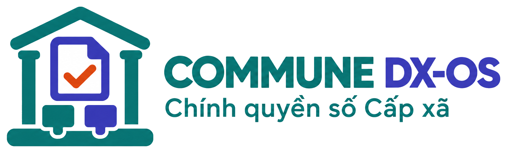
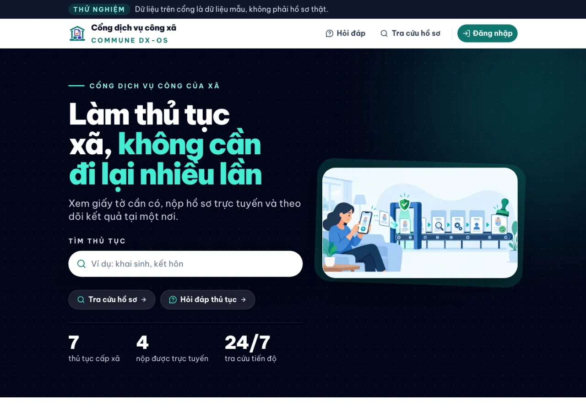
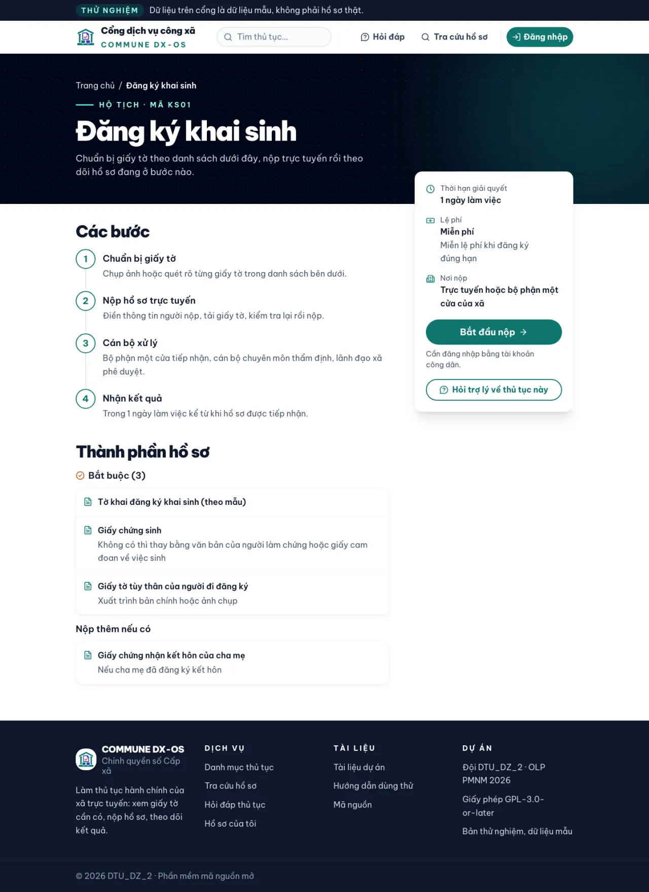
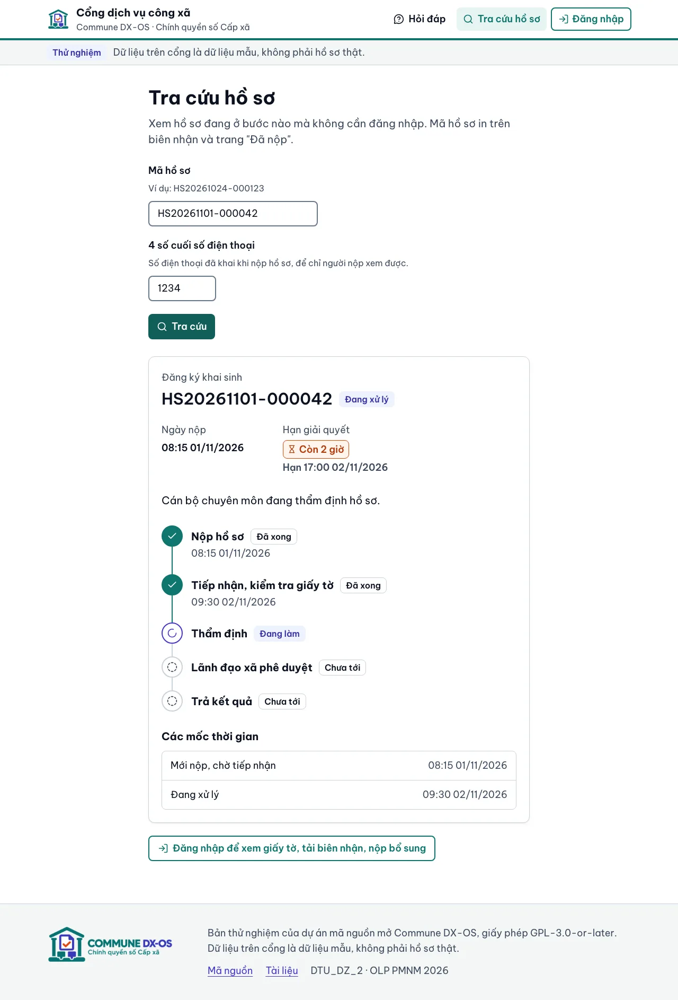
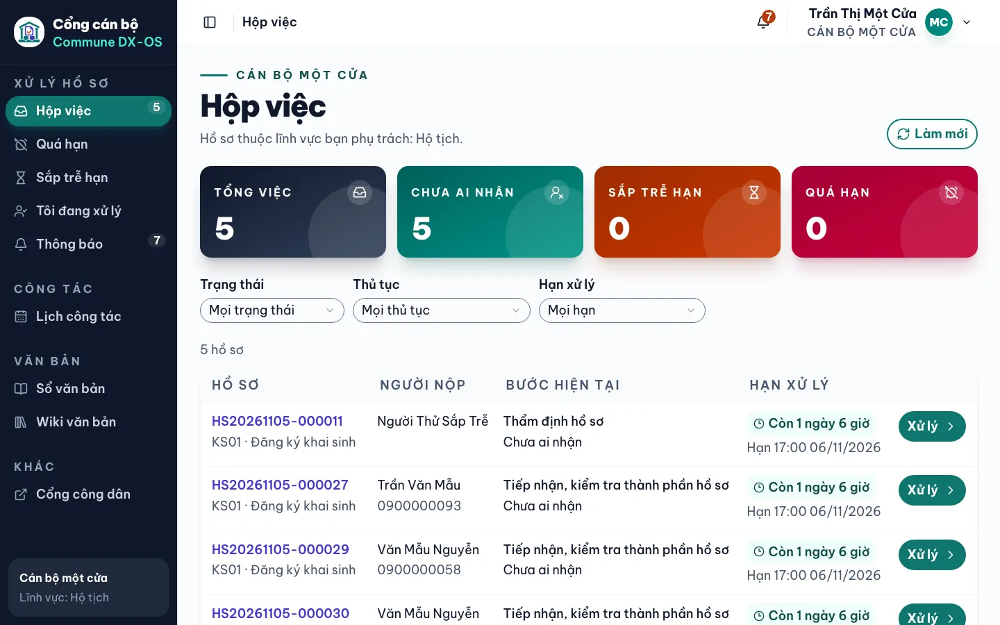
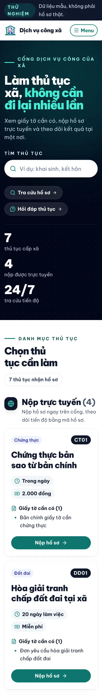
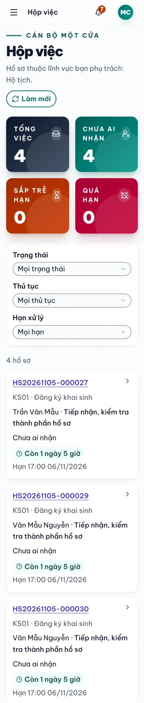
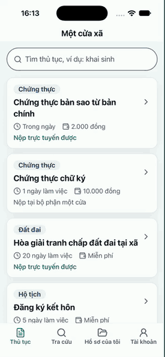
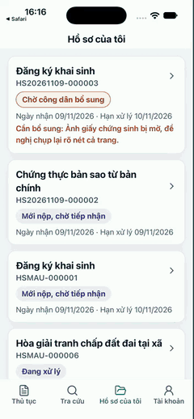
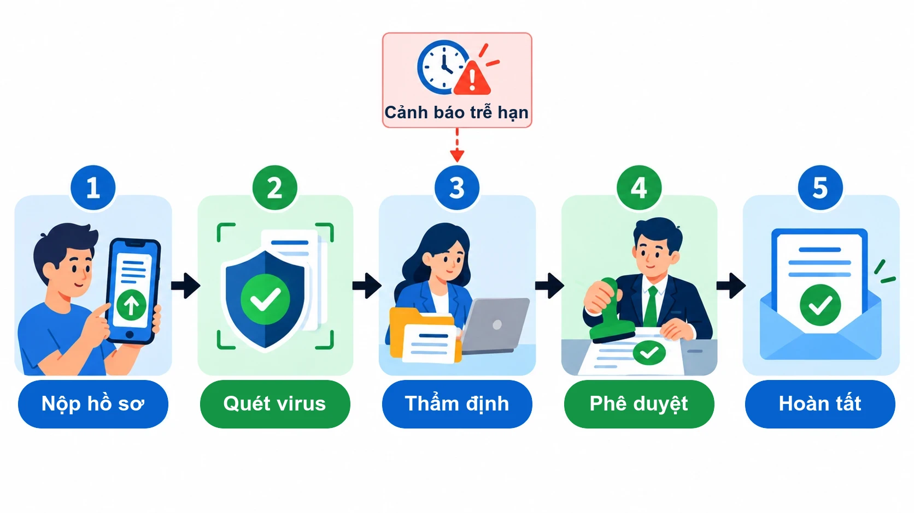

[Tiếng Việt](README.md) | English

<p align="center">
  <picture>
    <source media="(prefers-color-scheme: dark)" srcset="docs/images/logo/logo-ngang-nen-trang.png">
    
  </picture>
</p>

<h1 align="center">Commune DX-OS</h1>

<p align="center"><b>A digital-government operating system for Vietnamese communes.</b><br>Citizens apply once; commune officers always know where an application is and how long is left before its deadline.</p>

<p align="center">
  <a href="LICENSE"></a>
  <a href="https://github.com/commune-dxos/commune-dxos/actions/workflows/check.yml"></a>
  <a href="https://github.com/commune-dxos/commune-dxos/releases/latest"></a>
  <a href="https://reuse.software/spec-3.3/"></a>
  <a href="https://commune-dxos.github.io/commune-dxos/"></a>
</p>

<p align="center">
  <a href="https://commune.dzfullstack.com"><b>Demo</b></a> ·
  <a href="https://commune-dxos.github.io/commune-dxos/en/"><b>Documentation</b></a> ·
  <a href="https://github.com/commune-dxos/commune-dxos/releases/latest"><b>Download Android APK</b></a> ·
  <a href="docs/thu-nghiem.md"><b>Trial guide (Vietnamese)</b></a>
</p>

<p align="center">
  
</p>

Open-source software that runs on a single machine at the commune office. Team DTU_DZ_2 · OLP PMNM 2026 (Vietnam Open Source Olympiad) · topic DX-OS Open-Core. Latest release: **v0.12.2**.

The user interface, the procedure packages and most documentation are in Vietnamese; English pages live in [`docs/en/`](docs/en/index.md).

## Contents

- [The problem](#the-problem)
- [Solution](#solution)
- [Screenshots](#screenshots)
- [System architecture](#system-architecture)
- [Features by user](#features-by-user)
- [Supported procedures](#supported-procedures)
- [Open data](#open-data)
- [Repository layout](#repository-layout)
- [Technology](#technology)
- [Installation](#installation)
- [Demo](#demo)
- [Documentation](#documentation)
- [Contributing](#contributing)
- [License](#license)
- [Contact](#contact)
- [Authors](#authors)

## The problem

### What needs solving

The commune one-stop-shop desk handles birth registrations, certified copies, marriage registrations and land-dispute mediation every day, still mostly on paper.

1. **Citizens come back again and again.** After applying, people return to the office several times just to ask "is it done yet?". One missing paper means another trip. Example: parents come to register a birth but forget the hospital birth certificate, go home to fetch it and queue again.
2. **Nobody knows where a file is.** A paper file moves from the reception desk to the specialist desk to the leader's desk. When a citizen asks, officers search pile by pile.
3. **Delays are noticed too late.** Deadlines are counted by hand in working days. Nobody warns before a deadline passes. The leader only learns how many files were late when the books are added up at month end.
4. **Citizens' data is exposed.** The register is shared and anyone can open it. Papers are sent through chat apps and nobody scans them for malware.
5. **A new procedure waits for a software change.** Each new procedure or rule change means waiting for the vendor to change the code.

### Users

| User | Needs |
|---|---|
| Citizen | Know which papers are needed before coming; apply remotely; see the current step; receive a legally valid result |
| One-stop-shop officer | Receive complete applications; stop retyping papers; know which files are close to their deadline |
| Specialist officer | See only files of their own field; clear step-by-step processing; quick access to internal documents |
| Commune leader | Approve and sign; see late-file figures without counting by hand; approve the work schedule |
| Clerk | Register incoming documents, draft outgoing documents, draft the work schedule |
| Procedure package developer | Add a new procedure without changing engine code |

## Solution

### Overview

Commune DX-OS puts the whole life cycle of a commune administrative application into software. Citizens browse procedures and apply on the web or the Android app. The system checks that every required paper is present before accepting, scans uploads for malware, assigns an application code, computes the deadline in working days and runs the procedure's BPMN workflow. Officers process each step on the staff portal and are warned before a deadline passes. The leader approves, digitally signs the result and reads the dashboard. Every action goes into an audit log that cannot be altered. Everything runs with Docker Compose on one machine.

### Two-tier model

| Tier | Folder | Role |
|---|---|---|
| **Tier 1 – headless core** | [`nen-tang/`](nen-tang/) | API and service configuration only, no end-user UI, no business logic: SSO, API gateway, database, file storage, workflow, queue, secrets, CA |
| **Tier 2 – one-stop-shop engine** | [`mot-cua/`](mot-cua/) | One-stop-shop business logic that runs every procedure: business database, API, citizen portal, staff portal, mobile app. Talks to Tier 1 only through the API gateway |
| **Procedure packages** | [`thu-tuc/`](thu-tuc/) | One plug-in folder per procedure: description, BPMN workflow, JSON Schema of required documents, fake sample data |

The H-P-D-I space in Tier 2:

| Space | In Commune DX-OS |
|---|---|
| **H** – human | Citizen portal, Android app, staff portal with single sign-on + OTP; internal document wiki filtered by role |
| **P** – process | A BPMN workflow per procedure on Flowable; Poka-yoke: incomplete applications are blocked on the web, in the app and on the server |
| **D** – data | PostgreSQL with row-level security; SHA-256 hash-chained audit log; Parquet + dbt data warehouse for the dashboard |
| **I** – intelligence | Procedure Q&A assistant whose answers cite their sources; OCR reading of papers that an officer confirms (human-in-the-loop) |

### Highlights

| Highlight | Description |
|---|---|
| New procedures without code changes | Add a `thu-tuc/<code>/` folder and run `make nap-thu-tuc`. All four running procedures were added this way |
| Incomplete applications stopped at once | Required documents are declared as JSON Schema in the package; the web and the app send nothing when a mandatory paper is missing, and the server checks again |
| Automatic deadlines, early warning | Deadlines in working days (weekends and holidays skipped); with ≤ 1 day left, the officer is notified on the portal immediately |
| Digitally signed results | Receipts, result notices and outgoing documents are PAdES-signed PDFs from the commune's own CA; anyone can verify them |
| Tamper-evident log | Every action on a file goes into an append-only table with a SHA-256 hash chain; updates and deletes are blocked, even for a superuser |
| Role-based security | Keycloak login + OTP for officers; officers see only their own field (RLS); uploads scanned by ClamAV before storage; secrets in OpenBao |
| One API for web and app | The **Một cửa xã** Android app and the web portals call the same routes through APISIX, sign in with PKCE, and hold no secret in the app |
| Open data | The procedure catalogue is published as JSON and CSV under CC-BY-4.0, generated from the packages |

## Screenshots

Taken on a local machine with fake sample data.

| Citizen portal – home | Citizen portal – procedure details |
|---|---|
|  |  |
| **Progress lookup (no login)** | **Staff portal – inbox** |
|  |  |

| Applying on a phone | Staff portal on a phone | Android app – apply | Android app – add missing papers |
|---|---|---|---|
|  |  |  |  |

The two app recordings were made on the iOS Simulator with a test build, a locally running stack and fake sample data; the app looks the same on Android. Full web recordings are in [Demo](#demo).

## System architecture

<p align="center">
  
</p>

<sub>Static image for slides: [docs/images/kien-truc-2-tang.webp](docs/images/kien-truc-2-tang.webp)</sub>

| Contest requirement | Component | Configuration |
|---|---|---|
| SSO | Keycloak, OTP mandatory for officers and leaders | [`nen-tang/keycloak/`](nen-tang/keycloak/), [`mot-cua/keycloak/`](mot-cua/keycloak/) |
| API gateway | Apache APISIX, rate limit on the public API | [`nen-tang/apisix/`](nen-tang/apisix/) |
| Structured and unstructured data | PostgreSQL + RLS + PostgREST; Garage (S3) + ClamAV | [`nen-tang/postgres/`](nen-tang/postgres/), [`nen-tang/garage/`](nen-tang/garage/), [`mot-cua/db/`](mot-cua/db/) |
| Workflow engine | Flowable (BPMN 2.0), workflows live in the packages | [`thu-tuc/<code>/quy-trinh.bpmn20.xml`](thu-tuc/khai-sinh/quy-trinh.bpmn20.xml) |

### How an application is processed

<p align="center">
  
</p>

1. The citizen submits through APISIX; the gateway checks the Keycloak JWT.
2. `mot-cua-api` checks the required documents against the package's JSON Schema and rejects incomplete applications.
3. Uploaded papers are scanned by ClamAV and stored in Garage only when clean.
4. The system assigns an application code, computes the working-day deadline and starts the procedure's Flowable workflow.
5. An officer of the right field receives it, asks for missing papers if needed, then reviews it; the leader approves or sends it back.
6. Every step publishes an event on RabbitMQ; applications close to their deadline raise `ho_so.sap_tre_han` to the officer.

All components run from upstream images. Overview: [`docs/en/architecture.md`](docs/en/architecture.md); full detail, gateway routes and JWT flow (Vietnamese): [`docs/architecture.md`](docs/architecture.md).

## Features by user

Only what ships in **v0.12.2**.

**Citizen** (web portal and Android app, sample account `congdan01`)
- Browse procedures, required documents, deadlines and fees without logging in.
- Apply online with documents or photos; a missing mandatory paper is blocked before anything is sent.
- Track progress with the application code and the last 4 phone digits (no login), or under "My applications".
- Add missing papers when the one-stop-shop asks; download the digitally signed PDF receipt and result notice.
- Ask about procedures at `/hoi-dap`: relevant document passages are returned; answers cite their sources when a language model is enabled (`make up-ai`).

**One-stop-shop and specialist officers** (`/can-bo` portal, sample accounts `canbo01`, `canbo02`)
- Single sign-on through Keycloak with mandatory OTP.
- An inbox holding only files of their own field (RLS); overdue and near-deadline files first; filters by status, procedure, deadline.
- Process each BPMN step: receive, request missing papers, review, forward to the leader; each step's form is generated from the package.
- Near-deadline notifications on the portal (live bell; email and SMS are simulated).
- OCR pre-fills data from papers and the officer confirms it (needs `make up-ocr` or `make up-ai`).
- Search the internal document wiki within their permissions; view the incoming/outgoing register and the approved work schedule.

**Commune leader** (sample account `lanhdao01`)
- Sees every file; approves or returns at the last workflow step.
- Signs outgoing documents: the system numbers them, renders the PDF and signs it; anyone can verify a PDF issued by the commune.
- Approves the work schedule; the system refuses two entries in the same room at overlapping times.
- Reads the Superset dashboard at `/bao-cao/` (needs `make up-bi`): processing time, late rate by month and procedure, files per field. Guide (Vietnamese): [`docs/bao-cao.md`](docs/bao-cao.md).
- Every action on a file is in the append-only, SHA-256 hash-chained audit log.

**Clerk** (`vanthu01`)
- Registers incoming documents, drafts outgoing documents, drafts the work schedule for the leader's approval.

**Procedure package developer**
- Adds a procedure as a `thu-tuc/<code>/` folder with `thu-tuc.yaml`, a hand-written BPMN workflow, a JSON Schema of required documents and fake sample data; no engine code changes.
- `make nap-thu-tuc` validates and loads packages; `make check` validates BPMN, schemas and licence headers.
- Reads the catalogue from the public `/public/thu_tuc` API or the open dataset in `du-lieu-mo/`.

## Supported procedures

| Code | Procedure | Field | Deadline | Fee | Package |
|---|---|---|---|---|---|
| KS01 | Birth registration | Civil status | 1 working day | Free when registered on time | [`thu-tuc/khai-sinh/`](thu-tuc/khai-sinh/) |
| CT01 | Certified copy from the original | Certification | Same day | 2,000 VND/page; from the third page 1,000 VND/page, at most 200,000 VND per copy | [`thu-tuc/chung-thuc-ban-sao/`](thu-tuc/chung-thuc-ban-sao/) |
| KH01 | Marriage registration | Civil status | 5 working days (when verification is needed) | Free | [`thu-tuc/ket-hon/`](thu-tuc/ket-hon/) |
| DD01 | Land-dispute mediation at the commune | Land | 20 working days | No fee | [`thu-tuc/hoa-giai-dat-dai/`](thu-tuc/hoa-giai-dat-dai/) |

The table is taken from `thu-tuc/*/thu-tuc.yaml`. The full catalogue (required documents, steps, legal basis) is generated on the [documentation site](https://commune-dxos.github.io/commune-dxos/danh-muc-thu-tuc/) (Vietnamese).

**Add a procedure in 5 steps:** copy an existing package → edit `thu-tuc.yaml` → draw the workflow → declare the required documents → `make nap-thu-tuc`. Complete A-to-Z guide with a worked example (bilingual): [`docs/thu-tuc.md`](docs/thu-tuc.md#ví-dụ-từ-a-đến-z-gói-xác-nhận-thông-tin-về-cư-trú).

## Open data

The procedure catalogue with the JSON Schema of required documents is published in [`du-lieu-mo/thu-tuc-cap-xa/`](du-lieu-mo/thu-tuc-cap-xa/) as JSON and CSV under **CC-BY-4.0**: other communes and developers may reuse it freely, including commercially, with attribution.

- Generated from the `thu-tuc/*/` packages with `make du-lieu-mo`; `make check` fails if the open data drifts from the packages.
- The same content is available from the public API without login: `GET /public/thu_tuc` (demo: <https://commune.dzfullstack.com/public/thu_tuc>).

## Repository layout

```text
commune-dxos/
├── nen-tang/            Tier 1: headless core, API and service configuration only, no business logic
│   ├── apisix/          gateway routes, JWT, rate limiting
│   ├── keycloak/        shared dxos realm
│   ├── postgres/        PostgreSQL + pgAudit + pgvector image, init scripts
│   ├── openbao/         policies, agent, secret init and unseal
│   ├── garage/ rabbitmq/ step-ca/   file storage, queue, internal CA configuration
│   ├── superset/        dashboard image and configuration (bi profile)
│   ├── ocr/             ONNX Runtime document-reading service (ai profile)
│   └── scripts/         one-shot services: database roles, buckets, queues, search indexes
├── mot-cua/             Tier 2: one-stop-shop engine that runs every procedure
│   ├── db/              migrations, seed, SQL tests (RLS, audit)
│   ├── backend/         mot-cua-api, worker, signing, RAG assistant, package loader (Python)
│   ├── web-cong-dan/    citizen portal and /can-bo staff portal (React)
│   ├── di-dong/         Một cửa xã app (React Native): android/, ios/
│   ├── keycloak/ rabbitmq/ s3/   Tier 2 roles, queues, buckets
│   ├── mau-giay-to/     HTML templates for receipts, result notices, outgoing documents
│   ├── kho-du-lieu/ bao-cao/   Parquet + dbt, Superset dashboard builder
│   ├── tro-ly/ doc-giay-to/    assistant knowledge base, OCR document types
│   └── tests/           end-to-end smoke tests by feature
├── thu-tuc/             plug-in procedure packages: khai-sinh, chung-thuc-ban-sao, ket-hon, hoa-giai-dat-dai
├── du-lieu-mo/          procedure catalogue as CC-BY-4.0 open data (make du-lieu-mo)
├── docs/                documentation (MkDocs), English pages in docs/en/, images and demo GIFs
├── scripts/             smoke tests, SPDX check, lint, SQL tests, demo recording, changelog
├── LICENSES/ REUSE.toml NOTICE DEPENDENCIES.md   per-file licences and dependency declarations
├── docker-compose.yml   every service, grouped into core / bi / ai profiles
└── Makefile             run, test and release commands
```

## Technology

Every component has an OSI-approved licence and a pinned version. Full list of images, npm packages, pip packages, iOS pods and AI models: [`DEPENDENCIES.md`](DEPENDENCIES.md); third-party attribution: [`NOTICE`](NOTICE). The "Profile" column is the service group in `docker-compose.yml`: `core` starts with `make up`, `bi` with `make up-bi`, `ai` with `make up-ai` (OCR only: `make up-ocr`).

| Layer | Component | Role in Commune DX-OS | Licence | Profile |
|---|---|---|---|---|
| Identity | Keycloak 26.3 | Single sign-on (OIDC), OTP mandatory for officers, leaders, clerks | Apache-2.0 | core |
| API gateway | Apache APISIX 3.13 | Single entry point, JWT check, rate limiting, serves both web portals | Apache-2.0 | core |
| Data | PostgreSQL 17.6 + pgAudit 17.1 + pgvector 0.8.7 | Application database with row-level security, DDL audit, vectors for semantic search | PostgreSQL | core |
| Data | PostgREST 13 | REST API generated from the one-stop-shop schema | MIT | core |
| Data | Garage 2.4 | S3-style file storage (separate service, unmodified) | AGPL-3.0 | core |
| Data | Meilisearch 1.54 Community Edition | Search over procedures, the document wiki and the assistant's knowledge base | MIT | core |
| Process | Flowable REST 8 | Runs each package's BPMN 2.0 workflow | Apache-2.0 | core |
| Process | RabbitMQ 4.3 | Application events, near-deadline alerts | MPL-2.0 | core |
| Security | OpenBao 2.7 | Stores and issues per-service secrets (AppRole) | MPL-2.0 | core |
| Security | ClamAV 1.5 | Malware scan of uploads (separate service, unmodified) | GPL-2.0 | core |
| Signing, PDF | step-ca 0.30 + pyHanko 0.38 | The commune's internal CA, PAdES signing and PDF verification | Apache-2.0; MIT | core |
| Signing, PDF | Gotenberg 8.37 | Renders receipts, result notices and outgoing documents from HTML templates | MIT | core |
| Services | Python 3.13 | `mot-cua-api`, `mot-cua-worker`, assistant, procedure package loader | PSF-2.0 | core |
| Web UI | React 19 + Vite 7 + Tailwind CSS 4 + shadcn/ui (Radix UI) | Citizen and staff portals, sign-in with `oidc-client-ts` (PKCE) | MIT; `oidc-client-ts` Apache-2.0 | core |
| Web UI | nginx (`nginx-unprivileged`) | Serves the static web build | BSD-2-Clause | core |
| Mobile | React Native 0.80 | **Một cửa xã** app (Android, iOS), sign-in with `react-native-app-auth` (PKCE) | MIT | built separately |
| Reporting | Apache Superset 6.1 | One-stop-shop performance dashboard at `/bao-cao/`, sign-in through Keycloak | Apache-2.0 | bi |
| Reporting | Parquet + DuckDB 1.5 + dbt-core 1.11 | Historical data warehouse, marts for the dashboard | MIT; Apache-2.0 | bi |
| Intelligence | PaddleOCR PP-OCRv5 + VietOCR on ONNX Runtime 1.31 | Reads text from papers to pre-fill applications | Apache-2.0; MIT | ai |
| Intelligence | Ollama 0.40 + Qwen2.5 7B + bge-m3 | Procedure Q&A assistant: in-house RAG, provider chosen with `LLM_PROVIDER` | MIT; Apache-2.0; MIT | ai |
| Tooling | MkDocs + Material, git-cliff, reuse | Documentation site, CHANGELOG, REUSE 3.3 check (not shipped in the product) | BSD-2-Clause, MIT; MIT/Apache-2.0; GPL-3.0-or-later | — |

## Installation

### Requirements

| Component | Minimum | Recommended |
|---|---|---|
| Docker | Docker Engine 24+ or Docker Desktop 4.25+, Compose v2.20+ | latest |
| Memory for Docker | 4 GB (`core` profile) | 6 GB; about 6.5 GB more for `make up-ai` |
| Free disk | 6 GB | about 13 GB more for `make up-ai` (Ollama image + models) |
| CPU | amd64 or arm64 | — |
| Tools | `git`, `make`, `bash`, `curl`, `jq`, `python3` 3.10+ | — |
| Network | about 1.1 GB of images on first run | — |

**Operating systems:** the team runs it on **macOS (Apple Silicon)**, the development machines, and **Ubuntu 24.04**, the public demo server. Every image is published for amd64 and arm64. Not tested on Windows. Details, measurements and ports: [`docs/en/quick-start.md`](docs/en/quick-start.md).

### Run the system

```bash
git clone https://github.com/commune-dxos/commune-dxos.git
cd commune-dxos
cp .env.example .env      # nothing to fill in
make up                   # core + one-stop-shop engine + procedure packages + citizen portal
make smoke                # end-to-end check, ends with "0 trượt" (0 failed)
make demo-users           # sets a password for the sample users and prints it
```

The first `make up` takes 2–10 minutes depending on the network; `make smoke` takes about 1.5 minutes. Never delete or commit `.data/openbao/commune.json`: it holds the key to every secret.

### Check it works

| Address | What you get |
|---|---|
| http://localhost:9080/ | Citizen portal: catalogue and procedure details without login; apply after logging in |
| http://localhost:9080/tra-cuu | Progress lookup with the application code + last 4 phone digits |
| http://localhost:9080/can-bo | Staff portal: password + OTP (scan the QR code with an authenticator app the first time). Flow (Vietnamese): [`docs/cong-can-bo.md`](docs/cong-can-bo.md) |
| http://localhost:9080/public/thu_tuc | Public procedure catalogue API |
| http://localhost:9080/bao-cao/ | Superset dashboard (after `make up-bi` and `make kho-du-lieu`) |

Sample accounts (fake data): `congdan01` (citizen), `canbo01` (civil-status officer), `canbo02` (certification officer), `lanhdao01` (leader), `vanthu01` (clerk). Passwords are set and printed by `make demo-users`.

Optional profiles: `make up-bi` (dashboard), `make up-ocr` (document reading), `make up-ai` (OCR + assistant with a local language model).

### Mobile app

- **Download the APK:** every [release](https://github.com/commune-dxos/commune-dxos/releases) from v0.11.0 includes `mot-cua-xa-X.Y.Z-debug.apk`, verifiable with the release's `SHA256SUMS`. Install on Android 7.0 or later; the app points to the public demo. Citizen guide (Vietnamese): [`docs/cai-app.md`](docs/cai-app.md).
- **Build for Android:** Node ≥ 22, JDK 17, Android SDK; `cd mot-cua/di-dong && corepack enable && yarn install --frozen-lockfile && yarn apk:debug`.
- **iOS:** the Xcode project `mot-cua/di-dong/ios/` is on the `develop` branch and builds with Xcode and CocoaPods on a Mac; no iOS build has been released yet.
- Pointing the app at a local stack, building for iOS (Vietnamese): [`mot-cua/di-dong/README.md`](mot-cua/di-dong/README.md).

### Stop and remove data

```bash
make down                                  # stop every service, keep data
docker compose --profile '*' down -v       # stop and delete data volumes
rm .data/openbao/commune.json              # only to re-initialise secrets from scratch
```

## Demo

**Public demo:** <https://commune.dzfullstack.com>. It runs the `core` and `bi` profiles: citizen portal, staff portal, lookup, `/bao-cao/` dashboard; Q&A is search-only, the language-model assistant is not enabled. All data is fake.

Trial accounts are handed out by the team during trial sessions and are not published. The six role-based trial tasks and how to send feedback with the **Phản hồi dùng thử** (trial feedback) issue template: [`docs/thu-nghiem.md`](docs/thu-nghiem.md) (Vietnamese).

Recorded on a local machine with fake sample accounts and papers (`make quay-demo`); every call goes through APISIX.

**Citizen** browses the catalogue and applies for a birth registration: without the hospital birth certificate the portal blocks the submission before anything reaches the server; with every paper the application goes through and gets a code, then progress is looked up without logging in.

<p align="center">
  
</p>

**Civil-status officer** logs in with password and OTP, opens the new application from the inbox, confirms the documents are complete and finishes the reception step; the application moves to review.

<p align="center">
  
</p>

## Documentation

The documentation site is built with MkDocs from [`docs/`](docs/) and published at **https://commune-dxos.github.io/commune-dxos/** (English section: [/en/](https://commune-dxos.github.io/commune-dxos/en/)).

| Document | For | Source | Online |
|---|---|---|---|
| English overview, quick start, architecture, contributing | English readers | [`docs/en/`](docs/en/index.md) | [open](https://commune-dxos.github.io/commune-dxos/en/) |
| Installation, ports, accounts, troubleshooting (Vietnamese) | operators | [`docs/cai-dat.md`](docs/cai-dat.md) | [open](https://commune-dxos.github.io/commune-dxos/cai-dat/) |
| Architecture, gateway routes, JWT flow, APIs (Vietnamese) | reviewers, developers | [`docs/architecture.md`](docs/architecture.md) | [open](https://commune-dxos.github.io/commune-dxos/architecture/) |
| Adding a procedure, A-to-Z example (bilingual) | package developers | [`docs/thu-tuc.md`](docs/thu-tuc.md) | [open](https://commune-dxos.github.io/commune-dxos/thu-tuc/) |
| Procedure catalogue (generated from packages) | citizens, officers | `thu-tuc/*/thu-tuc.yaml` | [open](https://commune-dxos.github.io/commune-dxos/danh-muc-thu-tuc/) |
| Staff portal: processing flow, register, wiki, schedule | officers | [`docs/cong-can-bo.md`](docs/cong-can-bo.md) | [open](https://commune-dxos.github.io/commune-dxos/cong-can-bo/) |
| Superset reporting dashboard | commune leaders | [`docs/bao-cao.md`](docs/bao-cao.md) | [open](https://commune-dxos.github.io/commune-dxos/bao-cao/) |
| Installing the Một cửa xã Android app | citizens | [`docs/cai-app.md`](docs/cai-app.md) | [open](https://commune-dxos.github.io/commune-dxos/cai-app/) |
| Looking up an application | citizens | [`docs/tra-cuu-ho-so.md`](docs/tra-cuu-ho-so.md) | [open](https://commune-dxos.github.io/commune-dxos/tra-cuu-ho-so/) |
| Trial session guide, 6 role-based tasks | trial users | [`docs/thu-nghiem.md`](docs/thu-nghiem.md) | [open](https://commune-dxos.github.io/commune-dxos/thu-nghiem/) |
| Mapping to the contest requirements | reviewers | [`docs/de-thi-mapping.md`](docs/de-thi-mapping.md) | [open](https://commune-dxos.github.io/commune-dxos/de-thi-mapping/) |
| Guide to re-running the demo through H-P-D-I (Vietnamese) | anyone running the demo | [`docs/demo/huong-dan-demo.md`](docs/demo/huong-dan-demo.md) | [open](https://commune-dxos.github.io/commune-dxos/demo/huong-dan-demo/) |
| One-stop-shop engine, headless core, mobile app | developers | [`mot-cua/README.md`](mot-cua/README.md), [`nen-tang/README.md`](nen-tang/README.md), [`mot-cua/di-dong/README.md`](mot-cua/di-dong/README.md) | |
| Changes per release | everyone | [`CHANGELOG.md`](CHANGELOG.md) (generated with git-cliff), [Releases](https://github.com/commune-dxos/commune-dxos/releases) | |
| Contributing, code of conduct | contributors | [`CONTRIBUTING.md`](CONTRIBUTING.md), [`docs/en/contributing.md`](docs/en/contributing.md), [`CODE_OF_CONDUCT.md`](CODE_OF_CONDUCT.md) | |

## Contributing

Every task follows one loop: **issue → branch → pull request → cross-review → merge**.

1. Open an [issue](https://github.com/commune-dxos/commune-dxos/issues/new/choose) from a template ("Việc trong tuần" weekly task, "Thủ tục mới" new procedure, "Phản hồi dùng thử" trial feedback) and set a milestone.
2. Create a branch `feature/<issue-number>-<name>` from `develop`.
3. Commit with Conventional Commits including the issue number; run `make check` before every commit. CI runs the same checks as `make lint` (including `reuse lint`) and `make test`.
4. Open a pull request to `develop`. **At least one other team member reviews it; authors never approve their own work.** Merge with squash once CI is green.

Work tracking: [GitHub Project "Commune DX-OS – Lộ trình"](https://github.com/orgs/commune-dxos/projects/1), [Milestones](https://github.com/commune-dxos/commune-dxos/milestones). Process, labels, commit conventions: [`docs/en/contributing.md`](docs/en/contributing.md), [`CONTRIBUTING.md`](CONTRIBUTING.md) (Vietnamese). Image sources: [`docs/images/README.md`](docs/images/README.md).

## License

Commune DX-OS is released under the **[GNU General Public License version 3 or later](LICENSE)** (`GPL-3.0-or-later`).

> This program is free software: you can redistribute it and/or modify it under the terms of the GNU General Public License as published by the Free Software Foundation, either version 3 of the License, or (at your option) any later version.

Anyone may use, modify and redistribute it; redistributed versions must keep the GPL and include the source code.

- **Why GPL-3.0:** software for digital government is a public asset. Copyleft makes sure every redistributed modification, including a vendor's, stays open for communes and citizens. Version 3 is compatible with the Apache-2.0 components (Keycloak, APISIX, Flowable); version 2 is not.
- **Per-file licensing:** every source file carries a two-line SPDX header (`SPDX-FileCopyrightText`, `SPDX-License-Identifier`); files that cannot hold a comment (images, JSON) are declared in [`REUSE.toml`](REUSE.toml). The whole repository complies with [REUSE 3.3](https://reuse.software), checked in CI with `reuse lint`.
- **Licence change:** releases v0.0.1, v0.1.0 and v0.2.0 were published under Apache-2.0 and keep that licence; every release after v0.2.0 is GPL-3.0-or-later ([#47](https://github.com/commune-dxos/commune-dxos/issues/47)).
- **Open data:** [`du-lieu-mo/`](du-lieu-mo/) alone is under [CC-BY-4.0](LICENSES/CC-BY-4.0.txt).
- **Third parties:** components keep their own licences and are used only through upstream images or package managers; Garage (AGPL-3.0) and ClamAV (GPL-2.0) run as separate services, not linked, not modified. See [`NOTICE`](NOTICE) and [`DEPENDENCIES.md`](DEPENDENCIES.md).

## Contact

| Channel | Use for |
|---|---|
| [Issues](https://github.com/commune-dxos/commune-dxos/issues) | Bug reports, new procedure proposals, trial feedback |
| [Discussions](https://github.com/commune-dxos/commune-dxos/discussions) | Questions and general discussion |
| [Repository](https://github.com/commune-dxos/commune-dxos) | Source code, releases, documentation |
| [Demo](https://commune.dzfullstack.com) | Try it online |

## Authors

Team **DTU_DZ_2** – OLP PMNM 2026.

| Member (GitHub) | Presentation role | Responsible for |
|---|---|---|
| [`datnguyen262021`](https://github.com/datnguyen262021) | Team lead, V1 | Tier 1 headless core and security |
| [`vuthingockhanh2006dn-arch`](https://github.com/vuthingockhanh2006dn-arch) | V2 | One-stop-shop engine, BPMN workflows, dashboard |
| [`ky213456`](https://github.com/ky213456) | V3 | Citizen portal, lookup, OCR and RAG assistant |
