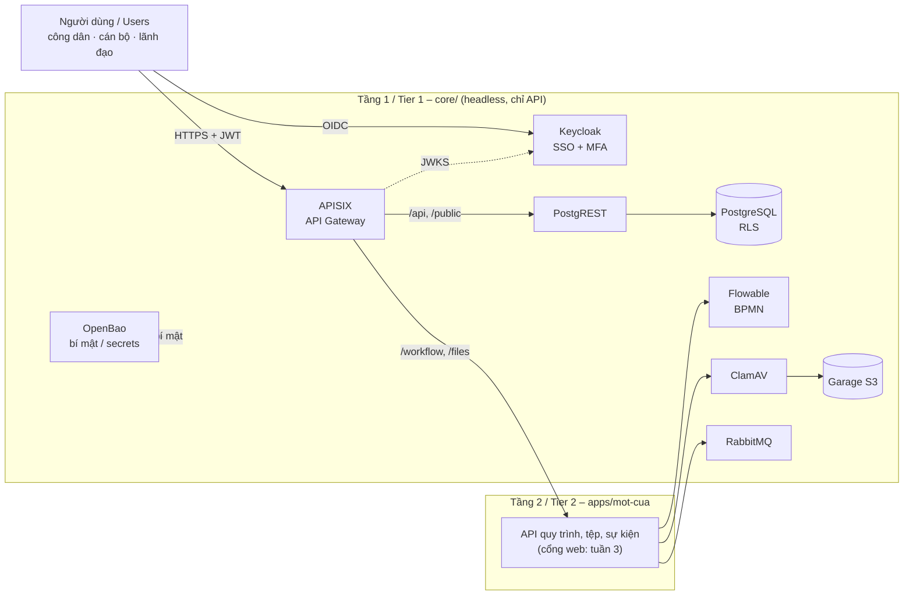

# Commune DX-OS — Hệ điều hành Chính quyền số Cấp xã

> OLP PMNM 2026 · Đề tài DX-OS Open-Core · Giấy phép / License: [Apache-2.0](LICENSE) · Phiên bản / Version: xem [`CHANGELOG.md`](CHANGELOG.md)

**VI:** Nền tảng nguồn mở giúp chính quyền cấp xã tiếp nhận và xử lý thủ tục hành chính trực tuyến (một cửa), theo dõi trễ hạn, lưu hồ sơ điện tử an toàn và hỗ trợ người dân tra cứu thủ tục. Người dùng: cán bộ một cửa, cán bộ chuyên môn, lãnh đạo xã, người dân.

**EN:** An open-source platform for commune-level governments to receive and process administrative procedures online (one-stop shop), track overdue cases, store case files securely and help citizens look up procedures. Users: front-desk officers, specialist officers, commune leaders, citizens.

Mục lục / Contents: [Kiến trúc](#1-kiến-trúc--architecture) · [Yêu cầu máy](#2-yêu-cầu-máy--requirements) · [Chạy từ máy sạch](#3-chạy-từ-máy-sạch--quick-start-from-a-clean-machine) · [Địa chỉ và tài khoản mẫu](#4-địa-chỉ-cổng-và-tài-khoản-mẫu--urls-ports-and-sample-accounts) · [Cấu hình](#5-cấu-hình-trước-khi-chạy--configuration) · [Thêm ứng dụng](#6-thêm-một-ứng-dụng-vào-apps--adding-an-app) · [Kiểm thử, đóng góp](#7-kiểm-thử-và-đóng-góp--testing-and-contributing) · [Xử lý lỗi](#8-xử-lý-lỗi-thường-gặp--troubleshooting) · [Giấy phép](#9-giấy-phép--license) · [Phiên bản](#10-phiên-bản--versions)

## 1. Kiến trúc / Architecture

**VI:** Ba tầng. **Tầng 1** `core/` là lõi headless, không có giao diện người dùng cuối, chỉ có API và **không chứa nghiệp vụ**: SSO (Keycloak), API Gateway (APISIX), dữ liệu có cấu trúc (PostgreSQL + Row-Level Security, API tự sinh bằng PostgREST) và phi cấu trúc (Garage S3, quét ClamAV), workflow engine (Flowable BPMN 2.0), hàng đợi (RabbitMQ), két bí mật (OpenBao). **Tầng 2** `apps/<tên>/` là ứng dụng cắm vào lõi, chọn bằng biến `DXOS_APP`; ứng dụng chính là [`apps/mot-cua/`](apps/mot-cua/) (một cửa cấp xã) và chỉ gọi lõi qua APISIX. **Người dùng** ở tầng ngoài cùng. Chi tiết: [`docs/architecture.md`](docs/architecture.md).

**EN:** Three tiers. **Tier 1** `core/` is a headless, business-agnostic core exposing only APIs: SSO (Keycloak), API gateway (APISIX), structured data (PostgreSQL + Row-Level Security, auto-generated REST by PostgREST) and unstructured data (Garage S3, ClamAV scanning), workflow engine (Flowable BPMN 2.0), message queue (RabbitMQ), secrets vault (OpenBao). **Tier 2** `apps/<name>/` are applications plugged into the core, selected with `DXOS_APP`; the main app is [`apps/mot-cua/`](apps/mot-cua/) (one-stop administrative services), which talks to the core only through APISIX. Details (in Vietnamese): [`docs/architecture.md`](docs/architecture.md).



## 2. Yêu cầu máy / Requirements

| Mục / Item | Tối thiểu / Minimum | Ghi chú / Notes |
|---|---|---|
| Hệ điều hành / OS | Linux, macOS, Windows (WSL2) | CPU **amd64 hoặc arm64** (mọi image đều có cả hai) / all images are multi-arch |
| Docker | Docker Engine **24+** hoặc Docker Desktop **4.25+** | đã thử / tested: Docker Desktop 28.5 (macOS arm64) |
| Docker Compose | **v2.20+** (`docker compose version`) | Docker Desktop đã có sẵn / bundled with Docker Desktop |
| RAM cho Docker / RAM for Docker | **4 GB**, khuyên / recommended **6 GB** (máy 8–16 GB) | đo được / measured ≈ 2,3 GB khi chạy; ClamAV ~1 GB, Keycloak ~0,5 GB, Flowable ~0,4 GB |
| Ổ trống / Free disk | **6 GB** | đo được / measured: 10 image ≈ 4,1 GB + volume ≈ 0,3 GB (CSDL virus ClamAV 175 MB) |
| Công cụ / Tools | `git`, `make`, `bash`, `curl`, `jq`, `python3` (3.10+) | `make smoke`, `make test`; Windows: chạy trong WSL2 |
| Mạng / Network | tải ≈ 1,1 GB lần đầu / ≈ 1.1 GB first download | 10 image nén (bản arm64 đo được 1,1 GiB) |

**VI:** Không cần cài Java, Node hay PostgreSQL trên máy: mọi dịch vụ chạy bằng image gốc của dự án upstream, không có bước build image riêng.

**EN:** No local Java, Node or PostgreSQL needed: every service runs from its upstream image; there is no custom image build step.

## 3. Chạy từ máy sạch / Quick start from a clean machine

**VI:** Clone vào thư mục nào cũng chạy được (không có đường dẫn tuyệt đối), và gọi được từ thư mục khác: `make -C /duong/dan/commune-dxos up`. Lần đầu `make up` mất khoảng **2–10 phút** tùy mạng (phần lớn là tải image), `make smoke` thêm khoảng 1,5 phút; các lần sau `make up` khoảng 35 giây. Đo được trên bản clone sạch (Docker Desktop, macOS arm64, 21/10/2026): `make up` lần đầu 2 phút 8 giây, `make smoke` 93 giây, 405/405 đạt.

**EN:** Works wherever you clone it (no absolute paths) and from any working directory: `make -C /path/to/commune-dxos up`. The first `make up` takes about **2–10 minutes** depending on bandwidth (mostly image pulls), `make smoke` about 1.5 more minutes; later `make up` runs take about 35 seconds. Measured on a fresh clone (Docker Desktop, macOS arm64, 2026-10-21): first `make up` 2 min 8 s, `make smoke` 93 s, 405/405 passed.

```bash
git clone https://github.com/commune-dxos/commune-dxos.git
cd commune-dxos
cp .env.example .env      # không có mật khẩu nào cần điền / no passwords to fill in
make up                   # lõi + ứng dụng DXOS_APP; tự init + unseal OpenBao / core + app, auto init + unseal OpenBao
make ps                   # dịch vụ chạy nền "healthy", dịch vụ một lần "Exited (0)" / services healthy, one-shot jobs exited 0
make smoke                # kiểm tra đầu-cuối / end-to-end checks: "== Kết quả: 405 đạt, 0 trượt"
make demo-users           # đặt mật khẩu cho người dùng mẫu và in ra / set and print a password for sample users
```

**VI:**
- `make up` tự gọi `bao-init`: lần đầu khởi tạo OpenBao, sinh bí mật ngẫu nhiên cho mọi dịch vụ và ghi **unseal key + root token** vào `.data/openbao/commune.json` (quyền 600, ngoài git). Chỉ cần gọi `make bao-init` riêng khi OpenBao bị seal mà không muốn khởi động lại cả hệ thống (mục 8).
- `make up` trả về khi container đã tạo; ClamAV cần thêm 1–2 phút để nạp CSDL virus. `make smoke` tự chờ dịch vụ healthy (tối đa ~3 phút) rồi mới kiểm.
- `make smoke` không xóa dữ liệu: nó thêm hồ sơ thử và đặt mật khẩu **ngẫu nhiên** cho người dùng mẫu, nên chạy `make demo-users` **sau** `make smoke`.
- Dừng: `make down` (giữ dữ liệu). Xóa sạch dữ liệu để chạy lại từ đầu: `docker compose --profile '*' down -v` rồi xóa `.data/openbao/commune.json`.

**EN:**
- `make up` runs `bao-init`: on first run it initialises OpenBao, generates random secrets for every service and writes the **unseal key + root token** to `.data/openbao/commune.json` (mode 600, git-ignored). Run `make bao-init` on its own only to unseal OpenBao without restarting everything (section 8).
- `make up` returns once containers are created; ClamAV needs 1–2 more minutes to load its virus database. `make smoke` waits for healthy services (up to ~3 minutes) before checking.
- `make smoke` never deletes data: it adds test cases and sets **random** passwords for sample users, so run `make demo-users` **after** `make smoke`.
- Stop: `make down` (keeps data). Wipe everything and start over: `docker compose --profile '*' down -v`, then delete `.data/openbao/commune.json`.

### Bí mật: OpenBao / Secrets: OpenBao
**VI:** Mọi mật khẩu, khóa, token của dịch vụ nằm trong OpenBao (MPL-2.0), không nằm trong repo hay `.env`. **Không xóa, không commit `.data/openbao/commune.json`** — mất tệp khi OpenBao đang seal là mất mọi bí mật; hãy sao lưu ra ngoài repo (`git clean -fdx` cũng xóa `.data/`). Tự unseal bằng tệp **chỉ dùng cho máy dev**; triển khai thật đặt `BAO_UNSEAL=manual` và unseal tay. Mỗi dịch vụ chỉ đọc được bí mật của mình (AppRole + policy). Chi tiết: [`docs/architecture.md` §4.4](docs/architecture.md#44-quản-lý-bí-mật-openbao-10).

**EN:** All service passwords, keys and tokens live in OpenBao (MPL-2.0), never in the repo or `.env`. **Do not delete or commit `.data/openbao/commune.json`** — losing it while OpenBao is sealed loses every secret; back it up outside the repo. File-based auto-unseal is **for development only**; in production set `BAO_UNSEAL=manual` and unseal by hand. Each service can read only its own secrets (AppRole + policy).

```bash
make bao-init             # init (lần đầu) + unseal + policy, idempotent / init (first run) + unseal + policies
make bao-status           # initialized / sealed
docker compose exec openbao bao operator unseal   # unseal tay khi BAO_UNSEAL=manual / manual unseal
make bao-import-env       # chuyển mật khẩu từ .env cũ (trước v0.1.0) / migrate passwords from an old .env
```

## 4. Địa chỉ, cổng và tài khoản mẫu / URLs, ports and sample accounts

| Dịch vụ / Service | Địa chỉ / URL | Ghi chú / Notes |
|---|---|---|
| API Gateway – công khai / public | http://localhost:9080/public/thu_tuc | không token, 60 req/phút/IP / no token, rate-limited |
| API Gateway – dữ liệu / data (JWT) | http://localhost:9080/api/ho_so | PostgREST qua APISIX, RLS theo vai trò |
| API Gateway – quy trình / workflow (JWT) | http://localhost:9080/workflow/tasks | API quy trình của `mot-cua` → Flowable |
| API Gateway – tệp / files (JWT) | http://localhost:9080/files/ | tải tệp hồ sơ, ClamAV quét trước khi lưu |
| Keycloak – tài khoản người dùng / account console | http://localhost:8080/realms/dxos/account | đăng nhập thử, cài OTP / sign in, set up OTP |
| Keycloak – quản trị / admin console | http://localhost:8080/admin/ | user `admin`; mật khẩu / password: `docker compose exec keycloak cat /run/dxos-secrets/admin_password` |
| PostgreSQL (debug) | `127.0.0.1:55432` | chỉ localhost / localhost only |
| Flowable REST (debug) | `127.0.0.1:8090` | chỉ localhost; Tầng 2 gọi qua APISIX |

**VI:** OpenBao, Garage, ClamAV, RabbitMQ, PostgREST không mở cổng ra máy host; chỉ truy cập qua gateway hoặc mạng nội bộ Docker.

**EN:** OpenBao, Garage, ClamAV, RabbitMQ and PostgREST publish no host ports; reach them only through the gateway or the internal Docker network.

**Tài khoản mẫu / Sample accounts** (dữ liệu giả / fake data, realm `dxos`, mật khẩu do `make demo-users` đặt / password set by `make demo-users`):

| Người dùng / User | Vai trò / Role | Thử gì / What to try |
|---|---|---|
| `congdan01`, `congdan02` | `cong_dan` – công dân / citizen | nộp hồ sơ, chỉ thấy hồ sơ của mình / submit cases, see only own cases |
| `canbo01` (hộ tịch), `canbo02` (chứng thực), `canbo03` (đất đai) | `can_bo` – cán bộ / officer | task theo lĩnh vực phụ trách; **bắt buộc OTP** / tasks of own field; **OTP required** |
| `lanhdao01` | `lanh_dao` – lãnh đạo / leader | phê duyệt, chỉ đọc hồ sơ; **bắt buộc OTP** / approve, read-only; **OTP required** |

```bash
make demo-users                                   # in mật khẩu chung / prints the shared password
DXOS_DEMO_PASSWORD='mat-khau-cua-ban' make demo-users   # hoặc tự chọn / or choose one
PW='<mật khẩu>'
TOKEN=$(curl -s http://localhost:8080/realms/dxos/protocol/openid-connect/token \
  -d grant_type=password -d client_id=dxos_cli -d username=congdan01 -d password="$PW" | jq -r .access_token)
curl -s -H "Authorization: Bearer $TOKEN" http://localhost:9080/api/ho_so | jq    # chỉ hồ sơ của congdan01 (3 mẫu + hồ sơ do smoke nộp)
curl -s 'http://localhost:9080/public/rpc/json_schema_thu_tuc?ma=KS01' | jq      # JSON Schema thành phần hồ sơ (không token)
```

**VI:** Cán bộ, lãnh đạo phải đăng nhập một lần ở trang tài khoản (account console) và quét mã QR bằng ứng dụng OTP (FreeOTP, Google Authenticator…); sau đó lấy token bằng curl thì gửi thêm `-d totp=<mã 6 số>`. Thêm lệnh thử từng route: [`docs/architecture.md` §8](docs/architecture.md#8-chạy-thử).

**EN:** Officers and leaders must sign in once on the account console and scan the QR code with an OTP app; afterwards add `-d totp=<6-digit code>` when requesting a token with curl. More route examples: [`docs/architecture.md` §8](docs/architecture.md#8-chạy-thử).

## 5. Cấu hình trước khi chạy / Configuration

**VI:** Mọi cấu hình nằm trong `.env` (sao chép từ [`.env.example`](.env.example), có chú thích từng biến), đọc lúc `make up`; không cần sửa mã hay `docker-compose.yml`. `.env` không chứa bí mật. Biến hay đổi:

**EN:** All configuration lives in `.env` (copied from the commented [`.env.example`](.env.example)) and is read at `make up`; no code or compose edits needed. `.env` holds no secrets. Common variables:

| Biến / Variable | Mặc định / Default | Ý nghĩa / Meaning |
|---|---|---|
| `DXOS_APP` | `mot-cua` | ứng dụng Tầng 2 trong `apps/` được nạp / Tier-2 app to load |
| `DXOS_SEED` | `true` | nạp dữ liệu mẫu giả; `false` khi triển khai thật / load fake sample data |
| `APISIX_PORT`, `KEYCLOAK_PORT` | `9080`, `8080` | cổng gateway, SSO trên host / host ports |
| `POSTGRES_PORT`, `FLOWABLE_PORT` | `55432`, `8090` | cổng debug, chỉ 127.0.0.1 / debug ports, localhost only |
| `DXOS_CORS_ORIGINS` | `http://localhost:5173` | origin web được gọi API / allowed web origins |
| `DXOS_GATEWAY_URL` | `http://localhost:9080` | địa chỉ gateway trong link tải tệp / gateway URL in file links |
| `DXOS_FILE_MAX_BYTES` | `10485760` | cỡ tệp tối đa (≤ 10 MiB) / max upload size |
| `BAO_UNSEAL` | `file` | `file` (máy dev) hoặc `manual` (triển khai thật) / dev auto-unseal or manual |
| `DXOS_SU_KIEN_QUET_GIAY`, `DXOS_SU_KIEN_SAP_TRE_NGAY` | `300`, `1` | chu kỳ quét và ngưỡng cảnh báo sắp trễ hạn / overdue-warning scan |

**VI:** Đổi `.env` khi hệ thống đang chạy: `make up` lại (Compose tạo lại dịch vụ bị ảnh hưởng). Đổi `DXOS_APP` sang ứng dụng khác cần CSDL mới (mục 6).

**EN:** After editing `.env` while running, run `make up` again. Switching `DXOS_APP` to a different app needs a fresh database (section 6).

## 6. Thêm một ứng dụng vào `apps/` / Adding an app

**VI:** Lõi chỉ biết **quy ước thư mục** `apps/<DXOS_APP>/`, không đọc nghiệp vụ. Một ứng dụng mới không sửa tệp nào trong `core/`, `docker-compose.yml` hay APISIX:

**EN:** The core only knows the **folder convention** `apps/<DXOS_APP>/`. A new app changes nothing in `core/`, `docker-compose.yml` or APISIX:

| Tệp / File | Lõi dùng để / Used by the core for |
|---|---|
| `app.env` | schema PostgREST phơi ra API (`PGRST_DB_SCHEMAS=…`) / exposed schema |
| `db/migrations/*.sql`, `db/seed/*.sql` | role, schema, RLS; dữ liệu giả khi `DXOS_SEED=true` (`app-migrate`) |
| `keycloak/realm.json` | vai trò, nhóm, client, người dùng mẫu (`app-realm`) / roles, groups, clients, sample users |
| `processes/*.bpmn20.xml` | quy trình BPMN, Flowable tự triển khai / auto-deployed workflows |
| `backend/main.py`, `backend/worker.py` | backend riêng (`/workflow`, `/files`) và tác vụ nền / app backend and worker |
| `s3/buckets.conf`, `rabbitmq/definitions.json` | bucket S3 và exchange/queue riêng của ứng dụng / app buckets and queues |

```bash
mkdir -p apps/dat-phong-hop/{db/migrations,db/seed,keycloak,tests}
# viết app.env, db/migrations/001_schema.sql, keycloak/realm.json theo mẫu apps/mot-cua/ (nhớ dòng SPDX: make license)
sed -i.bak 's/^DXOS_APP=.*/DXOS_APP=dat-phong-hop/' .env && rm .env.bak
docker compose --profile '*' down -v && rm -f .data/openbao/commune.json   # CSDL mới / fresh database
make up && make smoke
```

**VI:** Hướng dẫn đầy đủ, hợp đồng giữa lõi và ứng dụng: [`docs/architecture.md` §2](docs/architecture.md#2-lõi-độc-lập-nghiệp-vụ-core-và-appstên); ứng dụng mẫu: [`apps/mot-cua/README.md`](apps/mot-cua/README.md).

**EN:** Full guide and the core–app contract: [`docs/architecture.md` §2](docs/architecture.md#2-lõi-độc-lập-nghiệp-vụ-core-và-appstên); reference app: [`apps/mot-cua/README.md`](apps/mot-cua/README.md).

## 7. Kiểm thử và đóng góp / Testing and contributing

```bash
make check                # SPDX + BPMN + test đơn vị + compose hợp lệ (mọi profile) / license headers, BPMN, unit tests, compose
make lint                 # shellcheck, yamllint, BPMN (như CI / same as CI); cài / install: pip install -r scripts/requirements-lint.txt
make test                 # test đơn vị + SQL/RLS trên PostgreSQL tạm / unit + SQL/RLS tests on a throwaway PostgreSQL
make smoke                # kiểm tra đầu-cuối trên hệ thống đang chạy / end-to-end on the running stack
make license              # thêm header SPDX cho tệp mới / add SPDX headers to new files
```

**VI:** CI trên GitHub Actions chạy 6 job bắt buộc cho mỗi PR: `make-check`, `shellcheck`, `yamllint`, `bpmn`, `test-backend`, `test-sql` — cùng lệnh như trên máy. Quy trình issue → nhánh `feature/<số>-<tên>` → PR về `develop`, quy ước commit: [`CONTRIBUTING.md`](CONTRIBUTING.md), [`CODE_OF_CONDUCT.md`](CODE_OF_CONDUCT.md). Báo lỗi, đề xuất: [GitHub Issues](https://github.com/commune-dxos/commune-dxos/issues) (có mẫu issue; ghi lệnh đã chạy, output `make ps` và `docker compose version`).

**EN:** GitHub Actions runs 6 required jobs on every PR: `make-check`, `shellcheck`, `yamllint`, `bpmn`, `test-backend`, `test-sql` — the same commands as locally. Workflow (issue → `feature/<no>-<name>` branch → PR into `develop`) and commit conventions: [`CONTRIBUTING.md`](CONTRIBUTING.md). Bugs and ideas: [GitHub Issues](https://github.com/commune-dxos/commune-dxos/issues) (please include the commands you ran, `make ps` output and `docker compose version`).

## 8. Xử lý lỗi thường gặp / Troubleshooting

| Triệu chứng / Symptom | Cách xử lý / Fix |
|---|---|
| `port is already allocated` / `address already in use` (8080, 9080, 55432, 8090) | Đổi cổng trong `.env` (`KEYCLOAK_PORT`, `APISIX_PORT`, `POSTGRES_PORT`, `FLOWABLE_PORT`) rồi `make up`; tìm tiến trình chiếm cổng: `lsof -i :8080` / Change the port in `.env`, then `make up` |
| Sau khi khởi động lại máy/Docker, dịch vụ không lên, `*-secrets` thoát mã 1, `make bao-status` báo `Sealed true` / After a restart services fail, OpenBao sealed | Bình thường: OpenBao luôn seal sau khi khởi động lại. Chạy `make up` (hoặc `make bao-init` rồi `make up`) để unseal bằng `.data/openbao/commune.json` / Expected; `make up` unseals it again |
| `bao-init: thiếu /bao-init/commune.json: OpenBao đã khởi tạo nhưng không có unseal key/root token trên máy này` | Đã mất tệp `.data/openbao/commune.json`: khôi phục từ bản sao lưu. Không còn bản nào thì chỉ còn cách xóa dữ liệu: `docker compose --profile '*' down -v`, `make up` / Restore the backup, or wipe with `down -v` |
| Container bị `OOMKilled`, Keycloak/Flowable khởi động lại liên tục / containers OOM-killed | Tăng RAM cho Docker lên ≥ 6 GB (Docker Desktop → Settings → Resources); tắt ứng dụng nặng khác / Give Docker ≥ 6 GB RAM |
| `no space left on device` khi tải image / while pulling | Cần ≥ 5 GB trống. Dọn: `docker image prune -a -f`, `docker builder prune -f`; xem `docker system df` / Free ≥ 5 GB |
| `make smoke` trượt `clamav healthy` (`starting`) / ClamAV still starting | Lần đầu ClamAV tải CSDL virus (~250 MB); chờ 1–2 phút rồi chạy lại / wait and re-run |
| `/public/…` trả 429 hoặc `{"error_msg":…}` ngay sau `make smoke` / 429 right after smoke | Bước cuối của smoke cố ý dùng hết hạn mức 60 request/phút; đợi 1 phút (lần smoke kế tiếp tự chờ) / smoke exhausts the public rate limit on purpose; wait a minute |
| `invalid_grant – Account is not fully set up` khi lấy token cán bộ/lãnh đạo / for officers | Chưa cài OTP: đăng nhập trang tài khoản một lần (mục 4) / set up OTP on the account console first |
| `Thiếu .env` / missing `.env` | `cp .env.example .env` |
| Muốn chạy song song bản thứ hai / run a second copy side by side | Đặt `COMPOSE_PROJECT_NAME=<tên khác>` và đổi 4 cổng trong `.env`; mỗi project có volume và tệp khóa OpenBao riêng (`.data/openbao/<tên>.json`) / set another project name and ports |

## 9. Giấy phép / License
**VI:** Mã nguồn của dự án phát hành theo [Apache License 2.0](LICENSE); mỗi tệp mã và tệp cấu hình đều có dòng `SPDX-License-Identifier: Apache-2.0`, được kiểm tra bằng `make check` trên mỗi PR. Đội chọn Apache-2.0 vì:
- cho phép cơ quan nhà nước và doanh nghiệp tự do dùng, sửa và triển khai lại, kể cả tích hợp vào hệ thống riêng;
- có điều khoản cấp quyền sáng chế rõ ràng, giảm rủi ro pháp lý cho đơn vị triển khai;
- tương thích với các thành phần lõi (Keycloak, APISIX, Flowable, Superset đều dùng Apache-2.0).

Thành phần bên thứ ba giữ giấy phép riêng, liệt kê trong [`NOTICE`](NOTICE) và [`DEPENDENCIES.md`](DEPENDENCIES.md). Thành phần AGPL/GPL (Garage, ClamAV) chỉ chạy như dịch vụ riêng bằng image gốc, không sửa và không liên kết vào mã của dự án.

**EN:** The project's source code is released under the [Apache License 2.0](LICENSE); every code and configuration file carries an `SPDX-License-Identifier: Apache-2.0` line, checked by `make check` on each PR. We chose Apache-2.0 because:
- public agencies and companies can freely use, modify and redeploy it, including inside their own systems;
- it includes an explicit patent grant, lowering legal risk for adopters;
- it matches the core components (Keycloak, APISIX, Flowable, Superset are all Apache-2.0).

Third-party components keep their own licenses, listed in [`NOTICE`](NOTICE) and [`DEPENDENCIES.md`](DEPENDENCIES.md). AGPL/GPL components (Garage, ClamAV) run only as separate services from their upstream images, unmodified and not linked into our code.

## 10. Phiên bản / Versions
**VI:** Phiên bản theo [SemVer](https://semver.org/lang/vi/); thay đổi ghi trong [`CHANGELOG.md`](CHANGELOG.md) (mục `[Unreleased]` là phần đang làm). Bản phát hành kèm gói mã nguồn `.tar.gz`: [Releases](https://github.com/commune-dxos/commune-dxos/releases). Tiến độ theo tuần: [`docs/PLAN.md`](docs/PLAN.md); đối chiếu yêu cầu đề thi: [`docs/de-thi-mapping.md`](docs/de-thi-mapping.md).

**EN:** Versions follow [SemVer](https://semver.org/); changes are recorded in [`CHANGELOG.md`](CHANGELOG.md) (`[Unreleased]` = work in progress). Each release ships a source `.tar.gz`: [Releases](https://github.com/commune-dxos/commune-dxos/releases). Weekly plan: [`docs/PLAN.md`](docs/PLAN.md); requirement mapping: [`docs/de-thi-mapping.md`](docs/de-thi-mapping.md).
