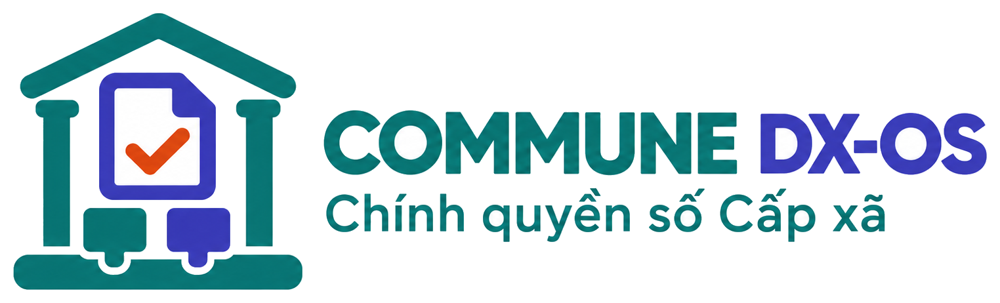
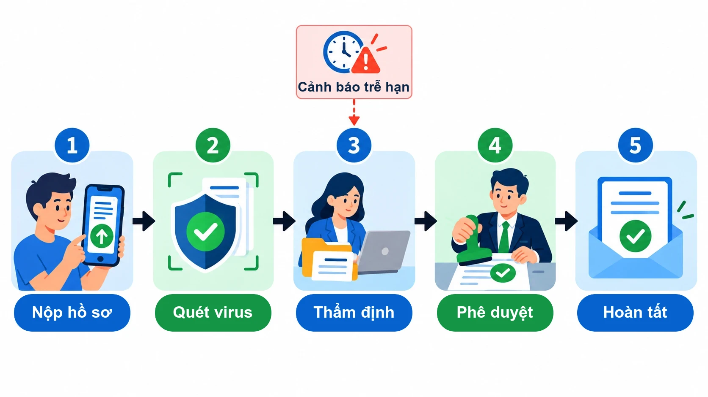

<p align="center">
  <picture>
    <source media="(prefers-color-scheme: dark)" srcset="docs/images/logo/logo-ngang-nen-trang.png">
    
  </picture>
</p>

<p align="center">
  
</p>

# Commune DX-OS — Hệ điều hành Chính quyền số Cấp xã

**Người dân nộp hồ sơ một lần, cán bộ xã biết hồ sơ đang ở đâu và còn bao lâu tới hạn.**

[](LICENSE)
[](https://github.com/commune-dxos/commune-dxos/releases)
[](https://github.com/commune-dxos/commune-dxos/actions/workflows/check.yml)
[](https://commune-dxos.github.io/commune-dxos/)

Nguồn mở, chạy trên một máy ở xã. Đội DTU_DZ_2 · OLP PMNM 2026 · Đề tài DX-OS Open-Core.

## Trước và sau chuyển đổi số

Tám việc hằng ngày ở bộ phận một cửa của xã, trước và sau khi có Commune DX-OS.

✅ đã phát hành, ghi bản đầu tiên có (mới nhất **v0.5.0**) · 🆕 có trên nhánh **`develop`**, vào bản phát hành tới · ⏳ **đang làm**, ghi tuần dự kiến

| Trước | Sau |
|---|---|
| Người dân đến xã nộp hồ sơ, rồi quay lại vài lần chỉ để hỏi "xong chưa". | Nộp hồ sơ, tải giấy tờ, xem hồ sơ đang ở bước nào qua API. ✅ v0.1.0 · Cổng web cho người dân nộp hồ sơ: ✅ v0.4.0 · Biên nhận và thông báo kết quả PDF có ký số: ✅ v0.5.0 · Tra cứu tiến độ trên cổng web (không cần đăng nhập, bằng mã hồ sơ), nộp bổ sung trực tuyến: 🆕 |
| Thiếu một tờ giấy, cán bộ trả về, người dân đi thêm một chuyến. | Mỗi thủ tục khai thành phần hồ sơ bằng JSON Schema, công khai để xem trước khi nộp. ✅ v0.1.0 · Chặn nộp khi còn thiếu (Poka-yoke), kiểm cả ở web và máy chủ: ✅ v0.5.0 |
| Hồ sơ giấy chuyển qua nhiều bàn, thất lạc, không ai biết đang nằm ở đâu. | Mỗi hồ sơ có mã, trạng thái và lịch sử từng bước của quy trình. Tệp có nhật ký chỉ ghi thêm, không sửa được. ✅ v0.1.0 · Trạng thái hồ sơ đi đúng bước quy trình Flowable: ✅ v0.5.0 |
| Hạn giải quyết tính tay, quá hạn rồi mới biết. | Hạn tự tính theo ngày làm việc, bỏ cuối tuần và ngày lễ. Còn ≤ 1 ngày thì hệ thống phát cảnh báo sắp trễ hạn qua hàng đợi. ✅ v0.1.0 · Cổng cán bộ xếp hồ sơ quá hạn, sắp trễ lên đầu: ✅ v0.5.0 · Gửi thông báo tới cán bộ, người dân: ⏳ tuần 5 |
| Sổ hồ sơ để chung, ai cũng mở được. Giấy tờ gửi qua tin nhắn, không ai kiểm. | Cán bộ chỉ thấy hồ sơ thuộc lĩnh vực mình, đăng nhập phải có mã OTP. Tệp được quét mã độc trước khi lưu. ✅ v0.1.0 · Cổng cán bộ đăng nhập một lần + OTP; sổ văn bản đến/đi có ký số: ✅ v0.5.0 |
| Thêm một thủ tục mới phải chờ sửa phần mềm. | Thêm một thư mục `thu-tuc/<ma>/` rồi chạy `make nap-thu-tuc`. Không sửa mã. ✅ v0.2.0 |
| Lãnh đạo xã cộng sổ cuối tháng mới biết bao nhiêu hồ sơ trễ. | Dashboard thời gian giải quyết, tỷ lệ trễ hạn; nhật ký kiểm toán có chuỗi băm. ✅ v0.5.0 |
| Cán bộ gõ lại từng dòng trên giấy tờ người dân mang tới. | Chụp giấy tờ, hệ thống đọc chữ và điền sẵn, cán bộ xác nhận lại. ⏳ tuần 5 |

Kế hoạch từng tuần: [`docs/PLAN.md`](docs/PLAN.md). Đối chiếu yêu cầu đề thi: [`docs/de-thi-mapping.md`](docs/de-thi-mapping.md).

## Thủ tục đang hỗ trợ

| Mã | Thủ tục | Lĩnh vực | Thời hạn | Lệ phí | Gói |
|---|---|---|---|---|---|
| KS01 | Đăng ký khai sinh | Hộ tịch | 1 ngày làm việc | Miễn khi đăng ký đúng hạn | [`thu-tuc/khai-sinh/`](thu-tuc/khai-sinh/) |
| CT01 | Chứng thực bản sao từ bản chính | Chứng thực | Trong ngày | 2.000 đ/trang; từ trang thứ ba 1.000 đ/trang, tối đa 200.000 đ/bản | [`thu-tuc/chung-thuc-ban-sao/`](thu-tuc/chung-thuc-ban-sao/) |

Mỗi gói gồm mô tả (`thu-tuc.yaml`), quy trình BPMN, JSON Schema thành phần hồ sơ và dữ liệu mẫu giả. Bảng trên chép từ `thu-tuc/*/thu-tuc.yaml`. Danh mục đầy đủ (thành phần hồ sơ, các bước, căn cứ pháp lý) tự sinh trên [trang tài liệu](https://commune-dxos.github.io/commune-dxos/danh-muc-thu-tuc/).

**Thêm thủ tục trong 5 bước:** chép gói có sẵn → sửa `thu-tuc.yaml` → vẽ quy trình → khai thành phần hồ sơ → `make nap-thu-tuc`. Hướng dẫn: [`docs/thu-tuc.md`](docs/thu-tuc.md).

## Hồ sơ đi qua hệ thống thế nào

<p align="center">
  
</p>

Người dân nộp hồ sơ; hệ thống cấp mã, tính hạn và khởi tạo quy trình của thủ tục. Giấy tờ tải lên được ClamAV quét, sạch mới lưu. Cán bộ lĩnh vực tiếp nhận, yêu cầu bổ sung nếu thiếu, rồi thẩm định. Lãnh đạo xã phê duyệt hoặc trả lại. Mỗi bước phát một sự kiện; hồ sơ sắp tới hạn sinh cảnh báo `ho_so.sap_tre_han`.

## Kiến trúc

<p align="center">
  
</p>

<sub>Ảnh tĩnh cho slide: [docs/images/kien-truc-2-tang.webp](docs/images/kien-truc-2-tang.webp)</sub>

Ba lớp, mỗi lớp một thư mục:

- [`nen-tang/`](nen-tang/): lõi headless Tầng 1. Chỉ có API, không giao diện, không nghiệp vụ.
- [`mot-cua/`](mot-cua/): bộ máy một cửa Tầng 2, chạy mọi thủ tục. Chỉ gọi lõi qua API Gateway.
- [`thu-tuc/`](thu-tuc/): mỗi thủ tục một gói, bộ nạp tự kiểm và nạp khi khởi động.

| Dịch vụ bắt buộc của đề | Thành phần | Cấu hình |
|---|---|---|
| SSO | Keycloak, OTP bắt buộc cho cán bộ và lãnh đạo | [`nen-tang/keycloak/`](nen-tang/keycloak/), [`mot-cua/keycloak/`](mot-cua/keycloak/) |
| API Gateway | Apache APISIX, giới hạn tần suất cho API công khai | [`nen-tang/apisix/`](nen-tang/apisix/) |
| Dữ liệu có cấu trúc và phi cấu trúc | PostgreSQL + RLS + PostgREST; Garage (S3) + ClamAV | [`nen-tang/postgres/`](nen-tang/postgres/), [`nen-tang/garage/`](nen-tang/garage/), [`mot-cua/db/`](mot-cua/db/) |
| Workflow engine | Flowable (BPMN 2.0), quy trình nằm trong từng gói | [`thu-tuc/<ma>/quy-trinh.bpmn20.xml`](thu-tuc/khai-sinh/quy-trinh.bpmn20.xml) |

Hỗ trợ thêm: RabbitMQ (sự kiện hồ sơ), OpenBao (bí mật). Mọi thành phần chạy bằng image gốc; thành phần AGPL/GPL (Garage, ClamAV) chạy như dịch vụ riêng, không sửa. Sơ đồ chi tiết, route gateway, luồng JWT: [`docs/architecture.md`](docs/architecture.md). Danh sách phụ thuộc và giấy phép: [`DEPENDENCIES.md`](DEPENDENCIES.md).

## Chạy thử trong 5 phút

Cần Docker (Compose v2.20+), RAM cho Docker 4 GB, ổ trống 6 GB, `git`, `make`, `curl`, `jq`, `python3`.

```bash
git clone https://github.com/commune-dxos/commune-dxos.git
cd commune-dxos
cp .env.example .env      # không có mật khẩu nào cần điền
make up                   # chạy lõi + bộ máy một cửa + nạp gói thu-tuc/ + cổng công dân
make smoke                # kiểm tra đầu-cuối, kết thúc bằng "0 trượt"
make demo-users           # đặt mật khẩu cho tài khoản mẫu và in ra
```

Lần đầu `make up` mất 2–10 phút tùy mạng, `make smoke` khoảng 1,5 phút. Dừng: `make down` (giữ dữ liệu). Không xóa, không commit `.data/openbao/commune.json`: mất tệp này là mất mọi bí mật.

Mở cổng công dân: **http://localhost:9080/** (APISIX phục vụ, cùng cổng với API; xem danh mục và chi tiết thủ tục không cần đăng nhập, nộp hồ sơ sau khi đăng nhập). Tra cứu tiến độ: **http://localhost:9080/tra-cuu** (mã hồ sơ + 4 số cuối số điện thoại, không cần đăng nhập) hoặc "Hồ sơ của tôi" sau khi đăng nhập. API công khai: http://localhost:9080/public/thu_tuc.

Mở cổng cán bộ: **http://localhost:9080/can-bo** (mật khẩu + mã OTP, lần đầu quét mã QR bằng ứng dụng OTP): hộp việc theo lĩnh vực, hạn xử lý đổi màu khi sắp trễ, chi tiết hồ sơ và tệp, xử lý từng bước tới khi lãnh đạo phê duyệt. Luồng: [`docs/cong-can-bo.md`](docs/cong-can-bo.md).

Tài khoản mẫu (dữ liệu giả): `congdan01` (người dân), `canbo01` (cán bộ hộ tịch), `canbo02` (cán bộ chứng thực), `lanhdao01` (lãnh đạo).

Cổng, tài khoản, gọi API bằng `curl`, xử lý lỗi: [`docs/cai-dat.md`](docs/cai-dat.md).

## Demo

Giao diện cổng người dân và cổng cán bộ đang làm ở tuần 3. GIF demo sẽ thêm vào đây ở tuần 3–4.

## Đội và cách đóng góp

Đội **DTU_DZ_2**. Việc chia theo tuần, mỗi việc một issue, một PR về `develop`.

| Muốn xem | Ở đâu |
|---|---|
| Việc đang làm | [GitHub Project "Commune DX-OS – Lộ trình"](https://github.com/orgs/commune-dxos/projects/1) |
| Việc theo tuần | [Milestones](https://github.com/commune-dxos/commune-dxos/milestones) |
| Cách làm một việc, nhãn, quy ước commit | [`docs/quy-trinh-lam-viec.md`](docs/quy-trinh-lam-viec.md), [`CONTRIBUTING.md`](CONTRIBUTING.md) |
| Đã thay đổi gì | [`CHANGELOG.md`](CHANGELOG.md) (sinh bằng git-cliff), [Releases](https://github.com/commune-dxos/commune-dxos/releases) |
| Báo lỗi, đề xuất thủ tục mới | [Issues](https://github.com/commune-dxos/commune-dxos/issues) |

Trước mỗi commit: `make check`. Cùng lệnh với CI: `make lint`, `make test`.

Quy tắc ứng xử: [`CODE_OF_CONDUCT.md`](CODE_OF_CONDUCT.md). Nguồn hình ảnh: [`docs/images/README.md`](docs/images/README.md).

## Giấy phép

Commune DX-OS phát hành theo **[GNU GPL phiên bản 3 hoặc mới hơn](LICENSE)** (`GPL-3.0-or-later`); mỗi tệp mã có header SPDX.

- **Vì sao GPL-3.0:** phần mềm cho chính quyền số là tài sản công. Copyleft bảo đảm mọi bản sửa đổi được phân phối lại, kể cả của nhà cung cấp, vẫn phải giữ mã nguồn mở cho xã và người dân. Chọn bản 3 vì tương thích với các thành phần Apache-2.0 (Keycloak, APISIX, Flowable), bản 2 thì không.
- **Mốc chuyển:** v0.0.1, v0.1.0, v0.2.0 đã phát hành theo Apache-2.0 và giữ nguyên giấy phép đó; từ bản phát hành sau v0.2.0 là GPL-3.0-or-later (quyết định D-010, [#47](https://github.com/commune-dxos/commune-dxos/issues/47)).
- **Bên thứ ba:** các thành phần giữ giấy phép riêng và chỉ dùng qua image gốc hoặc trình quản lý gói; Garage (AGPL-3.0) và ClamAV (GPL-2.0) chạy như dịch vụ riêng, không liên kết. Xem [`NOTICE`](NOTICE) và [`DEPENDENCIES.md`](DEPENDENCIES.md).
