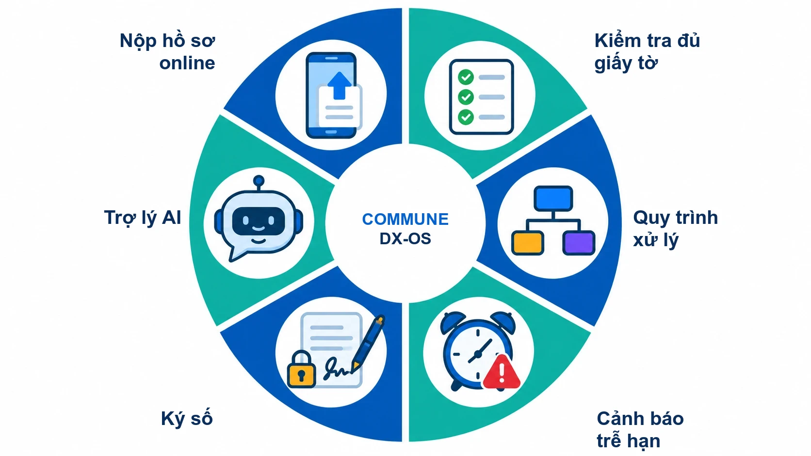
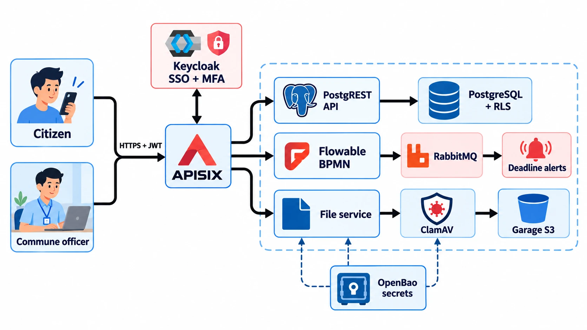

<p align="center">
  
</p>

# Commune DX-OS — Hệ điều hành Chính quyền số Cấp xã

Nền tảng nguồn mở giúp xã tiếp nhận, xử lý và theo dõi thủ tục hành chính trực tuyến: người dân nộp hồ sơ từ xa, cán bộ xử lý theo quy trình, lãnh đạo thấy ngay hồ sơ nào sắp trễ hạn.

[](LICENSE)
[](https://github.com/commune-dxos/commune-dxos/releases)
[](https://github.com/commune-dxos/commune-dxos/actions/workflows/check.yml)

OLP PMNM 2026 · Đề tài DX-OS Open-Core · Đội DTU_DZ_2

## 🧭 Giới thiệu

Cấp xã là nơi người dân làm thủ tục hành chính nhiều nhất: đăng ký khai sinh, chứng thực bản sao, xác nhận đất đai… Mỗi ngày bộ phận một cửa nhận hàng chục hồ sơ, phần lớn vẫn là giấy, mỗi hồ sơ phải qua tay nhiều cán bộ và có thời hạn giải quyết theo luật.

Commune DX-OS đưa toàn bộ vòng đời hồ sơ lên mạng: từ lúc người dân nộp, qua tiếp nhận, thẩm định, phê duyệt, đến khi trả kết quả. Hệ thống gồm một lõi dùng chung (đăng nhập, cổng API, dữ liệu, quy trình) và các ứng dụng nghiệp vụ cắm vào lõi; ứng dụng đầu tiên là **một cửa cấp xã**.

## ⚠️ Thách thức

- **Hồ sơ giấy:** khó lưu trữ, khó tra cứu, dễ thất lạc khi chuyển giữa các bàn.
- **Đi lại nhiều lần:** người dân phải đến xã để nộp, để bổ sung, để hỏi tiến độ.
- **Thiếu thành phần hồ sơ:** nộp thiếu giấy tờ chỉ phát hiện khi cán bộ xem, hồ sơ bị trả về.
- **Khó theo dõi trễ hạn:** hạn tính theo ngày làm việc, cán bộ khó biết hồ sơ nào sắp quá hạn.
- **Tệp tải lên có thể chứa mã độc:** nhận tệp từ người dân mà không quét là rủi ro cho cả hệ thống.
- **Dữ liệu phân tán:** mỗi bộ phận giữ sổ riêng, lãnh đạo thiếu số liệu về thời gian giải quyết.

## 💡 Giải pháp

<p align="center">
  
</p>

- **Nộp trực tuyến, một lần:** người dân nộp hồ sơ và giấy tờ từ điện thoại, xem tiến độ mà không cần đến xã.
- **Quy trình rõ ràng:** mỗi thủ tục là một quy trình BPMN; mỗi cán bộ chỉ thấy hồ sơ thuộc lĩnh vực mình phụ trách.
- **Hạn xử lý tự tính:** theo ngày làm việc (bỏ cuối tuần, ngày lễ); hồ sơ sắp trễ hạn tự phát cảnh báo.
- **An toàn mặc định:** đăng nhập một lần có xác thực hai lớp cho cán bộ, tệp được quét mã độc trước khi lưu, bí mật hệ thống nằm trong két riêng.
- **Mở để mở rộng:** lõi không chứa nghiệp vụ; ứng dụng mới cắm vào thư mục `apps/` mà không sửa lõi.

## 👥 Đối tượng

| Đối tượng | Dùng để |
|---|---|
| Công dân | Nộp hồ sơ, tải giấy tờ, theo dõi tiến độ, bổ sung khi được yêu cầu |
| Cán bộ một cửa | Tiếp nhận, kiểm tra thành phần, yêu cầu bổ sung |
| Cán bộ chuyên môn | Thẩm định hồ sơ thuộc lĩnh vực phụ trách (hộ tịch, chứng thực, đất đai…) |
| Lãnh đạo xã | Phê duyệt, theo dõi hồ sơ sắp trễ hạn và thời gian giải quyết |
| Quản trị hệ thống | Cài đặt, quản lý người dùng, bí mật, sao lưu |
| Lập trình viên | Viết ứng dụng mới cắm vào lõi qua API, không sửa `core/` |

## 📱 Chức năng

<p align="center">
  
</p>

| Chức năng | Bản v0.1.0 | Sắp có |
|---|---|---|
| Nộp hồ sơ online | ✅ API nộp hồ sơ, tải tệp, xem tiến độ (`/workflow`, `/files`) | Cổng web công dân và cổng cán bộ (React), tuần 3 |
| Kiểm tra đủ giấy tờ | ✅ JSON Schema thành phần hồ sơ của từng thủ tục, API công khai | Chặn nộp khi thiếu thành phần trước khi khởi tạo quy trình (Poka-yoke), tuần 3 |
| Quy trình xử lý | ✅ Quy trình đăng ký khai sinh (BPMN): tiếp nhận → bổ sung → thẩm định → phê duyệt | Thêm thủ tục khác |
| Cảnh báo trễ hạn | ✅ Sự kiện "sắp trễ hạn" qua hàng đợi; hẹn giờ quá hạn trong quy trình | Thông báo tới cán bộ và công dân, tuần 3; dashboard tỷ lệ trễ hạn, tuần 4 |
| Ký số | — | Ký số biên nhận và kết quả PDF, văn bản đi/đến, tuần 4 |
| Trợ lý AI | — | OCR giấy tờ tự điền hồ sơ (cán bộ xác nhận), trợ lý tra cứu thủ tục, tuần 5 |

Bản v0.1.0 là lõi và API của ứng dụng một cửa, kiểm chứng đầu-cuối bằng `make smoke` (405 kiểm tra).

## 🗺️ Kiến trúc

<p align="center">
  
</p>

Hệ thống chia hai tầng. **Tầng 1 – [`core/`](core/)** là lõi headless: chỉ có API, không có giao diện cho người dùng cuối và không chứa nghiệp vụ. **Tầng 2 – [`apps/mot-cua/`](apps/mot-cua/)** là ứng dụng một cửa: schema và phân quyền dữ liệu, vai trò, quy trình BPMN, backend mỏng; ứng dụng chỉ gọi lõi qua API Gateway và được chọn bằng biến `DXOS_APP`. Lõi có đủ 4 dịch vụ bắt buộc của đề: **SSO** (Keycloak, MFA cho cán bộ), **API Gateway** (APISIX), **dữ liệu có cấu trúc và phi cấu trúc** (PostgreSQL + RLS + PostgREST; Garage S3 + ClamAV), **workflow engine** (Flowable BPMN 2.0). Mọi thành phần chạy bằng image gốc của dự án upstream.

Sơ đồ chi tiết (route gateway, luồng JWT, luồng tệp, bí mật, sự kiện, hợp đồng lõi–ứng dụng): [`docs/architecture.md`](docs/architecture.md).

## ⚙️ Công nghệ

| Lớp | Thành phần | Giấy phép |
|---|---|---|
| SSO, MFA | Keycloak 26.3 | Apache-2.0 |
| API Gateway | Apache APISIX 3.13 | Apache-2.0 |
| CSDL, API tự sinh | PostgreSQL 17.6 + Row-Level Security, PostgREST 13 | PostgreSQL, MIT |
| Lưu tệp | Garage 2.4 (S3), dịch vụ riêng | AGPL-3.0 |
| Quét mã độc | ClamAV 1.5, dịch vụ riêng | GPL-2.0 |
| Workflow | Flowable REST 8.0 (BPMN 2.0) | Apache-2.0 |
| Hàng đợi sự kiện | RabbitMQ 4.3 | MPL-2.0 |
| Két bí mật | OpenBao 2.7 | MPL-2.0 |
| Backend ứng dụng | Python 3.13 (thư viện chuẩn) | PSF-2.0 |
| Sắp dùng | React + Vite, Superset, step-ca + pyHanko, Gotenberg, Meilisearch CE, PaddleOCR, Ollama + Qwen2.5 | xem [`DEPENDENCIES.md`](DEPENDENCIES.md) |

Thành phần AGPL/GPL chỉ chạy như dịch vụ riêng bằng image gốc, không sửa, không liên kết vào mã của dự án.

## 🔄 Luồng hồ sơ

<p align="center">
  
</p>

1. **Nộp hồ sơ:** công dân đăng nhập, chọn thủ tục, nộp hồ sơ; hệ thống tạo mã hồ sơ, tính hạn xử lý và khởi tạo quy trình.
2. **Quét virus:** mỗi tệp giấy tờ được ClamAV quét trước, sạch mới lưu vào Garage.
3. **Thẩm định:** cán bộ phụ trách lĩnh vực tiếp nhận, kiểm tra thành phần (thiếu thì công dân bổ sung) rồi thẩm định; không đạt thì từ chối.
4. **Phê duyệt:** lãnh đạo xã duyệt, hoặc trả lại để thẩm định lại.
5. **Hoàn tất:** hồ sơ đóng, công dân xem kết quả; mỗi bước đều phát sự kiện lên hàng đợi.

**Cảnh báo trễ hạn:** tác vụ nền quét định kỳ, hồ sơ chưa xong mà còn ≤ 1 ngày làm việc tới hạn sinh sự kiện `ho_so.sap_tre_han`; quá hạn thì hẹn giờ trong quy trình đánh dấu hồ sơ trễ.

## 🚀 Hướng phát triển

| Giai đoạn | Nội dung |
|---|---|
| Tuần 3 | Poka-yoke bằng JSON Schema, cổng công dân và cổng cán bộ (React), thông báo trễ hạn |
| Tuần 4 → v0.2.0 | Log kiểm toán chuỗi băm, ký số, sinh PDF, dữ liệu lịch sử Parquet + dbt, dashboard Superset, triển khai VPS |
| Tuần 5 | OCR giấy tờ tự điền hồ sơ (cán bộ xác nhận), trợ lý tra cứu thủ tục (RAG), demo công khai |
| Tuần 6 → v0.3.0 | Cải thiện theo phản hồi người dùng, module mẫu thứ hai cắm vào lõi, công bố bộ JSON Schema thủ tục dạng dữ liệu mở |
| Tuần 7 → v1.0.0 | Đóng băng tính năng, phát hành v1.0.0 |

Chi tiết theo tuần: [`docs/PLAN.md`](docs/PLAN.md); đối chiếu yêu cầu đề thi: [`docs/de-thi-mapping.md`](docs/de-thi-mapping.md).

## 🛠️ Cài đặt từ máy sạch

**Yêu cầu:** Linux, macOS hoặc Windows (WSL2), CPU amd64/arm64; Docker Engine 24+ hoặc Docker Desktop 4.25+ với Compose v2.20+; RAM cho Docker 4 GB (khuyên 6 GB); ổ trống 6 GB; `git`, `make`, `bash`, `curl`, `jq`, `python3` 3.10+. Không cần cài Java, Node hay PostgreSQL, không có bước build image.

```bash
git clone https://github.com/commune-dxos/commune-dxos.git
cd commune-dxos
cp .env.example .env      # không có mật khẩu nào cần điền
make up                   # lõi + ứng dụng DXOS_APP; tự init + unseal OpenBao
make bao-init             # (tùy chọn) init/unseal OpenBao lại, chạy lại an toàn; make up đã tự gọi
make ps                   # dịch vụ chạy nền "healthy", dịch vụ một lần "Exited (0)"
make smoke                # kiểm tra đầu-cuối: "== Kết quả: 405 đạt, 0 trượt"
make demo-users           # đặt mật khẩu cho người dùng mẫu và in ra (chạy SAU smoke)
```

Lần đầu `make up` mất khoảng 2–10 phút tùy mạng (đo trên bản clone sạch: 2 phút 8 giây), `make smoke` khoảng 1,5 phút. Dừng: `make down` (giữ dữ liệu). **Không xóa, không commit `.data/openbao/commune.json`** (unseal key + root token của OpenBao, sinh ở lần `make up` đầu): mất tệp là mất mọi bí mật, hãy sao lưu ra ngoài repo.

| Địa chỉ | Dùng để |
|---|---|
| http://localhost:9080/public/thu_tuc | API công khai (không token, 60 request/phút) |
| http://localhost:9080/api/ho_so · `/workflow/tasks` · `/files/` | API dữ liệu, quy trình, tệp (cần JWT) |
| http://localhost:8080/realms/dxos/account | Đăng nhập thử, cài OTP |

**Tài khoản mẫu** (dữ liệu giả, mật khẩu do `make demo-users` đặt): `congdan01`, `congdan02` (công dân); `canbo01` (hộ tịch), `canbo02` (chứng thực), `canbo03` (đất đai) (cán bộ, bắt buộc OTP); `lanhdao01` (lãnh đạo, bắt buộc OTP).

Hướng dẫn đầy đủ (yêu cầu máy chi tiết, bí mật OpenBao, cổng và tài khoản, gọi API thử bằng `curl`, biến cấu hình `.env`, thêm ứng dụng vào `apps/`, kiểm thử, **xử lý lỗi thường gặp**): [`docs/cai-dat.md`](docs/cai-dat.md).

## 🤝 Đóng góp

```bash
make check                # SPDX + BPMN + test đơn vị + compose hợp lệ, chạy trước mỗi commit
make lint                 # shellcheck, yamllint, BPMN như CI
make test                 # test đơn vị + SQL/RLS trên PostgreSQL tạm
```

Quy trình issue → nhánh `feature/<số>-<tên>` → PR về `develop`; CI chạy 6 job bắt buộc (`make-check`, `shellcheck`, `yamllint`, `bpmn`, `test-backend`, `test-sql`). Quy ước commit và cách làm: [`CONTRIBUTING.md`](CONTRIBUTING.md), [`CODE_OF_CONDUCT.md`](CODE_OF_CONDUCT.md).

## 🐛 Báo lỗi

Báo lỗi và đề xuất tại [GitHub Issues](https://github.com/commune-dxos/commune-dxos/issues) (có mẫu issue). Hãy ghi lệnh đã chạy, output `make ps` và `docker compose version`.

## 📜 Giấy phép

Mã nguồn phát hành theo [Apache License 2.0](LICENSE); mọi tệp mã và cấu hình có dòng `SPDX-License-Identifier: Apache-2.0`, kiểm bằng `make check` trên mỗi PR. Apache-2.0 cho phép cơ quan nhà nước và doanh nghiệp tự do dùng, sửa, triển khai lại, có điều khoản cấp quyền sáng chế rõ ràng và tương thích với các thành phần lõi. Thành phần bên thứ ba giữ giấy phép riêng: [`NOTICE`](NOTICE), [`DEPENDENCIES.md`](DEPENDENCIES.md). Nguồn và giấy phép hình ảnh: [`docs/images/README.md`](docs/images/README.md).

## 📝 CHANGELOG

Phiên bản theo [SemVer](https://semver.org/lang/vi/); thay đổi ghi trong [`CHANGELOG.md`](CHANGELOG.md) (mục `[Unreleased]` là phần đang làm). Bản phát hành kèm gói mã nguồn `.tar.gz`: [Releases](https://github.com/commune-dxos/commune-dxos/releases).
