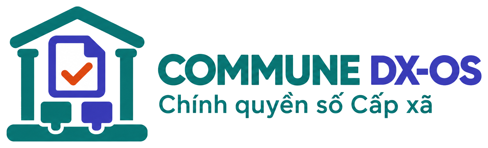
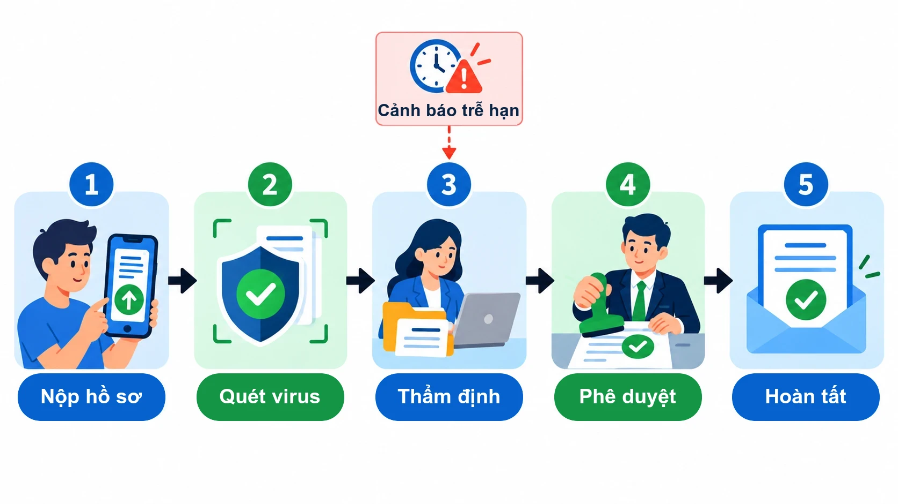

<p align="center">
  <picture>
    <source media="(prefers-color-scheme: dark)" srcset="docs/images/logo/logo-ngang-nen-trang.png">
    
  </picture>
</p>

<p align="center">
  
</p>

# Commune DX-OS — Hệ điều hành Chính quyền số Cấp xã

**Người dân nộp hồ sơ một lần, cán bộ xã biết hồ sơ đang ở đâu và còn bao lâu tới hạn.**

[](LICENSE)
[](https://github.com/commune-dxos/commune-dxos/releases)
[](https://github.com/commune-dxos/commune-dxos/actions/workflows/check.yml)
[](https://commune-dxos.github.io/commune-dxos/)

Nguồn mở, chạy trên một máy ở xã. Đội DTU_DZ_2 · OLP PMNM 2026 · Đề tài DX-OS Open-Core.

**Dùng thử ngay:** [bản demo công khai](https://commune.dzfullstack.com) · [tải APK Android](https://github.com/commune-dxos/commune-dxos/releases/latest) · [trang tài liệu](https://commune-dxos.github.io/commune-dxos/) · [hướng dẫn buổi dùng thử](docs/thu-nghiem.md)

**English:** [summary and quick start below](#english) · [docs in English](docs/en/index.md)

## Mục lục

- [Trước và sau chuyển đổi số](#trước-và-sau-chuyển-đổi-số)
- [Người dùng và tính năng theo vai](#người-dùng-và-tính-năng-theo-vai)
- [Thủ tục đang hỗ trợ](#thủ-tục-đang-hỗ-trợ)
- [Hồ sơ đi qua hệ thống thế nào](#hồ-sơ-đi-qua-hệ-thống-thế-nào)
- [Kiến trúc](#kiến-trúc)
- [Công nghệ sử dụng](#công-nghệ-sử-dụng)
- [Cấu trúc thư mục](#cấu-trúc-thư-mục)
- [Yêu cầu hệ thống](#yêu-cầu-hệ-thống)
- [Chạy thử trong 5 phút](#chạy-thử-trong-5-phút)
- [App di động](#app-di-động)
- [Demo](#demo)
- [Tài liệu](#tài-liệu)
- [Đội và cách đóng góp](#đội-và-cách-đóng-góp)
- [Liên hệ](#liên-hệ)
- [Giấy phép](#giấy-phép)
- [English](#english)

## Trước và sau chuyển đổi số

Tám việc hằng ngày ở bộ phận một cửa của xã, trước và sau khi có Commune DX-OS.

✅ đã phát hành, ghi bản đầu tiên có (mới nhất **v0.12.1**) · ⏳ **chưa làm**

| Trước | Sau |
|---|---|
| Người dân đến xã nộp hồ sơ, rồi quay lại vài lần chỉ để hỏi "xong chưa". | Nộp hồ sơ, tải giấy tờ, xem hồ sơ đang ở bước nào qua API. ✅ v0.1.0 · Cổng web cho người dân nộp hồ sơ: ✅ v0.4.0 · Biên nhận và thông báo kết quả PDF có ký số: ✅ v0.5.0 · Tra cứu tiến độ trên cổng web (không cần đăng nhập, bằng mã hồ sơ), nộp bổ sung trực tuyến: ✅ v0.6.0 · Trợ lý hỏi đáp thủ tục, trả lời có dẫn nguồn: ✅ v0.6.0 · App Android **Một cửa xã**: nộp hồ sơ kèm ảnh chụp giấy tờ, tra cứu, theo dõi hồ sơ của mình: ✅ v0.11.0 · Trên app: tải biên nhận và thông báo kết quả ký số, nộp bổ sung khi xã yêu cầu: ✅ v0.12.0 |
| Thiếu một tờ giấy, cán bộ trả về, người dân đi thêm một chuyến. | Mỗi thủ tục khai thành phần hồ sơ bằng JSON Schema, công khai để xem trước khi nộp. ✅ v0.1.0 · Chặn nộp khi còn thiếu (Poka-yoke), kiểm cả ở web và máy chủ: ✅ v0.5.0 |
| Hồ sơ giấy chuyển qua nhiều bàn, thất lạc, không ai biết đang nằm ở đâu. | Mỗi hồ sơ có mã, trạng thái và lịch sử từng bước của quy trình. Tệp có nhật ký chỉ ghi thêm, không sửa được. ✅ v0.1.0 · Trạng thái hồ sơ đi đúng bước quy trình Flowable: ✅ v0.5.0 |
| Hạn giải quyết tính tay, quá hạn rồi mới biết. | Hạn tự tính theo ngày làm việc, bỏ cuối tuần và ngày lễ. Còn ≤ 1 ngày thì hệ thống phát cảnh báo sắp trễ hạn qua hàng đợi. ✅ v0.1.0 · Cổng cán bộ xếp hồ sơ quá hạn, sắp trễ lên đầu: ✅ v0.5.0 · Thông báo sắp trễ hạn tới cán bộ trên cổng cán bộ, cập nhật ngay (email/SMS giả lập): ✅ v0.6.0 · Thông báo tới người dân: ⏳ |
| Sổ hồ sơ để chung, ai cũng mở được. Giấy tờ gửi qua tin nhắn, không ai kiểm. | Cán bộ chỉ thấy hồ sơ thuộc lĩnh vực mình, đăng nhập phải có mã OTP. Tệp được quét mã độc trước khi lưu. ✅ v0.1.0 · Cổng cán bộ đăng nhập một lần + OTP; sổ văn bản đến/đi có ký số: ✅ v0.5.0 · Wiki văn bản nội bộ, ai thấy gì theo vai và lĩnh vực: ✅ v0.6.0 · Lịch công tác: văn thư soạn, lãnh đạo duyệt, không cho trùng phòng cùng giờ: ✅ v0.8.0 |
| Thêm một thủ tục mới phải chờ sửa phần mềm. | Thêm một thư mục `thu-tuc/<ma>/` rồi chạy `make nap-thu-tuc`. Không sửa mã. ✅ v0.2.0 · Thêm gói kết hôn, hòa giải tranh chấp đất đai đúng cách đó (4 gói): ✅ v0.6.0 · Hướng dẫn thêm gói từ A đến Z (song ngữ), danh mục thủ tục công bố dạng dữ liệu mở CC-BY-4.0: ✅ v0.7.0 |
| Lãnh đạo xã cộng sổ cuối tháng mới biết bao nhiêu hồ sơ trễ. | Dashboard thời gian giải quyết, tỷ lệ trễ hạn; nhật ký kiểm toán có chuỗi băm. ✅ v0.5.0 |
| Cán bộ gõ lại từng dòng trên giấy tờ người dân mang tới. | Chụp giấy tờ, hệ thống đọc chữ và điền sẵn, cán bộ xác nhận lại. ✅ v0.6.0 |

Kế hoạch từng tuần: [`docs/PLAN.md`](docs/PLAN.md). Đối chiếu yêu cầu đề thi: [`docs/de-thi-mapping.md`](docs/de-thi-mapping.md).

## Người dùng và tính năng theo vai

Chỉ ghi những gì đã có trong bản **v0.12.1**.

**Người dân** (cổng web và app Android, tài khoản mẫu `congdan01`)
- Xem danh mục thủ tục, thành phần hồ sơ, thời hạn, lệ phí mà không cần đăng nhập.
- Nộp hồ sơ trực tuyến kèm giấy tờ hoặc ảnh chụp; thiếu giấy tờ bắt buộc thì bị chặn ngay trước khi gửi.
- Tra cứu tiến độ bằng mã hồ sơ và 4 số cuối số điện thoại (không đăng nhập), hoặc xem "Hồ sơ của tôi".
- Nộp bổ sung khi bộ phận một cửa yêu cầu; tải biên nhận và thông báo kết quả PDF có ký số.
- Hỏi đáp thủ tục ở `/hoi-dap`: trả về đoạn tài liệu liên quan; câu trả lời có dẫn nguồn khi bật mô hình ngôn ngữ (`make up-ai`).

**Cán bộ một cửa, cán bộ chuyên môn** (cổng `/can-bo`, tài khoản mẫu `canbo01`, `canbo02`)
- Đăng nhập một lần qua Keycloak, bắt buộc mã OTP.
- Hộp việc chỉ có hồ sơ thuộc lĩnh vực mình (RLS); hồ sơ quá hạn, sắp trễ lên đầu, lọc theo trạng thái, thủ tục, hạn.
- Xử lý từng bước của quy trình BPMN: tiếp nhận, yêu cầu bổ sung, thẩm định, trình lãnh đạo; form của mỗi bước sinh từ gói thủ tục.
- Nhận thông báo sắp trễ hạn ngay trên cổng (chuông cập nhật tức thì; email/SMS chỉ giả lập).
- Đọc giấy tờ bằng OCR để điền sẵn, cán bộ xác nhận lại (cần `make up-ocr` hoặc `make up-ai`).
- Tra wiki văn bản nội bộ theo quyền, xem sổ văn bản đến/đi và lịch công tác đã duyệt.

**Lãnh đạo xã** (tài khoản mẫu `lanhdao01`)
- Thấy mọi hồ sơ; phê duyệt hoặc trả lại ở bước cuối của quy trình.
- Ký ban hành văn bản đi: hệ thống cấp số, sinh PDF và ký số; ai cũng xác minh được PDF xã đã phát hành.
- Duyệt lịch công tác; hệ thống từ chối hai lịch trùng địa điểm và chồng giờ.
- Xem dashboard Superset ở `/bao-cao/` (cần `make up-bi`): thời gian giải quyết, tỷ lệ trễ hạn theo tháng và thủ tục, số hồ sơ theo lĩnh vực.
- Mọi thao tác trên hồ sơ nằm trong nhật ký kiểm toán chỉ ghi thêm, có chuỗi băm SHA-256.

Vai **văn thư** (`vanthu01`) vào sổ văn bản đến, soạn dự thảo văn bản đi, soạn lịch công tác chờ lãnh đạo duyệt.

**Người phát triển gói thủ tục**
- Thêm thủ tục bằng một thư mục `thu-tuc/<ma>/` gồm `thu-tuc.yaml`, quy trình BPMN viết tay, JSON Schema thành phần hồ sơ, dữ liệu mẫu giả; không sửa mã bộ máy.
- `make nap-thu-tuc` kiểm và nạp gói; `make check` kiểm BPMN, schema, header giấy phép.
- Đọc danh mục qua API công khai `/public/thu_tuc` hoặc bộ dữ liệu mở CC-BY-4.0 trong `du-lieu-mo/`.
- Hướng dẫn từ A đến Z: [`docs/thu-tuc.md`](docs/thu-tuc.md).

## Thủ tục đang hỗ trợ

| Mã | Thủ tục | Lĩnh vực | Thời hạn | Lệ phí | Gói |
|---|---|---|---|---|---|
| KS01 | Đăng ký khai sinh | Hộ tịch | 1 ngày làm việc | Miễn khi đăng ký đúng hạn | [`thu-tuc/khai-sinh/`](thu-tuc/khai-sinh/) |
| CT01 | Chứng thực bản sao từ bản chính | Chứng thực | Trong ngày | 2.000 đ/trang; từ trang thứ ba 1.000 đ/trang, tối đa 200.000 đ/bản | [`thu-tuc/chung-thuc-ban-sao/`](thu-tuc/chung-thuc-ban-sao/) |
| KH01 | Đăng ký kết hôn | Hộ tịch | 5 ngày làm việc (khi cần xác minh) | Miễn | [`thu-tuc/ket-hon/`](thu-tuc/ket-hon/) |
| DD01 | Hòa giải tranh chấp đất đai tại xã | Đất đai | 20 ngày làm việc | Không thu phí | [`thu-tuc/hoa-giai-dat-dai/`](thu-tuc/hoa-giai-dat-dai/) |

Mỗi gói gồm mô tả (`thu-tuc.yaml`), quy trình BPMN, JSON Schema thành phần hồ sơ và dữ liệu mẫu giả. Bảng trên chép từ `thu-tuc/*/thu-tuc.yaml`. Danh mục đầy đủ (thành phần hồ sơ, các bước, căn cứ pháp lý) tự sinh trên [trang tài liệu](https://commune-dxos.github.io/commune-dxos/danh-muc-thu-tuc/).

**Dữ liệu mở:** danh mục thủ tục kèm JSON Schema thành phần hồ sơ được công bố ở [`du-lieu-mo/thu-tuc-cap-xa/`](du-lieu-mo/thu-tuc-cap-xa/) (JSON, CSV) theo giấy phép **CC-BY-4.0** để xã khác, nhà phát triển dùng lại.

**Thêm thủ tục trong 5 bước:** chép gói có sẵn → sửa `thu-tuc.yaml` → vẽ quy trình → khai thành phần hồ sơ → `make nap-thu-tuc`. Hướng dẫn và ví dụ đầy đủ từ A đến Z: [`docs/thu-tuc.md`](docs/thu-tuc.md#ví-dụ-từ-a-đến-z-gói-xác-nhận-thông-tin-về-cư-trú).

## Hồ sơ đi qua hệ thống thế nào

<p align="center">
  
</p>

Người dân nộp hồ sơ; hệ thống cấp mã, tính hạn và khởi tạo quy trình của thủ tục. Giấy tờ tải lên được ClamAV quét, sạch mới lưu. Cán bộ lĩnh vực tiếp nhận, yêu cầu bổ sung nếu thiếu, rồi thẩm định. Lãnh đạo xã phê duyệt hoặc trả lại. Mỗi bước phát một sự kiện; hồ sơ sắp tới hạn sinh cảnh báo `ho_so.sap_tre_han`.

## Kiến trúc

<p align="center">
  
</p>

<sub>Ảnh tĩnh cho slide: [docs/images/kien-truc-2-tang.webp](docs/images/kien-truc-2-tang.webp)</sub>

Ba lớp, mỗi lớp một thư mục:

- [`nen-tang/`](nen-tang/): lõi headless Tầng 1. Chỉ có API, không giao diện, không nghiệp vụ.
- [`mot-cua/`](mot-cua/): bộ máy một cửa Tầng 2, chạy mọi thủ tục. Chỉ gọi lõi qua API Gateway.
- [`thu-tuc/`](thu-tuc/): mỗi thủ tục một gói, bộ nạp tự kiểm và nạp khi khởi động.

| Dịch vụ bắt buộc của đề | Thành phần | Cấu hình |
|---|---|---|
| SSO | Keycloak, OTP bắt buộc cho cán bộ và lãnh đạo | [`nen-tang/keycloak/`](nen-tang/keycloak/), [`mot-cua/keycloak/`](mot-cua/keycloak/) |
| API Gateway | Apache APISIX, giới hạn tần suất cho API công khai | [`nen-tang/apisix/`](nen-tang/apisix/) |
| Dữ liệu có cấu trúc và phi cấu trúc | PostgreSQL + RLS + PostgREST; Garage (S3) + ClamAV | [`nen-tang/postgres/`](nen-tang/postgres/), [`nen-tang/garage/`](nen-tang/garage/), [`mot-cua/db/`](mot-cua/db/) |
| Workflow engine | Flowable (BPMN 2.0), quy trình nằm trong từng gói | [`thu-tuc/<ma>/quy-trinh.bpmn20.xml`](thu-tuc/khai-sinh/quy-trinh.bpmn20.xml) |

Hỗ trợ thêm: RabbitMQ (sự kiện hồ sơ), OpenBao (bí mật). Mọi thành phần chạy bằng image gốc; thành phần AGPL/GPL (Garage, ClamAV) chạy như dịch vụ riêng, không sửa. Sơ đồ chi tiết, route gateway, luồng JWT: [`docs/architecture.md`](docs/architecture.md). Danh sách phụ thuộc và giấy phép: [`DEPENDENCIES.md`](DEPENDENCIES.md).

## Công nghệ sử dụng

Mọi thành phần đều có giấy phép OSI. Phiên bản ghim cứng, danh sách đầy đủ từng image, gói npm, gói pip, mô hình AI: [`DEPENDENCIES.md`](DEPENDENCIES.md). Cột "Profile" là nhóm dịch vụ trong `docker-compose.yml`: `core` chạy bằng `make up`, `bi` bằng `make up-bi`, `ai` bằng `make up-ai` (riêng OCR: `make up-ocr`).

| Thành phần | Vai trò trong Commune DX-OS | Giấy phép | Profile |
|---|---|---|---|
| Keycloak 26.3 | Đăng nhập một lần (OIDC), OTP bắt buộc cho cán bộ, lãnh đạo, văn thư | Apache-2.0 | core |
| Apache APISIX 3.13 | API Gateway: cửa vào duy nhất, kiểm JWT, giới hạn tần suất, phục vụ hai cổng web | Apache-2.0 | core |
| PostgreSQL 17.6 + pgAudit 17.1 + pgvector 0.8.7 | CSDL hồ sơ có Row-Level Security, nhật ký DDL, vector cho tìm theo nghĩa | PostgreSQL | core |
| PostgREST 13 | REST API tự sinh từ schema của bộ máy một cửa | MIT | core |
| Flowable REST 8 | Chạy quy trình BPMN 2.0 của từng gói thủ tục | Apache-2.0 | core |
| RabbitMQ 4.3 | Hàng đợi sự kiện hồ sơ, cảnh báo sắp trễ hạn | MPL-2.0 | core |
| Garage 2.4 | Lưu tệp kiểu S3 (dịch vụ riêng, không sửa mã) | AGPL-3.0 | core |
| ClamAV 1.5 | Quét mã độc tệp tải lên (dịch vụ riêng, không sửa mã) | GPL-2.0 | core |
| OpenBao 2.7 | Giữ và cấp bí mật cho từng dịch vụ (AppRole) | MPL-2.0 | core |
| step-ca 0.30 + pyHanko 0.38 | CA nội bộ của xã, ký số PAdES và xác minh PDF | Apache-2.0; MIT | core |
| Gotenberg 8.37 | Dựng PDF biên nhận, thông báo kết quả, văn bản đi từ mẫu HTML | MIT | core |
| Meilisearch 1.54 Community Edition | Tìm kiếm thủ tục, wiki văn bản, kho tri thức của trợ lý | MIT | core |
| Python 3.13 | `mot-cua-api`, `mot-cua-worker`, trợ lý, bộ nạp gói thủ tục | PSF-2.0 | core |
| React 19 + Vite 7 + Tailwind CSS 4 + shadcn/ui (Radix UI) | Cổng công dân và cổng cán bộ (`mot-cua/web-cong-dan/`), đăng nhập bằng `oidc-client-ts` (PKCE) | MIT; `oidc-client-ts` Apache-2.0 | core |
| nginx (`nginx-unprivileged`) | Phục vụ tệp tĩnh của bản build web | BSD-2-Clause | core |
| React Native 0.80 | App Android **Một cửa xã** (`mot-cua/di-dong/`), đăng nhập bằng `react-native-app-auth` (PKCE) | MIT | — (build riêng) |
| Apache Superset 6.1 | Dashboard hiệu suất một cửa ở `/bao-cao/`, đăng nhập qua Keycloak | Apache-2.0 | bi |
| Parquet + DuckDB 1.5 + dbt-core 1.11 | Kho dữ liệu lịch sử, dựng mart cho dashboard | MIT; Apache-2.0 | bi |
| PaddleOCR PP-OCRv5 + VietOCR trên ONNX Runtime 1.31 | Đọc chữ trên giấy tờ để điền sẵn hồ sơ | Apache-2.0; MIT | ai |
| Ollama 0.40 + Qwen2.5 7B + bge-m3 | Trợ lý hỏi đáp thủ tục: RAG tự viết (không dùng LlamaIndex), chọn nhà cung cấp bằng `LLM_PROVIDER` | MIT; Apache-2.0; MIT | ai |
| MkDocs + Material, git-cliff, reuse | Công cụ: trang tài liệu, CHANGELOG, kiểm REUSE 3.3 (không đi vào sản phẩm) | BSD-2-Clause, MIT; MIT/Apache-2.0; GPL-3.0-or-later | — |

## Cấu trúc thư mục

```text
commune-dxos/
├── nen-tang/            Tầng 1: lõi headless, chỉ có API và cấu hình dịch vụ, không nghiệp vụ
│   ├── apisix/          route gateway, JWT, giới hạn tần suất
│   ├── keycloak/        realm dxos dùng chung
│   ├── postgres/        image PostgreSQL + pgAudit + pgvector, script khởi tạo
│   ├── openbao/         chính sách, agent, khởi tạo và mở khóa bí mật
│   ├── garage/ rabbitmq/ step-ca/   cấu hình lưu tệp, hàng đợi, CA nội bộ
│   ├── superset/        image và cấu hình dashboard (profile bi)
│   ├── ocr/             dịch vụ đọc giấy tờ ONNX Runtime (profile ai)
│   └── scripts/         dịch vụ một lần: tạo role CSDL, bucket, hàng đợi, chỉ mục tìm kiếm
├── mot-cua/             Tầng 2: bộ máy một cửa chạy mọi thủ tục
│   ├── db/              migration, seed, test SQL (RLS, kiểm toán)
│   ├── backend/         mot-cua-api, worker, ký số, trợ lý RAG, bộ nạp gói (Python)
│   ├── web-cong-dan/    cổng công dân và cổng cán bộ /can-bo (React)
│   ├── di-dong/         app Android Một cửa xã (React Native)
│   ├── keycloak/ rabbitmq/ s3/   vai trò, hàng đợi, bucket của Tầng 2
│   ├── mau-giay-to/     mẫu HTML biên nhận, thông báo kết quả, văn bản đi
│   ├── kho-du-lieu/ bao-cao/   Parquet + dbt, dựng dashboard Superset
│   ├── tro-ly/ doc-giay-to/    kho tri thức cho trợ lý, loại giấy tờ cho OCR
│   └── tests/           smoke đầu-cuối theo tính năng
├── thu-tuc/             gói thủ tục cắm–rút: khai-sinh, chung-thuc-ban-sao, ket-hon, hoa-giai-dat-dai
├── du-lieu-mo/          danh mục thủ tục công bố dạng dữ liệu mở CC-BY-4.0 (sinh bằng make du-lieu-mo)
├── docs/                tài liệu (MkDocs), docs/en/ bản tiếng Anh, ảnh và GIF demo
├── scripts/             smoke, kiểm SPDX, lint, test SQL, quay demo, sinh CHANGELOG
├── LICENSES/ REUSE.toml NOTICE DEPENDENCIES.md   giấy phép từng tệp và khai báo phụ thuộc
├── docker-compose.yml   toàn bộ dịch vụ, chia profile core / bi / ai
└── Makefile             lệnh chạy, kiểm thử, phát hành
```

## Yêu cầu hệ thống

| | Tối thiểu | Ghi chú |
|---|---|---|
| Phần mềm | Docker với Compose v2.20+, `git`, `make`, `curl`, `jq`, `python3` | |
| RAM cho Docker | 4 GB, khuyên 6 GB | profile `core`; `make up-ai` cần thêm khoảng 6,5 GB |
| Ổ trống | 6 GB | `make up-ai` cần thêm khoảng 13 GB (image Ollama + mô hình) |
| Mạng | tải khoảng 1,1 GB image lần đầu | đo trên bản arm64 |

Đã chạy thật trên:
- **macOS, Apple Silicon** (máy phát triển của đội).
- **Ubuntu 24.04** (máy chủ chạy bản demo công khai).

Chưa thử trên Windows. Chi tiết, số đo, cổng dịch vụ: [`docs/cai-dat.md`](docs/cai-dat.md).

## Chạy thử trong 5 phút

Cần những thứ ở mục [Yêu cầu hệ thống](#yêu-cầu-hệ-thống).

```bash
git clone https://github.com/commune-dxos/commune-dxos.git
cd commune-dxos
cp .env.example .env      # không có mật khẩu nào cần điền
make up                   # chạy lõi + bộ máy một cửa + nạp gói thu-tuc/ + cổng công dân
make smoke                # kiểm tra đầu-cuối, kết thúc bằng "0 trượt"
make demo-users           # đặt mật khẩu cho tài khoản mẫu và in ra
```

Lần đầu `make up` mất 2–10 phút tùy mạng, `make smoke` khoảng 1,5 phút. Dừng: `make down` (giữ dữ liệu). Không xóa, không commit `.data/openbao/commune.json`: mất tệp này là mất mọi bí mật.

Mở cổng công dân: **http://localhost:9080/** (APISIX phục vụ, cùng cổng với API; xem danh mục và chi tiết thủ tục không cần đăng nhập, nộp hồ sơ sau khi đăng nhập). Tra cứu tiến độ: **http://localhost:9080/tra-cuu** (mã hồ sơ + 4 số cuối số điện thoại, không cần đăng nhập) hoặc "Hồ sơ của tôi" sau khi đăng nhập. API công khai: http://localhost:9080/public/thu_tuc.

Mở cổng cán bộ: **http://localhost:9080/can-bo** (mật khẩu + mã OTP, lần đầu quét mã QR bằng ứng dụng OTP): hộp việc theo lĩnh vực, hạn xử lý đổi màu khi sắp trễ, chi tiết hồ sơ và tệp, xử lý từng bước tới khi lãnh đạo phê duyệt. Luồng: [`docs/cong-can-bo.md`](docs/cong-can-bo.md).

Tài khoản mẫu (dữ liệu giả): `congdan01` (người dân), `canbo01` (cán bộ hộ tịch), `canbo02` (cán bộ chứng thực), `lanhdao01` (lãnh đạo).

Cổng, tài khoản, gọi API bằng `curl`, xử lý lỗi: [`docs/cai-dat.md`](docs/cai-dat.md).

**Dùng thử với người dùng thật:** 6 nhiệm vụ theo vai (công dân, cán bộ, lãnh đạo), mỗi nhiệm vụ một câu hỏi, báo lại bằng mẫu issue **Phản hồi dùng thử**: [`docs/thu-nghiem.md`](docs/thu-nghiem.md). Bản demo công khai: https://commune.dzfullstack.com (profile `core` và `bi`: hai cổng, tra cứu, dashboard `/bao-cao/`; hỏi đáp chỉ tìm kiếm, chưa bật trợ lý dùng mô hình ngôn ngữ).

## App di động

**Một cửa xã** là app Android cho người dân, nằm ở [`mot-cua/di-dong/`](mot-cua/di-dong/) (React Native, Tầng 2). App xem thủ tục, nộp hồ sơ kèm ảnh chụp giấy tờ (thiếu giấy tờ bắt buộc thì chặn trước khi gửi), tra cứu bằng mã hồ sơ không cần đăng nhập, xem hồ sơ của mình và trạng thái, bổ sung giấy tờ khi bộ phận một cửa yêu cầu rồi nộp lại, tải biên nhận và thông báo kết quả PDF có ký số. Xem quay màn hình ở mục [Demo](#demo). App gọi cùng các API qua APISIX với cổng web, đăng nhập bằng tài khoản công dân trên Keycloak (PKCE).

- **Tải APK:** mỗi [Release](https://github.com/commune-dxos/commune-dxos/releases) từ v0.11.0 có tệp `mot-cua-xa-X.Y.Z-debug.apk` (kiểm bằng `SHA256SUMS` cùng Release). Cài lên điện thoại Android 7.0 trở lên (cho phép cài từ nguồn ngoài). App trỏ bản demo https://commune.dzfullstack.com.
- **Tự build:** Node ≥ 22, JDK 17, Android SDK; `cd mot-cua/di-dong && corepack enable && yarn install --frozen-lockfile && yarn apk:debug`. Trỏ máy local (`make up`) bằng `.env` và `adb reverse`: [`mot-cua/di-dong/README.md`](mot-cua/di-dong/README.md).

## Demo

Quay thật trên máy với tài khoản và giấy tờ mẫu giả (`make quay-demo`), mọi lời gọi đi qua APISIX.

**Người dân** xem danh mục, nộp hồ sơ đăng ký khai sinh: thiếu giấy chứng sinh thì cổng chặn ngay, chưa gửi gì lên máy chủ; đủ giấy tờ thì nộp được, nhận mã hồ sơ. Sau đó tra cứu tiến độ bằng mã hồ sơ và 4 số cuối số điện thoại, không cần đăng nhập.

<p align="center">
  
</p>

**Cán bộ hộ tịch** đăng nhập bằng mật khẩu và mã OTP, mở hồ sơ vừa nộp từ hộp việc, xác nhận đủ thành phần và hoàn thành bước tiếp nhận; hồ sơ chuyển sang bước thẩm định.

<p align="center">
  
</p>

**App di động** (bên trái) nộp hồ sơ chứng thực bản sao: khai người nộp, chọn ảnh giấy tờ, nộp, nhận mã hồ sơ rồi mở biên nhận PDF có ký số của xã. (Bên phải) hồ sơ khai sinh bị yêu cầu bổ sung vì ảnh giấy chứng sinh mờ: xem yêu cầu, chọn ảnh mới, nộp lại; hồ sơ trở về bước tiếp nhận. Quay trên iOS Simulator bằng bản dựng thử, với stack chạy trên máy và dữ liệu mẫu giả; thư viện ảnh chỉ có hai ảnh giấy tờ mẫu giả của repo ([`mot-cua/web-cong-dan/public/mau-gia/`](mot-cua/web-cong-dan/public/mau-gia/)). Repo hiện chỉ phát hành APK Android, chưa có bản iOS.

<p align="center">
  
  &nbsp;&nbsp;
  
</p>

## Tài liệu

Trang tài liệu dựng bằng MkDocs từ thư mục [`docs/`](docs/), xem trực tuyến tại **https://commune-dxos.github.io/commune-dxos/**.

| Tài liệu | Dành cho | Nguồn | Trực tuyến |
|---|---|---|---|
| Cài đặt và chạy, cổng, tài khoản, xử lý lỗi | người vận hành | [`docs/cai-dat.md`](docs/cai-dat.md) | [mở](https://commune-dxos.github.io/commune-dxos/cai-dat/) |
| Kiến trúc tổng thể, route gateway, luồng JWT | giám khảo, người phát triển | [`docs/architecture.md`](docs/architecture.md) | [mở](https://commune-dxos.github.io/commune-dxos/architecture/) |
| Thêm một thủ tục mới, ví dụ từ A đến Z | người phát triển gói | [`docs/thu-tuc.md`](docs/thu-tuc.md) | [mở](https://commune-dxos.github.io/commune-dxos/thu-tuc/) |
| Danh mục thủ tục (tự sinh từ gói) | người dân, cán bộ | `thu-tuc/*/thu-tuc.yaml` | [mở](https://commune-dxos.github.io/commune-dxos/danh-muc-thu-tuc/) |
| Cổng cán bộ: luồng xử lý hồ sơ, sổ văn bản, wiki, lịch | cán bộ | [`docs/cong-can-bo.md`](docs/cong-can-bo.md) | [mở](https://commune-dxos.github.io/commune-dxos/cong-can-bo/) |
| Tra cứu hồ sơ đã nộp | người dân | [`docs/tra-cuu-ho-so.md`](docs/tra-cuu-ho-so.md) | [mở](https://commune-dxos.github.io/commune-dxos/tra-cuu-ho-so/) |
| Hướng dẫn buổi dùng thử, 6 nhiệm vụ theo vai | người dùng thử | [`docs/thu-nghiem.md`](docs/thu-nghiem.md) | [mở](https://commune-dxos.github.io/commune-dxos/thu-nghiem/) |
| Đối chiếu yêu cầu đề thi | giám khảo | [`docs/de-thi-mapping.md`](docs/de-thi-mapping.md) | [mở](https://commune-dxos.github.io/commune-dxos/de-thi-mapping/) |
| Kịch bản trình bày 15 phút | giám khảo | [`docs/trinh-bay/kich-ban-demo.md`](docs/trinh-bay/kich-ban-demo.md) | [mở](https://commune-dxos.github.io/commune-dxos/trinh-bay/kich-ban-demo/) |
| Bộ máy một cửa, lõi headless | người phát triển | [`mot-cua/README.md`](mot-cua/README.md), [`nen-tang/README.md`](nen-tang/README.md) | |
| App di động: build, trỏ máy local | người phát triển | [`mot-cua/di-dong/README.md`](mot-cua/di-dong/README.md) | |
| Tài liệu tiếng Anh | English readers | [`docs/en/`](docs/en/index.md) | [mở](https://commune-dxos.github.io/commune-dxos/en/) |

## Đội và cách đóng góp

Đội **DTU_DZ_2**. Việc chia theo tuần, mỗi việc một issue, một PR về `develop`.

| Thành viên (GitHub) | Vai trình bày | Phụ trách |
|---|---|---|
| [`datnguyen262021`](https://github.com/datnguyen262021) | Trưởng nhóm, V1 | Lõi headless Tầng 1 và bảo mật |
| [`vuthingockhanh2006dn-arch`](https://github.com/vuthingockhanh2006dn-arch) | V2 | Bộ máy một cửa, quy trình BPMN, dashboard |
| [`ky213456`](https://github.com/ky213456) | V3 | Cổng công dân, tra cứu, OCR và trợ lý RAG |

PR do thành viên khác duyệt, người viết không tự duyệt.

| Muốn xem | Ở đâu |
|---|---|
| Việc đang làm | [GitHub Project "Commune DX-OS – Lộ trình"](https://github.com/orgs/commune-dxos/projects/1) |
| Việc theo tuần | [Milestones](https://github.com/commune-dxos/commune-dxos/milestones) |
| Cách làm một việc, nhãn, quy ước commit | [`docs/quy-trinh-lam-viec.md`](docs/quy-trinh-lam-viec.md), [`CONTRIBUTING.md`](CONTRIBUTING.md) |
| Đã thay đổi gì | [`CHANGELOG.md`](CHANGELOG.md) (sinh bằng git-cliff), [Releases](https://github.com/commune-dxos/commune-dxos/releases) |
| Báo lỗi, đề xuất thủ tục mới | [Issues](https://github.com/commune-dxos/commune-dxos/issues) |
| Góp ý sau khi dùng thử | mẫu issue **Phản hồi dùng thử** (nhãn `user-feedback`), hướng dẫn ở [`docs/thu-nghiem.md`](docs/thu-nghiem.md) |

Trước mỗi commit: `make check`. Cùng lệnh với CI: `make lint` (gồm `reuse lint`: toàn repo đạt đặc tả [REUSE 3.3](https://reuse.software)), `make test`.

Quy tắc ứng xử: [`CODE_OF_CONDUCT.md`](CODE_OF_CONDUCT.md). Nguồn hình ảnh: [`docs/images/README.md`](docs/images/README.md).

## Liên hệ

- Báo lỗi, đề xuất thủ tục mới, phản hồi dùng thử: [Issues](https://github.com/commune-dxos/commune-dxos/issues).
- Hỏi đáp, trao đổi chung: [Discussions](https://github.com/commune-dxos/commune-dxos/discussions).

## Giấy phép

Commune DX-OS phát hành theo **[GNU GPL phiên bản 3 hoặc mới hơn](LICENSE)** (`GPL-3.0-or-later`); mỗi tệp mã có header SPDX.

- **Vì sao GPL-3.0:** phần mềm cho chính quyền số là tài sản công. Copyleft bảo đảm mọi bản sửa đổi được phân phối lại, kể cả của nhà cung cấp, vẫn phải giữ mã nguồn mở cho xã và người dân. Chọn bản 3 vì tương thích với các thành phần Apache-2.0 (Keycloak, APISIX, Flowable), bản 2 thì không.
- **Mốc chuyển:** v0.0.1, v0.1.0, v0.2.0 đã phát hành theo Apache-2.0 và giữ nguyên giấy phép đó; từ bản phát hành sau v0.2.0 là GPL-3.0-or-later (quyết định D-010, [#47](https://github.com/commune-dxos/commune-dxos/issues/47)).
- **Dữ liệu mở:** riêng thư mục [`du-lieu-mo/`](du-lieu-mo/) theo [CC-BY-4.0](LICENSES/CC-BY-4.0.txt) (khai trong `REUSE.toml`): dùng lại tự do, kể cả thương mại, miễn ghi công.
- **Bên thứ ba:** các thành phần giữ giấy phép riêng và chỉ dùng qua image gốc hoặc trình quản lý gói; Garage (AGPL-3.0) và ClamAV (GPL-2.0) chạy như dịch vụ riêng, không liên kết. Xem [`NOTICE`](NOTICE) và [`DEPENDENCIES.md`](DEPENDENCIES.md).

## English

**Commune DX-OS — a digital-government operating system for Vietnamese communes.** Citizens apply once; commune officers always know where an application is and how long is left before its deadline. Open source (GPL-3.0-or-later), runs on a single machine at the commune office. Team DTU_DZ_2 · OLP PMNM 2026 · topic DX-OS Open-Core.

Contents: [Before and after](#before-and-after) · [Supported procedures](#supported-procedures) · [Architecture](#architecture) · [Repository layout](#repository-layout) · [Quick start](#quick-start) · [Team and contributing](#team-and-contributing) · [License](#license)

### Before and after

| Before | After (released in) |
|---|---|
| Citizens come back to the office again and again to ask "is it done yet?". | Online application, progress lookup with the application code and last 4 phone digits, digitally signed receipt and result, Q&A assistant with cited sources (v0.1.0 → v0.6.0) |
| One missing paper means another trip. | Required documents declared per procedure as JSON Schema; incomplete applications blocked in the browser and on the server (v0.5.0) |
| Paper files get lost between desks. | Application code, status driven by the BPMN workflow, step history, append-only hash-chained audit log (v0.1.0, v0.5.0) |
| Deadlines counted by hand. | Working-day deadlines (weekends, holidays skipped), near-deadline alerts to officers in real time (v0.1.0, v0.6.0) |
| Anyone can open the register. | Officers see only their own field (row-level security), OTP login, virus scan before storage, internal wiki by role, a weekly work schedule approved by the commune leader that refuses double-booked rooms (v0.1.0 → v0.8.0) |
| A new procedure waits for a software change. | Add a `thu-tuc/<code>/` folder and run `make nap-thu-tuc`; four packages ship today; bilingual A-to-Z guide and the catalogue as CC-BY-4.0 open data (v0.2.0, v0.6.0, v0.7.0) |
| Late files counted at month end. | Superset dashboard of processing time and late rate, audit log verifiable by anyone (v0.5.0) |
| Officers retype citizens' papers. | OCR pre-fills the form, an officer confirms (v0.6.0) |

### Supported procedures

Birth registration (KS01), certified copy from original (CT01), marriage registration (KH01), land-dispute mediation at the commune (DD01). Each package holds a description (`thu-tuc.yaml`), a hand-written BPMN workflow, a JSON Schema of required documents and fake sample data. Adding one, step by step with a complete worked example: [`docs/thu-tuc.md`](docs/thu-tuc.md#ví-dụ-từ-a-đến-z-gói-xác-nhận-thông-tin-về-cư-trú) (bilingual). The catalogue is also published as open data under CC-BY-4.0 in [`du-lieu-mo/thu-tuc-cap-xa/`](du-lieu-mo/thu-tuc-cap-xa/).

### How an application moves

The citizen applies; the system assigns a code, computes the deadline and starts the procedure's workflow. Uploaded papers are scanned by ClamAV and stored only when clean. An officer of the right field receives it, asks for missing papers if needed, then reviews it. The commune leader approves or sends it back. Every step emits an event; applications close to their deadline raise `ho_so.sap_tre_han`.

### Architecture

- [`nen-tang/`](nen-tang/): Tier 1 headless core. API only, no UI, no business logic.
- [`mot-cua/`](mot-cua/): Tier 2 one-stop-shop engine that runs every procedure, plus the citizen and staff portals (React). Talks to the core only through the API gateway.
- [`thu-tuc/`](thu-tuc/): one package per procedure, checked and loaded at start-up.

| Contest requirement | Component |
|---|---|
| SSO | Keycloak, OTP mandatory for officers and leaders |
| API gateway | Apache APISIX, rate limit on the public API |
| Structured and unstructured data | PostgreSQL + row-level security + PostgREST; Garage (S3) + ClamAV |
| Workflow engine | Flowable (BPMN 2.0), workflows live in the packages |

Also: RabbitMQ (events), OpenBao (secrets), step-ca + pyHanko + Gotenberg (signed PDFs), Meilisearch CE + pgvector (search), Superset + DuckDB + dbt (reporting). Overview: [`docs/en/architecture.md`](docs/en/architecture.md); full detail (Vietnamese): [`docs/architecture.md`](docs/architecture.md).

### Repository layout

| Path | Contents |
|---|---|
| [`nen-tang/`](nen-tang/) | Tier 1 headless core: gateway, SSO, database, storage, queue, secrets, CA, dashboard and OCR service configuration |
| [`mot-cua/`](mot-cua/) | Tier 2 one-stop-shop engine: database migrations, Python backend, React portals (`web-cong-dan/`), React Native app (`di-dong/`), data warehouse, smoke tests |
| [`thu-tuc/`](thu-tuc/) | Plug-in procedure packages (birth, certified copy, marriage, land-dispute mediation) |
| [`du-lieu-mo/`](du-lieu-mo/) | Procedure catalogue as CC-BY-4.0 open data |
| [`docs/`](docs/) | Documentation site sources (MkDocs), English pages in `docs/en/` |
| [`scripts/`](scripts/) | Smoke tests, SPDX and lint checks, demo recording, changelog |

Tested on macOS (Apple Silicon) and Ubuntu 24.04 (public demo server); not tested on Windows.

### Quick start

Needs Docker with Compose v2.20+, 4 GB of memory for Docker, 6 GB free disk, `git`, `make`, `curl`, `jq`, `python3`.

```bash
git clone https://github.com/commune-dxos/commune-dxos.git
cd commune-dxos
cp .env.example .env      # nothing to fill in
make up                   # core + one-stop-shop engine + procedure packages + citizen portal
make smoke                # end-to-end check, ends with "0 trượt" (0 failed)
make demo-users           # sets a password for the sample users and prints it
```

The first `make up` takes 2–10 minutes depending on the network. Stop with `make down` (data kept). Never delete or commit `.data/openbao/commune.json`: it holds the key to every secret.

Try it without installing: [public demo](https://commune.dzfullstack.com) (portals, lookup, dashboard; search-only Q&A) · [Android APK](https://github.com/commune-dxos/commune-dxos/releases/latest) · [documentation site](https://commune-dxos.github.io/commune-dxos/).

Citizen portal: **http://localhost:9080/** · progress lookup: **http://localhost:9080/tra-cuu** · staff portal: **http://localhost:9080/can-bo** (password + OTP). Sample accounts (fake data): `congdan01` (citizen), `canbo01` (civil-status officer), `canbo02` (certification officer), `lanhdao01` (leader).

Android app for citizens (**Một cửa xã**, apply with document photos, lookup, my applications, add missing papers when asked, download the digitally signed receipt and result): `mot-cua-xa-X.Y.Z-debug.apk` on every [release](https://github.com/commune-dxos/commune-dxos/releases) from v0.11.0; build steps in [`mot-cua/di-dong/README.md`](mot-cua/di-dong/README.md). Screen recordings of the app (iOS Simulator, test build, fake sample data; only the Android APK is released): see the Vietnamese [Demo](#demo) section.

Requirements, ports, optional profiles (dashboard, OCR, local language model) and troubleshooting: [`docs/en/quick-start.md`](docs/en/quick-start.md).

### Team and contributing

Team **DTU_DZ_2**: [`datnguyen262021`](https://github.com/datnguyen262021) (team lead, headless core and security), [`vuthingockhanh2006dn-arch`](https://github.com/vuthingockhanh2006dn-arch) (one-stop-shop engine, BPMN, dashboard), [`ky213456`](https://github.com/ky213456) (citizen portal, lookup, OCR and RAG assistant). Work is planned by week, one issue and one pull request to `develop` per task, tracked on the [project board](https://github.com/orgs/commune-dxos/projects/1) and [milestones](https://github.com/commune-dxos/commune-dxos/milestones). How to contribute: [`docs/en/contributing.md`](docs/en/contributing.md). Changes: [`CHANGELOG.md`](CHANGELOG.md) (generated with git-cliff), [Releases](https://github.com/commune-dxos/commune-dxos/releases). Bugs and proposals: [Issues](https://github.com/commune-dxos/commune-dxos/issues); questions: [Discussions](https://github.com/commune-dxos/commune-dxos/discussions).

### License

**[GNU GPL version 3 or later](LICENSE)** (`GPL-3.0-or-later`), with an SPDX header in every source file; the repository passes `reuse lint` (REUSE 3.3). Software for digital government is a public asset: copyleft keeps every redistributed modification open for communes and citizens. Releases v0.0.1–v0.2.0 remain Apache-2.0. Open data in [`du-lieu-mo/`](du-lieu-mo/) is CC-BY-4.0. Third-party components keep their own licences and run from upstream images; Garage (AGPL-3.0) and ClamAV (GPL-2.0) run as separate services. See [`NOTICE`](NOTICE) and [`DEPENDENCIES.md`](DEPENDENCIES.md).
