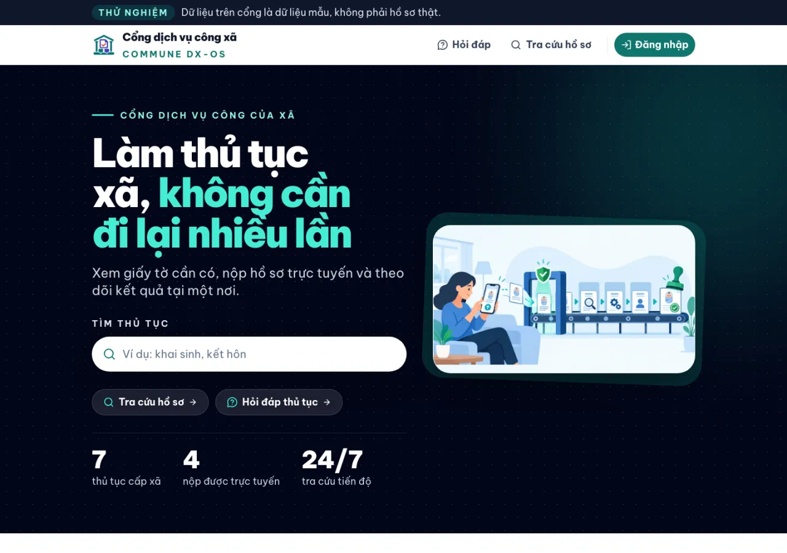
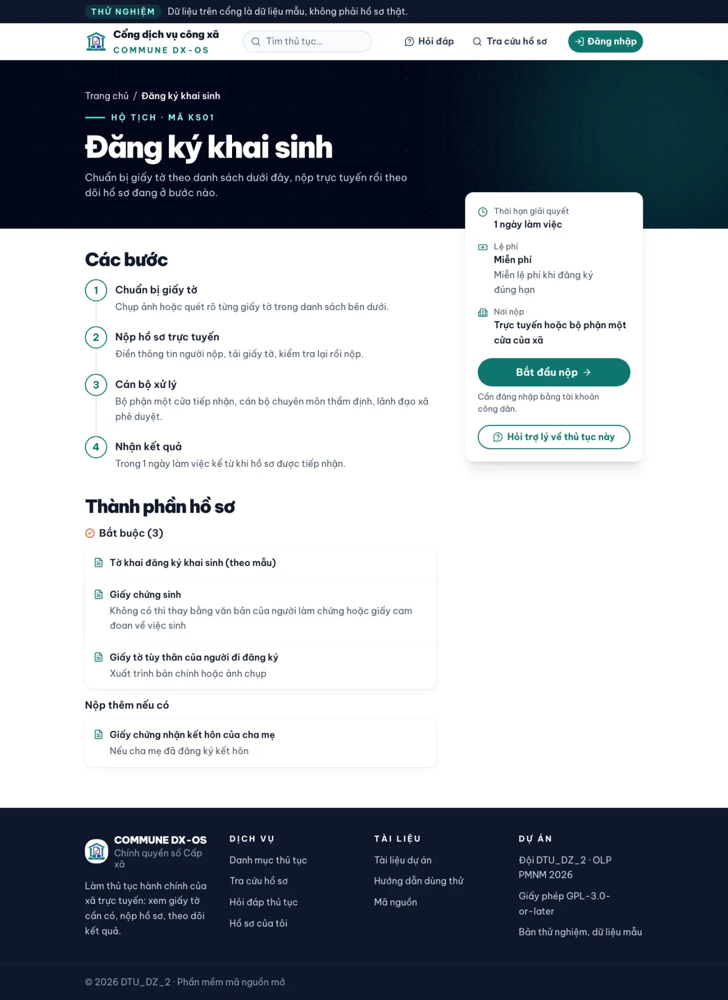
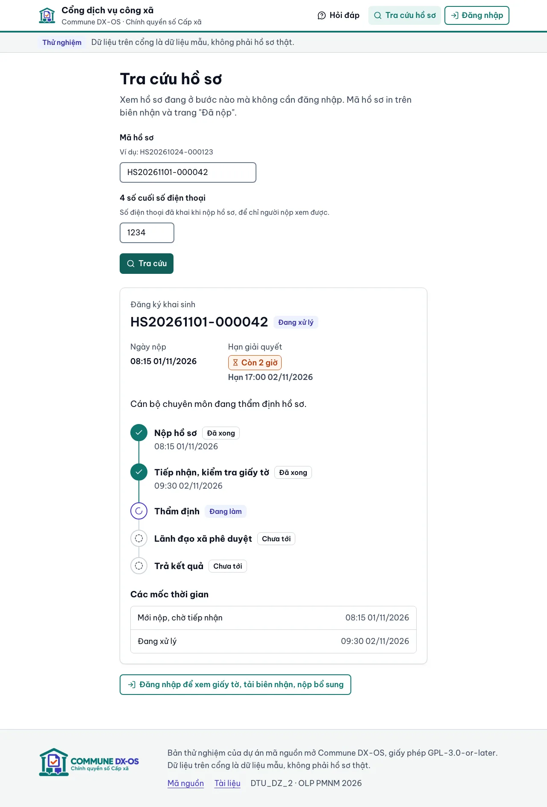
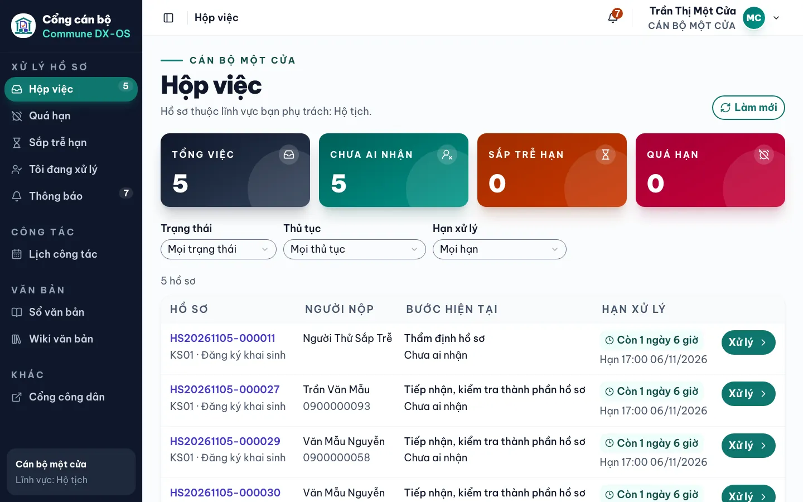
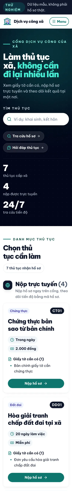
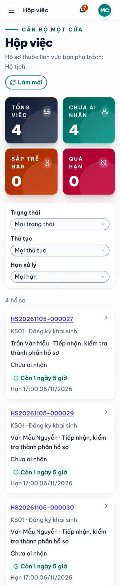
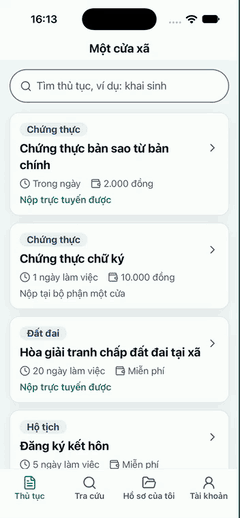
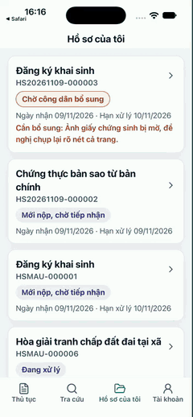

Tiếng Việt | [English](README.en.md)

<p align="center">
  <picture>
    <source media="(prefers-color-scheme: dark)" srcset="docs/images/logo/logo-ngang-nen-trang.png">
    
  </picture>
</p>

<h1 align="center">Commune DX-OS</h1>

<p align="center"><b>Hệ điều hành Chính quyền số Cấp xã.</b><br>Người dân nộp hồ sơ một lần, cán bộ xã biết hồ sơ đang ở đâu và còn bao lâu tới hạn.</p>

<p align="center">
  <a href="LICENSE"></a>
  <a href="https://github.com/commune-dxos/commune-dxos/actions/workflows/check.yml"></a>
  <a href="https://github.com/commune-dxos/commune-dxos/releases/latest"></a>
  <a href="https://reuse.software/spec-3.3/"></a>
  <a href="https://commune-dxos.github.io/commune-dxos/"></a>
</p>

<p align="center">
  <a href="https://commune.dzfullstack.com"><b>Demo</b></a> ·
  <a href="https://commune-dxos.github.io/commune-dxos/"><b>Tài liệu</b></a> ·
  <a href="https://github.com/commune-dxos/commune-dxos/releases/latest"><b>Tải APK Android</b></a> ·
  <a href="docs/thu-nghiem.md"><b>Hướng dẫn dùng thử</b></a>
</p>

<p align="center">
  
</p>

Phần mềm nguồn mở, chạy trên một máy ở xã. Đội DTU_DZ_2 · OLP PMNM 2026 · Đề tài DX-OS Open-Core. Bản mới nhất: **v0.12.2**.

## Mục lục

- [Ý tưởng bài toán](#ý-tưởng-bài-toán)
- [Giải pháp](#giải-pháp)
- [Giao diện ứng dụng](#giao-diện-ứng-dụng)
- [Kiến trúc hệ thống](#kiến-trúc-hệ-thống)
- [Tính năng chính theo đối tượng](#tính-năng-chính-theo-đối-tượng)
- [Thủ tục đang hỗ trợ](#thủ-tục-đang-hỗ-trợ)
- [Dữ liệu mở](#dữ-liệu-mở)
- [Cấu trúc dự án](#cấu-trúc-dự-án)
- [Công nghệ sử dụng](#công-nghệ-sử-dụng)
- [Cài đặt](#cài-đặt)
- [Demo](#demo)
- [Tài liệu](#tài-liệu)
- [Đóng góp](#đóng-góp)
- [Giấy phép](#giấy-phép)
- [Liên hệ](#liên-hệ)
- [Tác giả](#tác-giả)

## Ý tưởng bài toán

### Vấn đề cần giải quyết

Bộ phận một cửa của xã nhận hồ sơ khai sinh, chứng thực, kết hôn, hòa giải đất đai mỗi ngày, phần lớn vẫn trên giấy.

1. **Người dân đi lại nhiều lần.** Nộp hồ sơ xong, người dân quay lại xã vài lần chỉ để hỏi "xong chưa". Thiếu một tờ giấy, cán bộ trả về, thêm một chuyến nữa. Ví dụ: cha mẹ đi đăng ký khai sinh cho con nhưng quên giấy chứng sinh, phải về lấy rồi xếp hàng lại.
2. **Hồ sơ không biết đang ở đâu.** Hồ sơ giấy chuyển qua bàn tiếp nhận, bàn chuyên môn, bàn lãnh đạo. Khi người dân hỏi, cán bộ phải lục từng chồng.
3. **Trễ hạn mới biết.** Hạn giải quyết tính tay theo ngày làm việc. Không ai nhắc trước khi quá hạn. Lãnh đạo cộng sổ cuối tháng mới biết bao nhiêu hồ sơ trễ.
4. **Dữ liệu người dân để hở.** Sổ hồ sơ để chung, ai cũng mở được. Giấy tờ gửi qua tin nhắn, không ai kiểm mã độc.
5. **Thêm thủ tục phải chờ sửa phần mềm.** Mỗi khi có thủ tục mới hoặc quy định đổi, xã phải chờ nhà cung cấp sửa mã.

### Đối tượng người dùng

| Đối tượng | Nhu cầu |
|---|---|
| Người dân | Biết cần giấy tờ gì trước khi đi; nộp hồ sơ từ xa; xem hồ sơ đang ở bước nào; nhận kết quả có giá trị pháp lý |
| Cán bộ một cửa | Tiếp nhận đúng, đủ thành phần; không gõ lại giấy tờ; biết hồ sơ nào sắp trễ |
| Cán bộ chuyên môn | Chỉ thấy hồ sơ thuộc lĩnh vực mình; xử lý từng bước rõ ràng; tra văn bản nội bộ nhanh |
| Lãnh đạo xã | Phê duyệt, ký ban hành; xem số liệu trễ hạn mà không cộng sổ; duyệt lịch công tác |
| Văn thư | Vào sổ văn bản đến, soạn văn bản đi, soạn lịch công tác |
| Người phát triển gói thủ tục | Thêm thủ tục mới mà không sửa mã bộ máy |

## Giải pháp

### Tổng quan

Commune DX-OS đưa toàn bộ vòng đời một hồ sơ hành chính cấp xã lên phần mềm: người dân xem thủ tục và nộp hồ sơ trên web hoặc app Android; hệ thống kiểm đủ giấy tờ trước khi nhận, quét mã độc, cấp mã hồ sơ, tính hạn theo ngày làm việc và chạy quy trình BPMN của thủ tục; cán bộ xử lý từng bước trên cổng cán bộ, được nhắc trước khi trễ hạn; lãnh đạo phê duyệt, ký số kết quả và xem dashboard. Mọi thao tác ghi vào nhật ký kiểm toán không sửa được. Toàn bộ chạy bằng Docker Compose trên một máy.

### Mô hình hai tầng

| Tầng | Thư mục | Vai trò |
|---|---|---|
| **Tầng 1 – lõi headless** | [`nen-tang/`](nen-tang/) | Chỉ có API và cấu hình dịch vụ, không giao diện người dùng cuối, không nghiệp vụ: SSO, API Gateway, CSDL, lưu tệp, workflow, hàng đợi, bí mật, CA |
| **Tầng 2 – bộ máy một cửa** | [`mot-cua/`](mot-cua/) | Nghiệp vụ một cửa chạy mọi thủ tục: CSDL nghiệp vụ, API, cổng công dân, cổng cán bộ, app di động. Chỉ gọi Tầng 1 qua API Gateway |
| **Gói thủ tục** | [`thu-tuc/`](thu-tuc/) | Mỗi thủ tục một thư mục cắm–rút: mô tả, quy trình BPMN, JSON Schema thành phần hồ sơ, dữ liệu mẫu giả |

Không gian H-P-D-I trong Tầng 2:

| Không gian | Trong Commune DX-OS |
|---|---|
| **H** – con người | Cổng công dân, app Android, cổng cán bộ đăng nhập một lần + OTP; wiki văn bản nội bộ theo quyền |
| **P** – quy trình | Quy trình BPMN của từng thủ tục trên Flowable; Poka-yoke: chặn nộp khi thiếu giấy tờ, kiểm cả ở web, app và máy chủ |
| **D** – dữ liệu | PostgreSQL có Row-Level Security; nhật ký kiểm toán chuỗi băm SHA-256; kho dữ liệu Parquet + dbt cho dashboard |
| **I** – trí tuệ | Trợ lý hỏi đáp thủ tục trả lời có dẫn nguồn; đọc giấy tờ bằng OCR, cán bộ xác nhận lại (Human-in-the-loop) |

### Điểm nổi bật

| Điểm nổi bật | Mô tả |
|---|---|
| Thêm thủ tục không sửa mã | Thêm thư mục `thu-tuc/<ma>/`, chạy `make nap-thu-tuc`. Bốn thủ tục đang chạy đều thêm theo cách này |
| Chặn hồ sơ thiếu ngay khi nộp | Thành phần hồ sơ khai bằng JSON Schema trong gói; thiếu giấy tờ bắt buộc thì web và app không gửi gì, máy chủ kiểm lại lần nữa |
| Hạn tự tính, nhắc trước khi trễ | Hạn theo ngày làm việc (bỏ cuối tuần, ngày lễ); còn ≤ 1 ngày thì cán bộ nhận thông báo ngay trên cổng |
| Kết quả có ký số | Biên nhận, thông báo kết quả, văn bản đi là PDF ký số PAdES bằng CA nội bộ của xã; ai cũng xác minh được |
| Nhật ký không sửa được | Mọi thao tác trên hồ sơ ghi vào bảng chỉ ghi thêm có chuỗi băm SHA-256, chặn sửa, xóa kể cả superuser |
| Bảo mật theo vai | Đăng nhập Keycloak + OTP cho cán bộ; cán bộ chỉ thấy hồ sơ lĩnh vực mình (RLS); tệp quét ClamAV trước khi lưu; bí mật trong OpenBao |
| Web và app dùng chung API | App Android **Một cửa xã** và cổng web gọi cùng route qua APISIX, đăng nhập PKCE, không có bí mật trong app |
| Dữ liệu mở | Danh mục thủ tục công bố dạng JSON, CSV theo CC-BY-4.0, sinh tự động từ các gói |

## Giao diện ứng dụng

Ảnh chụp trên máy với dữ liệu mẫu giả.

| Cổng công dân – trang chủ | Cổng công dân – chi tiết thủ tục |
|---|---|
|  |  |
| **Tra cứu hồ sơ (không cần đăng nhập)** | **Cổng cán bộ – hộp việc** |
|  |  |

| Nộp hồ sơ trên điện thoại | Cổng cán bộ trên điện thoại | App Android – nộp hồ sơ | App Android – bổ sung hồ sơ |
|---|---|---|---|
|  |  |  |  |

Hai đoạn quay app thực hiện trên iOS Simulator bằng bản dựng thử, với stack chạy trên máy và dữ liệu mẫu giả; giao diện app giống nhau trên Android. Quay đầy đủ luồng web ở mục [Demo](#demo).

## Kiến trúc hệ thống

<p align="center">
  
</p>

<sub>Ảnh tĩnh cho slide: [docs/images/kien-truc-2-tang.webp](docs/images/kien-truc-2-tang.webp)</sub>

| Dịch vụ bắt buộc của đề | Thành phần | Cấu hình |
|---|---|---|
| SSO | Keycloak, OTP bắt buộc cho cán bộ và lãnh đạo | [`nen-tang/keycloak/`](nen-tang/keycloak/), [`mot-cua/keycloak/`](mot-cua/keycloak/) |
| API Gateway | Apache APISIX, giới hạn tần suất cho API công khai | [`nen-tang/apisix/`](nen-tang/apisix/) |
| Dữ liệu có cấu trúc và phi cấu trúc | PostgreSQL + RLS + PostgREST; Garage (S3) + ClamAV | [`nen-tang/postgres/`](nen-tang/postgres/), [`nen-tang/garage/`](nen-tang/garage/), [`mot-cua/db/`](mot-cua/db/) |
| Workflow engine | Flowable (BPMN 2.0), quy trình nằm trong từng gói | [`thu-tuc/<ma>/quy-trinh.bpmn20.xml`](thu-tuc/khai-sinh/quy-trinh.bpmn20.xml) |

### Luồng xử lý một hồ sơ

<p align="center">
  
</p>

1. Người dân nộp hồ sơ qua APISIX; gateway kiểm JWT của Keycloak.
2. `mot-cua-api` kiểm đủ thành phần hồ sơ theo JSON Schema của gói; thiếu thì từ chối.
3. Giấy tờ tải lên được ClamAV quét, sạch mới lưu vào Garage.
4. Hệ thống cấp mã hồ sơ, tính hạn theo ngày làm việc, khởi tạo quy trình Flowable của thủ tục.
5. Cán bộ lĩnh vực tiếp nhận, yêu cầu bổ sung nếu thiếu, rồi thẩm định; lãnh đạo phê duyệt hoặc trả lại.
6. Mỗi bước phát sự kiện lên RabbitMQ; hồ sơ sắp tới hạn sinh cảnh báo `ho_so.sap_tre_han` tới cán bộ.

Mọi thành phần chạy bằng image gốc. Sơ đồ chi tiết, route gateway, luồng JWT: [`docs/architecture.md`](docs/architecture.md).

## Tính năng chính theo đối tượng

Chỉ ghi những gì đã có trong bản **v0.12.2**.

**Người dân** (cổng web và app Android, tài khoản mẫu `congdan01`)
- Xem danh mục thủ tục, thành phần hồ sơ, thời hạn, lệ phí mà không cần đăng nhập.
- Nộp hồ sơ trực tuyến kèm giấy tờ hoặc ảnh chụp; thiếu giấy tờ bắt buộc thì bị chặn ngay trước khi gửi.
- Tra cứu tiến độ bằng mã hồ sơ và 4 số cuối số điện thoại (không đăng nhập), hoặc xem "Hồ sơ của tôi".
- Nộp bổ sung khi bộ phận một cửa yêu cầu; tải biên nhận và thông báo kết quả PDF có ký số.
- Hỏi đáp thủ tục ở `/hoi-dap`: trả về đoạn tài liệu liên quan; câu trả lời có dẫn nguồn khi bật mô hình ngôn ngữ (`make up-ai`).

**Cán bộ một cửa, cán bộ chuyên môn** (cổng `/can-bo`, tài khoản mẫu `canbo01`, `canbo02`)
- Đăng nhập một lần qua Keycloak, bắt buộc mã OTP.
- Hộp việc chỉ có hồ sơ thuộc lĩnh vực mình (RLS); hồ sơ quá hạn, sắp trễ lên đầu, lọc theo trạng thái, thủ tục, hạn.
- Xử lý từng bước của quy trình BPMN: tiếp nhận, yêu cầu bổ sung, thẩm định, trình lãnh đạo; form của mỗi bước sinh từ gói thủ tục.
- Nhận thông báo sắp trễ hạn ngay trên cổng (chuông cập nhật tức thì; email/SMS chỉ giả lập).
- Đọc giấy tờ bằng OCR để điền sẵn, cán bộ xác nhận lại (cần `make up-ocr` hoặc `make up-ai`).
- Tra wiki văn bản nội bộ theo quyền, xem sổ văn bản đến/đi và lịch công tác đã duyệt.

**Lãnh đạo xã** (tài khoản mẫu `lanhdao01`)
- Thấy mọi hồ sơ; phê duyệt hoặc trả lại ở bước cuối của quy trình.
- Ký ban hành văn bản đi: hệ thống cấp số, sinh PDF và ký số; ai cũng xác minh được PDF xã đã phát hành.
- Duyệt lịch công tác; hệ thống từ chối hai lịch trùng địa điểm và chồng giờ.
- Xem dashboard Superset ở `/bao-cao/` (cần `make up-bi`): thời gian giải quyết, tỷ lệ trễ hạn theo tháng và thủ tục, số hồ sơ theo lĩnh vực. Hướng dẫn: [`docs/bao-cao.md`](docs/bao-cao.md).
- Mọi thao tác trên hồ sơ nằm trong nhật ký kiểm toán chỉ ghi thêm, có chuỗi băm SHA-256.

**Văn thư** (`vanthu01`)
- Vào sổ văn bản đến, soạn dự thảo văn bản đi, soạn lịch công tác chờ lãnh đạo duyệt.

**Người phát triển gói thủ tục**
- Thêm thủ tục bằng một thư mục `thu-tuc/<ma>/` gồm `thu-tuc.yaml`, quy trình BPMN viết tay, JSON Schema thành phần hồ sơ, dữ liệu mẫu giả; không sửa mã bộ máy.
- `make nap-thu-tuc` kiểm và nạp gói; `make check` kiểm BPMN, schema, header giấy phép.
- Đọc danh mục qua API công khai `/public/thu_tuc` hoặc bộ dữ liệu mở trong `du-lieu-mo/`.

## Thủ tục đang hỗ trợ

| Mã | Thủ tục | Lĩnh vực | Thời hạn | Lệ phí | Gói |
|---|---|---|---|---|---|
| KS01 | Đăng ký khai sinh | Hộ tịch | 1 ngày làm việc | Miễn khi đăng ký đúng hạn | [`thu-tuc/khai-sinh/`](thu-tuc/khai-sinh/) |
| CT01 | Chứng thực bản sao từ bản chính | Chứng thực | Trong ngày | 2.000 đ/trang; từ trang thứ ba 1.000 đ/trang, tối đa 200.000 đ/bản | [`thu-tuc/chung-thuc-ban-sao/`](thu-tuc/chung-thuc-ban-sao/) |
| KH01 | Đăng ký kết hôn | Hộ tịch | 5 ngày làm việc (khi cần xác minh) | Miễn | [`thu-tuc/ket-hon/`](thu-tuc/ket-hon/) |
| DD01 | Hòa giải tranh chấp đất đai tại xã | Đất đai | 20 ngày làm việc | Không thu phí | [`thu-tuc/hoa-giai-dat-dai/`](thu-tuc/hoa-giai-dat-dai/) |

Bảng trên chép từ `thu-tuc/*/thu-tuc.yaml`. Danh mục đầy đủ (thành phần hồ sơ, các bước, căn cứ pháp lý) tự sinh trên [trang tài liệu](https://commune-dxos.github.io/commune-dxos/danh-muc-thu-tuc/).

**Thêm thủ tục trong 5 bước:** chép gói có sẵn → sửa `thu-tuc.yaml` → vẽ quy trình → khai thành phần hồ sơ → `make nap-thu-tuc`. Hướng dẫn và ví dụ đầy đủ từ A đến Z: [`docs/thu-tuc.md`](docs/thu-tuc.md#ví-dụ-từ-a-đến-z-gói-xác-nhận-thông-tin-về-cư-trú).

## Dữ liệu mở

Danh mục thủ tục kèm JSON Schema thành phần hồ sơ được công bố ở [`du-lieu-mo/thu-tuc-cap-xa/`](du-lieu-mo/thu-tuc-cap-xa/) dạng JSON và CSV, theo giấy phép **CC-BY-4.0**: xã khác, nhà phát triển dùng lại tự do, kể cả thương mại, miễn ghi công.

- Sinh tự động từ các gói `thu-tuc/*/` bằng `make du-lieu-mo`; `make check` báo lỗi nếu dữ liệu mở lệch với gói.
- Cùng nội dung có qua API công khai, không cần đăng nhập: `GET /public/thu_tuc` (bản demo: <https://commune.dzfullstack.com/public/thu_tuc>).

## Cấu trúc dự án

```text
commune-dxos/
├── nen-tang/            Tầng 1: lõi headless, chỉ có API và cấu hình dịch vụ, không nghiệp vụ
│   ├── apisix/          route gateway, JWT, giới hạn tần suất
│   ├── keycloak/        realm dxos dùng chung
│   ├── postgres/        image PostgreSQL + pgAudit + pgvector, script khởi tạo
│   ├── openbao/         chính sách, agent, khởi tạo và mở khóa bí mật
│   ├── garage/ rabbitmq/ step-ca/   cấu hình lưu tệp, hàng đợi, CA nội bộ
│   ├── superset/        image và cấu hình dashboard (profile bi)
│   ├── ocr/             dịch vụ đọc giấy tờ ONNX Runtime (profile ai)
│   └── scripts/         dịch vụ một lần: tạo role CSDL, bucket, hàng đợi, chỉ mục tìm kiếm
├── mot-cua/             Tầng 2: bộ máy một cửa chạy mọi thủ tục
│   ├── db/              migration, seed, test SQL (RLS, kiểm toán)
│   ├── backend/         mot-cua-api, worker, ký số, trợ lý RAG, bộ nạp gói (Python)
│   ├── web-cong-dan/    cổng công dân và cổng cán bộ /can-bo (React)
│   ├── di-dong/         app Một cửa xã (React Native): android/, ios/
│   ├── keycloak/ rabbitmq/ s3/   vai trò, hàng đợi, bucket của Tầng 2
│   ├── mau-giay-to/     mẫu HTML biên nhận, thông báo kết quả, văn bản đi
│   ├── kho-du-lieu/ bao-cao/   Parquet + dbt, dựng dashboard Superset
│   ├── tro-ly/ doc-giay-to/    kho tri thức cho trợ lý, loại giấy tờ cho OCR
│   └── tests/           smoke đầu-cuối theo tính năng
├── thu-tuc/             gói thủ tục cắm–rút: khai-sinh, chung-thuc-ban-sao, ket-hon, hoa-giai-dat-dai
├── du-lieu-mo/          danh mục thủ tục dạng dữ liệu mở CC-BY-4.0 (sinh bằng make du-lieu-mo)
├── docs/                tài liệu (MkDocs), docs/en/ bản tiếng Anh, ảnh và GIF demo
├── scripts/             smoke, kiểm SPDX, lint, test SQL, quay demo, sinh CHANGELOG
├── LICENSES/ REUSE.toml NOTICE DEPENDENCIES.md   giấy phép từng tệp và khai báo phụ thuộc
├── docker-compose.yml   toàn bộ dịch vụ, chia profile core / bi / ai
└── Makefile             lệnh chạy, kiểm thử, phát hành
```

## Công nghệ sử dụng

Mọi thành phần đều có giấy phép OSI, phiên bản ghim cứng. Danh sách đầy đủ từng image, gói npm, gói pip, pod iOS, mô hình AI: [`DEPENDENCIES.md`](DEPENDENCIES.md); ghi công bên thứ ba: [`NOTICE`](NOTICE). Cột "Profile" là nhóm dịch vụ trong `docker-compose.yml`: `core` chạy bằng `make up`, `bi` bằng `make up-bi`, `ai` bằng `make up-ai` (riêng OCR: `make up-ocr`).

| Lớp | Thành phần | Vai trò trong Commune DX-OS | Giấy phép | Profile |
|---|---|---|---|---|
| Định danh | Keycloak 26.3 | Đăng nhập một lần (OIDC), OTP bắt buộc cho cán bộ, lãnh đạo, văn thư | Apache-2.0 | core |
| Cổng API | Apache APISIX 3.13 | Cửa vào duy nhất, kiểm JWT, giới hạn tần suất, phục vụ hai cổng web | Apache-2.0 | core |
| Dữ liệu | PostgreSQL 17.6 + pgAudit 17.1 + pgvector 0.8.7 | CSDL hồ sơ có Row-Level Security, nhật ký DDL, vector cho tìm theo nghĩa | PostgreSQL | core |
| Dữ liệu | PostgREST 13 | REST API tự sinh từ schema của bộ máy một cửa | MIT | core |
| Dữ liệu | Garage 2.4 | Lưu tệp kiểu S3 (dịch vụ riêng, không sửa mã) | AGPL-3.0 | core |
| Dữ liệu | Meilisearch 1.54 Community Edition | Tìm kiếm thủ tục, wiki văn bản, kho tri thức của trợ lý | MIT | core |
| Quy trình | Flowable REST 8 | Chạy quy trình BPMN 2.0 của từng gói thủ tục | Apache-2.0 | core |
| Quy trình | RabbitMQ 4.3 | Hàng đợi sự kiện hồ sơ, cảnh báo sắp trễ hạn | MPL-2.0 | core |
| Bảo mật | OpenBao 2.7 | Giữ và cấp bí mật cho từng dịch vụ (AppRole) | MPL-2.0 | core |
| Bảo mật | ClamAV 1.5 | Quét mã độc tệp tải lên (dịch vụ riêng, không sửa mã) | GPL-2.0 | core |
| Ký số, PDF | step-ca 0.30 + pyHanko 0.38 | CA nội bộ của xã, ký số PAdES và xác minh PDF | Apache-2.0; MIT | core |
| Ký số, PDF | Gotenberg 8.37 | Dựng PDF biên nhận, thông báo kết quả, văn bản đi từ mẫu HTML | MIT | core |
| Dịch vụ | Python 3.13 | `mot-cua-api`, `mot-cua-worker`, trợ lý, bộ nạp gói thủ tục | PSF-2.0 | core |
| Giao diện web | React 19 + Vite 7 + Tailwind CSS 4 + shadcn/ui (Radix UI) | Cổng công dân và cổng cán bộ, đăng nhập bằng `oidc-client-ts` (PKCE) | MIT; `oidc-client-ts` Apache-2.0 | core |
| Giao diện web | nginx (`nginx-unprivileged`) | Phục vụ tệp tĩnh của bản build web | BSD-2-Clause | core |
| Di động | React Native 0.80 | App **Một cửa xã** (Android, iOS), đăng nhập bằng `react-native-app-auth` (PKCE) | MIT | build riêng |
| Báo cáo | Apache Superset 6.1 | Dashboard hiệu suất một cửa ở `/bao-cao/`, đăng nhập qua Keycloak | Apache-2.0 | bi |
| Báo cáo | Parquet + DuckDB 1.5 + dbt-core 1.11 | Kho dữ liệu lịch sử, dựng mart cho dashboard | MIT; Apache-2.0 | bi |
| Trí tuệ | PaddleOCR PP-OCRv5 + VietOCR trên ONNX Runtime 1.31 | Đọc chữ trên giấy tờ để điền sẵn hồ sơ | Apache-2.0; MIT | ai |
| Trí tuệ | Ollama 0.40 + Qwen2.5 7B + bge-m3 | Trợ lý hỏi đáp thủ tục: RAG tự viết, chọn nhà cung cấp bằng `LLM_PROVIDER` | MIT; Apache-2.0; MIT | ai |
| Công cụ | MkDocs + Material, git-cliff, reuse | Trang tài liệu, CHANGELOG, kiểm REUSE 3.3 (không đi vào sản phẩm) | BSD-2-Clause, MIT; MIT/Apache-2.0; GPL-3.0-or-later | — |

## Cài đặt

### Yêu cầu

| Thành phần | Tối thiểu | Khuyến nghị |
|---|---|---|
| Docker | Docker Engine 24+ hoặc Docker Desktop 4.25+, Compose v2.20+ | bản mới nhất |
| RAM cho Docker | 4 GB (profile `core`) | 6 GB; thêm khoảng 6,5 GB nếu chạy `make up-ai` |
| Ổ trống | 6 GB | thêm khoảng 13 GB nếu chạy `make up-ai` (image Ollama + mô hình) |
| CPU | amd64 hoặc arm64 | — |
| Công cụ | `git`, `make`, `bash`, `curl`, `jq`, `python3` 3.10+ | — |
| Mạng | tải khoảng 1,1 GB image lần đầu | — |

**Hệ điều hành:** đội đã chạy thật trên **macOS (Apple Silicon)**, máy phát triển, và **Ubuntu 24.04**, máy chủ bản demo công khai. Mọi image có bản amd64 và arm64. Đội chưa thử trên Windows. Chi tiết, số đo, cổng dịch vụ: [`docs/cai-dat.md`](docs/cai-dat.md).

### Chạy hệ thống

```bash
git clone https://github.com/commune-dxos/commune-dxos.git
cd commune-dxos
cp .env.example .env      # không có mật khẩu nào cần điền
make up                   # chạy lõi + bộ máy một cửa + nạp gói thu-tuc/ + cổng công dân
make smoke                # kiểm tra đầu-cuối, kết thúc bằng "0 trượt"
make demo-users           # đặt mật khẩu cho tài khoản mẫu và in ra
```

Lần đầu `make up` mất 2–10 phút tùy mạng, `make smoke` khoảng 1,5 phút. Không xóa, không commit `.data/openbao/commune.json`: tệp này giữ khóa của mọi bí mật.

### Kiểm tra

| Địa chỉ | Nội dung |
|---|---|
| http://localhost:9080/ | Cổng công dân: danh mục, chi tiết thủ tục không cần đăng nhập; nộp hồ sơ sau khi đăng nhập |
| http://localhost:9080/tra-cuu | Tra cứu tiến độ bằng mã hồ sơ + 4 số cuối số điện thoại |
| http://localhost:9080/can-bo | Cổng cán bộ: mật khẩu + mã OTP (lần đầu quét mã QR bằng ứng dụng OTP). Luồng: [`docs/cong-can-bo.md`](docs/cong-can-bo.md) |
| http://localhost:9080/public/thu_tuc | API công khai danh mục thủ tục |
| http://localhost:9080/bao-cao/ | Dashboard Superset (sau `make up-bi` và `make kho-du-lieu`) |

Tài khoản mẫu (dữ liệu giả): `congdan01` (người dân), `canbo01` (cán bộ hộ tịch), `canbo02` (cán bộ chứng thực), `lanhdao01` (lãnh đạo), `vanthu01` (văn thư). Mật khẩu do `make demo-users` đặt và in ra.

Profile tùy chọn: `make up-bi` (dashboard), `make up-ocr` (đọc giấy tờ), `make up-ai` (OCR + trợ lý dùng mô hình ngôn ngữ trên máy).

### App di động

- **Tải APK:** mỗi [Release](https://github.com/commune-dxos/commune-dxos/releases) từ v0.11.0 có tệp `mot-cua-xa-X.Y.Z-debug.apk`, kiểm bằng `SHA256SUMS` cùng Release. Cài lên Android 7.0 trở lên; app trỏ sẵn bản demo. Hướng dẫn cho người dân: [`docs/cai-app.md`](docs/cai-app.md).
- **Tự build Android:** Node ≥ 22, JDK 17, Android SDK; `cd mot-cua/di-dong && corepack enable && yarn install --frozen-lockfile && yarn apk:debug`.
- **iOS:** dự án Xcode `mot-cua/di-dong/ios/` có trên nhánh `develop`, build bằng Xcode và CocoaPods trên máy Mac; chưa phát hành bản iOS.
- Trỏ máy local, build iOS: [`mot-cua/di-dong/README.md`](mot-cua/di-dong/README.md).

### Dừng và xóa dữ liệu

```bash
make down                                  # dừng mọi dịch vụ, giữ dữ liệu
docker compose --profile '*' down -v       # dừng và xóa volume dữ liệu
rm .data/openbao/commune.json              # chỉ khi muốn khởi tạo lại bí mật từ đầu
```

## Demo

**Bản demo công khai:** <https://commune.dzfullstack.com>. Chạy profile `core` và `bi`: cổng công dân, cổng cán bộ, tra cứu, dashboard `/bao-cao/`; hỏi đáp chỉ tìm kiếm, chưa bật trợ lý dùng mô hình ngôn ngữ. Mọi dữ liệu là dữ liệu giả.

Tài khoản thử do đội cấp trong buổi dùng thử, không đăng công khai. Sáu nhiệm vụ theo vai và cách gửi phản hồi bằng mẫu issue **Phản hồi dùng thử**: [`docs/thu-nghiem.md`](docs/thu-nghiem.md).

Quay thật trên máy với tài khoản và giấy tờ mẫu giả (`make quay-demo`), mọi lời gọi đi qua APISIX.

**Người dân** xem danh mục, nộp hồ sơ đăng ký khai sinh: thiếu giấy chứng sinh thì cổng chặn ngay, chưa gửi gì lên máy chủ; đủ giấy tờ thì nộp được, nhận mã hồ sơ, rồi tra cứu tiến độ không cần đăng nhập.

<p align="center">
  
</p>

**Cán bộ hộ tịch** đăng nhập bằng mật khẩu và mã OTP, mở hồ sơ vừa nộp từ hộp việc, xác nhận đủ thành phần và hoàn thành bước tiếp nhận; hồ sơ chuyển sang bước thẩm định.

<p align="center">
  
</p>

## Tài liệu

Trang tài liệu dựng bằng MkDocs từ thư mục [`docs/`](docs/), xem trực tuyến tại **https://commune-dxos.github.io/commune-dxos/**.

| Tài liệu | Dành cho | Nguồn | Trực tuyến |
|---|---|---|---|
| Cài đặt và chạy, cổng, tài khoản, xử lý lỗi | người vận hành | [`docs/cai-dat.md`](docs/cai-dat.md) | [mở](https://commune-dxos.github.io/commune-dxos/cai-dat/) |
| Kiến trúc tổng thể, route gateway, luồng JWT, các API | giám khảo, người phát triển | [`docs/architecture.md`](docs/architecture.md) | [mở](https://commune-dxos.github.io/commune-dxos/architecture/) |
| Thêm một thủ tục mới, ví dụ từ A đến Z | người phát triển gói | [`docs/thu-tuc.md`](docs/thu-tuc.md) | [mở](https://commune-dxos.github.io/commune-dxos/thu-tuc/) |
| Danh mục thủ tục (tự sinh từ gói) | người dân, cán bộ | `thu-tuc/*/thu-tuc.yaml` | [mở](https://commune-dxos.github.io/commune-dxos/danh-muc-thu-tuc/) |
| Cổng cán bộ: luồng xử lý hồ sơ, sổ văn bản, wiki, lịch | cán bộ | [`docs/cong-can-bo.md`](docs/cong-can-bo.md) | [mở](https://commune-dxos.github.io/commune-dxos/cong-can-bo/) |
| Dashboard báo cáo Superset | lãnh đạo xã | [`docs/bao-cao.md`](docs/bao-cao.md) | [mở](https://commune-dxos.github.io/commune-dxos/bao-cao/) |
| Cài app Android Một cửa xã | người dân | [`docs/cai-app.md`](docs/cai-app.md) | [mở](https://commune-dxos.github.io/commune-dxos/cai-app/) |
| Tra cứu hồ sơ đã nộp | người dân | [`docs/tra-cuu-ho-so.md`](docs/tra-cuu-ho-so.md) | [mở](https://commune-dxos.github.io/commune-dxos/tra-cuu-ho-so/) |
| Hướng dẫn buổi dùng thử, 6 nhiệm vụ theo vai | người dùng thử | [`docs/thu-nghiem.md`](docs/thu-nghiem.md) | [mở](https://commune-dxos.github.io/commune-dxos/thu-nghiem/) |
| Đối chiếu yêu cầu đề thi | giám khảo | [`docs/de-thi-mapping.md`](docs/de-thi-mapping.md) | [mở](https://commune-dxos.github.io/commune-dxos/de-thi-mapping/) |
| Kịch bản trình bày 15 phút | giám khảo | [`docs/trinh-bay/kich-ban-demo.md`](docs/trinh-bay/kich-ban-demo.md) | [mở](https://commune-dxos.github.io/commune-dxos/trinh-bay/kich-ban-demo/) |
| Bộ máy một cửa, lõi headless, app di động | người phát triển | [`mot-cua/README.md`](mot-cua/README.md), [`nen-tang/README.md`](nen-tang/README.md), [`mot-cua/di-dong/README.md`](mot-cua/di-dong/README.md) | |
| Thay đổi qua từng bản | mọi người | [`CHANGELOG.md`](CHANGELOG.md) (sinh bằng git-cliff), [Releases](https://github.com/commune-dxos/commune-dxos/releases) | |
| Cách đóng góp, quy tắc ứng xử | người đóng góp | [`CONTRIBUTING.md`](CONTRIBUTING.md), [`CODE_OF_CONDUCT.md`](CODE_OF_CONDUCT.md) | |
| Tài liệu tiếng Anh | English readers | [`docs/en/`](docs/en/index.md) | [mở](https://commune-dxos.github.io/commune-dxos/en/) |

## Đóng góp

Mỗi việc đi theo một vòng: **issue → nhánh → PR → review chéo → merge**.

1. Mở [issue](https://github.com/commune-dxos/commune-dxos/issues/new/choose) theo mẫu ("Việc trong tuần", "Thủ tục mới", "Phản hồi dùng thử"), gắn milestone.
2. Tạo nhánh `feature/<số-issue>-<tên>` từ `develop`.
3. Commit theo Conventional Commits có số issue; chạy `make check` trước mỗi commit. CI chạy cùng lệnh với `make lint` (gồm `reuse lint`) và `make test`.
4. Mở PR về `develop`. **Ít nhất một thành viên khác duyệt, người viết không tự duyệt**, CI xanh thì merge squash.

Theo dõi việc: [GitHub Project "Commune DX-OS – Lộ trình"](https://github.com/orgs/commune-dxos/projects/1), [Milestones](https://github.com/commune-dxos/commune-dxos/milestones). Quy trình, nhãn, quy ước commit: [`CONTRIBUTING.md`](CONTRIBUTING.md), [`docs/quy-trinh-lam-viec.md`](docs/quy-trinh-lam-viec.md). Nguồn hình ảnh: [`docs/images/README.md`](docs/images/README.md).

## Giấy phép

Commune DX-OS phát hành theo **[GNU General Public License phiên bản 3 hoặc mới hơn](LICENSE)** (`GPL-3.0-or-later`).

> This program is free software: you can redistribute it and/or modify it under the terms of the GNU General Public License as published by the Free Software Foundation, either version 3 of the License, or (at your option) any later version.

Nghĩa là ai cũng được dùng, sửa, phân phối lại; bản phân phối lại phải giữ giấy phép GPL và kèm mã nguồn.

- **Vì sao GPL-3.0:** phần mềm cho chính quyền số là tài sản công. Copyleft bảo đảm mọi bản sửa đổi được phân phối lại, kể cả của nhà cung cấp, vẫn phải giữ mã nguồn mở cho xã và người dân. Chọn bản 3 vì tương thích với các thành phần Apache-2.0 (Keycloak, APISIX, Flowable), bản 2 thì không.
- **Giấy phép từng tệp:** mỗi tệp mã có header SPDX hai dòng (`SPDX-FileCopyrightText`, `SPDX-License-Identifier`); tệp không chú thích được (ảnh, JSON) khai trong [`REUSE.toml`](REUSE.toml). Toàn repo đạt đặc tả [REUSE 3.3](https://reuse.software), CI kiểm bằng `reuse lint`.
- **Mốc chuyển:** v0.0.1, v0.1.0, v0.2.0 đã phát hành theo Apache-2.0 và giữ nguyên giấy phép đó; từ bản phát hành sau v0.2.0 là GPL-3.0-or-later ([#47](https://github.com/commune-dxos/commune-dxos/issues/47)).
- **Dữ liệu mở:** riêng [`du-lieu-mo/`](du-lieu-mo/) theo [CC-BY-4.0](LICENSES/CC-BY-4.0.txt).
- **Bên thứ ba:** các thành phần giữ giấy phép riêng, chỉ dùng qua image gốc hoặc trình quản lý gói; Garage (AGPL-3.0) và ClamAV (GPL-2.0) chạy như dịch vụ riêng, không liên kết, không sửa mã. Xem [`NOTICE`](NOTICE) và [`DEPENDENCIES.md`](DEPENDENCIES.md).

## Liên hệ

| Kênh | Dùng cho |
|---|---|
| [Issues](https://github.com/commune-dxos/commune-dxos/issues) | Báo lỗi, đề xuất thủ tục mới, phản hồi dùng thử |
| [Discussions](https://github.com/commune-dxos/commune-dxos/discussions) | Hỏi đáp, trao đổi chung |
| [Kho mã](https://github.com/commune-dxos/commune-dxos) | Mã nguồn, Release, tài liệu |
| [Bản demo](https://commune.dzfullstack.com) | Dùng thử trực tuyến |

## Tác giả

Đội **DTU_DZ_2** – OLP PMNM 2026.

| Thành viên (GitHub) | Vai trình bày | Phụ trách |
|---|---|---|
| [`datnguyen262021`](https://github.com/datnguyen262021) | Trưởng nhóm, V1 | Lõi headless Tầng 1 và bảo mật |
| [`vuthingockhanh2006dn-arch`](https://github.com/vuthingockhanh2006dn-arch) | V2 | Bộ máy một cửa, quy trình BPMN, dashboard |
| [`ky213456`](https://github.com/ky213456) | V3 | Cổng công dân, tra cứu, OCR và trợ lý RAG |
