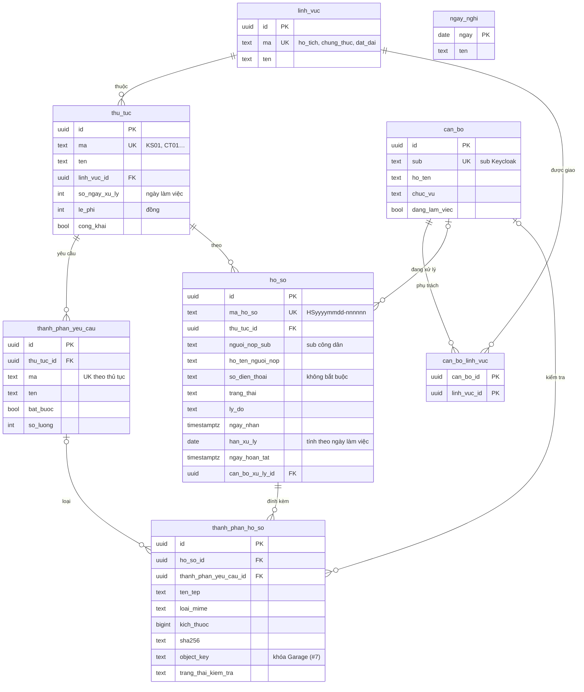
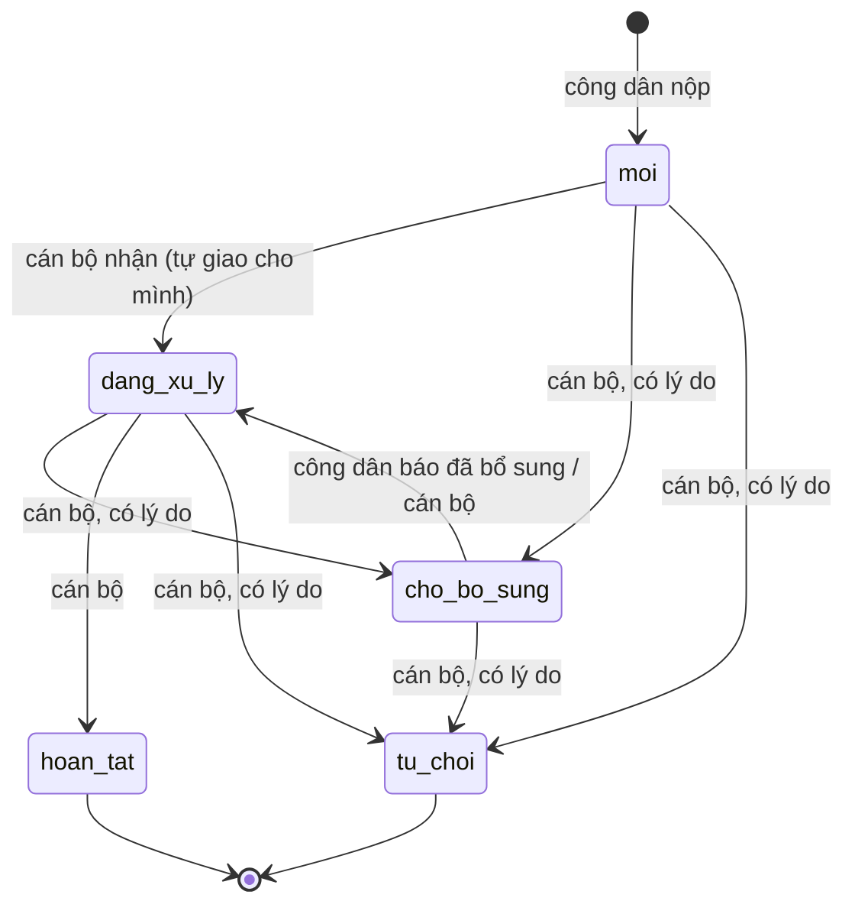

# apps/mot-cua – Ứng dụng Một cửa cấp xã (Tầng 2)

Ứng dụng chính của Commune DX-OS: tiếp nhận và xử lý thủ tục hành chính. Cắm vào lõi `core/` bằng `DXOS_APP=mot-cua` trong `.env`; không sửa tệp nào của lõi.

| Tệp | Lõi dùng để |
|---|---|
| `app.env` | cấu hình PostgREST: phơi schema `mot_cua` |
| `db/migrations/001_schema_mot_cua.sql` | role `cong_dan`/`can_bo`/`lanh_dao` + `GRANT … TO authenticator`, schema `mot_cua` (bảng giữ chỗ tuần 1, bị 002 thay) |
| `db/migrations/002_schema_day_du.sql` | schema đầy đủ (#5): bảng, trigger, quyền theo cột, RLS mọi bảng |
| `db/seed/002_du_lieu_mau.sql` | **dữ liệu giả**: 3 lĩnh vực, 6 thủ tục kèm thành phần hồ sơ, 3 cán bộ, 6 hồ sơ ở đủ trạng thái, ngày nghỉ 2026; chỉ nạp khi `DXOS_SEED=true` |
| `db/tests/rls.sql` | test quyền/RLS (63 kiểm tra), chạy trong một transaction rồi ROLLBACK |
| `keycloak/realm.json` | client role của `dxos_api`, nhóm `/cong-dan`, `/can-bo`, `/lanh-dao`, client `mot_cua_web` (PKCE), 6 người dùng mẫu có `id` (= `sub`) cố định; cán bộ và lãnh đạo bắt buộc cài OTP |
| `processes/dang_ky_khai_sinh.bpmn20.xml` | quy trình đăng ký khai sinh (#8), Flowable tự triển khai khi khởi động; sơ đồ và biến: [`processes/README.md`](processes/README.md) |
| `backend/main.py` | API quy trình `/workflow/*` (#6): dịch vụ `app-backend`, chỉ thư viện chuẩn Python; xem [API cho Tầng 2](#api-cho-tầng-2) |
| `tests/smoke.sh` | `make smoke`: route công khai, `rls.sql`, MFA, gọi API qua APISIX bằng token thật của từng vai trò (cán bộ, lãnh đạo dùng mật khẩu + TOTP), luồng khai sinh đầy đủ qua `/workflow`. Cần thêm `python3` trên máy để sinh mã TOTP |

Sửa schema: thêm tệp `db/migrations/003_<mo-ta>.sql`, **không sửa** tệp đã áp dụng (`app-migrate` sẽ dừng vì SHA-256 khác). Áp dụng: `make migrate`.

## Sơ đồ dữ liệu

Khóa chính UUID (trừ `ngay_nghi` khóa theo ngày và bảng nối `can_bo_linh_vuc`); bảng nào cũng có `created_at`, `updated_at` (CSDL tự ghi).



- **Thành phần hồ sơ bắt buộc** nằm trong bảng `thanh_phan_yeu_cau` (không phải JSON trong cột) để kiểm "đủ thành phần" bằng một truy vấn. Hàm `mot_cua.json_schema_thu_tuc(ma)` sinh JSON Schema 2020-12 từ bảng này cho Poka-yoke (tuần 3): `GET /public/rpc/json_schema_thu_tuc?ma=KS01`. Dữ liệu được kiểm có dạng `{"thanh_phan": {"<ma>": ["<id thanh_phan_ho_so>", …]}}`.
- **Hạn xử lý** = ngày nhận (giờ Việt Nam) + `so_ngay_xu_ly` ngày làm việc, bỏ thứ Bảy, Chủ nhật và `ngay_nghi`; nộp vào ngày nghỉ thì tính từ ngày làm việc kế tiếp. Trigger tính khi nộp. Chưa xử lý: tạm dừng tính hạn khi chờ bổ sung, quy tắc nhận hồ sơ sau 15 giờ.
- **Trạng thái** (trigger chặn bước sai, mã lỗi 23514 → HTTP 400):



## Dữ liệu cá nhân

Tối thiểu theo mục đích giải quyết thủ tục: `nguoi_nop_sub` (định danh Keycloak), họ tên người nộp, số điện thoại liên hệ (không bắt buộc). **Không** lưu số CCCD, ngày sinh, địa chỉ trong CSDL; giấy tờ tùy thân là một thành phần hồ sơ (tệp ở Garage, #7) và chỉ cán bộ phụ trách lĩnh vực của hồ sơ, lãnh đạo, chính người nộp xem được. Danh sách cán bộ không mở cho công dân và người ngoài. Dữ liệu mẫu đều giả (xã giả định, tên, số điện thoại `09000000xx`, `sub` dạng `00000000-…`).

## Quyền theo vai trò

Đổi vai trò như PostgREST làm cho mỗi request: `SET ROLE` theo `resource_access.dxos_api.roles[0]` của JWT, policy đọc `dxos.jwt_sub()` của lõi. RLS bật và `FORCE` trên mọi bảng của `mot_cua`. Không role nào ghi được danh mục, cán bộ, phân công, ngày nghỉ qua API (quản trị bằng migration/SQL); không role nào xóa được hồ sơ.

| Bảng | `anon` (`/public/*`) | `cong_dan` | `can_bo` | `lanh_dao` |
|---|---|---|---|---|
| `linh_vuc`, `ngay_nghi` | đọc | đọc | đọc | đọc |
| `thu_tuc`, `thanh_phan_yeu_cau` | đọc thủ tục `cong_khai` | đọc thủ tục `cong_khai` | đọc tất cả | đọc tất cả |
| `can_bo`, `can_bo_linh_vuc` | — | — | đọc | đọc |
| `ho_so` – đọc | — | hồ sơ của mình | hồ sơ thuộc lĩnh vực mình phụ trách | tất cả |
| `ho_so` – thêm | — | hồ sơ của mình, thủ tục công khai, trạng thái `moi`; chỉ cột `thu_tuc_id`, `ho_ten_nguoi_nop`, `so_dien_thoai` | — | — |
| `ho_so` – sửa | — | chỉ khi `cho_bo_sung`: `ho_ten_nguoi_nop`, `so_dien_thoai`, chuyển về `dang_xu_ly` | hồ sơ lĩnh vực mình, chưa đóng: `trang_thai`, `ly_do`, `can_bo_xu_ly_id` (người được giao phải cùng lĩnh vực) | — |
| `thanh_phan_ho_so` – đọc | — | của hồ sơ mình | của hồ sơ mình thấy | tất cả |
| `thanh_phan_ho_so` – thêm | — | vào hồ sơ mình khi `moi`/`cho_bo_sung`; loại thành phần phải thuộc thủ tục của hồ sơ | — | — |
| `thanh_phan_ho_so` – sửa | — | — | `trang_thai_kiem_tra`, `ghi_chu_kiem_tra` (CSDL ghi người, giờ kiểm tra) | — |

Cán bộ phụ trách lĩnh vực nào được tra từ `can_bo` (theo `sub`) + `can_bo_linh_vuc`, không cần claim riêng trong JWT: đổi phân công có hiệu lực ngay. Hàm tra cứu nằm ở schema `mot_cua_noi_bo` (không phơi ra API), `SECURITY DEFINER`, `search_path` rỗng.

## API cho Tầng 2

Web (cổng công dân, cổng cán bộ) chỉ gọi APISIX `http://localhost:${APISIX_PORT:-9080}`, gửi access token Keycloak realm `dxos` (client `mot_cua_web`, Authorization Code + PKCE; cán bộ, lãnh đạo nhập thêm OTP) ở header `Authorization: Bearer …`. Origin của web phải nằm trong `DXOS_CORS_ORIGINS` (`.env`). Bảng route đầy đủ và lý do thiết kế: `docs/architecture.md` §4.1, §4.2.

| Tiền tố | Dùng cho | Ví dụ |
|---|---|---|
| `/public/` (không token, 60 req/phút/IP) | danh mục công khai cho cổng công dân | `GET /public/thu_tuc?select=id,ma,ten,thanh_phan_yeu_cau(ma,ten,bat_buoc)`, `GET /public/rpc/json_schema_thu_tuc?ma=KS01`, `GET /public/linh_vuc` |
| `/api/` (token) | đọc/ghi bảng `mot_cua` theo cú pháp PostgREST, quyền theo bảng ở mục [Quyền theo vai trò](#quyền-theo-vai-trò) | `GET /api/ho_so?select=*,thu_tuc:thu_tuc_id(ma,ten)&order=ngay_nhan.desc`, `PATCH /api/ho_so?id=eq.<id>` (cán bộ đổi trạng thái), `POST /api/thanh_phan_ho_so` |
| `/workflow/` (token) | quy trình Flowable của hồ sơ, qua `backend/main.py` | bảng dưới |
| `/files/` (token) | tệp hồ sơ – **chưa có**, trả 503 tới khi xong #7 | |

OpenAPI của PostgREST: `GET /api/` (kèm token) hoặc `GET /public/`, chỉ liệt kê bảng, cột, RPC mà vai trò của người gọi được quyền.

### `/workflow` – quy trình hồ sơ

Body và response là JSON; lỗi có dạng `{"loi": "…", "chiTiet": …}`. Người dùng không gọi thẳng Flowable và không cầm mật khẩu của nó; backend tự kiểm token, tra quyền rồi gọi Flowable bằng tài khoản kỹ thuật.

| Endpoint | Ai | Làm gì | Mã trả về |
|---|---|---|---|
| `POST /workflow/ho-so` body `{"thu_tuc_id", "ho_ten_nguoi_nop", "so_dien_thoai"?}` | công dân | kiểm thủ tục có quy trình → lưu hồ sơ qua PostgREST bằng token của công dân (RLS, CSDL tự đặt người nộp, trạng thái `moi`, hạn xử lý; cột khác client gửi bị bỏ) → khởi tạo quy trình với `businessKey` = mã hồ sơ. Trả `{"hoSo", "processInstanceId", "quyTrinh", "buocDangMo"}` | 201; 400 body sai; 403 không phải công dân; 404 thủ tục không thấy; 422 thủ tục chưa có quy trình (không lưu hồ sơ); 502 Flowable lỗi (hồ sơ đã lưu, trả kèm `chiTiet.hoSo` để gọi lại `khoi-tao`) |
| `POST /workflow/ho-so/{id}/khoi-tao` | công dân (người nộp) | khởi tạo quy trình cho hồ sơ đã nộp (ví dụ nộp qua `/api/ho_so`) | 201; 404 không thấy hồ sơ (kể cả hồ sơ người khác); 409 đã có quy trình hoặc hồ sơ không còn `moi`; 422 |
| `GET /workflow/ho-so/{id}/tien-do` | ai xem được hồ sơ theo RLS | các quy trình của hồ sơ: `batDau`, `ketThuc`, `diemKetThuc` (`ket_thuc_hoan_tat`/`ket_thuc_tu_choi`), `buocDangMo`, `lichSu` các bước | 200; 404 |
| `GET /workflow/tasks` | mọi vai trò | task của người gọi: giao đích danh cho mình (`bo_sung` của công dân, task mình đã nhận) + task chưa ai nhận của nhóm mình (cán bộ: các lĩnh vực đang phụ trách; lãnh đạo: `lanh_dao`). Mỗi task: `id`, `buoc`, `ten`, `nguoiNhan`, `taoLuc`, `processInstanceId`, `hoSoId`, `maHoSo`, `hanXuLyLuc`, `quaHan` | 200 |
| `POST /workflow/tasks/{id}/complete` body `{"bien": {…}}` | người được giao hoặc thuộc nhóm ứng viên | nhận task cho mình (nếu chưa ai nhận) rồi hoàn thành; trả `buocDangMo` sau đó | 200; 400 biến sai/thiếu; 403 không có quyền; 404 không thấy task; 409 người khác vừa nhận |

Biến được phép khi hoàn thành (khớp `processes/dang_ky_khai_sinh.bpmn20.xml`; biến khác bị từ chối 400):

| Bước | Ai | Biến bắt buộc | Biến tùy chọn |
|---|---|---|---|
| `tiep_nhan` | cán bộ lĩnh vực `ho_tich` | `hopLe` (bool: đủ thành phần?) | `ghiChu` (chuỗi) |
| `bo_sung` | công dân nộp hồ sơ | – | `ghiChu` |
| `tham_dinh` | cán bộ lĩnh vực `ho_tich` | `datYeuCau` (bool) | `ghiChu` |
| `phe_duyet` | lãnh đạo | `pheDuyet` (bool) | `ghiChu` |

Thêm thủ tục có quy trình: thêm tệp BPMN vào `processes/`, rồi thêm mã thủ tục → khóa quy trình vào `QUY_TRINH_THEO_THU_TUC` và biến của các bước mới vào `BIEN_THEO_BUOC` trong `backend/main.py`. Chưa làm: đồng bộ `ho_so.trang_thai` theo bước quy trình (#9).

```bash
# Công dân (token lấy như docs/architecture.md §8) nộp hồ sơ khai sinh và khởi tạo quy trình
TT=$(curl -s 'http://localhost:9080/public/thu_tuc?ma=eq.KS01&select=id' | jq -r '.[0].id')
curl -s -X POST -H "Authorization: Bearer $TOKEN" -H 'Content-Type: application/json' \
  -d "{\"thu_tuc_id\":\"$TT\",\"ho_ten_nguoi_nop\":\"Nguyễn Văn Mẫu\"}" http://localhost:9080/workflow/ho-so
# Cán bộ hộ tịch: xem task, tiếp nhận (đủ thành phần)
curl -s -H "Authorization: Bearer $TOKEN_CAN_BO" http://localhost:9080/workflow/tasks
curl -s -X POST -H "Authorization: Bearer $TOKEN_CAN_BO" -H 'Content-Type: application/json' \
  -d '{"bien":{"hopLe":true}}' http://localhost:9080/workflow/tasks/<id>/complete
```

## Người dùng mẫu

| Người dùng | `sub` | Vai trò | Ghi chú |
|---|---|---|---|
| `congdan01` | `…0000c001` | `cong_dan` | Nguyễn Văn Mẫu, 3 hồ sơ mẫu |
| `congdan02` | `…0000c002` | `cong_dan` | Lê Thị Thử, 3 hồ sơ mẫu |
| `canbo01` | `…0000b001` | `can_bo` | hộ tịch; bắt cài OTP |
| `canbo02` | `…0000b002` | `can_bo` | chứng thực; bắt cài OTP |
| `canbo03` | `…0000b003` | `can_bo` | đất đai; bắt cài OTP |
| `lanhdao01` | `…0000d001` | `lanh_dao` | bắt cài OTP |

Realm không chứa mật khẩu: đặt bằng `kcadm.sh set-password` (xem `docs/architecture.md` §8). `sub` cố định chỉ áp dụng khi realm được nạp lần đầu; volume Keycloak cũ giữ `sub` cũ.

## Chạy test

```bash
make smoke                      # toàn bộ: lõi + ứng dụng + quy trình Flowable + /workflow (199 kiểm tra)
docker compose exec -T postgres psql -XqtA -U postgres -d commune < apps/mot-cua/db/tests/rls.sql   # chỉ RLS
```

Sắp tới: API tệp và Garage (#7), sự kiện RabbitMQ (#9), cổng công dân và cổng cán bộ (React, tuần 3).
