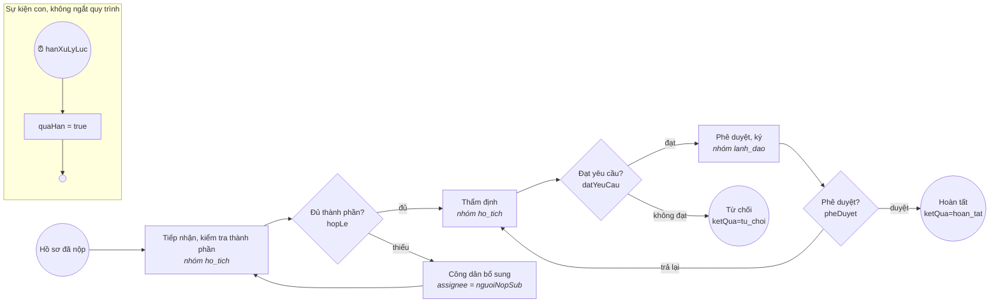

# Quy trình BPMN của mot-cua

BPMN 2.0 viết tay (không có modeler, bpmn-js bị cấm – D-004). Flowable REST tự triển khai mọi tệp `*.bpmn20.xml` ở đây khi khởi động; sửa xong chạy `make check` (kiểm cú pháp) rồi `docker compose --profile core up -d --force-recreate flowable`. Cách viết: [`docs/architecture.md` §7](../../../docs/architecture.md#7-viết-bpmn-khi-không-có-modeler).

## `dang_ky_khai_sinh` – Đăng ký khai sinh (KS01)

| Biến | Ai đặt | Ý nghĩa |
|---|---|---|
| `hoSoId`, `maHoSo` (= businessKey) | bên khởi tạo | liên kết `mot_cua.ho_so` |
| `nguoiNopSub` | bên khởi tạo | `sub` công dân, người làm bước bổ sung |
| `hanXuLyLuc` | bên khởi tạo | `ho_so.han_xu_ly` dạng ISO 8601 (ví dụ `2026-10-21T17:00:00+07:00`), **bắt buộc** |
| `hopLe`, `datYeuCau`, `pheDuyet`, `ghiChu` | cán bộ, khi hoàn thành task | rẽ nhánh tại các gateway |
| `ketQua` | quy trình | `hoan_tat` / `tu_choi` khi kết thúc |
| `quaHan` | quy trình | `true` khi tới hạn mà chưa xong |

`candidateGroups` trùng mã lĩnh vực (`mot_cua.linh_vuc.ma`) và vai trò `lanh_dao`, để cổng cán bộ lấy task theo đúng lĩnh vực mà RLS cho cán bộ xem hồ sơ. Chưa làm: đồng bộ `ho_so.trang_thai` theo bước và phát sự kiện RabbitMQ (#9), khởi tạo quy trình sau Poka-yoke (tuần 3), gọi qua APISIX `/workflow` (#6).
