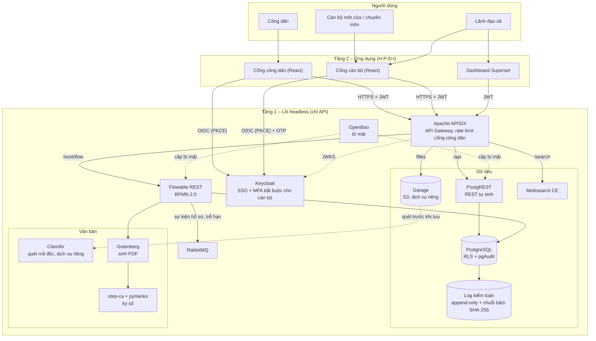
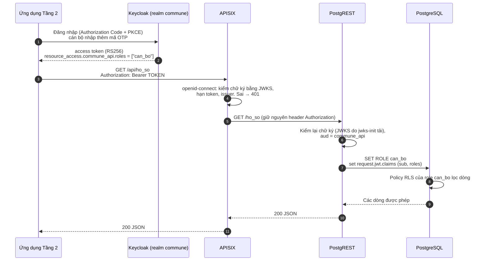

# Kiến trúc Commune DX-OS

Phiên bản tài liệu: v0.0.1 (tuần 1). Stack theo D-003, giấy phép đã xác minh ở D-004 (17/10/2026).

## 1. Tổng quan 3 tầng

- **Tầng 1 – Lõi headless:** không có giao diện, chỉ có API. Gồm SSO, API Gateway, dữ liệu có cấu trúc và phi cấu trúc, workflow, cùng các dịch vụ hỗ trợ (bí mật, hàng đợi, tìm kiếm, ký số, sinh PDF, quét mã độc, log kiểm toán).
- **Tầng 2 – Ứng dụng:** cổng cán bộ và cổng công dân (React), dashboard Superset. Tầng 2 **chỉ gọi lõi qua APISIX**, không kết nối thẳng CSDL, Flowable hay Garage.
- **Người dùng:** công dân, cán bộ một cửa, cán bộ chuyên môn, lãnh đạo xã.



Đường nét đứt là luồng nội bộ giữa các dịch vụ lõi. Route `/workflow`, `/files`, `/search` làm ở tuần 2–5; tuần 1 chỉ có `/api`.

## 2. Ánh xạ 4 dịch vụ bắt buộc của đề

| Yêu cầu của đề (Tầng 1) | Thành phần | Bằng chứng trong repo |
|---|---|---|
| Identity / SSO | Keycloak 26, realm `commune`; cán bộ và lãnh đạo bắt buộc cấu hình OTP | `infra/keycloak/realm-commune.json` |
| API Gateway | Apache APISIX 3.13 chế độ standalone (không cần etcd); kiểm JWT, giới hạn tần suất | `infra/apisix/config.yaml`, `infra/apisix/apisix.yaml` |
| Quản trị dữ liệu có cấu trúc | PostgreSQL 17 + Row-Level Security, PostgREST sinh REST API; pgAudit (tuần 2) | `infra/postgres/initdb/10-schema.sql` |
| Quản trị dữ liệu phi cấu trúc | Garage (S3), ClamAV quét trước khi lưu; Meilisearch CE để tìm toàn văn | tuần 2 (TODO trong `docker-compose.yml`) |
| Workflow engine | Flowable REST 8.0.0, BPMN 2.0 trong `processes/*.bpmn20.xml` | tuần 2 (TODO trong `docker-compose.yml`) |

## 3. Luồng xác thực: JWT Keycloak → APISIX → PostgREST → RLS



Chi tiết cách claim vai trò thành role PostgreSQL:

1. Realm có 3 realm role `cong_dan`, `can_bo`, `lanh_dao`. Mỗi role là composite, trỏ tới **client role cùng tên** của client `commune_api`. Người dùng được gán role qua nhóm `/cong-dan`, `/can-bo`, `/lanh-dao`.
2. Vì token có client role của `commune_api`, Keycloak thêm `commune_api` vào `aud`. PostgREST đặt `PGRST_JWT_AUD=commune_api` nên token cấp cho ứng dụng khác bị từ chối.
3. PostgREST đọc role từ `PGRST_JWT_ROLE_CLAIM_KEY=.resource_access.commune_api.roles[0]` rồi `SET ROLE` sang role PostgreSQL trùng tên. Không có claim → dùng role `anon`.
4. Ràng buộc: mỗi người dùng chỉ có **đúng một** client role của `commune_api`. Nếu sau này một người kiêm nhiệm, chuyển sang cách dùng `db-pre-request` để chọn role.
5. Trong PostgreSQL, policy RLS dùng `mot_cua.jwt_sub()` (claim `sub`) để công dân chỉ thấy và chỉ nộp hồ sơ của chính mình. Quyền theo cột chặn công dân tự đặt trạng thái, người nộp hay hạn xử lý.

| Role PostgreSQL | Đăng nhập | `thu_tuc` | `ho_so` |
|---|---|---|---|
| `authenticator` | có (PostgREST) | — | — (chỉ chuyển role) |
| `anon` | không | đọc | không có quyền |
| `cong_dan` | không | đọc | đọc và nộp hồ sơ **của mình** |
| `can_bo` | không | đọc | đọc tất cả; đổi `trang_thai` khi hồ sơ chưa đóng |
| `lanh_dao` | không | đọc | chỉ đọc tất cả |

Vì sao kiểm JWT hai lần: APISIX chặn sớm request không hợp lệ và giới hạn tần suất; PostgREST vẫn tự kiểm để CSDL không tin bất kỳ thứ gì đứng trước nó (Zero-Trust, nguyên lý B4).

JWKS cho PostgREST: PostgREST không tự tải khóa từ URL, nên dịch vụ một lần `jwks-init` tải `.../realms/commune/protocol/openid-connect/certs` vào volume `jwks`, PostgREST đọc qua `PGRST_JWT_SECRET=@/jwks/jwks.json`. Realm chỉ khai báo một khóa RSA dùng để ký (RS256), không có khóa mã hóa, để JWKS gọn. Khi xoay khóa Keycloak: `docker compose --profile core up -d --force-recreate jwks-init postgrest`.

## 4. MFA cho cán bộ

- Tuần 1: người dùng mẫu `canbo01`, `lanhdao01` có required action `CONFIGURE_TOTP`, nên lần đăng nhập đầu phải quét mã QR bằng ứng dụng OTP (FreeOTP, Google Authenticator…). Từ lần sau, luồng browser mặc định của Keycloak hỏi OTP vì người dùng đã cấu hình.
- Tuần 2: thay bằng luồng xác thực riêng có "Condition – user role": mọi người có role `can_bo`/`lanh_dao` đều bị hỏi OTP, kể cả tài khoản tạo mới chưa có required action. Cần cấu hình tương tự cho luồng direct grant.
- Client `commune_cli` bật password grant chỉ để thử bằng curl trong môi trường dev; tắt khi triển khai thật.

## 5. Chia profile docker-compose

| Profile | Dịch vụ | Trạng thái | Ghi chú tài nguyên |
|---|---|---|---|
| `core` | PostgreSQL, Keycloak, PostgREST, APISIX (+ `jwks-init` chạy một lần) | đã chạy thử 17/10/2026 | mục tiêu laptop 16 GB |
| `core` | Garage, Flowable REST, RabbitMQ, OpenBao | TODO tuần 2 | |
| `docs` | Gotenberg, step-ca, ClamAV, Meilisearch CE | TODO tuần 2–5 | ClamAV cần ~1,5 GB RAM cho cơ sở dữ liệu mẫu virus |
| `ai` | Ollama + Qwen2.5 7B, PaddleOCR/VietOCR | TODO tuần 5 | cần ~8 GB RAM |
| `bi` | Apache Superset | TODO tuần 4 | |

Chạy: `make up` (= `docker compose --profile core up -d`). Thêm profile: `docker compose --profile core --profile docs up -d`.
Mọi image ghim phiên bản cụ thể, lấy từ dự án gốc (bảng ở `DEPENDENCIES.md`). Cấu hình qua `.env` (mẫu `.env.example`).

## 6. Viết BPMN khi không có modeler

D-004: image `flowable-ui` (có modeler) dừng ở 6.8.0 (2022), bpmn-js bị cấm vì giấy phép bpmn.io không phải OSI. Cách làm:

1. Viết tay tệp `processes/<ma-thu-tuc>.bpmn20.xml` theo chuẩn BPMN 2.0, namespace `http://www.omg.org/spec/BPMN/20100524/MODEL` và `http://flowable.org/bpmn`. Dòng thứ 2 là `<!-- SPDX-License-Identifier: Apache-2.0 -->` (`make license` tự thêm sau khai báo `<?xml ?>`).
2. Chỉ dùng tập phần tử nhỏ: `startEvent`, `userTask` (có `flowable:candidateGroups` trùng nhóm Keycloak), `serviceTask`, `exclusiveGateway`, `boundaryEvent` + `timerEventDefinition` cho cảnh báo trễ hạn, `endEvent`.
3. Không cần phần `bpmndi` (tọa độ vẽ): Flowable chạy được khi thiếu phần này. Sơ đồ cho tài liệu và slide vẽ bằng Mermaid `flowchart` đặt cạnh tệp XML.
4. Kiểm tra: triển khai qua REST `POST /flowable-rest/service/repository/deployments`; Flowable từ chối tệp sai cú pháp. Thêm bước kiểm XML (`xmllint --noout`) vào `make check` khi có tệp đầu tiên.
5. Khi số quy trình tăng: sinh XML từ mô tả YAML/JSON bằng script Python của đội (mỗi thủ tục một tệp cấu hình), giữ đúng tinh thần module cắm–rút.

## 7. Chạy thử

Đã chạy thật profile `core` ngày 17/10/2026 (Docker Desktop, macOS arm64). Kết quả ở mục 7.1. Các bước để tự chạy lại:

```bash
cp .env.example .env            # đổi mật khẩu
make up
docker compose ps               # chờ postgres, keycloak, postgrest, apisix "healthy"; jwks-init "exited (0)"

# 1. Không token → 401 từ APISIX
curl -i http://localhost:9080/api/ho_so

# 2. Danh mục thủ tục công khai (role anon), giới hạn 60 request/phút/IP
curl -i http://localhost:9080/api/thu_tuc

# 3. Đặt mật khẩu cho người dùng mẫu (realm không chứa mật khẩu)
set -a; . ./.env; set +a
docker compose exec keycloak /opt/keycloak/bin/kcadm.sh config credentials \
  --server http://localhost:8080 --realm master --user "$KEYCLOAK_ADMIN" --password "$KEYCLOAK_ADMIN_PASSWORD"
docker compose exec keycloak /opt/keycloak/bin/kcadm.sh set-password -r commune \
  --username congdan01 --new-password 'mat-khau-thu-nghiem'

# 4. Lấy token công dân và gọi lại → 200, danh sách rỗng (công dân mới chưa có hồ sơ)
TOKEN=$(curl -s http://localhost:8080/realms/commune/protocol/openid-connect/token \
  -d grant_type=password -d client_id=commune_cli \
  -d username=congdan01 -d password='mat-khau-thu-nghiem' | jq -r .access_token)
curl -i -H "Authorization: Bearer $TOKEN" http://localhost:9080/api/ho_so

# 5. Nộp hồ sơ → 201; gọi lại bước 4 → thấy đúng hồ sơ của mình
curl -i -X POST -H "Authorization: Bearer $TOKEN" -H 'Content-Type: application/json' \
  -H 'Prefer: return=representation' \
  -d '{"ma_thu_tuc":"KS01","ho_ten_nguoi_nop":"Nguyễn Văn Mẫu"}' http://localhost:9080/api/ho_so

# 6. Token sai chữ ký → 401
curl -i -H "Authorization: Bearer ${TOKEN%?????}AAAAA" http://localhost:9080/api/ho_so
```

Người dùng `canbo01`, `lanhdao01` phải cài OTP trước khi lấy được token: đăng nhập một lần qua trình duyệt (client `commune_web`) và quét mã QR, sau đó gửi thêm `-d totp=<mã 6 số>` khi lấy token bằng `commune_cli`. Lưu ý: gõ sai hai lần trong vòng 1 giây sẽ bị khóa tạm 60 giây (brute-force protection của realm).

### 7.1 Kết quả chạy thử 17/10/2026

| Kiểm tra | Kết quả |
|---|---|
| Khởi động | `postgres`, `keycloak`, `apisix` healthy; `jwks-init` Exited (0); `postgrest` chạy, APISIX báo upstream `healthy` qua `/ready` |
| JWKS | chỉ có 1 khóa `RS256`, `"use":"sig"` |
| Claim token công dân | `iss=http://localhost:8080/realms/commune`, `aud=commune_api`, `resource_access.commune_api.roles=["cong_dan"]` |
| `/api/ho_so` không token / token sửa chữ ký / token hợp lệ | **401 / 401 / 200** |
| Gọi thẳng PostgREST (bỏ qua APISIX) không token hoặc token sửa chữ ký | 401 / 401 |
| MFA (Admin REST API) | `canbo01`, `lanhdao01`: `requiredActions=["CONFIGURE_TOTP"]`; `congdan01`: `[]` |
| MFA (token endpoint) | `congdan01` lấy được token; `canbo01`, `lanhdao01`: `invalid_grant – Account is not fully set up` |
| MFA (trình duyệt) | sau mật khẩu, Keycloak hiện trang cài OTP; sau khi cài: không gửi OTP → `Invalid user credentials`, OTP đúng → có token |
| RLS `anon` | `/api/thu_tuc` 200 (3 dòng); `ho_so` bị chặn (401) |
| RLS `cong_dan` | trước khi nộp `[]`; POST → 201, `nguoi_nop_sub` = `sub` của token; GET sau đó chỉ thấy 1 hồ sơ của mình; tự đặt `trang_thai` → 403; PATCH → 403 |
| RLS `can_bo` | thấy cả 3 hồ sơ; PATCH `trang_thai` → 200; PATCH hồ sơ đã `hoan_tat` → `[]` (policy chặn); POST → 403 |
| RLS `lanh_dao` | thấy cả 3 hồ sơ; PATCH → 403 |
| Rate limit `/api/thu_tuc` | 62 request liên tiếp: 59 × 200, 3 × 429 |

Đã sửa sau lần chạy đầu:
- Cổng PostgreSQL mặc định trên host đổi từ 5432 sang 55432 (máy dev thường đã có PostgreSQL chiếm cổng 5432).
- PostgREST v13.0.4 không có cờ `--ready`, và image amd64 dựng `FROM scratch` (không có shell), nên bỏ healthcheck Docker của `postgrest`. APISIX kiểm chủ động `http://postgrest:3001/ready` (khối `checks` của upstream).

## 8. Việc tiếp theo (tuần 2)

- pgAudit: image `postgres` gốc không có sẵn; build image từ Dockerfile của đội (cài gói `pgaudit` của PGDG) và bật `shared_preload_libraries`.
- RLS theo lĩnh vực: claim `linh_vuc` cho cán bộ (cần khai báo user profile của Keycloak 26).
- Route `/workflow`, `/files`; Garage, Flowable, RabbitMQ, OpenBao; chuyển mật khẩu từ `.env` sang OpenBao.
- Log kiểm toán append-only + chuỗi băm SHA-256 (tuần 4).
