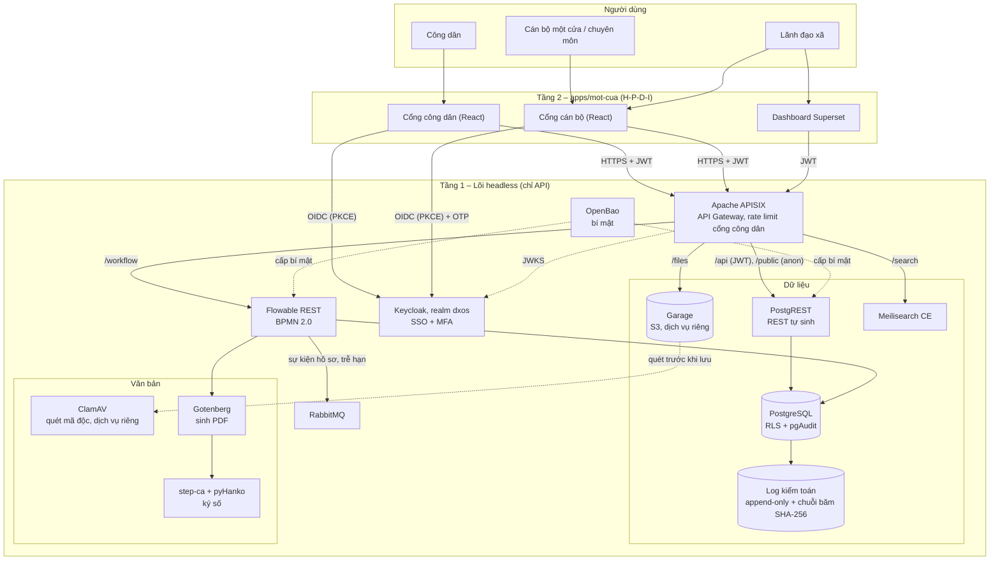
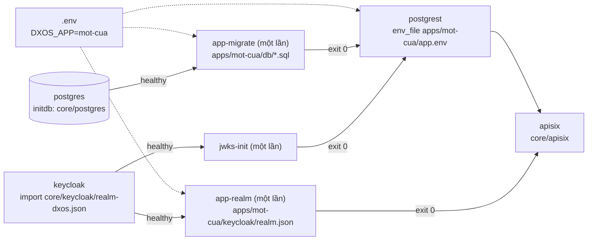
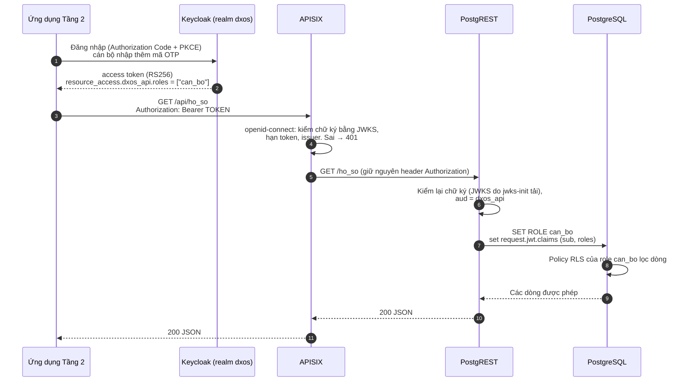

# Kiến trúc Commune DX-OS

Phiên bản tài liệu: v0.0.1+ (đầu tuần 2, sau khi tách `core/` và `apps/`, #3). Stack theo D-003, giấy phép đã xác minh ở D-004 (17/10/2026).

## 1. Tổng quan 3 tầng

- **Tầng 1 – Lõi headless** (`core/`): không có giao diện cho người dùng cuối, chỉ có API (và giao diện quản trị của từng dịch vụ cho quản trị viên). Gồm SSO, API Gateway, dữ liệu có cấu trúc và phi cấu trúc, workflow, cùng các dịch vụ hỗ trợ (bí mật, hàng đợi, tìm kiếm, ký số, sinh PDF, quét mã độc, log kiểm toán). **Không chứa nghiệp vụ** (mục 2).
- **Tầng 2 – Ứng dụng** (`apps/<tên>/`): ứng dụng chính là `apps/mot-cua/` (một cửa cấp xã): schema, vai trò, quy trình, dữ liệu mẫu, sau này cổng cán bộ và cổng công dân (React), dashboard Superset. Tầng 2 **chỉ gọi lõi qua APISIX**, không kết nối thẳng CSDL, Flowable hay Garage.
- **Người dùng:** công dân, cán bộ một cửa, cán bộ chuyên môn, lãnh đạo xã.



Đường nét đứt là luồng nội bộ giữa các dịch vụ lõi. Route `/workflow`, `/files`, `/search` làm ở tuần 2–5; hiện có `/api/*` (bắt buộc JWT) và `/public/*` (đọc công khai bằng role `anon`).

## 2. Lõi độc lập nghiệp vụ: `core/` và `apps/<tên>/`

### 2.1 Vì sao tách

- BTC trả lời (D-005 mục 11): **dịch vụ Tầng 1 phải độc lập hoàn toàn với nghiệp vụ cụ thể**, chỉ cung cấp dịch vụ cơ bản. D-008: backend Tầng 1 "cố gắng ở mức tổng quát nhất có thể"; cắm–rút là khái niệm cho **người thiết kế, xây dựng hệ thống**.
- Bản tuần 1 trộn hai tầng: init SQL của lõi tạo luôn bảng `ho_so`, role `cong_dan`/`can_bo`/`lanh_dao`; realm Keycloak có sẵn người dùng một cửa; APISIX có route riêng cho bảng `thu_tuc`. Một tổ chức khác (hợp tác xã, trường học…) muốn dùng lõi sẽ phải sửa lõi.
- Sau khi tách, lõi chỉ cung cấp **cơ chế** (đăng nhập, kiểm JWT, chuyển JWT thành role PostgreSQL để RLS áp dụng, sổ migration), còn **chính sách** (bảng nào, vai trò nào, ai thấy dòng nào) do ứng dụng khai báo. Đổi ứng dụng = đổi một biến `DXOS_APP`, không sửa tệp nào trong `core/`.

### 2.2 Phân chia

```
core/                         Tầng 1 – không có tên bảng, vai trò hay thủ tục nghiệp vụ
  postgres/initdb/10-core.sql   role authenticator + anon; schema dxos: dxos.jwt_claims(),
                                dxos.jwt_claim(ten), dxos.jwt_sub(); sổ dxos.app_migration
  postgres/initdb/20-auth.sh    mật khẩu authenticator, CSDL riêng của Keycloak
  keycloak/realm-dxos.json      realm dxos: khóa ký RS256, chính sách OTP, chống dò mật khẩu,
                                client dxos_api (audience, không có role) và dxos_cli (dev)
  apisix/                       /public/* → role anon (chỉ GET, 60 req/phút/IP);
                                /api/* → bắt buộc JWT realm dxos
  scripts/app-migrate.sh        dịch vụ một lần: áp dụng SQL của ứng dụng
  scripts/app-realm.sh          dịch vụ một lần: nạp vai trò/nhóm/người dùng của ứng dụng
apps/mot-cua/                 Tầng 2 – ứng dụng một cửa
  app.env                       PGRST_DB_SCHEMAS=mot_cua
  db/migrations/001_*.sql       role cong_dan/can_bo/lanh_dao, schema mot_cua, bảng, trigger, quyền, RLS
  db/seed/001_*.sql             thủ tục và hồ sơ mẫu GIẢ (chỉ khi DXOS_SEED=true)
  keycloak/realm.json           client role của dxos_api, nhóm, client mot_cua_web, người dùng mẫu
  tests/smoke.sh                kiểm tra riêng của ứng dụng (make smoke gọi)
```

| Thứ | Lõi `core/` | Ứng dụng `apps/mot-cua/` |
|---|---|---|
| Role PostgreSQL | `authenticator` (PostgREST đăng nhập), `anon` | `cong_dan`, `can_bo`, `lanh_dao` + `GRANT … TO authenticator` |
| Schema | `dxos` (hàm đọc claim, sổ migration; không phơi ra API) | `mot_cua` (phơi ra API qua `app.env`) |
| RLS | hàm `dxos.jwt_sub()`, `dxos.jwt_claim()` dùng trong policy | policy cụ thể trên `mot_cua.ho_so` |
| Keycloak | realm `dxos`, khóa, OTP, client `dxos_api`, `dxos_cli` | client role của `dxos_api`, nhóm, client web, người dùng mẫu, required action OTP |
| APISIX | `/public/*`, `/api/*` (không nêu tên tài nguyên) | không cần route riêng: tài nguyên công khai = bảng đã `GRANT SELECT … TO anon` |

### 2.3 Khởi động



- `app-migrate` (image `postgres`, đã có sẵn): áp dụng `db/migrations/*.sql` theo thứ tự tên, rồi `db/seed/*.sql` nếu `DXOS_SEED=true`. Mỗi tệp chạy **trong một transaction cùng dòng ghi sổ** `dxos.app_migration (ung_dung, loai, tep, sha256)`: lỗi giữa chừng không để lại nửa schema; chạy lại thì bỏ qua tệp đã áp dụng; tệp đã áp dụng mà bị sửa nội dung thì dừng với mã lỗi (phải viết migration mới). Cuối cùng gửi `NOTIFY pgrst, 'reload schema'`.
- `app-realm` (image `keycloak`, đã có sẵn, dùng `kcadm.sh`): gọi **Partial Import** của Keycloak vào realm `dxos` với `ifResourceExists=SKIP`: đối tượng đã có thì giữ nguyên, nên chạy lại không lỗi và không ghi đè người dùng đã cài OTP (ghi đè sẽ đổi `sub`, làm hồ sơ cũ mất chủ).
- Không kéo thêm image nào so với tuần 1. Chạy lại tay: `make migrate`; nạp dữ liệu mẫu khi đã tắt seed: `make seed`.

### 2.4 Hợp đồng giữa lõi và ứng dụng

Lõi chỉ biết các quy ước sau trong `apps/<DXOS_APP>/` (thiếu thư mục nào thì bước tương ứng được bỏ qua, riêng `app.env` là bắt buộc):

1. `app.env`: ít nhất `PGRST_DB_SCHEMAS=<schema>` – các schema PostgREST phơi ra.
2. `db/migrations/NNN_<mo-ta>.sql`: chạy bằng superuser, một lần. Phải tạo role nghiệp vụ `NOLOGIN` và `GRANT <role> TO authenticator`; cấp quyền cho `anon` với những gì công khai.
3. `db/seed/NNN_<mo-ta>.sql`: dữ liệu giả, viết để chạy lại không trùng (`ON CONFLICT DO NOTHING`).
4. `keycloak/realm.json`: định dạng `PartialImportRepresentation` (`roles.client.dxos_api`, `groups`, `clients`, `users`). Mỗi người dùng có **đúng một** client role của `dxos_api`, trùng tên role PostgreSQL (PostgREST đọc `resource_access.dxos_api.roles[0]`).
5. `tests/smoke.sh`: đoạn bash được `scripts/smoke.sh` `source`, dùng các hàm `kiem`, `ma_http`, `sql`, `kc`, `lay_token` trong `scripts/lib-smoke.sh`.
6. Sau này (tuần 2–3): `processes/*.bpmn20.xml` cho Flowable, `web/` cho giao diện, backend riêng của ứng dụng (D-008 mục 4) – cùng nguyên tắc: lõi triển khai theo quy ước thư mục, không đọc nội dung.

### 2.5 Cắm một ứng dụng khác (cho lập trình viên)

Ví dụ ứng dụng đặt phòng họp `apps/dat-phong-hop/` (module mẫu thứ hai, tuần 6):

```bash
mkdir -p apps/dat-phong-hop/{db/migrations,db/seed,keycloak,tests}
echo 'PGRST_DB_SCHEMAS=dat_phong' > apps/dat-phong-hop/app.env      # thêm dòng SPDX ở đầu
# db/migrations/001_schema.sql : CREATE ROLE nhan_vien NOLOGIN; GRANT nhan_vien TO authenticator;
#   CREATE SCHEMA dat_phong; CREATE TABLE dat_phong.lich (..., nguoi_dat text DEFAULT dxos.jwt_sub());
#   policy RLS: USING (nguoi_dat = dxos.jwt_sub())
# keycloak/realm.json : {"roles":{"client":{"dxos_api":[{"name":"nhan_vien"}]}}, "groups":[...], "users":[...]}
sed -i '' 's/^DXOS_APP=.*/DXOS_APP=dat-phong-hop/' .env                     # Linux: sed -i
docker compose --profile core down -v && make up && make smoke              # CSDL mới cho ứng dụng mới
```

Không sửa tệp nào trong `core/`, `docker-compose.yml` hay APISIX. Giới hạn hiện tại: mỗi lần chạy một ứng dụng (`DXOS_APP` là một tên); role PostgreSQL là đối tượng toàn cụm nên các ứng dụng nên đặt tên role không trùng nhau nếu sau này chạy chung một CSDL.

### 2.6 Nâng cấp từ bản tuần 1

Volume `pg-data` tạo trước khi tách vẫn có schema `mot_cua` cũ nhưng thiếu schema `dxos`; `app-migrate` sẽ dừng và hướng dẫn. Dữ liệu tuần 1 là dữ liệu giả, nên xóa volume rồi chạy lại: `docker compose --profile core down -v && make up`. Realm cũ `commune` cũng không còn được dùng (realm mới là `dxos`).

## 3. Ánh xạ 4 dịch vụ bắt buộc của đề

| Yêu cầu của đề (Tầng 1) | Thành phần | Bằng chứng trong repo |
|---|---|---|
| Identity / SSO | Keycloak 26, realm lõi `dxos`; vai trò và người dùng do ứng dụng nạp; cán bộ và lãnh đạo của `mot-cua` bắt buộc cấu hình OTP | `core/keycloak/realm-dxos.json`, `apps/mot-cua/keycloak/realm.json` |
| API Gateway | Apache APISIX 3.13 chế độ standalone (không cần etcd); kiểm JWT, giới hạn tần suất | `core/apisix/config.yaml`, `core/apisix/apisix.yaml` |
| Quản trị dữ liệu có cấu trúc | PostgreSQL 17 + Row-Level Security, PostgREST sinh REST API cho schema của ứng dụng; migration theo ứng dụng; pgAudit (tuần 2) | `core/postgres/initdb/10-core.sql`, `core/scripts/app-migrate.sh`, `apps/mot-cua/db/` |
| Quản trị dữ liệu phi cấu trúc | Garage (S3), ClamAV quét trước khi lưu; Meilisearch CE để tìm toàn văn | tuần 2 (TODO trong `docker-compose.yml`) |
| Workflow engine | Flowable REST 8.0.0, BPMN 2.0 trong `apps/<tên>/processes/*.bpmn20.xml` | tuần 2 (TODO trong `docker-compose.yml`) |

## 4. Luồng xác thực: JWT Keycloak → APISIX → PostgREST → RLS



Chi tiết cách claim vai trò thành role PostgreSQL:

1. Lõi: realm `dxos` có client `dxos_api` **không có role nào**. Ứng dụng `mot-cua` thêm 3 client role `cong_dan`, `can_bo`, `lanh_dao` của `dxos_api` và gán cho nhóm `/cong-dan`, `/can-bo`, `/lanh-dao` (tệp `apps/mot-cua/keycloak/realm.json`).
2. Vì token có client role của `dxos_api`, Keycloak thêm `dxos_api` vào `aud`. PostgREST đặt `PGRST_JWT_AUD=dxos_api` nên token cấp cho mục đích khác bị từ chối.
3. PostgREST đọc role từ `PGRST_JWT_ROLE_CLAIM_KEY=.resource_access.dxos_api.roles[0]` rồi `SET ROLE` sang role PostgreSQL trùng tên (role này do migration của ứng dụng tạo). Không có token (route `/public/*`) → role `anon` của lõi.
4. Ràng buộc: mỗi người dùng chỉ có **đúng một** client role của `dxos_api`. Nếu sau này một người kiêm nhiệm, chuyển sang cách dùng `db-pre-request` để chọn role.
5. Trong PostgreSQL, policy RLS của ứng dụng dùng hàm lõi `dxos.jwt_sub()` (claim `sub`) để công dân chỉ thấy và chỉ nộp hồ sơ của chính mình. Quyền theo cột chặn công dân tự đặt trạng thái, người nộp hay hạn xử lý.

| Role PostgreSQL | Đăng nhập | `thu_tuc` | `ho_so` |
|---|---|---|---|
| `authenticator` (lõi) | có (PostgREST) | — | — (chỉ chuyển role) |
| `anon` (lõi) | không | đọc (`/public/thu_tuc`) | không có quyền |
| `cong_dan` | không | đọc | đọc và nộp hồ sơ **của mình** |
| `can_bo` | không | đọc | đọc tất cả; đổi `trang_thai` khi hồ sơ chưa đóng |
| `lanh_dao` | không | đọc | chỉ đọc tất cả |

Vì sao kiểm JWT hai lần: APISIX chặn sớm request không hợp lệ và giới hạn tần suất; PostgREST vẫn tự kiểm để CSDL không tin bất kỳ thứ gì đứng trước nó (Zero-Trust, nguyên lý B4).

JWKS cho PostgREST: PostgREST không tự tải khóa từ URL, nên dịch vụ một lần `jwks-init` tải `.../realms/dxos/protocol/openid-connect/certs` vào volume `jwks`, PostgREST đọc qua `PGRST_JWT_SECRET=@/jwks/jwks.json`. Realm chỉ khai báo một khóa RSA dùng để ký (RS256), không có khóa mã hóa, để JWKS gọn. Khi xoay khóa Keycloak: `docker compose --profile core up -d --force-recreate jwks-init postgrest`.

## 5. MFA cho cán bộ

- Hiện tại: chính sách OTP (TOTP 6 số, 30 giây) nằm ở realm lõi; ứng dụng quyết định ai bị bắt OTP. Người dùng mẫu `canbo01`, `lanhdao01` của `mot-cua` có required action `CONFIGURE_TOTP`, nên lần đăng nhập đầu phải quét mã QR bằng ứng dụng OTP (FreeOTP, Google Authenticator…). Từ lần sau, luồng browser mặc định của Keycloak hỏi OTP vì người dùng đã cấu hình.
- Tuần 2: thay bằng luồng xác thực riêng có "Condition – user role": mọi người có role `can_bo`/`lanh_dao` đều bị hỏi OTP, kể cả tài khoản tạo mới chưa có required action. Cần cấu hình tương tự cho luồng direct grant.
- Client lõi `dxos_cli` bật password grant chỉ để thử bằng curl và `make smoke` trong môi trường dev; tắt khi triển khai thật.

## 6. Chia profile docker-compose

| Profile | Dịch vụ | Trạng thái | Ghi chú tài nguyên |
|---|---|---|---|
| `core` | PostgreSQL, Keycloak, PostgREST, APISIX (+ dịch vụ một lần `jwks-init`, `app-migrate`, `app-realm`) | chạy thử 17/10 và 20/10/2026 | mục tiêu laptop 16 GB |
| `core` | Garage, Flowable REST, RabbitMQ, OpenBao | TODO tuần 2 | |
| `docs` | Gotenberg, step-ca, ClamAV, Meilisearch CE | TODO tuần 2–5 | ClamAV cần ~1,5 GB RAM cho cơ sở dữ liệu mẫu virus |
| `ai` | Ollama + Qwen2.5 7B, PaddleOCR/VietOCR | TODO tuần 5 | cần ~8 GB RAM |
| `bi` | Apache Superset | TODO tuần 4 | |

Chạy: `make up` (= `docker compose --profile core up -d`), kiểm tra: `make smoke`. Thêm profile: `docker compose --profile core --profile docs up -d`.
Mọi image ghim phiên bản cụ thể, lấy từ dự án gốc (bảng ở `DEPENDENCIES.md`). Cấu hình qua `.env` (mẫu `.env.example`).

## 7. Viết BPMN khi không có modeler

D-004: image `flowable-ui` (có modeler) dừng ở 6.8.0 (2022), bpmn-js bị cấm vì giấy phép bpmn.io không phải OSI. Cách làm:

1. Viết tay tệp `apps/<tên>/processes/<ma-thu-tuc>.bpmn20.xml` theo chuẩn BPMN 2.0, namespace `http://www.omg.org/spec/BPMN/20100524/MODEL` và `http://flowable.org/bpmn`. Dòng thứ 2 là `<!-- SPDX-License-Identifier: Apache-2.0 -->` (`make license` tự thêm sau khai báo `<?xml ?>`).
2. Chỉ dùng tập phần tử nhỏ: `startEvent`, `userTask` (có `flowable:candidateGroups` trùng nhóm Keycloak), `serviceTask`, `exclusiveGateway`, `boundaryEvent` + `timerEventDefinition` cho cảnh báo trễ hạn, `endEvent`.
3. Không cần phần `bpmndi` (tọa độ vẽ): Flowable chạy được khi thiếu phần này. Sơ đồ cho tài liệu và slide vẽ bằng Mermaid `flowchart` đặt cạnh tệp XML.
4. Kiểm tra: triển khai qua REST `POST /flowable-rest/service/repository/deployments`; Flowable từ chối tệp sai cú pháp. Thêm bước kiểm XML (`xmllint --noout`) vào `make check` khi có tệp đầu tiên.
5. Khi số quy trình tăng: sinh XML từ mô tả YAML/JSON bằng script Python của đội (mỗi thủ tục một tệp cấu hình), giữ đúng tinh thần module cắm–rút.

## 8. Chạy thử

Cách nhanh nhất: `make up` rồi `make smoke` (`scripts/smoke.sh` + `apps/<DXOS_APP>/tests/smoke.sh`). Smoke đặt mật khẩu ngẫu nhiên cho người dùng mẫu (realm không chứa mật khẩu), không in mật khẩu hay token, không xóa dữ liệu; mỗi lần chạy thêm một hồ sơ thử của `congdan01`. Kết quả gần nhất ở mục 8.2. Thử tay từng bước:

```bash
cp .env.example .env            # đổi mật khẩu; DXOS_APP=mot-cua
make up
docker compose ps -a            # postgres, keycloak, apisix "healthy"; jwks-init, app-migrate, app-realm "Exited (0)"

# 1. Không token → 401 từ APISIX
curl -i http://localhost:9080/api/ho_so

# 2. Đọc công khai (role anon), giới hạn 60 request/phút/IP
curl -i http://localhost:9080/public/thu_tuc

# 3. Đặt mật khẩu cho người dùng mẫu (realm không chứa mật khẩu)
set -a; . ./.env; set +a
docker compose exec keycloak /opt/keycloak/bin/kcadm.sh config credentials \
  --server http://localhost:8080 --realm master --user "$KEYCLOAK_ADMIN" --password "$KEYCLOAK_ADMIN_PASSWORD"
docker compose exec keycloak /opt/keycloak/bin/kcadm.sh set-password -r dxos \
  --username congdan01 --new-password 'mat-khau-thu-nghiem'

# 4. Lấy token công dân và gọi lại → 200, danh sách rỗng (công dân mới chưa có hồ sơ)
TOKEN=$(curl -s http://localhost:8080/realms/dxos/protocol/openid-connect/token \
  -d grant_type=password -d client_id=dxos_cli \
  -d username=congdan01 -d password='mat-khau-thu-nghiem' | jq -r .access_token)
curl -i -H "Authorization: Bearer $TOKEN" http://localhost:9080/api/ho_so

# 5. Nộp hồ sơ → 201; gọi lại bước 4 → thấy đúng hồ sơ của mình
curl -i -X POST -H "Authorization: Bearer $TOKEN" -H 'Content-Type: application/json' \
  -H 'Prefer: return=representation' \
  -d '{"ma_thu_tuc":"KS01","ho_ten_nguoi_nop":"Nguyễn Văn Mẫu"}' http://localhost:9080/api/ho_so

# 6. Token sai chữ ký → 401
curl -i -H "Authorization: Bearer ${TOKEN%?????}AAAAA" http://localhost:9080/api/ho_so

# 7. Chạy lại migration và vai trò Keycloak → bỏ qua phần đã áp dụng, không lỗi
make migrate
```

Người dùng `canbo01`, `lanhdao01` phải cài OTP trước khi lấy được token: đăng nhập một lần qua trình duyệt (client `mot_cua_web`) và quét mã QR, sau đó gửi thêm `-d totp=<mã 6 số>` khi lấy token bằng `dxos_cli`. Lưu ý: gõ sai hai lần trong vòng 1 giây sẽ bị khóa tạm 60 giây (brute-force protection của realm).

### 8.1 Kết quả chạy thử 17/10/2026

Bản tuần 1, trước khi tách lõi: realm `commune`, client `commune_api`/`commune_cli`, route công khai `/api/thu_tuc`.

| Kiểm tra | Kết quả |
|---|---|
| Khởi động | `postgres`, `keycloak`, `apisix` healthy; `jwks-init` Exited (0); `postgrest` chạy, APISIX báo upstream `healthy` qua `/ready` |
| JWKS | chỉ có 1 khóa `RS256`, `"use":"sig"` |
| Claim token công dân | `iss=http://localhost:8080/realms/commune`, `aud=commune_api`, `resource_access.commune_api.roles=["cong_dan"]` |
| `/api/ho_so` không token / token sửa chữ ký / token hợp lệ | **401 / 401 / 200** |
| Gọi thẳng PostgREST (bỏ qua APISIX) không token hoặc token sửa chữ ký | 401 / 401 |
| MFA (Admin REST API) | `canbo01`, `lanhdao01`: `requiredActions=["CONFIGURE_TOTP"]`; `congdan01`: `[]` |
| MFA (token endpoint) | `congdan01` lấy được token; `canbo01`, `lanhdao01`: `invalid_grant – Account is not fully set up` |
| MFA (trình duyệt) | sau mật khẩu, Keycloak hiện trang cài OTP; sau khi cài: không gửi OTP → `Invalid user credentials`, OTP đúng → có token |
| RLS `anon` | `/api/thu_tuc` 200 (3 dòng); `ho_so` bị chặn (401) |
| RLS `cong_dan` | trước khi nộp `[]`; POST → 201, `nguoi_nop_sub` = `sub` của token; GET sau đó chỉ thấy 1 hồ sơ của mình; tự đặt `trang_thai` → 403; PATCH → 403 |
| RLS `can_bo` | thấy cả 3 hồ sơ; PATCH `trang_thai` → 200; PATCH hồ sơ đã `hoan_tat` → `[]` (policy chặn); POST → 403 |
| RLS `lanh_dao` | thấy cả 3 hồ sơ; PATCH → 403 |
| Rate limit `/api/thu_tuc` | 62 request liên tiếp: 59 × 200, 3 × 429 |

Đã sửa sau lần chạy đầu:
- Cổng PostgreSQL mặc định trên host đổi từ 5432 sang 55432 (máy dev thường đã có PostgreSQL chiếm cổng 5432).
- PostgREST v13.0.4 không có cờ `--ready`, và image amd64 dựng `FROM scratch` (không có shell), nên bỏ healthcheck Docker của `postgrest`. APISIX kiểm chủ động `http://postgrest:3001/ready` (khối `checks` của upstream).

### 8.2 Kết quả chạy thử 20/10/2026 (sau khi tách `core/` và `apps/`, #3)

Docker Desktop, macOS arm64, project tạm `COMPOSE_PROJECT_NAME=commune-r9` (volume trống), `DXOS_APP=mot-cua`, `DXOS_SEED=true`. `make up` xong trong khoảng 25 giây (image đã tải); `make smoke`: **45 đạt, 0 trượt**.

| Kiểm tra | Kết quả |
|---|---|
| Khởi động từ volume trống | `postgres`, `keycloak`, `apisix` healthy; `jwks-init`, `app-migrate`, `app-realm` Exited (0) |
| `app-migrate` lần 1 | áp dụng `migration 001_schema_mot_cua.sql`, `seed 001_du_lieu_mau.sql`; PostgREST nạp 2 bảng của `mot_cua` |
| `app-realm` lần 1 | `added=10` (3 client role, 3 nhóm, 1 client, 3 người dùng) |
| Lõi không chứa nghiệp vụ | schema `dxos` chỉ có bảng `app_migration`; realm lõi không có role hay người dùng |
| Chạy lại (`make migrate`, smoke) | `app-migrate`: mã 0, bỏ qua cả 2 tệp; `app-realm`: mã 0, `added=0 skipped=10` |
| Tệp migration đã áp dụng bị sửa (giả lập bằng cách đổi `sha256` trong sổ) | `app-migrate` dừng, mã 1, báo phải viết migration mới |
| JWKS realm `dxos` | 1 khóa `RS256`, `use=sig` |
| `/api/ho_so` không token / token sửa chữ ký / token công dân | **401 / 401 / 200** |
| `/api/` token rác (route lõi, không gắn tài nguyên) | 401 |
| Claim token công dân | `iss=http://localhost:8080/realms/dxos`, `aud` chứa `dxos_api`, `resource_access.dxos_api.roles=["cong_dan"]` |
| MFA | `canbo01`, `lanhdao01`: `requiredActions=["CONFIGURE_TOTP"]`, lấy token bằng mật khẩu → `Account is not fully set up`; `congdan01`: `[]`, lấy được token |
| RLS `anon` | `/public/thu_tuc` 200 (3 dòng); `/public/ho_so` 401; POST `/public/ho_so` 404 (route chỉ GET); `SET ROLE anon` → `permission denied for table ho_so` |
| RLS `cong_dan` (qua APISIX) | POST → có id, `nguoi_nop_sub` = `sub` của token; GET thấy thêm đúng 1 hồ sơ, mọi dòng đều của mình; tự đặt `trang_thai` → 403; PATCH → 403; trong CSDL với `sub` giả `…c001` → 1 dòng |
| RLS `can_bo` (trong CSDL) | thấy tất cả; đóng hồ sơ đang mở → 1 dòng, sửa tiếp hồ sơ đã đóng → 0 dòng (transaction rồi ROLLBACK); INSERT → `permission denied` |
| RLS `lanh_dao` (trong CSDL) | thấy tất cả; UPDATE → `permission denied` |

`can_bo`, `lanh_dao` bắt buộc OTP nên smoke không lấy được token của hai vai trò này; RLS của chúng được kiểm trong CSDL bằng `SET ROLE` + `request.jwt.claims`, đúng cách PostgREST làm cho mỗi request. Luồng có OTP qua trình duyệt đã kiểm tay ngày 17/10 (mục 8.1).

## 9. Việc tiếp theo (tuần 2)

- pgAudit: image `postgres` gốc không có sẵn; build image từ Dockerfile của đội (cài gói `pgaudit` của PGDG) và bật `shared_preload_libraries`.
- RLS theo lĩnh vực: claim `linh_vuc` cho cán bộ (cần khai báo user profile của Keycloak 26).
- MFA theo vai trò bằng luồng xác thực có điều kiện (mục 5); khi đó smoke có thể kiểm `can_bo` qua APISIX bằng TOTP sinh trong script.
- Quy ước thêm cho `apps/<tên>/`: `processes/` (Flowable), route APISIX riêng khi ứng dụng có backend riêng.
- Route `/workflow`, `/files`; Garage, Flowable, RabbitMQ, OpenBao; chuyển mật khẩu từ `.env` sang OpenBao.
- Log kiểm toán append-only + chuỗi băm SHA-256 (tuần 4).
