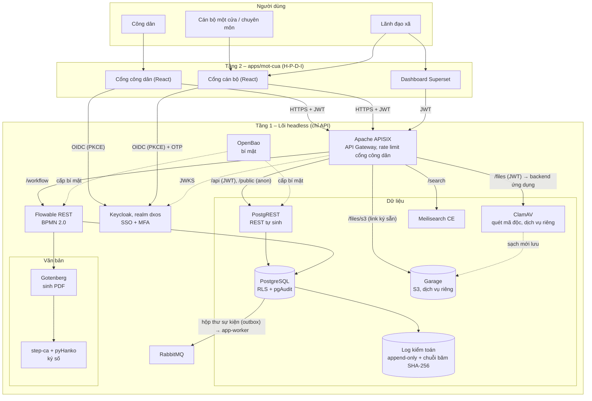
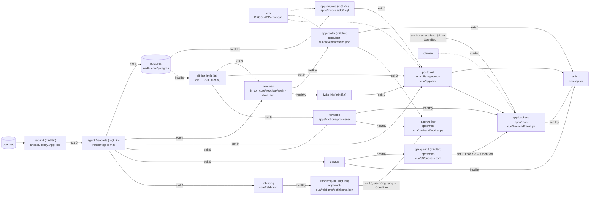
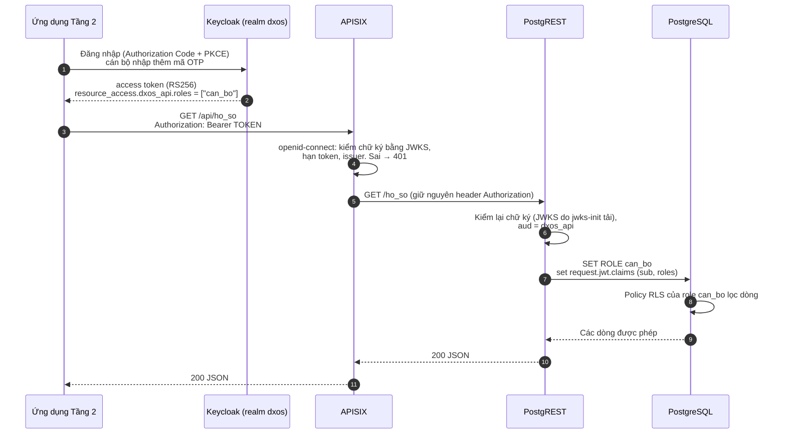
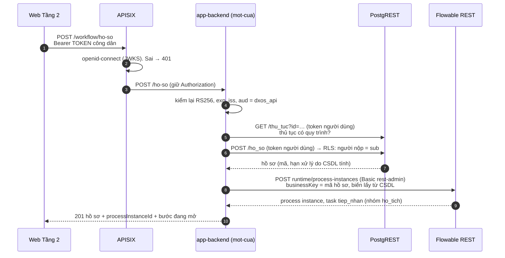
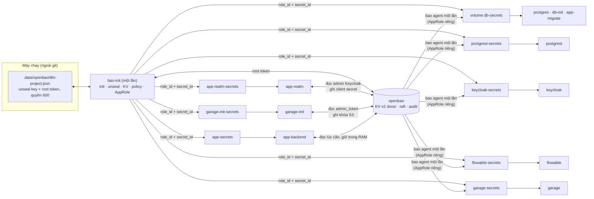
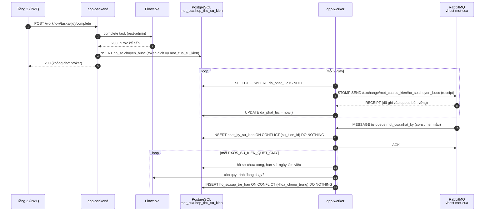
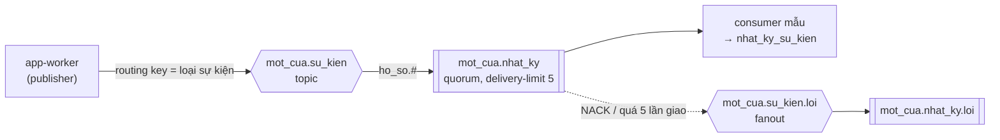

# Kiến trúc Commune DX-OS

Phiên bản tài liệu: v0.0.1+ (tuần 2: tách `core/` và `apps/` #3, schema #5, Flowable #8, route gateway #6, tệp #7, OpenBao #10, sự kiện RabbitMQ #9). Stack theo D-003, giấy phép đã xác minh ở D-004 (17/10/2026).

## 1. Tổng quan 3 tầng

- **Tầng 1 – Lõi headless** (`core/`): không có giao diện cho người dùng cuối, chỉ có API (và giao diện quản trị của từng dịch vụ cho quản trị viên). Gồm SSO, API Gateway, dữ liệu có cấu trúc và phi cấu trúc, workflow, cùng các dịch vụ hỗ trợ (bí mật, hàng đợi, tìm kiếm, ký số, sinh PDF, quét mã độc, log kiểm toán). **Không chứa nghiệp vụ** (mục 2).
- **Tầng 2 – Ứng dụng** (`apps/<tên>/`): ứng dụng chính là `apps/mot-cua/` (một cửa cấp xã): schema, vai trò, quy trình, dữ liệu mẫu, sau này cổng cán bộ và cổng công dân (React), dashboard Superset. Tầng 2 **chỉ gọi lõi qua APISIX**, không kết nối thẳng CSDL, Flowable hay Garage.
- **Người dùng:** công dân, cán bộ một cửa, cán bộ chuyên môn, lãnh đạo xã.



Đường nét đứt là luồng nội bộ giữa các dịch vụ lõi. Hiện có `/public/*` (đọc công khai bằng role `anon`), `/api/*` (JWT → PostgREST), `/workflow/*` (JWT → backend của ứng dụng → Flowable), `/files/*` (JWT → backend của ứng dụng: quét ClamAV rồi lưu Garage, #7) và `/files/s3/*` (link GET đã ký ngắn hạn tới Garage); `/search` ở tuần 5. Bảng route: §4.1, luồng tệp: §4.3.

## 2. Lõi độc lập nghiệp vụ: `core/` và `apps/<tên>/`

### 2.1 Vì sao tách

- BTC trả lời (D-005 mục 11): **dịch vụ Tầng 1 phải độc lập hoàn toàn với nghiệp vụ cụ thể**, chỉ cung cấp dịch vụ cơ bản. D-008: backend Tầng 1 "cố gắng ở mức tổng quát nhất có thể"; cắm–rút là khái niệm cho **người thiết kế, xây dựng hệ thống**.
- Bản tuần 1 trộn hai tầng: init SQL của lõi tạo luôn bảng `ho_so`, role `cong_dan`/`can_bo`/`lanh_dao`; realm Keycloak có sẵn người dùng một cửa; APISIX có route riêng cho bảng `thu_tuc`. Một tổ chức khác (hợp tác xã, trường học…) muốn dùng lõi sẽ phải sửa lõi.
- Sau khi tách, lõi chỉ cung cấp **cơ chế** (đăng nhập, kiểm JWT, chuyển JWT thành role PostgreSQL để RLS áp dụng, sổ migration), còn **chính sách** (bảng nào, vai trò nào, ai thấy dòng nào) do ứng dụng khai báo. Đổi ứng dụng = đổi một biến `DXOS_APP`, không sửa tệp nào trong `core/`.

### 2.2 Phân chia

```
core/                         Tầng 1 – không có tên bảng, vai trò hay thủ tục nghiệp vụ
  postgres/initdb/10-core.sql   role authenticator + anon; schema dxos: dxos.jwt_claims(),
                                dxos.jwt_claim(ten), dxos.jwt_sub(); sổ dxos.app_migration
  keycloak/realm-dxos.json      realm dxos: khóa ký RS256, chính sách OTP, chống dò mật khẩu,
                                client dxos_api (audience, không có role) và dxos_cli (dev)
  apisix/                       /public/* → role anon (chỉ GET, 60 req/phút/IP); /api/* → PostgREST,
                                /workflow/*, /files/* → app-backend: bắt buộc JWT realm dxos;
                                /files/s3/* → Garage (link ký sẵn, chỉ GET/HEAD);
                                chặn API quản trị Flowable; CORS theo DXOS_CORS_ORIGINS (§4.1)
  garage/garage.toml            Garage một nút (S3 :3900, Admin API :3903), bí mật đọc từ tệp (§4.3)
  openbao/config.hcl            OpenBao server (raft, không UI, audit ra stdout) (§4.4)
  openbao/bao-init.py           dịch vụ một lần: init, unseal, KV, policy, AppRole, bí mật lõi
  openbao/policies/*.hcl        policy từng danh tính; openbao/agent/*.hcl: agent render tệp bí mật
  openbao/kiem-quyen.py         kiểm policy bằng AppRole thật của từng dịch vụ (make smoke)
  scripts/app-migrate.sh        dịch vụ một lần: áp dụng SQL của ứng dụng
  scripts/app-realm.sh          dịch vụ một lần: nạp vai trò/nhóm/người dùng của ứng dụng; ghi secret
                                của client dịch vụ vào OpenBao
  scripts/db-init.sh            dịch vụ một lần: role + CSDL riêng của authenticator, keycloak, flowable,
                                mật khẩu theo OpenBao
  scripts/kc-start.sh           entrypoint Keycloak: đọc mật khẩu từ tệp bí mật
  scripts/garage-init.py        dịch vụ một lần: layout, bucket của ứng dụng, khóa S3 riêng của ứng dụng
  rabbitmq/                     RabbitMQ một nút: rabbitmq.conf, enabled_plugins (STOMP + management) (§4.5)
  scripts/rabbitmq-init.py      dịch vụ một lần: vhost + user riêng của ứng dụng, nạp topology ứng dụng khai báo
apps/mot-cua/                 Tầng 2 – ứng dụng một cửa
  app.env                       PGRST_DB_SCHEMAS=mot_cua
  db/migrations/001_*.sql       role cong_dan/can_bo/lanh_dao, schema mot_cua (bản giữ chỗ tuần 1)
  db/migrations/002_*.sql       schema đầy đủ: lĩnh vực, thủ tục, thành phần, cán bộ, hồ sơ, RLS (#5)
  db/migrations/003_*.sql       tệp hồ sơ: role dich_vu_tep, cột kết quả quét, nhật ký tệp chỉ thêm (#7)
  db/migrations/004_*.sql       sự kiện: role dich_vu_su_kien, hộp thư đi (outbox), nhật ký sự kiện (#9)
  db/seed/002_*.sql             danh mục thủ tục, cán bộ, hồ sơ mẫu GIẢ (chỉ khi DXOS_SEED=true)
  db/tests/rls.sql              test quyền/RLS từng vai trò (make smoke chạy)
  keycloak/realm.json           client role của dxos_api, nhóm, client mot_cua_web, client dịch vụ
                                mot_cua_tep (service account, role dich_vu_tep), người dùng mẫu
  processes/*.bpmn20.xml        quy trình BPMN viết tay, Flowable tự triển khai (#8)
  s3/buckets.conf               bucket S3 ứng dụng cần (mot-cua-ho-so) (#7)
  rabbitmq/definitions.json     exchange mot_cua.su_kien, queue mot_cua.nhat_ky (+ queue lỗi) (#9)
  backend/main.py               API quy trình mỏng /workflow (#6, §4.2) và API tệp /files (#7, §4.3),
                                dịch vụ app-backend
  backend/tep.py, tests/        phần thuần của API tệp + test đơn vị (make test-backend, trong make check)
  backend/bimat.py              đọc bí mật của ứng dụng từ OpenBao (AppRole app) (#10)
  backend/worker.py             dịch vụ app-worker: phát outbox lên RabbitMQ, quét sắp trễ hạn, consumer mẫu (#9)
  backend/su_kien.py, hop_thu.py, stomp.py   định dạng sự kiện, outbox qua PostgREST, client STOMP (#9)
  tests/smoke.sh, smoke-tep.sh, smoke-su-kien.sh   kiểm tra riêng của ứng dụng (make smoke gọi)
```

| Thứ | Lõi `core/` | Ứng dụng `apps/mot-cua/` |
|---|---|---|
| Role PostgreSQL | `authenticator` (PostgREST đăng nhập), `anon` | `cong_dan`, `can_bo`, `lanh_dao` + `GRANT … TO authenticator` |
| Schema | `dxos` (hàm đọc claim, sổ migration; không phơi ra API) | `mot_cua` (phơi ra API qua `app.env`) |
| RLS | hàm `dxos.jwt_sub()`, `dxos.jwt_claim()` dùng trong policy | policy trên mọi bảng `mot_cua`, theo vai trò và lĩnh vực cán bộ phụ trách (§2.7) |
| Keycloak | realm `dxos`, khóa, OTP, client `dxos_api`, `dxos_cli` | client role của `dxos_api`, nhóm, client web, người dùng mẫu, required action OTP |
| APISIX | `/public/*`, `/api/*`, `/workflow/*`, `/files/*`, `/files/s3/*` (không nêu tên tài nguyên); upstream `app-backend`, `garage-s3` là tên dịch vụ chung | không cần route riêng: tài nguyên công khai = bảng đã `GRANT SELECT … TO anon`; endpoint dưới `/workflow`, `/files` do `backend/main.py` của ứng dụng quyết định |
| Object storage | Garage một nút, ClamAV; tạo bucket và **một khóa S3 riêng cho mỗi ứng dụng** chỉ có quyền trên bucket ứng dụng khai báo; không biết tên bucket nghiệp vụ nào | `s3/buckets.conf`; cấu trúc khóa object, loại tệp nhận, quyền xem do backend + RLS của ứng dụng quyết định |
| Bí mật | OpenBao, policy theo danh tính; nhánh `dxos/apps/<DXOS_APP>/` cho ứng dụng (khóa S3, client secret) | đọc bí mật của mình qua AppRole `app` (`backend/bimat.py`) |
| Hàng đợi | RabbitMQ một nút; **vhost + user riêng cho mỗi ứng dụng** (không tag quản trị, không quyền configure); không biết tên exchange/queue nghiệp vụ nào | `rabbitmq/definitions.json` (exchange, queue, binding); loại sự kiện, định dạng, consumer do ứng dụng quyết định (§4.5) |

### 2.3 Khởi động



- `app-migrate` (image `postgres`, đã có sẵn): áp dụng `db/migrations/*.sql` theo thứ tự tên, rồi `db/seed/*.sql` nếu `DXOS_SEED=true`. Mỗi tệp chạy **trong một transaction cùng dòng ghi sổ** `dxos.app_migration (ung_dung, loai, tep, sha256)`: lỗi giữa chừng không để lại nửa schema; chạy lại thì bỏ qua tệp đã áp dụng; tệp đã áp dụng mà bị sửa nội dung thì dừng với mã lỗi (phải viết migration mới). Cuối cùng gửi `NOTIFY pgrst, 'reload schema'`.
- `app-realm` (image `keycloak`, đã có sẵn, dùng `kcadm.sh`): gọi **Partial Import** của Keycloak vào realm `dxos` với `ifResourceExists=SKIP`: đối tượng đã có thì giữ nguyên, nên chạy lại không lỗi và không ghi đè người dùng đã cài OTP (ghi đè sẽ đổi `sub`, làm hồ sơ cũ mất chủ).
- `garage-init` (image `python` đã dùng cho `app-backend`): §4.3. Chạy lại an toàn (layout, khóa, bucket đã có thì giữ).
- `rabbitmq-init` (image `python`): §4.5. Chạy lại an toàn (vhost, user đã có thì giữ, mật khẩu đặt lại theo OpenBao; topology khai báo lại không đổi gì).
- `bao-init`, agent `db-secrets`, `postgrest-secrets`, `keycloak-secrets`, `flowable-secrets`, `garage-secrets` (image `openbao`), `db-init` (image `postgres`): §4.4. Đều chạy lại ở mỗi `up`.
- Chạy lại tay: `make migrate`; nạp dữ liệu mẫu khi đã tắt seed: `make seed`.

### 2.4 Hợp đồng giữa lõi và ứng dụng

Lõi chỉ biết các quy ước sau trong `apps/<DXOS_APP>/` (thiếu thư mục nào thì bước tương ứng được bỏ qua, riêng `app.env` là bắt buộc):

1. `app.env`: ít nhất `PGRST_DB_SCHEMAS=<schema>` – các schema PostgREST phơi ra.
2. `db/migrations/NNN_<mo-ta>.sql`: chạy bằng superuser, một lần. Phải tạo role nghiệp vụ `NOLOGIN` và `GRANT <role> TO authenticator`; cấp quyền cho `anon` với những gì công khai.
3. `db/seed/NNN_<mo-ta>.sql`: dữ liệu giả, viết để chạy lại không trùng (`ON CONFLICT DO NOTHING`).
4. `keycloak/realm.json`: định dạng `PartialImportRepresentation` (`roles.client.dxos_api`, `groups`, `clients`, `users`). Mỗi người dùng có **đúng một** client role của `dxos_api`, trùng tên role PostgreSQL (PostgREST đọc `resource_access.dxos_api.roles[0]`).
5. `tests/smoke.sh`: đoạn bash được `scripts/smoke.sh` `source`, dùng các hàm `kiem`, `ma_http`, `sql`, `kc`, `lay_token` trong `scripts/lib-smoke.sh`.
6. `processes/*.bpmn20.xml` (#8): Flowable đọc thư mục này (mount chỉ đọc vào `/dxos/processes`, thuộc tính `flowable.process-definition-location-prefix`) và tự triển khai khi khởi động; tệp không đổi thì không tạo phiên bản mới. Cú pháp được `scripts/check-bpmn.py` kiểm trong `make check`/CI.
7. `backend/main.py` (#6, D-008 mục 4): backend riêng của ứng dụng, dịch vụ `app-backend` chạy bằng image `python` gốc (chỉ thư viện chuẩn), nhận `/workflow/*` từ APISIX (đã bỏ tiền tố). Lõi truyền vào địa chỉ PostgREST, Flowable, JWKS, issuer, audience, OpenBao qua biến môi trường, và role_id/secret_id của AppRole `app` trong `/run/dxos-secrets/approle/` (volume `app-secrets`, chỉ đọc); mật khẩu tài khoản kỹ thuật Flowable và bí mật của ứng dụng đọc từ OpenBao (§4.4). Thiếu tệp này thì dịch vụ chỉ chạy chỗ giữ, `/workflow` trả 502.
8. `s3/buckets.conf` (#7): mỗi dòng một tên bucket. `garage-init` tạo bucket và khóa `dxos-app-<DXOS_APP>` chỉ đọc/ghi trên các bucket này (không tạo được bucket, không phải owner; bucket bỏ khỏi danh sách thì bị thu hồi quyền), ghi thông tin kết nối vào OpenBao `dxos/apps/<DXOS_APP>/s3`, `app-backend` đọc bằng AppRole `app` (§4.4).
9. Client có service account trong `keycloak/realm.json` (confidential, `serviceAccountsEnabled`): Keycloak tự sinh client secret khi nạp, `app-realm` ghi vào `/run/dxos-secrets/keycloak-<clientId>.secret` cho backend lấy token Client Credentials. Service account mang client role của `dxos_api` trùng role PostgreSQL như người dùng.
10. `rabbitmq/definitions.json` (#9): định dạng definitions của RabbitMQ, **chỉ** `exchanges`, `queues`, `bindings` (không có `vhost`, hoặc `vhost` = tên ứng dụng). `rabbitmq-init` tạo vhost `<DXOS_APP>`, user `app-<DXOS_APP>` (không tag, configure `^$`, read/write `.*` trong vhost của mình), nạp topology bằng HTTP API quản trị, ghi thông tin kết nối (`username`, `password`, `vhost`, `host`, `stomp_port`) vào OpenBao `dxos/apps/<DXOS_APP>/rabbitmq`. Khai thêm `users`, `permissions`, `policies`… thì `rabbitmq-init` dừng.
11. `backend/worker.py` (#9): tác vụ nền của ứng dụng, dịch vụ `app-worker` (cùng image, cùng AppRole `app` với `app-backend`, không có cổng). Healthcheck: tiến trình phải chạm `/tmp/song` ít nhất mỗi 60 giây. Thiếu tệp thì chỉ chạy chỗ giữ.
12. Sau này (tuần 3): `web/` cho giao diện – cùng nguyên tắc: lõi triển khai theo quy ước thư mục, không đọc nội dung.

### 2.5 Cắm một ứng dụng khác (cho lập trình viên)

Ví dụ ứng dụng đặt phòng họp `apps/dat-phong-hop/` (module mẫu thứ hai, tuần 6):

```bash
mkdir -p apps/dat-phong-hop/{db/migrations,db/seed,keycloak,tests}
echo 'PGRST_DB_SCHEMAS=dat_phong' > apps/dat-phong-hop/app.env      # thêm dòng SPDX ở đầu
# db/migrations/001_schema.sql : CREATE ROLE nhan_vien NOLOGIN; GRANT nhan_vien TO authenticator;
#   CREATE SCHEMA dat_phong; CREATE TABLE dat_phong.lich (..., nguoi_dat text DEFAULT dxos.jwt_sub());
#   policy RLS: USING (nguoi_dat = dxos.jwt_sub())
# keycloak/realm.json : {"roles":{"client":{"dxos_api":[{"name":"nhan_vien"}]}}, "groups":[...], "users":[...]}
sed -i '' 's/^DXOS_APP=.*/DXOS_APP=dat-phong-hop/' .env                     # Linux: sed -i
docker compose --profile core down -v && make up && make smoke              # CSDL mới cho ứng dụng mới
```

Không sửa tệp nào trong `core/`, `docker-compose.yml` hay APISIX. Giới hạn hiện tại: mỗi lần chạy một ứng dụng (`DXOS_APP` là một tên); role PostgreSQL là đối tượng toàn cụm nên các ứng dụng nên đặt tên role không trùng nhau nếu sau này chạy chung một CSDL.

### 2.6 Nâng cấp từ bản tuần 1

Volume `pg-data` tạo trước khi tách vẫn có schema `mot_cua` cũ nhưng thiếu schema `dxos`; `app-migrate` sẽ dừng và hướng dẫn. Dữ liệu tuần 1 là dữ liệu giả, nên xóa volume rồi chạy lại: `docker compose --profile core down -v && make up`. Realm cũ `commune` cũng không còn được dùng (realm mới là `dxos`).

Lên bản có OpenBao (#10): giữ `.env` cũ, `make up` chuyển mật khẩu sang OpenBao, rồi xóa các dòng mật khẩu khỏi `.env` (§4.4.5). Không cần xóa volume.

Từ v0.0.1 lên schema đầy đủ (#5): `make up` (hoặc `make migrate`) áp dụng `002_schema_day_du.sql`, migration này **thay** hai bảng giữ chỗ `thu_tuc`, `ho_so` của 001 (khóa `text`/`bigint`, chỉ có dữ liệu giả) bằng schema mới; seed 001 bị bỏ, seed 002 nạp lại dữ liệu mẫu. Đã chạy thử trên volume tạo từ bản #3: smoke đạt hết. Người dùng mẫu tạo trước đó giữ `sub` ngẫu nhiên (Partial Import bỏ qua người dùng đã có), nên hồ sơ và cán bộ mẫu chỉ khớp người dùng Keycloak khi chạy từ volume trống; muốn khớp thì `docker compose --profile core down -v && make up`.

### 2.7 Tầng dữ liệu của ứng dụng `mot-cua` (#5)

Sơ đồ ER, bảng quyền đầy đủ và quy tắc trạng thái: [`apps/mot-cua/README.md`](../apps/mot-cua/README.md). Tóm tắt:

- Schema `mot_cua` (phơi ra API): `linh_vuc`, `thu_tuc`, `thanh_phan_yeu_cau`, `ngay_nghi`, `can_bo`, `can_bo_linh_vuc`, `ho_so`, `thanh_phan_ho_so`; khóa chính UUID, `created_at`/`updated_at`. Hàm RPC công khai `json_schema_thu_tuc(ma)` sinh JSON Schema thành phần hồ sơ (nguồn cho Poka-yoke tuần 3).
- Schema `mot_cua_noi_bo` (không phơi ra API): hàm tính hạn theo ngày làm việc, hàm kiểm "cán bộ đang gọi có phụ trách lĩnh vực này", trigger.
- RLS bật và ép (`FORCE`) trên mọi bảng. Công dân: hồ sơ của mình (`nguoi_nop_sub = dxos.jwt_sub()`). Cán bộ: hồ sơ thuộc lĩnh vực mình phụ trách, tra theo `sub` trong `can_bo` + `can_bo_linh_vuc` (không cần claim riêng trong JWT; đổi phân công có hiệu lực ngay, không phải chờ token mới). Lãnh đạo: đọc tất cả. `anon`: chỉ danh mục công khai.
- Dữ liệu cá nhân tối thiểu: `sub`, họ tên, số điện thoại (không bắt buộc); không lưu CCCD, ngày sinh, địa chỉ. Giấy tờ chỉ lưu metadata, tệp ở Garage (#7).
- Kiểm tra: `apps/mot-cua/db/tests/rls.sql` (63 kiểm tra, một transaction rồi ROLLBACK, không phụ thuộc seed) + smoke qua APISIX bằng token thật từng vai trò (§8.3).

## 3. Ánh xạ 4 dịch vụ bắt buộc của đề

| Yêu cầu của đề (Tầng 1) | Thành phần | Bằng chứng trong repo |
|---|---|---|
| Identity / SSO | Keycloak 26, realm lõi `dxos`; vai trò và người dùng do ứng dụng nạp; cán bộ và lãnh đạo của `mot-cua` bắt buộc cấu hình OTP | `core/keycloak/realm-dxos.json`, `apps/mot-cua/keycloak/realm.json` |
| API Gateway | Apache APISIX 3.13 chế độ standalone (không cần etcd); route `/public`, `/api`, `/workflow`, `/files`; kiểm JWT, giới hạn tần suất, CORS, chặn API quản trị Flowable | `core/apisix/config.yaml`, `core/apisix/apisix.yaml`, §4.1, §8.5 |
| Quản trị dữ liệu có cấu trúc | PostgreSQL 17 + Row-Level Security, PostgREST sinh REST API cho schema của ứng dụng; migration theo ứng dụng; pgAudit (tuần 2) | `core/postgres/initdb/10-core.sql`, `core/scripts/app-migrate.sh`, `apps/mot-cua/db/` |
| Quản trị dữ liệu phi cấu trúc | Garage v2.4.1 (S3, một nút), ClamAV 1.5.4 quét **trước khi lưu**, kiểm loại tệp bằng magic bytes, link GET ký ngắn hạn; Meilisearch CE để tìm toàn văn (tuần 5) | `core/garage/`, `core/scripts/garage-init.py`, `apps/mot-cua/backend/`, §4.3, §8.6 |
| Workflow engine | Flowable REST 8.0.0 (CSDL riêng `flowable` trong PostgreSQL), BPMN 2.0 viết tay trong `apps/<tên>/processes/*.bpmn20.xml`, tự triển khai khi khởi động; Tầng 2 dùng qua `/workflow` (API quy trình của ứng dụng) | `docker-compose.yml` (`flowable`, `db-init`, `app-backend`), `apps/mot-cua/processes/`, `apps/mot-cua/backend/`, §4.2, §7, §8.4, §8.5 |

## 4. Luồng xác thực: JWT Keycloak → APISIX → PostgREST → RLS



Chi tiết cách claim vai trò thành role PostgreSQL:

1. Lõi: realm `dxos` có client `dxos_api` **không có role nào**. Ứng dụng `mot-cua` thêm 3 client role `cong_dan`, `can_bo`, `lanh_dao` của `dxos_api` và gán cho nhóm `/cong-dan`, `/can-bo`, `/lanh-dao` (tệp `apps/mot-cua/keycloak/realm.json`).
2. Vì token có client role của `dxos_api`, Keycloak thêm `dxos_api` vào `aud`. PostgREST đặt `PGRST_JWT_AUD=dxos_api` nên token cấp cho mục đích khác bị từ chối.
3. PostgREST đọc role từ `PGRST_JWT_ROLE_CLAIM_KEY=.resource_access.dxos_api.roles[0]` rồi `SET ROLE` sang role PostgreSQL trùng tên (role này do migration của ứng dụng tạo). Không có token (route `/public/*`) → role `anon` của lõi.
4. Ràng buộc: mỗi người dùng chỉ có **đúng một** client role của `dxos_api`. Nếu sau này một người kiêm nhiệm, chuyển sang cách dùng `db-pre-request` để chọn role.
5. Trong PostgreSQL, policy RLS của ứng dụng dùng hàm lõi `dxos.jwt_sub()` (claim `sub`): công dân chỉ thấy và chỉ nộp hồ sơ của chính mình; cán bộ được tra `sub` trong bảng `can_bo` để biết lĩnh vực phụ trách. Quyền theo cột chặn công dân tự đặt trạng thái, người nộp, hạn xử lý hay cán bộ xử lý.

| Role PostgreSQL | Đăng nhập | Danh mục (`thu_tuc`…) | `ho_so`, `thanh_phan_ho_so` |
|---|---|---|---|
| `authenticator` (lõi) | có (PostgREST) | — | — (chỉ chuyển role) |
| `anon` (lõi) | không | đọc thủ tục công khai (`/public/thu_tuc`) | không có quyền |
| `cong_dan` | không | đọc thủ tục công khai | đọc và nộp hồ sơ **của mình**; sửa khi hồ sơ đang chờ bổ sung |
| `can_bo` | không | đọc tất cả | đọc và xử lý hồ sơ thuộc **lĩnh vực phụ trách**, khi hồ sơ chưa đóng |
| `lanh_dao` | không | đọc tất cả | chỉ đọc tất cả |

Bảng đầy đủ theo từng bảng và cột: `apps/mot-cua/README.md`.

Vì sao kiểm JWT hai lần: APISIX chặn sớm request không hợp lệ và giới hạn tần suất; PostgREST vẫn tự kiểm để CSDL không tin bất kỳ thứ gì đứng trước nó (Zero-Trust, nguyên lý B4).

OpenAPI: `GET /api/` (có token) hoặc `GET /public/` trả đặc tả OpenAPI do PostgREST sinh, với `PGRST_OPENAPI_MODE=follow-privileges` – chỉ liệt kê bảng, cột, RPC mà role của request được quyền (anon chỉ thấy danh mục công khai), nên không lộ cấu trúc ngoài quyền. `PGRST_DB_MAX_ROWS=1000` chặn trên số dòng mỗi response.

JWKS cho PostgREST: PostgREST không tự tải khóa từ URL, nên dịch vụ một lần `jwks-init` tải `.../realms/dxos/protocol/openid-connect/certs` vào volume `jwks`, PostgREST đọc qua `PGRST_JWT_SECRET=@/jwks/jwks.json`. Realm chỉ khai báo một khóa RSA dùng để ký (RS256), không có khóa mã hóa, để JWKS gọn. Khi xoay khóa Keycloak: `docker compose --profile core up -d --force-recreate jwks-init postgrest`.

### 4.1 Bảng route của gateway (`core/apisix/apisix.yaml`)

| Route | Phương thức | Xác thực | Đích | Giới hạn / ghi chú |
|---|---|---|---|---|
| `/public/*` | GET, HEAD, OPTIONS | không; header `Authorization` bị bỏ → role `anon` | PostgREST | 60 req/phút/IP, vượt → 429 (JSON); chỉ đọc những gì ứng dụng `GRANT … TO anon` |
| `/api/*` | mọi | JWT Keycloak (APISIX + PostgREST kiểm) | PostgREST, `SET ROLE` theo `resource_access.dxos_api.roles[0]` → RLS | 600 req/phút/IP |
| `/workflow/*` | mọi (backend chỉ nhận GET/POST) | JWT Keycloak (APISIX + backend kiểm) | `app-backend:8000` (backend của ứng dụng), bỏ tiền tố `/workflow` | 300 req/phút/IP; endpoint: `apps/<DXOS_APP>/README.md` |
| `/workflow/{repository,management,identity,runtime,history,query,form,flowable-rest}/*`, `/flowable-rest/*` | mọi | – | không chuyển tiếp | luôn 403: API quản trị/REST thô của Flowable không mở qua gateway |
| `/files/*` | mọi (backend nhận GET/POST) | JWT Keycloak (APISIX + backend kiểm) | `app-backend:8000`, giữ nguyên đường dẫn | 120 req/phút/IP; body ≤ 10 MiB (`client-control`, vượt → 413); endpoint: `apps/<DXOS_APP>/README.md` |
| `/files/s3/*` | GET, HEAD | chữ ký SigV4 trong URL (Garage kiểm chữ ký và hạn) | Garage S3 `garage:3900`, bỏ tiền tố, Host viết lại `garage:3900` | 120 req/phút/IP; bỏ header `Authorization`, `Cookie`; thêm `X-Content-Type-Options: nosniff`, `Cache-Control: private, no-store` |

- Toàn cục: plugin `cors` với `allow_origins` lấy từ biến môi trường `DXOS_CORS_ORIGINS` (`.env`, mặc định `http://localhost:5173`, nhiều origin cách nhau bởi dấu phẩy); APISIX đọc biến trong `apisix.yaml` bằng `${{DXOS_CORS_ORIGINS}}`, biến được khai báo ở `nginx_config.envs` của `config.yaml`. PostgREST cũng chỉ cho cùng danh sách origin (`PGRST_SERVER_CORS_ALLOWED_ORIGINS`), origin lạ không nhận header CORS.
- Cấu hình `openid-connect` (bearer only, JWKS của realm `dxos`) đặt một lần trong `plugin_configs` `jwt-dxos`, các route cần token tham chiếu `plugin_config_id`.
- Không mở cổng ra host: PostgREST, `app-backend`, Garage (S3 và Admin API), ClamAV. Flowable chỉ có cổng debug trên `127.0.0.1` (smoke, quản trị viên); Keycloak mở cổng 8080 cho trình duyệt đăng nhập.

### 4.2 Luồng `/workflow`: API quy trình mỏng của ứng dụng

Flowable REST chỉ có Basic auth bằng tài khoản của chính nó, không hiểu JWT Keycloak và không biết công dân nào sở hữu hồ sơ nào. Hai cách đã cân nhắc:

| Cách | Vì sao không/có chọn |
|---|---|
| APISIX proxy thẳng `/workflow/*` → Flowable, lọc đường dẫn, gateway gắn Basic auth | **Không chọn**: mọi người dùng thành `rest-admin` trong mắt Flowable; lọc đường dẫn không ngăn công dân liệt kê task của người khác, hoàn thành task tiếp nhận hay khởi tạo quy trình với biến tùy ý |
| API mỏng `apps/mot-cua/backend/main.py` gọi Flowable thay người dùng | **Chọn**: kiểm quyền theo `sub`, vai trò và lĩnh vực trước mỗi lời gọi; ~300 dòng Python thư viện chuẩn, không build image |



- **Ai thấy task nào** (`GET /workflow/tasks`): task giao đích danh cho `sub` của người gọi (bước `bo_sung` của công dân) cộng task chưa ai nhận của nhóm người gọi. Nhóm = `candidateGroups` trong BPMN: lãnh đạo → `lanh_dao`; cán bộ → mã các lĩnh vực đang phụ trách, tra trong `mot_cua.can_bo` + `can_bo_linh_vuc` **bằng token của chính cán bộ** (đổi phân công có hiệu lực ngay, giống RLS). Công dân không có nhóm.
- **Hoàn thành task** (`POST /workflow/tasks/{id}/complete`): chỉ người được giao, hoặc người thuộc nhóm ứng viên khi task chưa ai nhận; backend nhận (`claim`) task cho `sub` rồi hoàn thành, nên lịch sử Flowable ghi đúng người xử lý. Chỉ nhận biến khai báo cho bước đó (`hopLe`, `datYeuCau`, `pheDuyet`, `ghiChu`), đúng kiểu, đủ biến bắt buộc; biến hệ thống (`hoSoId`, `nguoiNopSub`, `hanXuLyLuc`, `quaHan`, `ketQua`) client không đặt được.
- **Hồ sơ** luôn đọc/ghi qua PostgREST bằng token người dùng: khởi tạo quy trình hay xem tiến độ hồ sơ người khác → 404 vì RLS không trả dòng. Thủ tục chưa có quy trình → 422 trước khi lưu hồ sơ.
- **Bí mật**: mật khẩu `rest-admin` chỉ nằm trong biến môi trường của `flowable` và `app-backend` (sau này lấy từ OpenBao, #10); client không bao giờ cầm.
- **Zero-Trust**: backend tự kiểm chữ ký RS256 theo JWKS của Keycloak (tải lại khi gặp `kid` lạ), hạn, issuer, audience; token sửa chữ ký hoặc sửa payload (đổi role) gọi thẳng vào backend trong mạng nội bộ → 401.
- **Sự kiện** (#9, §4.5): khởi tạo quy trình thành công → `ho_so.moi`; hoàn thành task → `ho_so.chuyen_buoc`, và `ho_so.hoan_tat` | `ho_so.tu_choi` nếu quy trình vừa kết thúc. Gọi thẳng Flowable REST (cổng debug, smoke mục 5) không qua API này nên không phát sự kiện.
- Chưa làm: đồng bộ `ho_so.trang_thai` theo bước quy trình; Poka-yoke đủ thành phần trước khi khởi tạo (tuần 3).

### 4.3 Dữ liệu phi cấu trúc: tải tệp, quét ClamAV, link ký ngắn hạn (#7)

Garage (AGPL-3.0) và ClamAV (GPL-2.0) chạy như **dịch vụ riêng bằng image gốc, không sửa mã**, chỉ nói chuyện qua mạng (S3 HTTP, giao thức TCP của `clamd`) – D-004, `NOTICE`. Backend của ứng dụng tự ký SigV4 và nói giao thức `clamd` bằng thư viện chuẩn Python (`apps/mot-cua/backend/tep.py`), không nhúng thư viện nào của hai dự án.

```mermaid
sequenceDiagram
  autonumber
  participant App as Web Tầng 2
  participant GW as APISIX
  participant BE as app-backend (mot-cua)
  participant API as PostgREST
  participant AV as ClamAV (clamd)
  participant S3 as Garage (S3)

  App->>GW: POST /files/ho-so/{id}/tep?ten=to-khai.pdf<br/>Bearer TOKEN công dân, Content-Type: application/pdf, body = tệp
  GW->>GW: JWT (JWKS) sai → 401; body > 10 MiB → 413
  GW->>BE: chuyển nguyên request
  BE->>BE: kiểm lại JWT; tên, đuôi pdf/jpg/png, Content-Type khớp đuôi → sai: 415
  BE->>API: GET /ho_so?id=… (token người dùng, RLS)
  Note over BE: chỉ công dân, hồ sơ của mình (không thấy → 404),<br/>trạng thái moi/cho_bo_sung (khác → 409)
  BE->>AV: INSTREAM (toàn bộ nội dung)
  alt nhiễm (vd. EICAR)
    BE->>API: POST /nhat_ky_tep tu_choi_ma_doc (token dịch vụ)
    BE-->>App: 422 + tên mẫu virus. KHÔNG lưu gì
  else sạch
    BE->>BE: magic bytes khớp đuôi? Không → nhật ký tu_choi_loai_tep, 415
    BE->>S3: PUT mot-cua-ho-so/ho-so/{id}/{uuid}.pdf (khóa S3 của ứng dụng, SigV4)
    BE->>API: POST /thanh_phan_ho_so (token dịch vụ dich_vu_tep): object_key, sha256,<br/>kích thước, người tải, ket_qua_quet=sach, phiên bản ClamAV
    Note over BE,S3: ghi metadata lỗi → xóa object vừa lưu
    BE->>API: POST /nhat_ky_tep tai_len
    BE-->>App: 201 metadata
  end
  App->>GW: GET /files/tep/{id}?ttl=60 (Bearer)
  GW->>BE: chuyển tiếp (đã kiểm JWT)
  BE->>API: đọc metadata bằng token người dùng (RLS); không thấy mà tệp có thật → 403, không có → 404
  BE->>API: nhật ký cap_link
  BE-->>App: link = /files/s3/mot-cua-ho-so/…?X-Amz-…&X-Amz-Expires=60
  App->>GW: GET link (không cần token)
  GW->>S3: GET (Host garage:3900)
  S3-->>App: tệp (sửa URL → 403; quá hạn → 400 "Date is too old")
```

**Thứ tự kiểm.** Kiểm rẻ trước khi đọc body (token, tên, đuôi, Content-Type, kích thước, quyền trên hồ sơ); sau khi nhận body thì **quét mọi tệp trước**, rồi mới kiểm magic bytes: tệp nhiễm luôn được ghi nhật ký kể cả khi sai loại. `clamd` không trả lời → 503, không lưu (fail-closed). Không có đường nào ghi object mà chưa qua quét: chỉ `app-backend` cầm khóa S3, route `/files/s3/*` chỉ cho GET/HEAD.

**Ai ghi metadata.** Từ migration 003, công dân không còn quyền `INSERT` vào `thanh_phan_ho_so`: nếu backend ghi bằng token người dùng thì người dùng cũng tự ghi được qua `/api` với `object_key`, `sha256`, kết quả quét giả. Backend kiểm quyền bằng token người dùng, còn dòng metadata và nhật ký ghi bằng token **Client Credentials của client dịch vụ `mot_cua_tep`** (role `dich_vu_tep`). RLS vẫn là lớp thứ hai cho cả dịch vụ: chỉ gắn được tệp có `object_key` dưới tiền tố `ho-so/<ho_so_id>/`, do chính người nộp tải, đã quét sạch, vào hồ sơ đang `moi`/`cho_bo_sung`; dịch vụ không sửa, không xóa được metadata hay hồ sơ.

| Vai trò | Tải lên | Xem/link tệp |
|---|---|---|
| `cong_dan` | hồ sơ của mình, khi `moi` hoặc `cho_bo_sung` | hồ sơ của mình |
| `can_bo` | không (403) | hồ sơ thuộc lĩnh vực đang phụ trách; lĩnh vực khác → 403 |
| `lanh_dao` | không (403) | mọi hồ sơ (chỉ xem) |
| `dich_vu_tep` (service account) | ghi metadata/nhật ký sau khi backend đã kiểm | đọc để kiểm tồn tại; không cấp link |

**Nhật ký tệp** `mot_cua.nhat_ky_tep`: `tai_len`, `tu_choi_ma_doc` (kèm tên mẫu virus, sha256), `tu_choi_loai_tep`, `cap_link`; chỉ thêm – trigger chặn `UPDATE`/`DELETE`/`TRUNCATE` kể cả superuser; lãnh đạo đọc được qua `/api/nhat_ky_tep`. Log kiểm toán chuỗi băm SHA-256 của toàn hệ thống là việc tuần 4.

**Bí mật, không có trong repo hay `.env`** (nằm trong OpenBao, §4.4):

| Bí mật | Sinh bởi | Nằm ở (KV `dxos/`) | Ai đọc |
|---|---|---|---|
| `rpc_secret`, `admin_token` của Garage | `bao-init` (32 byte ngẫu nhiên) | `core/garage` | `garage` (tệp do agent render), `garage-init` |
| Khóa S3 `dxos-app-<app>` (access key + secret) | Garage (`CreateKey`), `garage-init` ghi lại khi đổi | `apps/<app>/s3` | `app-backend` (đọc lúc cần, chỉ trong RAM) |
| Client secret `mot_cua_tep` | Keycloak khi nạp realm, `app-realm` ghi | `apps/<app>/keycloak/mot_cua_tep` | `app-backend` |

Không bí mật nào được in ra log; client chỉ nhận link đã ký (chứa access key ID, không chứa secret). Xoay khóa S3: xóa khóa `dxos-app-<app>` bằng CLI `garage key delete` (`docker compose exec garage /garage …`) rồi `make up` và `docker compose --profile core up -d --no-deps --force-recreate app-backend` (khóa mới được tạo và ghi vào OpenBao; `app-backend` đọc lại ở lần gọi đầu).

**Garage một nút.** `replication_factor = 1`, `db_engine = sqlite`, dung lượng khai báo `GARAGE_CAPACITY_BYTES` (mặc định 10 GiB). Đủ cho máy local và chung kết; triển khai thật cần ≥ 3 nút ở các zone khác nhau và `replication_factor = 3`. Link quá hạn Garage trả **400 `InvalidRequest: Date is too old`** (AWS S3 trả 403); sửa đường dẫn hay chữ ký → 403.

**ClamAV.** Image `clamav/clamav:1.5.4-debian` (đa kiến trúc; bản Alpine chỉ có amd64), có sẵn CSDL virus nên volume trống không phải tải ~300 MB; `freshclam` trong container cập nhật vào volume `clamav-db`. Nạp CSDL mất khoảng 30–60 giây và cần ~1–1,5 GB RAM; trong lúc đó API tải tệp trả 503. ClamAV nằm trong profile `core` (không phải `docs`) vì quét là điều kiện bắt buộc để lưu tệp.

### 4.4 Quản lý bí mật: OpenBao (#10)

Không có mật khẩu, khóa hay token nào trong repo hay `.env`. **OpenBao 2.7.1** (MPL-2.0, nhánh mã nguồn mở của Vault do Linux Foundation quản lý; HashiCorp Vault bị loại vì giấy phép BSL) là nguồn duy nhất của mọi bí mật dịch vụ. Chạy như dịch vụ riêng bằng image gốc `openbao/openbao`, không sửa mã. Cấu hình và mã khởi tạo: `core/openbao/`.

#### 4.4.1 Thiết kế và lý do

| Quyết định | Chọn | Vì sao / thay thế khi triển khai thật |
|---|---|---|
| Chế độ chạy | Server thường (`bao server`, **không** `-dev`), web UI tắt (lõi headless) | `-dev` giữ dữ liệu trong RAM, tự unseal, root token cố định: không chứng minh được vòng đời bí mật thật |
| Storage | `raft` (integrated storage) một nút, volume `bao-data` | Không cần dịch vụ ngoài; thêm nút bằng `retry_join` mà không đổi storage; có `bao operator raft snapshot` để sao lưu. `file` đơn giản hơn nhưng không mở rộng được |
| Mạng | Chỉ nghe trong mạng nội bộ Docker, không publish cổng, không qua APISIX; TLS tắt | Triển khai thật: TLS bằng chứng thư từ step-ca của lõi |
| Khởi tạo | `bao-init` (Python thư viện chuẩn, HTTP API) chạy ở **mỗi** `make up`, idempotent | Volume trống và volume cũ cùng một lệnh; không có bước tay nào để quên |
| Unseal | Shamir 1 phần, ngưỡng 1 (`BAO_KEY_SHARES`, `BAO_KEY_THRESHOLD`); `BAO_UNSEAL=file`: `bao-init` tự unseal bằng tệp khóa trên máy — **chỉ cho máy dev** | Thật: 5 phần / ngưỡng 3 chia cho nhiều người (`BAO_UNSEAL=manual`), hoặc auto-unseal bằng KMS/HSM hay một OpenBao khác (transit); thu hồi root token sau khi cấu hình |
| Danh tính | Mỗi dịch vụ (nhóm dịch vụ cùng vai trò) một **AppRole** + policy `dxos-<tên>` chỉ đọc/ghi đúng đường dẫn của mình; token 15 phút (backend: 1 giờ, đăng nhập lại khi hết hạn) | role_id/secret_id nằm trong volume riêng của danh tính đó, chủ là uid của dịch vụ, quyền 0400. Thật: secret_id có hạn + response wrapping, `secret_id_bound_cidrs` |
| Cách dịch vụ nhận bí mật | (a) Image không tự gọi HTTP được (PostgreSQL, PostgREST, Keycloak, Flowable, Garage): **`bao agent` một lần** đăng nhập AppRole, render tệp 0400 vào volume riêng `<danh tính>-secrets` rồi thoát; dịch vụ đọc bằng cơ chế sẵn có (`POSTGRES_PASSWORD_FILE`, `PGPASSFILE`, `PGRST_DB_URI=@tệp`, Spring Boot `configtree`, `*_file` của Garage; Keycloak qua `core/scripts/kc-start.sh`). (b) `app-realm` (bash), `garage-init`, `app-backend` (Python): **tự gọi HTTP API**, bí mật chỉ nằm trong bộ nhớ | Agent một lần không tốn RAM khi chạy (laptop 16 GB). Đánh đổi: tệp render nằm trong volume Docker (trong VM của Docker Desktop), mỗi volume chỉ dịch vụ đó mount. Thật: agent chạy lâu dài làm sidecar, tệp trên tmpfs, tự render lại khi bí mật đổi |
| Bí mật lõi | `bao-init` sinh ngẫu nhiên (32 ký tự `[A-Za-z0-9_-]`, an toàn trong URI; khóa Garage 32 byte hex) khi chưa có; không bao giờ ghi đè | Bí mật do dịch vụ khác sinh (khóa S3 do Garage, client secret do Keycloak) được `garage-init`/`app-realm` ghi vào OpenBao bằng quyền chỉ-ghi của chúng |
| Kiểm toán | Audit device `file` ra stdout (`docker compose logs openbao`), giá trị bí mật và token được băm HMAC | Khai báo trong `config.hcl` (OpenBao không cho bật audit qua API). Thật: chuyển log về kho log tập trung |
| Xoay vòng | Đổi giá trị trong KV rồi `make up`: `db-init` đặt lại mật khẩu role PostgreSQL, agent render lại; khởi động lại dịch vụ dùng nó (`docker compose up -d --force-recreate <dịch vụ>`) | Khóa S3: xóa khóa `dxos-app-<app>` bằng `docker compose exec garage /garage key delete …` rồi `make up` (`garage-init` tạo và ghi khóa mới) |

#### 4.4.2 Sơ đồ



Thứ tự khởi động: `openbao` → `bao-init` (exit 0) → agent `*-secrets` (exit 0) → `postgres` → `db-init` → `keycloak`, `postgrest`, `flowable` → `app-realm`, `garage-init` → `app-backend` (xem §2.3).

#### 4.4.3 Dịch vụ ↔ đường dẫn KV ↔ policy

KV v2 gắn ở `dxos/`; policy viết theo đường dẫn API `dxos/data/<đường dẫn>`. `${DXOS_APP}` trong policy được `bao-init` thay bằng ứng dụng đang chọn, nên ứng dụng chỉ chạm nhánh của chính mình.

| Danh tính (AppRole, policy `dxos-…`) | Dịch vụ dùng | Đọc | Ghi | Nhận bằng |
|---|---|---|---|---|
| `db` | `postgres` (initdb), `db-init`, `app-migrate` | `core/db/*` (`postgres`, `authenticator`, `keycloak`, `flowable`) | – | agent `db-secrets` (uid 70): `postgres_password`, `pgpass`, mật khẩu từng role |
| `postgrest` | `postgrest` | `core/db/authenticator` | – | agent `postgrest-secrets` (uid 1000): `db-uri` |
| `keycloak` | `keycloak` | `core/db/keycloak`, `core/keycloak/admin` | – | agent `keycloak-secrets` (uid 1000): `db_password`, `admin_password` |
| `flowable` | `flowable` | `core/db/flowable`, `core/flowable/rest-admin` | – | agent `flowable-secrets` (uid 100): `flowable/spring.datasource.password`, `flowable/flowable.rest.app.admin.password` |
| `garage` | `garage` | `core/garage` (`rpc_secret`, `admin_token`) | – | agent `garage-secrets` (root): `rpc_secret`, `admin_token` |
| `garage-init` | `garage-init` | `core/garage`, `apps/${DXOS_APP}/s3` | `apps/${DXOS_APP}/s3` | HTTP API (Python) |
| `app-realm` | `app-realm` | `core/keycloak/admin` | `apps/${DXOS_APP}/keycloak/*` (chỉ ghi, không đọc lại) | HTTP/1.0 qua `/dev/tcp` (image Keycloak không có curl) |
| `app` | `app-backend`, `app-worker` | `apps/${DXOS_APP}/*` (gồm `rabbitmq`), `core/flowable/rest-admin` | – | HTTP API (`apps/mot-cua/backend/bimat.py`), chỉ trong RAM |
| `rabbitmq` (#9) | `rabbitmq` | `core/rabbitmq/admin` | – | agent `rabbitmq-secrets` (uid 100): `conf.d/20-admin.conf` (`default_user`/`default_pass`, chỉ áp dụng khi volume `rabbitmq-data` trống) |
| `rabbitmq-init` (#9) | `rabbitmq-init` | `core/rabbitmq/admin`, `apps/${DXOS_APP}/rabbitmq` | `apps/${DXOS_APP}/rabbitmq` | HTTP API (Python) |

`make smoke` kiểm ma trận này bằng chính AppRole của từng dịch vụ (`core/openbao/kiem-quyen.py`, `scripts/smoke-openbao.sh`): 38 cặp (27 từ #10, 11 thêm ở #9) danh tính × đường dẫn, gồm cả `app` không đọc được `apps/<ứng dụng khác>/…`, `garage-init` không ghi được `core/garage`, `keycloak` không ghi được bí mật của chính mình. Phép thử ghi dùng check-and-set `cas=0` lên đường dẫn đã có nên không bao giờ đổi bí mật thật.

#### 4.4.4 Khởi tạo, unseal, khởi động lại

```
make up            # docker compose --profile core up -d; bao-init chạy trước mọi dịch vụ dùng bí mật
make bao-init      # chạy riêng bước khởi tạo/unseal (idempotent)
make bao-status    # initialized / sealed
```

- Lần đầu (volume `bao-data` trống): `bao-init` gọi `sys/init`, ghi **unseal key + root token** vào `${BAO_INIT_DIR:-./.data/openbao}/<tên compose project>.json` (thư mục 700, tệp 600; `.data/` đã nằm trong `.gitignore`), rồi unseal, bật KV v2 + AppRole, ghi policy, sinh bí mật lõi, cấp AppRole.
- **Không xóa, không commit tệp này.** Mất tệp khi OpenBao đang seal = mất mọi bí mật (phải xóa volume và khởi tạo lại từ đầu). `git clean -fdx` xóa cả `.data/`: sao lưu tệp ra ngoài repo. Mỗi compose project một tệp, nên project tạm (`COMPOSE_PROJECT_NAME=…`) không ghi đè khóa của project chính. Nếu volume `bao-data` bị xóa mà tệp cũ còn, `bao-init` đổi tên tệp cũ thành `…json.<thời điểm>.bak` thay vì ghi đè.
- Khởi động lại (`make down` rồi `make up`, khởi động lại Docker, `docker compose restart openbao`): OpenBao luôn về trạng thái **seal**. `make up` chạy lại `bao-init` → unseal → dịch vụ chạy tiếp. Khi đang seal, agent thoát mã 1 sau khoảng 1 giây, dịch vụ phụ thuộc không khởi động (fail-closed); dịch vụ đang chạy giữ bí mật đã nhận.
- `BAO_UNSEAL=manual`: `bao-init` không đọc unseal key từ tệp; unseal tay `docker compose exec openbao bao operator unseal` (lặp đủ ngưỡng) rồi `make bao-init`.

#### 4.4.5 Chuyển từ `.env` cũ (volume tạo trước #10)

Volume cũ có mật khẩu role PostgreSQL, quản trị Keycloak, `rest-admin` của Flowable đã đặt theo `.env`. Không cần xóa volume:

1. Giữ nguyên `.env` cũ (còn `POSTGRES_PASSWORD`, `PGRST_DB_PASSWORD`, `KEYCLOAK_DB_PASSWORD`, `KEYCLOAK_ADMIN_PASSWORD`, `FLOWABLE_DB_PASSWORD`, `FLOWABLE_ADMIN_PASSWORD`), chạy `make up`. Bí mật nào **chưa có** trong OpenBao thì `bao-init` lấy từ biến `.env` tương ứng (truyền vào dưới tên `LEGACY_*`); `rpc_secret`/`admin_token` của Garage lấy từ volume `garage-secrets` cũ. Log ghi rõ `ĐÃ CHUYỂN từ .env sang OpenBao: …` (chỉ tên biến). Tệp rõ cũ `s3.json`, `keycloak-*.secret` trong volume `app-secrets` bị xóa (khóa S3 và client secret được `garage-init`/`app-realm` ghi lại vào OpenBao ngay lần chạy đó).
2. Xóa 6 dòng mật khẩu khỏi `.env`, chạy lại `make up` và `make smoke`.
3. Lỡ chạy `make up` bản mới với `.env` đã xóa mật khẩu trên volume cũ (bí mật mới sinh ngẫu nhiên, Keycloak/Flowable không đăng nhập được CSDL): đưa lại các dòng cũ vào `.env` rồi `make bao-import-env` (ghi đè bằng giá trị `.env`), sau đó `make up`.

Đã chạy thử trên volume tạo bằng `develop` trước #10 (project tạm `commune-b10m`, smoke cũ 277/277 để có dữ liệu): §8.7.

#### 4.4.6 Xem và đổi một bí mật (quản trị viên)

Root token đọc từ tệp trên máy, đi qua biến môi trường của lệnh, không in ra:

```
TK="$(python3 -c 'import json; print(json.load(open(".data/openbao/commune.json"))["root_token"])')"
docker compose exec -e BAO_TOKEN="$TK" openbao bao kv metadata get dxos/core/db/flowable   # phiên bản, không hiện giá trị
docker compose exec -e BAO_TOKEN="$TK" openbao bao kv patch dxos/core/db/flowable password="$(openssl rand -hex 16)"
make up                                                # db-init đặt lại mật khẩu role, agent render lại
docker compose --profile core up -d --no-deps --force-recreate flowable
```

Quy trình xoay vòng này mới kiểm bằng tay từng bước (chưa có trong `make smoke`).

### 4.5 Sự kiện hồ sơ qua RabbitMQ (#9)

RabbitMQ (MPL-2.0) chạy như **dịch vụ riêng bằng image gốc** `rabbitmq:4.3.6-alpine`, một nút, cấu hình `core/rabbitmq/` (D-004, `NOTICE`). Plugin bật: `rabbitmq_stomp` (cổng 61613, ứng dụng phát/nhận) và `rabbitmq_management` (HTTP API quản trị 15672). **Không cổng nào mở ra host, không có route APISIX**: chỉ dịch vụ trong mạng nội bộ Docker gọi được. Danh mục sự kiện và payload: [`apps/mot-cua/README.md`](../apps/mot-cua/README.md#sự-kiện-hồ-sơ-rabbitmq-9).

#### 4.5.1 Thiết kế và lý do

| Quyết định | Lý do |
|---|---|
| **Ứng dụng phát sau khi gọi Flowable thành công**, qua **hộp thư đi (transactional outbox) trong PostgreSQL**, không dùng listener trong BPMN | Listener HTTP của Flowable phải cầm thông tin đăng nhập vào backend, chạy trong transaction của engine (lỗi mạng làm hỏng bước quy trình hoặc phát sự kiện cho bước đã rollback) và phải lặp lại trong mọi tệp BPMN. Backend đã đứng giữa người dùng và Flowable (§4.2) nên biết chắc bước nào vừa xong. Ghi vào bảng rồi `app-worker` mới phát nên request không phụ thuộc broker: RabbitMQ dừng → request vẫn 200, sự kiện chờ trong bảng |
| Phát **at-least-once**, consumer **chống trùng theo id** | Publisher chỉ đánh dấu `da_phat_luc` sau khi RabbitMQ trả RECEIPT (publisher confirm). Mất kết nối giữa RECEIPT và lúc đánh dấu → phát lại cùng id; consumer ghi `nhat_ky_su_kien` với khóa chính = id (`ON CONFLICT DO NOTHING`) |
| **Sắp trễ hạn** = tác vụ định kỳ trong `app-worker`, chống trùng bằng ràng buộc `UNIQUE` | Hạn xử lý đúng nằm trong CSDL (`ho_so.han_xu_ly`, tính theo ngày làm việc, có thể gia hạn), không phải trong biến Flowable. Mỗi `DXOS_SU_KIEN_QUET_GIAY` (300) giây: hồ sơ chưa xong (trạng thái không phải `hoan_tat`/`tu_choi` **và** còn quy trình đang chạy trong Flowable), chưa quá 17:00 ngày hạn, còn ≤ `DXOS_SU_KIEN_SAP_TRE_NGAY` (1) ngày làm việc (bỏ thứ Bảy, Chủ nhật, `ngay_nghi`) → ghi `ho_so.sap_tre_han` với `khoa_chong_trung = ho_so.sap_tre_han:<hồ sơ>:<hạn>`. Quét lại, chạy nhiều worker hay khởi động lại đều không phát trùng; gia hạn sang ngày khác thì được cảnh báo lại. Quá hạn đã có hẹn giờ trong BPMN (`quaHan`, #8) |
| **STOMP** thay vì AMQP 0-9-1 | Backend chỉ dùng thư viện chuẩn Python (không cài `pika`). STOMP là giao thức văn bản (`apps/mot-cua/backend/stomp.py`, ~150 dòng) và RabbitMQ hỗ trợ đủ: SEND có `receipt` (sau publisher confirm), `ack: client-individual` + `prefetch-count`, NACK `requeue: false` → dead-letter |
| Lõi không biết tên exchange/queue nghiệp vụ | Ứng dụng khai `rabbitmq/definitions.json`; `rabbitmq-init` tạo **vhost riêng** `<DXOS_APP>` và user `app-<DXOS_APP>`: không tag (bị HTTP API quản trị từ chối), configure `^$` (không tự khai báo/xóa exchange, queue), read/write trong vhost của mình |
| Sự kiện **không chứa dữ liệu cá nhân** | Chỉ id nội bộ + mã hồ sơ, mã lĩnh vực, mã thủ tục. Role `dich_vu_su_kien` chỉ được `SELECT` các cột `id, ma_ho_so, thu_tuc_id, trang_thai, han_xu_ly` của `ho_so` (quyền cột: đọc họ tên, số điện thoại, sub người nộp → 42501); `su_kien.kiem()` từ chối sự kiện có khóa như `hoTen`, `soDienThoai`, `nguoiNopSub` |

#### 4.5.2 Sơ đồ



Topology của `mot-cua` (`apps/mot-cua/rabbitmq/definitions.json`):



Thêm consumer mới (thông báo, tuần 3): thêm queue + binding (ví dụ `ho_so.sap_tre_han`, `ho_so.chuyen_buoc`) vào `definitions.json`, `make up` (rabbitmq-init nạp), viết vòng nhận theo mẫu `worker.vong_nhan`. Mỗi consumer một queue riêng nên không lấy tin của nhau.

#### 4.5.3 Bí mật và quản trị

- Tài khoản quản trị khởi tạo `RABBITMQ_ADMIN` (mặc định `admin`), mật khẩu sinh ngẫu nhiên trong OpenBao `dxos/core/rabbitmq/admin`; agent `rabbitmq-secrets` render `default_user`/`default_pass` vào `/run/dxos-secrets/conf.d/20-admin.conf` (quyền 0400), RabbitMQ nạp cùng `core/rabbitmq/rabbitmq.conf` (`RABBITMQ_CONFIG_FILE` + `RABBITMQ_CONFIG_FILES`). Giống `POSTGRES_PASSWORD`, giá trị này **chỉ áp dụng khi volume `rabbitmq-data` còn trống**; đổi sau đó: `docker compose exec rabbitmq rabbitmqctl change_password admin '<mật khẩu mới>'` rồi đặt cùng giá trị vào OpenBao (§4.4.6).
- User ứng dụng: mật khẩu ở `dxos/apps/<DXOS_APP>/rabbitmq`; đổi trong OpenBao rồi `make up` (rabbitmq-init đặt lại, worker đọc lại khi kết nối lại).
- `hostname: rabbitmq` cố định trong compose: tên nút `rabbit@rabbitmq` quyết định thư mục dữ liệu, tạo lại container không mất queue và tin bền vững.
- Xem nhanh: `docker compose exec rabbitmq rabbitmqctl -q list_queues -p mot-cua name type messages`.

## 5. MFA cho cán bộ

- Hiện tại: chính sách OTP (TOTP 6 số, 30 giây) nằm ở realm lõi; ứng dụng quyết định ai bị bắt OTP. Người dùng mẫu `canbo01`, `lanhdao01` của `mot-cua` có required action `CONFIGURE_TOTP`, nên lần đăng nhập đầu phải quét mã QR bằng ứng dụng OTP (FreeOTP, Google Authenticator…). Từ lần sau, luồng browser mặc định của Keycloak hỏi OTP vì người dùng đã cấu hình.
- Tuần 2: thay bằng luồng xác thực riêng có "Condition – user role": mọi người có role `can_bo`/`lanh_dao` đều bị hỏi OTP, kể cả tài khoản tạo mới chưa có required action. Cần cấu hình tương tự cho luồng direct grant.
- Client lõi `dxos_cli` bật password grant chỉ để thử bằng curl và `make smoke` trong môi trường dev; tắt khi triển khai thật.
- `make smoke` kiểm luồng có OTP thật (#5): tạo người dùng tạm role `can_bo`/`lanh_dao` có sẵn credential OTP (Partial Import qua stdin), chỉ mật khẩu → không có token, mật khẩu + mã TOTP sinh trong script → có token, gọi API qua APISIX, rồi xóa người dùng tạm.

## 6. Chia profile docker-compose

| Profile | Dịch vụ | Trạng thái | Ghi chú tài nguyên |
|---|---|---|---|
| `core` | PostgreSQL, Keycloak, PostgREST, APISIX (+ dịch vụ một lần `jwks-init`, `app-migrate`, `app-realm`) | chạy thử 17/10 và 20/10/2026 | mục tiêu laptop 16 GB |
| `core` | Flowable REST (+ dịch vụ một lần `db-init`, trước #10 là `flowable-db-init`) | chạy thử 20/10/2026 (#8) | JVM `-Xmx512M` |
| `core` | `app-backend` (backend của ứng dụng, image `python` gốc) | chạy thử 21/10/2026 (#6) | ~20 MB RAM |
| `core` | Garage (+ dịch vụ một lần `garage-secrets`, `garage-init`), ClamAV | chạy thử 21/10/2026 (#7) | Garage ~30 MB RAM; ClamAV ~1–1,5 GB RAM cho CSDL virus |
| `core` | OpenBao (+ dịch vụ một lần `bao-init`, 5 agent `*-secrets`) | chạy thử 21/10/2026 (#10) | agent chạy khoảng 1 giây rồi thoát, không giữ RAM |
| `core` | RabbitMQ (+ dịch vụ một lần `rabbitmq-secrets`, `rabbitmq-init`), `app-worker` | chạy thử 21/10/2026 (#9) | RabbitMQ ~150 MB RAM, chặn publisher ở 40% RAM; `app-worker` ~20 MB |
| `docs` | Gotenberg, step-ca, Meilisearch CE | TODO tuần 2–5 | |
| `ai` | Ollama + Qwen2.5 7B, PaddleOCR/VietOCR | TODO tuần 5 | cần ~8 GB RAM |
| `bi` | Apache Superset | TODO tuần 4 | |

Chạy: `make up` (= `docker compose --profile core up -d`), kiểm tra: `make smoke`. Thêm profile: `docker compose --profile core --profile docs up -d`.
Mọi image ghim phiên bản cụ thể, lấy từ dự án gốc (bảng ở `DEPENDENCIES.md`). Cấu hình qua `.env` (mẫu `.env.example`).

## 7. Viết BPMN khi không có modeler

D-004: image `flowable-ui` (có modeler) dừng ở 6.8.0 (2022), bpmn-js bị cấm vì giấy phép bpmn.io không phải OSI. Cách làm:

1. Viết tay tệp `apps/<tên>/processes/<ma-thu-tuc>.bpmn20.xml` theo chuẩn BPMN 2.0, namespace `http://www.omg.org/spec/BPMN/20100524/MODEL` và `http://flowable.org/bpmn`. Dòng thứ 2 là `<!-- SPDX-License-Identifier: Apache-2.0 -->` (`make license` tự thêm sau khai báo `<?xml ?>`).
2. Chỉ dùng tập phần tử nhỏ: `startEvent`, `userTask` (có `flowable:candidateGroups` trùng nhóm Keycloak), `serviceTask`, `exclusiveGateway`, `boundaryEvent` + `timerEventDefinition` cho cảnh báo trễ hạn, `endEvent`.
3. Không cần phần `bpmndi` (tọa độ vẽ): Flowable chạy được khi thiếu phần này. Sơ đồ cho tài liệu và slide vẽ bằng Mermaid `flowchart` đặt cạnh tệp XML.
4. Kiểm tra hai lớp: `make check` (và CI) chạy `scripts/check-bpmn.py` – XML hợp lệ, id không trùng, mũi tên trỏ đúng phần tử, nút nào cũng có đường vào/ra, gateway có `default` và điều kiện, userTask có người nhận; khi khởi động, Flowable tự triển khai và từ chối tệp sai ngữ nghĩa (`make smoke` kiểm quy trình đã lên và chạy được).
5. Triển khai: đặt tệp vào `apps/<DXOS_APP>/processes/` rồi `docker compose --profile core up -d --force-recreate flowable`. Không gọi REST `repository/deployments` tay để tránh hai nguồn sự thật.
6. Khi số quy trình tăng: sinh XML từ mô tả YAML/JSON bằng script Python của đội (mỗi thủ tục một tệp cấu hình), giữ đúng tinh thần module cắm–rút.

## 8. Chạy thử

Cách nhanh nhất: `make up` rồi `make smoke` (`scripts/smoke.sh` + `apps/<DXOS_APP>/tests/smoke.sh`). Smoke đặt mật khẩu ngẫu nhiên cho người dùng mẫu (realm không chứa mật khẩu), không in mật khẩu hay token, không xóa dữ liệu có sẵn (chỉ xóa người dùng và cán bộ tạm do chính smoke tạo); mỗi lần chạy thêm một hồ sơ thử của `congdan01`. Kết quả gần nhất ở mục 8.3. Thử tay từng bước:

```bash
cp .env.example .env            # đổi mật khẩu; DXOS_APP=mot-cua
make up
docker compose ps -a            # postgres, keycloak, apisix "healthy"; jwks-init, app-migrate, app-realm "Exited (0)"

# 1. Không token → 401 từ APISIX
curl -i http://localhost:9080/api/ho_so

# 2. Đọc công khai (role anon), giới hạn 60 request/phút/IP
curl -i http://localhost:9080/public/thu_tuc

# 3. Đặt mật khẩu cho người dùng mẫu (realm không chứa mật khẩu)
set -a; . ./.env; set +a
docker compose exec keycloak /opt/keycloak/bin/kcadm.sh config credentials \
  --server http://localhost:8080 --realm master --user "$KEYCLOAK_ADMIN" --password "$KEYCLOAK_ADMIN_PASSWORD"
docker compose exec keycloak /opt/keycloak/bin/kcadm.sh set-password -r dxos \
  --username congdan01 --new-password 'mat-khau-thu-nghiem'

# 4. Lấy token công dân và gọi lại → 200, danh sách rỗng (công dân mới chưa có hồ sơ)
TOKEN=$(curl -s http://localhost:8080/realms/dxos/protocol/openid-connect/token \
  -d grant_type=password -d client_id=dxos_cli \
  -d username=congdan01 -d password='mat-khau-thu-nghiem' | jq -r .access_token)
curl -i -H "Authorization: Bearer $TOKEN" http://localhost:9080/api/ho_so

# 5. Nộp hồ sơ → 201 (mã hồ sơ, hạn xử lý do CSDL tính); gọi lại bước 4 → thấy đúng hồ sơ của mình
TT=$(curl -s 'http://localhost:9080/public/thu_tuc?ma=eq.KS01&select=id' | jq -r '.[0].id')
curl -i -X POST -H "Authorization: Bearer $TOKEN" -H 'Content-Type: application/json' \
  -H 'Prefer: return=representation' \
  -d "{\"thu_tuc_id\":\"$TT\",\"ho_ten_nguoi_nop\":\"Nguyễn Văn Mẫu\"}" http://localhost:9080/api/ho_so

# 5b. Danh mục kèm thành phần hồ sơ, JSON Schema cho Poka-yoke (không cần token)
curl -s 'http://localhost:9080/public/thu_tuc?select=ma,ten,so_ngay_xu_ly,thanh_phan_yeu_cau(ma,ten,bat_buoc)'
curl -s 'http://localhost:9080/public/rpc/json_schema_thu_tuc?ma=KS01'

# 5c. Nộp hồ sơ và khởi tạo quy trình khai sinh trong một lời gọi qua /workflow (§4.2), xem task, tiến độ
curl -s -X POST -H "Authorization: Bearer $TOKEN" -H 'Content-Type: application/json' \
  -d "{\"thu_tuc_id\":\"$TT\",\"ho_ten_nguoi_nop\":\"Nguyễn Văn Mẫu\"}" http://localhost:9080/workflow/ho-so | jq
curl -s -H "Authorization: Bearer $TOKEN" http://localhost:9080/workflow/tasks | jq
# API quản trị Flowable không mở qua gateway → 403
curl -i http://localhost:9080/workflow/repository/deployments

# 6. Token sai chữ ký → 401
curl -i -H "Authorization: Bearer ${TOKEN%?????}AAAAA" http://localhost:9080/api/ho_so

# 7. Chạy lại migration và vai trò Keycloak → bỏ qua phần đã áp dụng, không lỗi
make migrate
```

Người dùng `canbo01`, `lanhdao01` phải cài OTP trước khi lấy được token: đăng nhập một lần qua trình duyệt (client `mot_cua_web`) và quét mã QR, sau đó gửi thêm `-d totp=<mã 6 số>` khi lấy token bằng `dxos_cli`. Lưu ý: gõ sai hai lần trong vòng 1 giây sẽ bị khóa tạm 60 giây (brute-force protection của realm).

### 8.1 Kết quả chạy thử 17/10/2026

Bản tuần 1, trước khi tách lõi: realm `commune`, client `commune_api`/`commune_cli`, route công khai `/api/thu_tuc`.

| Kiểm tra | Kết quả |
|---|---|
| Khởi động | `postgres`, `keycloak`, `apisix` healthy; `jwks-init` Exited (0); `postgrest` chạy, APISIX báo upstream `healthy` qua `/ready` |
| JWKS | chỉ có 1 khóa `RS256`, `"use":"sig"` |
| Claim token công dân | `iss=http://localhost:8080/realms/commune`, `aud=commune_api`, `resource_access.commune_api.roles=["cong_dan"]` |
| `/api/ho_so` không token / token sửa chữ ký / token hợp lệ | **401 / 401 / 200** |
| Gọi thẳng PostgREST (bỏ qua APISIX) không token hoặc token sửa chữ ký | 401 / 401 |
| MFA (Admin REST API) | `canbo01`, `lanhdao01`: `requiredActions=["CONFIGURE_TOTP"]`; `congdan01`: `[]` |
| MFA (token endpoint) | `congdan01` lấy được token; `canbo01`, `lanhdao01`: `invalid_grant – Account is not fully set up` |
| MFA (trình duyệt) | sau mật khẩu, Keycloak hiện trang cài OTP; sau khi cài: không gửi OTP → `Invalid user credentials`, OTP đúng → có token |
| RLS `anon` | `/api/thu_tuc` 200 (3 dòng); `ho_so` bị chặn (401) |
| RLS `cong_dan` | trước khi nộp `[]`; POST → 201, `nguoi_nop_sub` = `sub` của token; GET sau đó chỉ thấy 1 hồ sơ của mình; tự đặt `trang_thai` → 403; PATCH → 403 |
| RLS `can_bo` | thấy cả 3 hồ sơ; PATCH `trang_thai` → 200; PATCH hồ sơ đã `hoan_tat` → `[]` (policy chặn); POST → 403 |
| RLS `lanh_dao` | thấy cả 3 hồ sơ; PATCH → 403 |
| Rate limit `/api/thu_tuc` | 62 request liên tiếp: 59 × 200, 3 × 429 |

Đã sửa sau lần chạy đầu:
- Cổng PostgreSQL mặc định trên host đổi từ 5432 sang 55432 (máy dev thường đã có PostgreSQL chiếm cổng 5432).
- PostgREST v13.0.4 không có cờ `--ready`, và image amd64 dựng `FROM scratch` (không có shell), nên bỏ healthcheck Docker của `postgrest`. APISIX kiểm chủ động `http://postgrest:3001/ready` (khối `checks` của upstream).

### 8.2 Kết quả chạy thử 20/10/2026 (sau khi tách `core/` và `apps/`, #3)

Docker Desktop, macOS arm64, project tạm `COMPOSE_PROJECT_NAME=commune-r9` (volume trống), `DXOS_APP=mot-cua`, `DXOS_SEED=true`. `make up` xong trong khoảng 25 giây (image đã tải); `make smoke`: **45 đạt, 0 trượt**.

| Kiểm tra | Kết quả |
|---|---|
| Khởi động từ volume trống | `postgres`, `keycloak`, `apisix` healthy; `jwks-init`, `app-migrate`, `app-realm` Exited (0) |
| `app-migrate` lần 1 | áp dụng `migration 001_schema_mot_cua.sql`, `seed 001_du_lieu_mau.sql`; PostgREST nạp 2 bảng của `mot_cua` |
| `app-realm` lần 1 | `added=10` (3 client role, 3 nhóm, 1 client, 3 người dùng) |
| Lõi không chứa nghiệp vụ | schema `dxos` chỉ có bảng `app_migration`; realm lõi không có role hay người dùng |
| Chạy lại (`make migrate`, smoke) | `app-migrate`: mã 0, bỏ qua cả 2 tệp; `app-realm`: mã 0, `added=0 skipped=10` |
| Tệp migration đã áp dụng bị sửa (giả lập bằng cách đổi `sha256` trong sổ) | `app-migrate` dừng, mã 1, báo phải viết migration mới |
| JWKS realm `dxos` | 1 khóa `RS256`, `use=sig` |
| `/api/ho_so` không token / token sửa chữ ký / token công dân | **401 / 401 / 200** |
| `/api/` token rác (route lõi, không gắn tài nguyên) | 401 |
| Claim token công dân | `iss=http://localhost:8080/realms/dxos`, `aud` chứa `dxos_api`, `resource_access.dxos_api.roles=["cong_dan"]` |
| MFA | `canbo01`, `lanhdao01`: `requiredActions=["CONFIGURE_TOTP"]`, lấy token bằng mật khẩu → `Account is not fully set up`; `congdan01`: `[]`, lấy được token |
| RLS `anon` | `/public/thu_tuc` 200 (3 dòng); `/public/ho_so` 401; POST `/public/ho_so` 404 (route chỉ GET); `SET ROLE anon` → `permission denied for table ho_so` |
| RLS `cong_dan` (qua APISIX) | POST → có id, `nguoi_nop_sub` = `sub` của token; GET thấy thêm đúng 1 hồ sơ, mọi dòng đều của mình; tự đặt `trang_thai` → 403; PATCH → 403; trong CSDL với `sub` giả `…c001` → 1 dòng |
| RLS `can_bo` (trong CSDL) | thấy tất cả; đóng hồ sơ đang mở → 1 dòng, sửa tiếp hồ sơ đã đóng → 0 dòng (transaction rồi ROLLBACK); INSERT → `permission denied` |
| RLS `lanh_dao` (trong CSDL) | thấy tất cả; UPDATE → `permission denied` |

`can_bo`, `lanh_dao` bắt buộc OTP nên smoke không lấy được token của hai vai trò này; RLS của chúng được kiểm trong CSDL bằng `SET ROLE` + `request.jwt.claims`, đúng cách PostgREST làm cho mỗi request. Luồng có OTP qua trình duyệt đã kiểm tay ngày 17/10 (mục 8.1). Từ #5 smoke kiểm cả hai vai trò này qua APISIX bằng TOTP (mục 8.3).

### 8.3 Kết quả chạy thử 20/10/2026 (schema đầy đủ của `mot-cua`, #5)

Docker Desktop, macOS arm64, `DXOS_APP=mot-cua`, `DXOS_SEED=true`. Ba lần chạy, mỗi lần `make smoke` **126 đạt, 0 trượt** (63 kiểm tra SQL/RLS + kiểm tra lõi + kiểm tra qua API):

| Lần chạy | `app-migrate` | `app-realm` |
|---|---|---|
| Volume trống (project tạm `commune-i5`) | áp dụng migration 001, 002, seed 002 | `added=13` (3 role, 3 nhóm, 1 client, 6 người dùng có `id` cố định) |
| Chạy lại trên volume cũ (`make down` rồi `make up`) | bỏ qua cả 3 tệp | `added=0 skipped=13` |
| Nâng cấp volume v0.0.1 (project `commune-r9`, tạo từ bản #3) | bỏ qua 001, áp dụng 002 + seed 002 | `added=3 skipped=10` (thêm `congdan02`, `canbo02`, `canbo03`) |

Kiểm tra qua APISIX → PostgREST bằng token thật:

| Vai trò | Kết quả |
|---|---|
| `anon` | `/public/thu_tuc` 200, đúng 6 thủ tục công khai; embed `thanh_phan_yeu_cau` 200; `/public/rpc/json_schema_thu_tuc` trả schema đúng thủ tục; `/public/ho_so`, `/public/can_bo` 401; POST 404 |
| `cong_dan` (mật khẩu) | POST hồ sơ → có id, `nguoi_nop_sub` = `sub`, trạng thái `moi`, mã `HS…`, có hạn; GET chỉ hồ sơ của mình, đúng số dòng; tự đặt `trang_thai` → 403; PATCH hồ sơ đã nộp → 0 dòng; PATCH cột cấm → 403; đính kèm giấy tờ → 201; `/api/can_bo` → 403 |
| `can_bo` (mật khẩu + TOTP, người dùng tạm) | chỉ mật khẩu → không có token; có OTP → token role `can_bo`; GET chỉ hồ sơ thuộc lĩnh vực phụ trách, đúng số dòng; nhận xử lý → `dang_xu_ly`, tự giao cho mình; PATCH hồ sơ lĩnh vực khác → 0 dòng; chuyển trạng thái sai → 400; POST → 403 |
| `lanh_dao` (mật khẩu + TOTP, người dùng tạm) | GET thấy tất cả hồ sơ; PATCH → 403; POST → 403 |

Dung lượng ổ hệ thống: 11 GB trống trước khi chạy, 8,6 GB sau khi `make down` + `docker image prune -a -f` + `docker builder prune -f` (Docker Desktop không trả ngay dung lượng của tệp đĩa ảo).

### 8.4 Kết quả chạy thử 20/10/2026 (Flowable + quy trình khai sinh, #8)

Docker Desktop, macOS arm64, image `flowable/flowable-rest:8.0.0` (arm64, 172 MB). Ba lần chạy, mỗi lần `make smoke` **147 đạt, 0 trượt**:

| Lần chạy | Kết quả |
|---|---|
| Volume trống (project tạm `commune-i8`) | `flowable-db-init` tạo role + CSDL `flowable`; Flowable healthy sau khoảng 40 giây, triển khai `dang_ky_khai_sinh` phiên bản 1, không có quy trình demo |
| Chạy lại (`make down` → `make up`) | vẫn 1 deployment, phiên bản 1 (tệp không đổi) |
| Volume có sẵn tạo trước khi có Flowable (`commune-i5`) | `flowable-db-init` tạo CSDL còn thiếu, không cần xóa volume |

Quy trình qua REST (cổng debug `127.0.0.1:8090`): hồ sơ KS01 do công dân nộp qua APISIX → khởi tạo với `businessKey` = mã hồ sơ → `tiep_nhan` (nhóm `ho_tich`) → thiếu thành phần → `bo_sung` (giao đúng `sub` người nộp) → `tiep_nhan` → `tham_dinh` → `phe_duyet` (nhóm `lanh_dao`) → kết thúc `ket_thuc_hoan_tat`, `ketQua=hoan_tat`. Nhánh thẩm định không đạt → `ket_thuc_tu_choi`. Hạn đã qua → hẹn giờ không ngắt quy trình đặt `quaHan=true` trong khoảng 2 giây, task vẫn mở. REST không đăng nhập → 401; CSDL ứng dụng không có bảng `act_*`.

### 8.5 Kết quả chạy thử 21/10/2026 (route gateway + `/workflow`, #6)

Docker Desktop, macOS arm64. Ba lần chạy, mỗi lần `make smoke` **199 đạt, 0 trượt**: volume trống (project tạm `commune-i6`), chạy lại (`make down` → `make up`), volume có sẵn tạo trước khi có `app-backend` (`commune-i8`, không cần xóa volume).

| Route | Kiểm | Kết quả |
|---|---|---|
| `/api/*`, `/workflow/*`, `/files/*` | không token; token rác; token sửa chữ ký | 401 |
| `/api/*` | token công dân, cán bộ (mật khẩu + TOTP), lãnh đạo (mật khẩu + TOTP) | đúng quyền theo RLS (§8.3) |
| `/public/*` | không token: danh mục thủ tục, JSON Schema; hồ sơ, cán bộ | 200; 401 |
| `/public/*` | dùng hết 60 request/phút | 429; `/api` không bị ảnh hưởng |
| `/workflow/ho-so` | công dân nộp hồ sơ KS01 | 201, quy trình `dang_ky_khai_sinh` ở `tiep_nhan`, hồ sơ trong CSDL có người nộp = `sub`, trạng thái `moi` (bỏ qua `trang_thai` client gửi); khởi tạo lại → 409; thủ tục chưa có quy trình → 422, không lưu hồ sơ; cán bộ, lãnh đạo nộp → 403 |
| `/workflow/ho-so/{id}/…` | công dân với hồ sơ người khác | 404 (RLS) |
| `/workflow/tasks` | cán bộ chưa/đã được giao lĩnh vực hộ tịch; lãnh đạo; công dân | không thấy/thấy task `tiep_nhan`; số task = số task của các nhóm lĩnh vực phụ trách; lãnh đạo chỉ thấy `phe_duyet`; công dân chỉ thấy `bo_sung` của mình |
| `/workflow/tasks/{id}/complete` | đi hết quy trình bằng token thật | tiep_nhan (thiếu) → bo_sung (công dân) → tiep_nhan → tham_dinh → phe_duyet (lãnh đạo) → `ket_thuc_hoan_tat`; Flowable ghi người xử lý = `sub` cán bộ; biến sai bước hoặc thiếu biến → 400; công dân làm bước của cán bộ, cán bộ làm bước của công dân/lãnh đạo → 403; task đã xong → 404 |
| `/workflow/{repository,management,identity,runtime,query}/…`, `/flowable-rest/…` | gọi kèm cả Basic auth `rest-admin` | 403 |
| `app-backend` gọi thẳng trong mạng nội bộ | token đúng; sửa chữ ký; sửa payload đổi role | 200; 401; 401 |
| CORS | origin `DXOS_CORS_ORIGINS`; preflight `/api`; origin lạ | có header; 200; không có header |
| Cổng host | PostgREST, `app-backend`; Flowable | không mở; chỉ `127.0.0.1` |

Dung lượng ổ hệ thống: 11 GB trống trước khi kéo image, 4,6 GB sau khi `make down` + `docker image prune -a -f` + `docker builder prune -f` (Docker Desktop chưa trả dung lượng tệp đĩa ảo).

### 8.6 Kết quả chạy thử 21/10/2026 (Garage + ClamAV + API tệp, #7)

Docker Desktop, macOS arm64. Ba lần chạy, mỗi lần `make smoke` **277 đạt, 0 trượt**: volume trống (project tạm `commune-i7`), chạy lại trên cùng volume, volume có sẵn tạo trước khi có Garage (`commune-i6`: migration 003 tự áp dụng, `app-realm` thêm client dịch vụ, không cần xóa volume). `make test`: 17 test đơn vị (tên/đuôi/Content-Type, magic bytes, quy tắc quyền, SigV4 theo ví dụ chính thức của AWS, giao thức `clamd`). `db/tests/rls.sql` thêm kiểm tra cho `dich_vu_tep` và nhật ký tệp.

| Kiểm (qua APISIX) | Kết quả |
|---|---|
| Công dân tải PDF hợp lệ (tên tiếng Việt) | 201; Garage có object `ho-so/<id>/<uuid>.pdf`; dòng `thanh_phan_ho_so` có sha256, kích thước, người tải = `sub`, `ket_qua_quet=sach`, phiên bản ClamAV |
| Tệp mẫu EICAR (đặt tên `.pdf`) | 422 kèm tên mẫu virus; không có object, không có dòng metadata; nhật ký `tu_choi_ma_doc` có `sub`, sha256, tên mẫu |
| Tệp giả mạo (đuôi `.pdf`, nội dung HTML); PDF khai `image/png`; PDF đặt tên `.png`; đuôi `.exe` | 415; tệp giả mạo có nhật ký `tu_choi_loai_tep`, không có object |
| Tệp 11 MiB | 413 ở gateway |
| Thành phần yêu cầu không thuộc thủ tục | 400, object vừa lưu bị xóa (không để object mồ côi) |
| Cán bộ, lãnh đạo tải lên; công dân khác tải vào hồ sơ không phải của mình; hồ sơ đang xử lý | 403; 403; 404; 409 |
| Công dân ghi thẳng metadata qua `/api/thanh_phan_ho_so` | 403 |
| Xem tệp: công dân chủ hồ sơ, cán bộ đúng lĩnh vực, lãnh đạo | 200, link tải đúng nội dung (sha256), `Content-Type: application/pdf`, `nosniff` |
| Xem tệp: công dân khác; cán bộ sau khi bỏ phân công lĩnh vực; tệp không tồn tại; không token | 403; 403; 404; 401 |
| Link: sửa chữ ký; đổi sang object khác; không chữ ký; `PUT /files/s3/…`; `ttl` vượt giới hạn | 403; 403; 403; 401; 400 |
| Link `ttl=1`, gọi sau 3 giây | 400 `Date is too old` (không tải được) |
| Hạ tầng | Garage, ClamAV healthy, không mở cổng ra host; Admin API không token → 403; khóa ứng dụng chỉ RW trên `mot-cua-ho-so`, không tạo được bucket; `s3.json` quyền 600, khóa không nằm trong biến môi trường; `garage-init` lần 2 không tạo thêm gì |

Dung lượng ổ hệ thống: 11 GB trống trước khi kéo image, 1,3 GB sau khi `make down` + xóa volume project tạm + `docker image prune -a -f` + `docker builder prune -f` (Docker Desktop không trả dung lượng tệp đĩa ảo cho macOS; cần dọn trước khi chạy lại).

### 8.7 Kết quả chạy thử 21/10/2026 (OpenBao giữ bí mật dịch vụ, #10)

Docker Desktop, macOS arm64, OpenBao 2.7.1. Mỗi lần chạy `make smoke` **328 đạt, 0 trượt** (277 kiểm tra cũ + 51 kiểm tra mới: dịch vụ một lần `bao-init`, 5 agent, `db-init` thoát mã 0, `openbao` healthy, và `scripts/smoke-openbao.sh`).

| Kịch bản | Kết quả |
|---|---|
| Volume trống (project tạm `commune-b10`), `.env` = `.env.example` (không mật khẩu nào) | `make up` một lệnh: init (1 phần khóa), unseal, KV v2, AppRole, 7 bí mật lõi sinh ngẫu nhiên, 8 AppRole; mọi dịch vụ healthy; smoke 328/328 |
| Chỉ khởi động lại OpenBao (`docker compose restart openbao`) | seal; agent `db-secrets` thoát mã 1 sau ~0,5 giây (fail-closed); `make up` unseal lại, giữ nguyên secret_id |
| `make down` rồi `make up` (giữ volume) | unseal tự động, không sinh bí mật mới; smoke 328/328 |
| Volume tạo bằng `develop` trước #10 (project tạm `commune-b10m`, `.env` cũ có 6 mật khẩu, đã chạy smoke cũ 277/277 để có dữ liệu) | `make up`: 6 mật khẩu chuyển từ `.env`, `rpc_secret`/`admin_token` lấy từ volume `garage-secrets` cũ, xóa `s3.json` và `keycloak-mot_cua_tep.secret` dạng rõ trong `app-secrets`; xóa 6 dòng mật khẩu khỏi `.env`, `make up` lại: smoke 328/328, 16 hồ sơ cũ còn nguyên |
| Policy (27 cặp danh tính × đường dẫn bằng AppRole thật) | đúng ma trận §4.4.3, ví dụ `postgrest` đọc `core/db/postgres` → 403, `app` đọc `apps/ung-dung-khac/s3` → 403, `garage-init` ghi `core/garage` → 403 |
| Cấu hình container | không biến môi trường nào chứa mật khẩu/secret/token ở 9 dịch vụ dùng bí mật; tệp render quyền 0400; tệp unseal key quyền 600 và bị git bỏ qua |
| Nhật ký kiểm toán | có dòng đọc `dxos/data/core/flowable/rest-admin`; mật khẩu dạng rõ không xuất hiện trong log OpenBao |
| Quét repo | mọi giá trị bí mật của hai project tạm (KV, root token, unseal key, mật khẩu `.env` cũ) không xuất hiện trong tệp nào mà git theo dõi hoặc chưa bị ignore |

Dung lượng ổ hệ thống: 8,4 GB trống trước khi kéo image, 4,4 GB sau khi `make down` + `down -v` hai project tạm + `docker image prune -a -f` + `docker builder prune -f` (Docker Desktop không trả dung lượng tệp đĩa ảo cho macOS).

### 8.8 Kết quả chạy thử 21/10/2026 (sự kiện hồ sơ qua RabbitMQ, #9)

Docker Desktop, macOS arm64, RabbitMQ 4.3.6. Mỗi lần chạy `make smoke` **405 đạt, 0 trượt** (328 kiểm tra cũ + 77 mới: dịch vụ một lần `rabbitmq-secrets`, `rabbitmq-init`, `rabbitmq` và `app-worker` healthy, 11 cặp policy OpenBao mới, 22 kiểm tra SQL/RLS của `dich_vu_su_kien`, `scripts/smoke-rabbitmq.sh`, `apps/mot-cua/tests/smoke-su-kien.sh`). `make test`: 53 test đơn vị (36 mới).

| Kịch bản | Kết quả |
|---|---|
| Volume trống (project tạm `commune-e9`), `make up` một lệnh | `rabbitmq-init`: tạo vhost `mot-cua`, user `app-mot-cua`, 2 exchange, 2 queue, 2 binding, ghi thông tin kết nối vào OpenBao; mọi dịch vụ healthy; smoke 405/405, chạy lại 405/405 |
| `make down` rồi `make up` (giữ volume) | `rabbitmq-init` không tạo lại gì; queue và 57 dòng nhật ký sự kiện còn nguyên; smoke 405/405 |
| Volume tạo bằng `develop` 29ce3df (project tạm `commune-e9m`, đã chạy smoke cũ 328/328 để có dữ liệu), chuyển sang nhánh #9 | `bao-init` sinh mật khẩu `core/rabbitmq/admin`, cấp 2 AppRole mới; `app-migrate` chỉ áp dụng `004_su_kien.sql`; `app-realm` thêm 3 đối tượng (role, client, service account); 11 hồ sơ cũ còn nguyên; smoke 405/405 |
| Công dân nộp hồ sơ khai sinh qua `/workflow`, cán bộ/công dân/lãnh đạo đi hết quy trình (mục 4d) | consumer nhận đúng `ho_so.moi` ×1, `ho_so.chuyen_buoc` ×5 (tiep_nhan→bo_sung→tiep_nhan→tham_dinh→phe_duyet), `ho_so.hoan_tat` ×1; 7/7 dòng hộp thư đã phát, id khớp nhật ký; không có họ tên, số điện thoại hay `sub` người nộp trong sự kiện |
| Thẩm định không đạt | `ho_so.tu_choi` |
| Đẩy hạn một hồ sơ về ngày làm việc kế tiếp, quét 3 lần | lần 1 tạo cảnh báo, lần 2, 3 tạo 0; đúng 1 `ho_so.sap_tre_han` (`conLaiNgayLamViec` 1) trong hộp thư và nhật ký; ghi trùng khóa → CSDL bỏ qua |
| Tin sai định dạng phát vào exchange | consumer NACK → queue `mot_cua.nhat_ky.loi` +1, không ghi nhật ký |
| `docker compose stop rabbitmq`, cán bộ hoàn thành task | request 200; sự kiện nằm trong hộp thư, chưa phát; `app-worker` thử lại có giãn cách (1, 2, 4 giây…); `start rabbitmq` → phát và consumer nhận đúng 1 lần, queue trống, hộp thư không còn dòng chưa phát |
| Management | không cổng host (15672, 61613 → không kết nối được), không route APISIX (`/rabbitmq/…` → 404); trong mạng nội bộ quản trị → 200, user ứng dụng → 401; không có user `guest`; user ứng dụng chỉ có quyền trong vhost `mot-cua`, configure `^$` |

Dung lượng ổ hệ thống: 10 GB trống trước khi kéo image, 5,6 GB sau khi `make down` + `down -v` hai project tạm + `docker image prune -a -f` + `docker builder prune -f` (Docker Desktop không trả dung lượng tệp đĩa ảo cho macOS).

## 9. Việc tiếp theo (tuần 2)

- pgAudit: image `postgres` gốc không có sẵn; build image từ Dockerfile của đội (cài gói `pgaudit` của PGDG) và bật `shared_preload_libraries`.
- MFA theo vai trò bằng luồng xác thực có điều kiện (mục 5).
- Quyền ghi danh mục thủ tục, phân công lĩnh vực qua API (hiện chỉ quản trị bằng migration/SQL): cần role quản trị riêng của ứng dụng.
- Quy ước thêm cho `apps/<tên>/`: `processes/` (Flowable), route APISIX riêng khi ứng dụng có backend riêng.
- Đồng bộ `mot_cua.ho_so.trang_thai` theo bước quy trình (có thể làm bằng một consumer của sự kiện `ho_so.*`, §4.5); khởi tạo quy trình sau Poka-yoke (tuần 3).
- Thông báo cho công dân, cán bộ khi có `ho_so.chuyen_buoc`, `ho_so.sap_tre_han` (tuần 3): thêm queue + binding vào `apps/mot-cua/rabbitmq/definitions.json` và một consumer, theo mẫu consumer nhật ký (§4.5). Sự kiện `ho_so.qua_han` khi hẹn giờ quá hạn của BPMN chạy.
- OpenBao khi triển khai thật (§4.4.1): Shamir nhiều phần hoặc auto-unseal, thu hồi root token, TLS từ step-ca, secret_id có hạn + response wrapping, agent sidecar trên tmpfs.
- Tệp: giao diện tải/xem (tuần 3); Poka-yoke kiểm đủ thành phần theo JSON Schema dựa trên `thanh_phan_ho_so` đã quét (tuần 3); OCR đọc tệp đã lưu (tuần 5).
- Log kiểm toán append-only + chuỗi băm SHA-256 (tuần 4).
