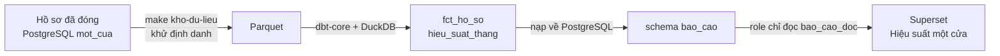

<!-- SPDX-FileCopyrightText: 2026 DTU_DZ_2 -->
<!-- SPDX-License-Identifier: GPL-3.0-or-later -->
# Dashboard báo cáo cho lãnh đạo xã

Dashboard **Hiệu suất một cửa** cho lãnh đạo xã biết, không cần cộng sổ: bao nhiêu hồ sơ đã giải quyết, bao nhiêu phần trăm trễ hạn, thủ tục nào chậm, lĩnh vực nào nhiều việc. Dashboard chạy trên Apache Superset, chỉ đọc số liệu đã khử định danh, không thấy họ tên hay số điện thoại người dân.

## Ai dùng, mở ở đâu

| | Bản demo công khai | Máy trong xã / máy của bạn |
|---|---|---|
| Địa chỉ | <https://commune.dzfullstack.com/bao-cao/> | `http://localhost:9080/bao-cao/` |
| Cần bật | đã bật sẵn | `make up-bi` (Superset), rồi `make kho-du-lieu` để có số liệu; muốn có sẵn dữ liệu giả thì `make du-lieu-demo` |
| Dữ liệu | dữ liệu giả | hồ sơ đã đóng trên máy đó (hoặc dữ liệu giả của `make du-lieu-demo`) |

- **Người xem:** tài khoản có vai **lãnh đạo** (`lanh_dao`) trên Keycloak. Tài khoản mẫu: `lanhdao01`.
- **Đăng nhập:** chỉ qua Keycloak, giống cổng cán bộ: mật khẩu + **mã OTP**. Superset không có tài khoản mật khẩu riêng nào.
- **Mật khẩu:** trên máy, `make demo-users` đặt và in mật khẩu một lần; trên demo công khai, đội cấp trực tiếp. Không ghi mật khẩu vào tài liệu, issue hay ảnh chụp (xem [Hướng dẫn buổi dùng thử](thu-nghiem.md#13-tài-khoản-mẫu)).
- Tài khoản vai khác (công dân, cán bộ) đăng nhập được nhưng không thấy dashboard nào.

### Các bước mở dashboard

1. Mở địa chỉ `/bao-cao/` ở bảng trên. Hoặc trong cổng cán bộ (`/can-bo`), đăng nhập bằng tài khoản lãnh đạo rồi bấm liên kết **Báo cáo hiệu suất**.
2. Bấm **Sign in with Keycloak**, nhập `lanhdao01`, mật khẩu, rồi mã OTP 6 số trong ứng dụng OTP trên điện thoại. Lần đầu dùng tài khoản này thì quét mã QR để cài OTP.
3. Vào **Dashboards** → **Hiệu suất một cửa**, hoặc mở thẳng `/bao-cao/superset/dashboard/hieu-suat-mot-cua/`.

<!-- Cần ảnh: toàn cảnh dashboard Hiệu suất một cửa trên bản demo công khai (dữ liệu giả), chụp sau khi đăng nhập
     bằng tài khoản lãnh đạo; lưu docs/images/bao-cao-toan-canh.webp, khai nguồn trong docs/images/README.md. -->

!!! note "Ảnh chụp"
    Trang này chưa có ảnh chụp dashboard. Dashboard chỉ mở được sau khi đăng nhập bằng tài khoản lãnh đạo có OTP, nên ảnh sẽ do người giữ tài khoản demo chụp và bổ sung sau.

## Từng biểu đồ trên dashboard

Dashboard có 5 biểu đồ, xếp 3 hàng. Mọi số liệu tính trên **hồ sơ đã đóng**, tức đã hoàn tất hoặc bị từ chối. Hồ sơ đang xử lý không có ở đây, xem ở hộp việc của cổng cán bộ.

| Biểu đồ | Kiểu | Đọc thế nào | Tính từ |
|---|---|---|---|
| **Hồ sơ đã đóng** | một con số | Tổng số hồ sơ đã hoàn tất hoặc từ chối. | `COUNT(*)` trên `bao_cao.fct_ho_so` |
| **Tỷ lệ trễ hạn** | một con số (%) | Phần trăm hồ sơ đóng sau 17:00 của ngày hạn xử lý. Càng thấp càng tốt. | trung bình cột `tre_han` của `bao_cao.fct_ho_so` |
| **Số hồ sơ theo lĩnh vực** | biểu đồ tròn | Mỗi phần là một lĩnh vực (hộ tịch, chứng thực, đất đai…), nhãn ghi tên và số hồ sơ. Cho biết bộ phận nào nhiều việc nhất. | đếm hồ sơ theo `ten_linh_vuc` của `bao_cao.fct_ho_so` |
| **Tỷ lệ trễ hạn theo tháng và thủ tục** | cột theo tháng | Mỗi tháng một nhóm cột, mỗi cột một thủ tục, nhãn trên cột là tỷ lệ trễ hạn (tháng không trễ hiện 0%). Tìm thủ tục và tháng có cột cao bất thường. | `SUM(so_tre_han) / SUM(so_ho_so)` trên `bao_cao.hieu_suat_thang` |
| **Thời gian giải quyết theo thủ tục và tháng** | bảng | Mỗi dòng một thủ tục trong một tháng: số hồ sơ, số ngày làm việc trung bình và trung vị, số giờ trung bình và trung vị, tỷ lệ trễ hạn. Trung vị ít bị kéo lệch bởi vài hồ sơ quá chậm. | cột `so_ngay_lam_viec`, `so_gio_giai_quyet`, `tre_han` của `bao_cao.fct_ho_so` |

Cách tính các cột:

- **Tháng** là tháng hồ sơ được **đóng**, theo giờ Việt Nam.
- **Số ngày làm việc** đếm từ sau ngày nộp tới hết ngày đóng, bỏ thứ Bảy, Chủ nhật và ngày nghỉ lễ trong lịch của xã.
- **Số giờ** tính từ lúc nộp tới lúc đóng, kể cả ngoài giờ hành chính.
- **Trễ hạn** nghĩa là đóng sau 17:00 ngày hạn xử lý. Hạn tự tính theo thời hạn khai trong gói thủ tục.

Bấm vào một phần của biểu đồ tròn hoặc biểu đồ cột thì các biểu đồ khác lọc theo phần đó (cross-filter của Superset); bấm lại để bỏ lọc.

<!-- Cần ảnh: cận cảnh biểu đồ "Tỷ lệ trễ hạn theo tháng và thủ tục" và bảng "Thời gian giải quyết theo thủ tục và tháng"
     trên bản demo; lưu docs/images/bao-cao-tre-han.webp, khai nguồn trong docs/images/README.md. -->

## Số liệu đi từ đâu tới dashboard



| Bước | Ở đâu trong repo |
|---|---|
| Xuất hồ sơ đã đóng, bỏ cột dữ liệu cá nhân, ghi Parquet | [`mot-cua/kho-du-lieu/chay.py`](https://github.com/commune-dxos/commune-dxos/blob/main/mot-cua/kho-du-lieu/chay.py), `mot-cua/backend/kho_du_lieu.py` |
| Dựng bảng `fct_ho_so` (một dòng mỗi hồ sơ) và `hieu_suat_thang` (tháng × thủ tục), kèm test dữ liệu | `mot-cua/kho-du-lieu/dbt/models/marts/` |
| Nạp hai bảng vào schema `bao_cao` của PostgreSQL trong một transaction | RPC `mot_cua.nap_bao_cao` (`mot-cua/db/migrations/009_kho_du_lieu.sql`); quyền đọc của Superset ở `010_doc_bao_cao.sql` |
| Dựng kết nối, dataset, biểu đồ, dashboard và vai "Lãnh đạo xã" bằng mã, mỗi lần `make up-bi` | [`mot-cua/bao-cao/superset_dung.py`](https://github.com/commune-dxos/commune-dxos/blob/main/mot-cua/bao-cao/superset_dung.py) |

Superset chỉ đọc schema `bao_cao` bằng role `bao_cao_doc`, không đọc được bảng hồ sơ gốc, không ghi được gì. Thiết kế chi tiết: [Kiến trúc §4.8 Kho dữ liệu](architecture.md#48-kho-dữ-liệu-lịch-sử-parquet--duckdb--dbt-core-80), [§4.10 Dashboard Superset](architecture.md#410-dashboard-superset-82).

## Cập nhật số liệu

Dashboard không tự chạy lại kho dữ liệu. Số liệu mới có ngay sau mỗi lần chạy:

```bash
make kho-du-lieu
```

Trên máy chủ của xã có thể đặt lịch (cron) chạy lệnh này mỗi đêm. Xem lineage và mô tả từng cột của dbt: `make kho-du-lieu-tai-lieu` rồi mở `http://127.0.0.1:8580`.

## Gặp lỗi thì làm gì

| Hiện tượng | Cách xử lý |
|---|---|
| `/bao-cao/` trả 404 hoặc không mở được trên máy | Chưa bật profile `bi`: chạy `make up-bi`. |
| Đăng nhập xong không thấy dashboard nào | Tài khoản không có vai lãnh đạo. Dùng `lanhdao01` hoặc gán client role `lanh_dao` trên Keycloak. |
| Keycloak báo cần cài OTP | Lần đầu đăng nhập: quét mã QR bằng ứng dụng OTP rồi nhập mã 6 số. |
| Biểu đồ trống, "No results" | Chưa có hồ sơ đã đóng trong kho: chạy `make kho-du-lieu` (hoặc `make du-lieu-demo` để có dữ liệu giả). |
| Số liệu cũ | Chạy lại `make kho-du-lieu`; Superset không lưu tạm kết quả nên tải lại trang là thấy số mới. |
| Giao diện Superset còn vài chữ tiếng Anh (Dashboards, Sign in with Keycloak…) | Superset chưa có bản dịch tiếng Việt cho các nhãn này. |

Góp ý về con số còn thiếu: mẫu issue **Phản hồi dùng thử**, nhiệm vụ 6 trong [Hướng dẫn buổi dùng thử](thu-nghiem.md#nhiệm-vụ-6-dashboard-báo-cáo--lãnh-đạo-sinh-viên).
