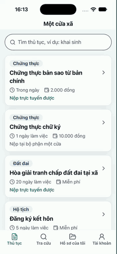
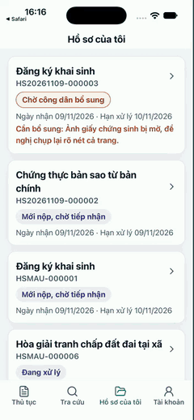

<!-- SPDX-FileCopyrightText: 2026 DTU_DZ_2 -->
<!-- SPDX-License-Identifier: GPL-3.0-or-later -->
# Cài app Android "Một cửa xã"

Trang này dành cho **người dân** muốn nộp và theo dõi hồ sơ của xã trên điện thoại Android. Không cần biết lập trình. Người phát triển muốn tự build app thì đọc [`mot-cua/di-dong/README.md`](https://github.com/commune-dxos/commune-dxos/blob/main/mot-cua/di-dong/README.md).

App **Một cửa xã** làm được:

- xem thủ tục, thời hạn, lệ phí, giấy tờ cần nộp;
- nộp hồ sơ kèm ảnh chụp giấy tờ (thiếu giấy tờ bắt buộc thì app báo ngay, chưa gửi đi);
- tra cứu hồ sơ bằng mã hồ sơ và 4 số cuối số điện thoại, không cần đăng nhập;
- xem hồ sơ của mình, bổ sung giấy tờ khi xã yêu cầu, tải biên nhận và thông báo kết quả có ký số.

App đang trỏ tới **bản demo công khai** https://commune.dzfullstack.com. Mọi dữ liệu trên đó là dữ liệu thử, **không dùng giấy tờ hay thông tin thật** của bạn.

## Cần chuẩn bị

- Điện thoại **Android 7.0 trở lên**, có mạng. Chưa có bản cho iPhone.
- Khoảng 100 MB bộ nhớ trống.
- Tài khoản công dân thử nghiệm, ví dụ `congdan01`. Mật khẩu do đội cấp trực tiếp trong buổi dùng thử, không đăng ở đâu cả (xem [Hướng dẫn buổi dùng thử](thu-nghiem.md#13-tài-khoản-mẫu)). Chỉ xem thủ tục và tra cứu thì không cần tài khoản.
- Vài ảnh giấy tờ **mẫu**, ví dụ ảnh một tờ giấy trắng ghi chữ "MẪU – GIẤY CHỨNG SINH".

## Bước 1. Tải tệp cài đặt

1. Trên điện thoại, mở trình duyệt, vào trang Release mới nhất: <https://github.com/commune-dxos/commune-dxos/releases/latest>.
2. Kéo xuống mục **Assets**, bấm tệp có tên dạng `mot-cua-xa-X.Y.Z-debug.apk` (X.Y.Z là số phiên bản, ví dụ `mot-cua-xa-0.13.0-debug.apk`).
3. Trình duyệt có thể hỏi "Tệp này có thể gây hại"; bấm **Vẫn tải xuống**.

??? note "Tùy chọn: kiểm tệp có đúng của đội không"
    Cùng trang Release có tệp `SHA256SUMS` ghi mã kiểm của từng tệp. Trên máy tính đã tải APK về:

    ```bash
    sha256sum mot-cua-xa-*.apk
    ```

    So chuỗi in ra với dòng có tên tệp APK trong `SHA256SUMS`. Khác nhau thì đừng cài, tải lại từ trang Release.

## Bước 2. Cho phép cài và cài app

App chưa có trên Google Play nên Android cần bạn cho phép cài từ nguồn ngoài, một lần:

1. Mở tệp vừa tải (thanh thông báo, hoặc ứng dụng **Tệp** → **Tệp đã tải xuống**).
2. Android báo không cho cài ứng dụng không rõ nguồn gốc: bấm **Cài đặt** (Settings) trong hộp thoại, bật **Cho phép từ nguồn này** cho trình duyệt hoặc ứng dụng Tệp, rồi quay lại. Tên mục có thể khác chút tùy hãng máy (Samsung, Xiaomi, Oppo…).
3. Bấm **Cài đặt**. Nếu Play Protect cảnh báo (vì app ký bằng khóa thử nghiệm), chọn **Vẫn cài đặt**.
4. Cài xong, bấm **Mở**. Biểu tượng **Một cửa xã** cũng có trên màn hình chính.

Cài xong có thể tắt lại quyền "Cho phép từ nguồn này" cho an toàn.

## Bước 3. Đăng nhập

App có 4 thẻ ở dưới cùng: **Thủ tục**, **Tra cứu**, **Hồ sơ của tôi**, **Tài khoản**.

1. Mở thẻ **Tài khoản**, bấm **Đăng nhập**.
2. App mở trang đăng nhập của xã (Keycloak). Nhập tên `congdan01` và mật khẩu được cấp.
3. Đăng nhập xong, app quay về, thẻ Tài khoản ghi "Đang đăng nhập với tên congdan01".

## Bước 4. Nộp thử một hồ sơ

1. Thẻ **Thủ tục**: gõ "chung thuc" vào ô **Tìm thủ tục** (không dấu cũng được), mở **Chứng thực bản sao từ bản chính**.
2. Đọc thời hạn, lệ phí, **Thành phần hồ sơ**, rồi bấm **Nộp hồ sơ**.
3. Mục **1. Người nộp**: điền họ tên và số điện thoại **giả** (4 số cuối dùng để tra cứu).
4. Mục **2. Ảnh giấy tờ**: với từng giấy tờ, bấm **Chụp ảnh** hoặc **Chọn ảnh**. Giấy tờ ghi **Bắt buộc** mà chưa có ảnh thì app báo "Hồ sơ chưa đủ".
5. Bấm **Nộp hồ sơ**. Màn **Đã nộp hồ sơ** hiện **mã hồ sơ** (dạng `HS20261112-000123`) và hạn xử lý. Ghi lại mã này.
6. Bấm **Tải biên nhận (PDF)** để mở biên nhận có ký số của xã.

Mất mạng giữa chừng thì app báo "Hồ sơ chưa gửi xong": bấm **Thử lại**, phần đã gửi được giữ lại, không tạo trùng hồ sơ.

## Bước 5. Tra cứu và theo dõi

- **Không cần đăng nhập:** thẻ **Tra cứu**, nhập **Mã hồ sơ** và **4 số cuối số điện thoại** đã khai, bấm **Tra cứu**.
- **Đã đăng nhập:** thẻ **Hồ sơ của tôi** liệt kê các hồ sơ, trạng thái và hạn; kéo xuống để làm mới.
- Khi xã yêu cầu **bổ sung**: hồ sơ có nhãn "Cần bổ sung". Mở hồ sơ, đọc **Yêu cầu của bộ phận một cửa**, chụp thêm ảnh cho giấy tờ được yêu cầu, bấm **Nộp lại hồ sơ**.
- Khi có kết quả: mở hồ sơ, bấm **Tải thông báo kết quả (PDF)**.

## Hình ảnh

Chưa có ảnh chụp trên máy Android. Hai đoạn quay dưới đây quay trên **iOS Simulator** (bản dựng thử, dữ liệu mẫu giả); giao diện app trên Android giống nhau, chỉ khác hộp thoại hệ thống (chọn ảnh, mở PDF).

<p align="center">
  
  &nbsp;&nbsp;
  
</p>

<!-- Cần ảnh: chụp màn hình trên máy Android thật hoặc máy ảo (dữ liệu giả) cho bước 2 (hộp thoại cho phép cài),
     bước 3 (thẻ Tài khoản đã đăng nhập), bước 4 (màn Đã nộp hồ sơ); lưu ở docs/images/, khai nguồn trong docs/images/README.md. -->

## Lỗi hay gặp

| Hiện tượng | Cách xử lý |
|---|---|
| Bấm tệp APK không có gì xảy ra, hoặc báo "Đã chặn cài đặt" | Làm lại bước 2: bật **Cho phép từ nguồn này** cho đúng ứng dụng đang mở tệp (trình duyệt hoặc Tệp). |
| "Ứng dụng chưa được cài đặt" khi cài đè bản cũ | Mỗi bản thử nghiệm có thể ký bằng khóa khác. Gỡ app **Một cửa xã** cũ (giữ ngón tay trên biểu tượng → Gỡ cài đặt) rồi cài lại. Sau đó phải đăng nhập lại. |
| "Ứng dụng không tương thích" hoặc không thấy nút Cài đặt | Máy chạy Android cũ hơn 7.0, chưa hỗ trợ. |
| Đăng nhập báo sai tên hoặc mật khẩu | Kiểm lại chữ hoa, chữ thường; hỏi người tổ chức buổi thử. Mật khẩu có thể đã được đổi sau buổi thử trước. |
| Trang đăng nhập không mở, hoặc mở xong không quay về app | Kiểm mạng, đóng app rồi mở lại; thử lại sau vài phút. Vẫn lỗi thì báo lại như dưới đây. |
| App báo "Phiên đăng nhập đã hết hạn" | Bình thường khi để lâu không dùng: bấm **Đăng nhập** lại. |
| Dải "Đang không có kết nối mạng" | Bật Wi-Fi hoặc dữ liệu di động; app tự tải lại khi có mạng. |
| "Chưa tải được dữ liệu" | Bấm **Thử lại**. Bản demo có thể đang khởi động lại. |

## Báo lỗi, góp ý

1. Mở [Issues → New issue](https://github.com/commune-dxos/commune-dxos/issues/new/choose), chọn mẫu **Phản hồi dùng thử** (cần tài khoản GitHub; không có thì nhờ người tổ chức buổi thử ghi hộ).
2. Ghi: bạn đang làm bước nào, bấm gì, thấy gì, mong thấy gì; **mã hồ sơ** nếu có; hãng và đời máy, phiên bản Android, phiên bản app (thẻ **Tài khoản** → **Phiên bản app**).
3. Ảnh chụp màn hình thì che thông tin cá nhân trước.

Issue là công khai: **không dán mật khẩu, họ tên, số điện thoại, số CCCD hay ảnh giấy tờ thật.**
