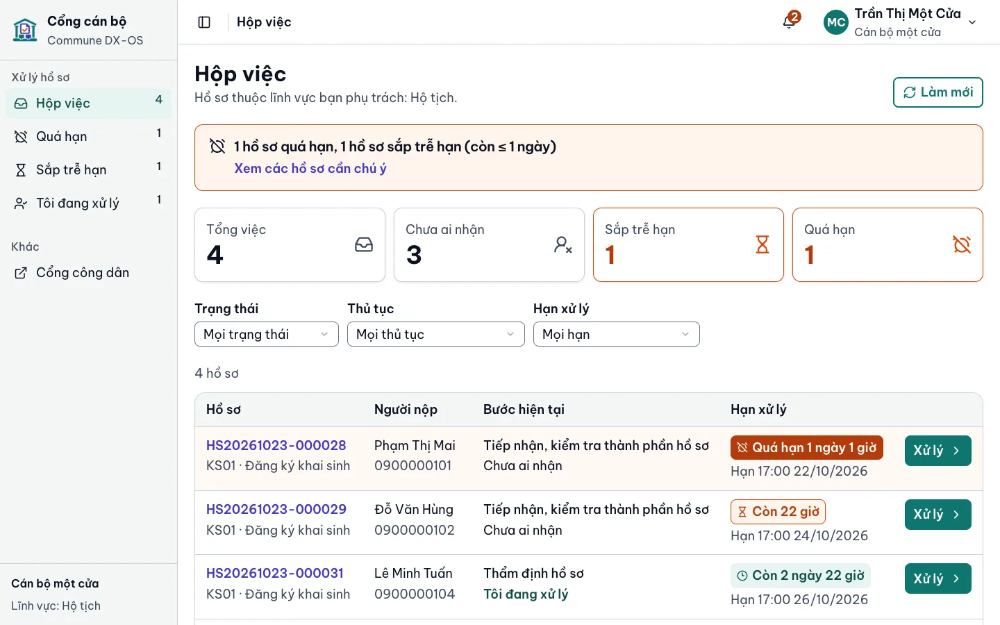
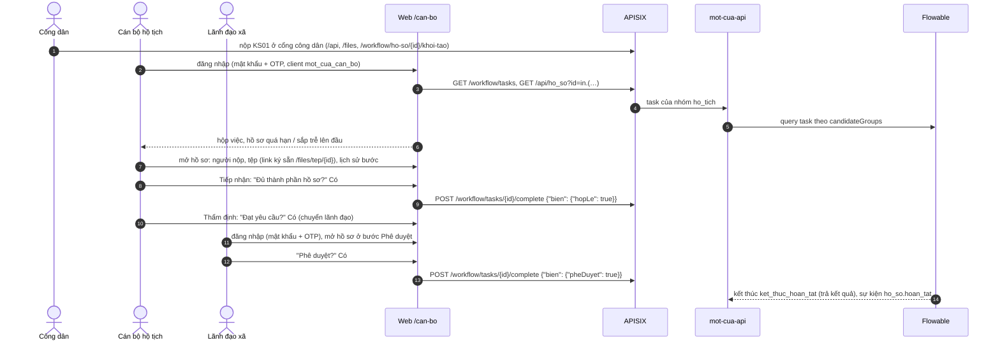
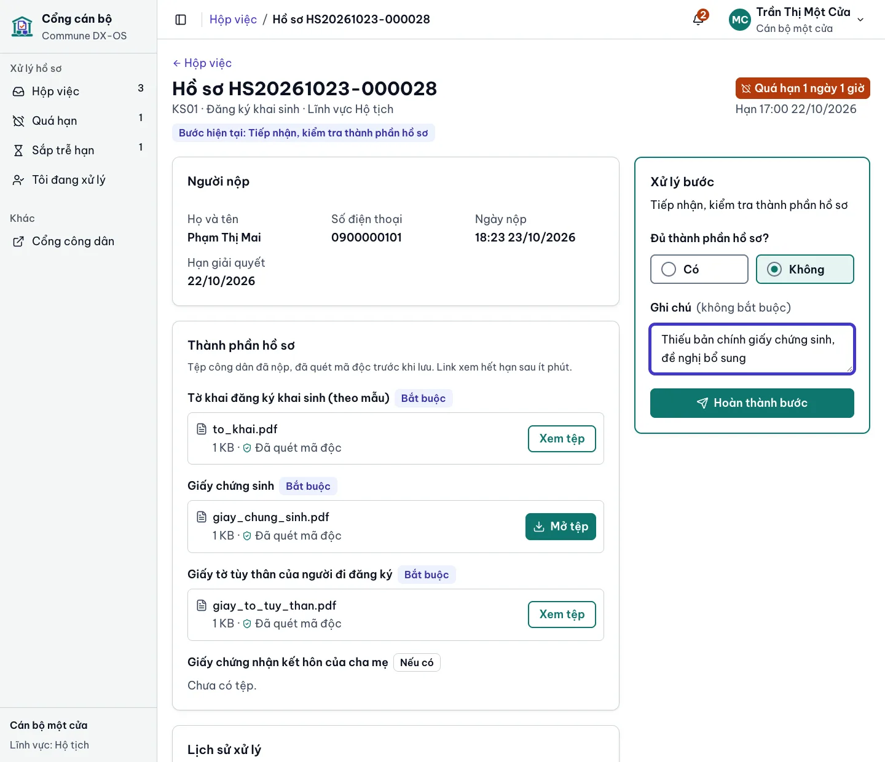
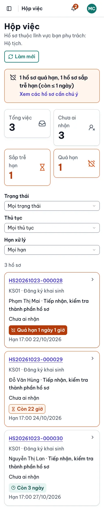
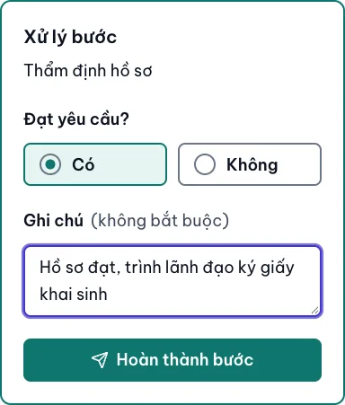

<!-- SPDX-FileCopyrightText: 2026 DTU_DZ_2 -->
<!-- SPDX-License-Identifier: GPL-3.0-or-later -->
# Cổng cán bộ: luồng xử lý hồ sơ

Cổng cán bộ (#55) là ứng dụng Tầng 2 cho **cán bộ một cửa, cán bộ chuyên môn và lãnh đạo xã**: đăng nhập một lần bằng mật khẩu + OTP, xem hồ sơ thuộc lĩnh vực mình phụ trách, xử lý từng bước của quy trình. Cổng chạy ở **http://localhost:9080/can-bo** sau `make up`, cùng ứng dụng web với cổng công dân ([`mot-cua/web-cong-dan/`](../mot-cua/web-cong-dan/), mã ở `src/can-bo/`) và chỉ gọi lõi qua APISIX.

<p>
  
</p>

## Đăng nhập và quyền

| Bước | Ai kiểm | Cách |
|---|---|---|
| Đăng nhập | Keycloak realm `dxos` | client public **`mot_cua_can_bo`** (riêng với `mot_cua_web` của cổng công dân), Authorization Code + PKCE S256, chỉ nhận `redirect_uri` dưới `/can-bo/`. Web không có bí mật nào |
| OTP | Keycloak | tài khoản vai `can_bo`, `lanh_dao` có required action `CONFIGURE_TOTP`: lần đầu quét mã QR bằng ứng dụng OTP, các lần sau nhập mật khẩu rồi mã 6 số |
| Vào cổng | web | đọc client role `dxos_api` trong access token; không có `can_bo` hay `lanh_dao` (ví dụ công dân) thì hiện **"Bạn không có quyền vào cổng cán bộ"**, không gọi API nào |
| Thấy hồ sơ nào | PostgreSQL RLS | cán bộ chỉ thấy hồ sơ của lĩnh vực mình phụ trách (`mot_cua.can_bo_linh_vuc`), lãnh đạo thấy tất cả |
| Thấy task nào, xử lý bước nào | `mot-cua-api` | task Flowable giao cho mình hoặc thuộc nhóm ứng viên của mình (`candidateGroups` = mã lĩnh vực, hoặc `lanh_dao`); sai nhóm → 403, sai biến → 400, người khác vừa nhận → 409, web hiện nguyên câu báo |

Web chỉ dùng vai trò để chọn màn hình; mọi quyền thật do APISIX (JWT), `mot-cua-api` (kiểm lại chữ ký, nhóm) và RLS kiểm ở từng request.

## Luồng một hồ sơ khai sinh (KS01)



| Bước BPMN (KS01) | Ai | Form trên cổng | Kết quả |
|---|---|---|---|
| `tiep_nhan` – Tiếp nhận, kiểm tra thành phần | cán bộ hộ tịch | **Đủ thành phần hồ sơ?** Có / Không; Ghi chú | Có → thẩm định; Không → **yêu cầu bổ sung** (task về công dân) |
| `tham_dinh` – Thẩm định | cán bộ hộ tịch | **Đạt yêu cầu?** Có / Không; Ghi chú | Có → **chuyển lãnh đạo**; Không → **từ chối** |
| `phe_duyet` – Phê duyệt, ký | lãnh đạo | **Phê duyệt?** Có / Không; Ghi chú | Có → **hoàn tất, trả kết quả**; Không → trả lại thẩm định |

Chứng thực bản sao (CT01) có thêm ô số: "Số trang của một bản" (không bắt buộc) và "Số bản đã chứng thực" (bắt buộc, bước trả kết quả).

## Form sinh từ gói thủ tục

Cổng không biết thủ tục nào. Form của mỗi bước sinh từ `flowable:formProperty` trong `thu-tuc/<goi>/quy-trinh.bpmn20.xml`; bộ nạp gói ghi vào cột `thu_tuc.bien_theo_buoc` dạng `{bước: {biến: {kieu, bat_buoc, ten}}}` (nhãn `ten` = thuộc tính `name`):

| `type` của formProperty | Ô trên form | Gửi lên API |
|---|---|---|
| `boolean` | hai lựa chọn Có / Không | `true` / `false` |
| `long` | ô số nguyên | số |
| `string` | ô nhiều dòng | chuỗi (để trống thì không gửi) |

Trường `required="true"` đứng đầu và phải điền: thiếu thì form báo lỗi tại chỗ, **không gửi request nào**; `mot-cua-api` kiểm lại đúng danh sách đó. Thêm thủ tục mới ([`thu-tuc.md`](thu-tuc.md)) là cổng cán bộ có form cho các bước của thủ tục đó, không sửa mã web.

<p>
  
  
</p>
<p>
  
</p>

## Hạn xử lý và cảnh báo

- Hạn lấy từ biến `hanXuLyLuc` của quy trình (`mot-cua-api` đặt lúc khởi tạo = `ho_so.han_xu_ly` 17:00 giờ Việt Nam); biến `quaHan` (hẹn giờ trong BPMN) đặt `true` khi tới hạn.
- Thẻ hạn ghi **còn bao lâu** ("Còn 5 giờ", "Quá hạn 1 ngày") và hạn chính xác; **sắp trễ** = còn ≤ 1 ngày (viền đỏ son, nền nhạt), **quá hạn** = nền đỏ son. Mức phân biệt bằng biểu tượng và chữ, không chỉ bằng màu.
- Hộp việc xếp quá hạn, sắp trễ lên đầu; ô số liệu và chuông ở đầu trang đếm từ dữ liệu đã có, tải lại mỗi phút. Đẩy cảnh báo realtime qua RabbitMQ là #56.
- Bộ lọc (trạng thái nhận, thủ tục, hạn) nằm trên URL: `/can-bo?han=qua_han`, `/can-bo?han=sap_tre`, `/can-bo?trang_thai=cua_toi`, `/can-bo?thu_tuc=KS01`.

## Hạ tầng

| Thành phần | Cấu hình |
|---|---|
| APISIX | route `mot-cua-web-can-bo` (`/can-bo`, `/can-bo/*`, chỉ GET/HEAD, 300 request/phút/IP, `X-Robots-Tag: noindex, nofollow`) tới dịch vụ `mot-cua-web` – [`nen-tang/apisix/apisix.yaml`](../nen-tang/apisix/apisix.yaml) |
| nginx của `mot-cua-web` | SPA fallback cho `/can-bo/…`, CSP không `unsafe-inline`, `frame-ancestors 'none'`; `/cau-hinh.js` có `clientIdCanBo` từ biến `DXOS_OIDC_CLIENT_ID_CAN_BO` – [`nginx/default.conf.template`](../mot-cua/web-cong-dan/nginx/default.conf.template) |
| Keycloak | client `mot_cua_can_bo` trong [`mot-cua/keycloak/realm.json`](../mot-cua/keycloak/realm.json), `tang2-realm` tự thêm vào realm có sẵn ở lần `make up` tới |
| Gói JS | cổng cán bộ nạp lười (`cong-can-bo-*.js`), người dân không tải mã của cán bộ |

Không mở cổng nào ra host: web, API, Flowable, Garage chỉ đi qua APISIX ở cổng 9080.

## Chạy thử

```bash
make up && make smoke     # smoke mục 4i: trang /can-bo, client mot_cua_can_bo, E2E cán bộ → lãnh đạo
make demo-users           # đặt mật khẩu chung cho tài khoản mẫu và in ra
```

Mở **http://localhost:9080/can-bo**, đăng nhập:

| Tài khoản (dữ liệu giả) | Vai | Thấy gì |
|---|---|---|
| `canbo01` | cán bộ hộ tịch | task KS01 (tiếp nhận, thẩm định) |
| `canbo02` | cán bộ chứng thực | task CT01; **không** thấy hồ sơ KS01 |
| `canbo03` | cán bộ đất đai | chưa có thủ tục nào có gói: hộp việc trống |
| `lanhdao01` | lãnh đạo | bước phê duyệt, ký của mọi thủ tục |
| `congdan01` | công dân | trang "không có quyền" |

Lần đầu Keycloak đòi cài OTP: quét mã QR bằng FreeOTP, Google Authenticator… Smoke dùng người dùng tạm có OTP và xóa khi xong, không đụng tài khoản mẫu. Chạy dev (`npm run dev` trong `mot-cua/web-cong-dan/`) thì mở http://localhost:5173/can-bo.
