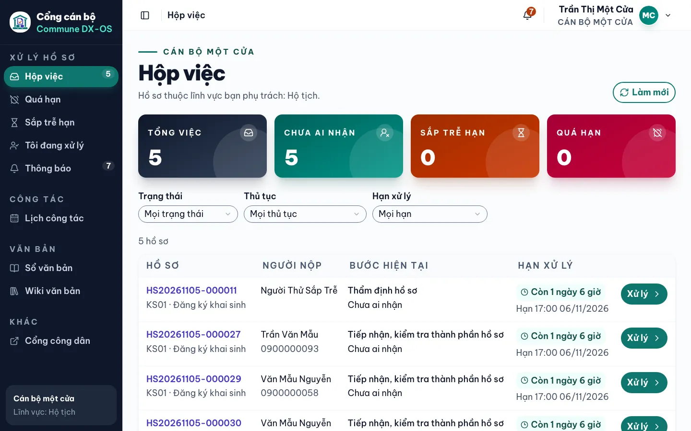
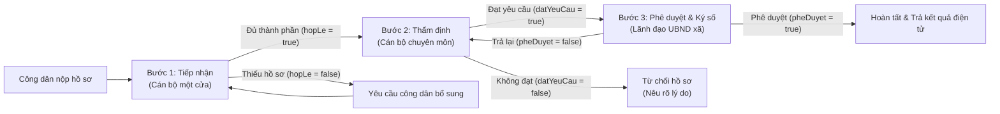
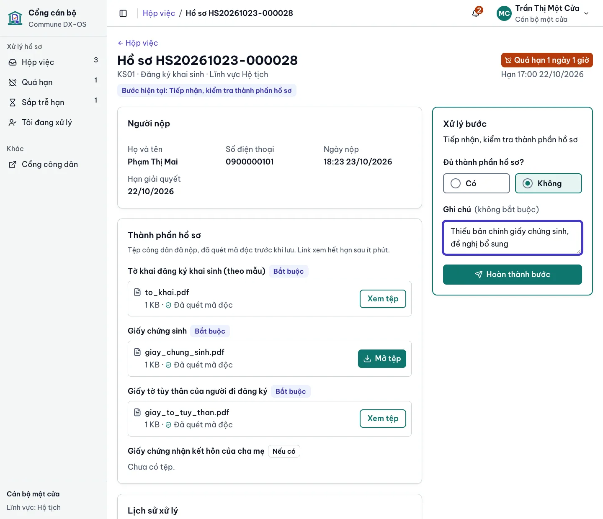
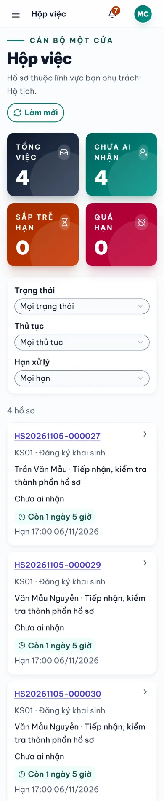
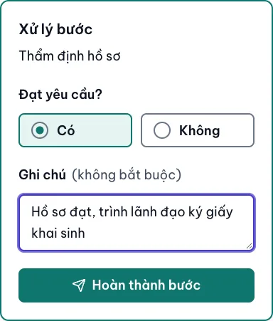

<!-- SPDX-FileCopyrightText: 2026 DTU_DZ_2 -->
<!-- SPDX-License-Identifier: GPL-3.0-or-later -->
# Sổ tay hướng dẫn vận hành Cổng Một Cửa cho cán bộ xã

Tài liệu này hướng dẫn chi tiết quy trình thao tác hàng ngày trên **Cổng cán bộ** (`/can-bo`) dành cho **cán bộ tiếp nhận một cửa, cán bộ chuyên môn, văn thư và lãnh đạo UBND cấp xã**.

  

---

## 1. Đăng nhập SSO Keycloak và xác thực hai yếu tố (OTP)

Hệ thống sử dụng cơ chế đăng nhập một lần (Single Sign-On) qua **Keycloak** (realm `dxos`, client `mot_cua_can_bo` chuẩn OAuth 2.0 Authorization Code + PKCE S256). Mọi tài khoản cán bộ đều bắt buộc bật xác thực hai lớp (TOTP) để bảo vệ dữ liệu công vụ.

### 1.1. Các bước đăng nhập

1. Mở trình duyệt và truy cập địa chỉ Cổng cán bộ:
   - Môi trường tại xã / máy trạm: `http://localhost:9080/can-bo`
   - Môi trường thử nghiệm công khai: `https://commune.dzfullstack.com/can-bo`
2. Hệ thống tự động chuyển hướng sang trang đăng nhập tập trung của **Keycloak**:
   - Nhập **Tên đăng nhập** và **Mật khẩu** công vụ được cấp.
   - **Nếu đăng nhập lần đầu:** Màn hình hiện mã QR (`CONFIGURE_TOTP`). Mở ứng dụng tạo mã OTP trên điện thoại (**FreeOTP** hoặc **Google Authenticator**), quét mã QR, nhập mã 6 chữ số hiển thị trên điện thoại để hoàn tất kích hoạt.
   - **Các lần đăng nhập tiếp theo:** Nhập mã OTP 6 chữ số hiện hành từ ứng dụng điện thoại.

### 1.2. Phân quyền tự động theo vai trò và lĩnh vực

Ngay sau khi đăng nhập, hệ thống kiểm tra quyền trong JWT và áp dụng chính sách bảo mật tới từng dòng dữ liệu (PostgreSQL Row-Level Security):

| Vai trò trên hệ thống | Tài khoản mẫu | Phạm vi dữ liệu & Màn hình làm việc |
|---|---|---|
| **Cán bộ hộ tịch** (`can_bo`) | `canbo01` | Chỉ thấy và xử lý hồ sơ thuộc lĩnh vực **Hộ tịch** (`ho_tich`), ví dụ: Đăng ký khai sinh (`KS01`). |
| **Cán bộ chứng thực** (`can_bo`) | `canbo02` | Chỉ thấy và xử lý hồ sơ thuộc lĩnh vực **Tư pháp – Chứng thực** (`chung_thuc`), ví dụ: Chứng thực bản sao (`CT01`). |
| **Cán bộ đất đai** (`can_bo`) | `canbo03` | Phụ trách lĩnh vực **Đất đai** (`dat_dai`). Không nhìn thấy hồ sơ của hộ tịch hay chứng thực. |
| **Văn thư xã** (`van_thu`) | `vanthu01` | Vào thẳng **Sổ văn bản đến/đi** (`/can-bo/van-ban`), quản lý **Wiki văn bản** và dự kiến **Lịch công tác**. Không truy cập hồ sơ cá nhân của công dân. |
| **Lãnh đạo UBND xã** (`lanh_dao`) | `lanhdao01` | Xem toàn bộ hồ sơ của xã, thực hiện bước **Phê duyệt & Ký số**, ký ban hành văn bản đi, duyệt lịch công tác và xem **Dashboard báo cáo** (`/bao-cao/`). |

---

## 2. Tiếp nhận, thẩm định và luân chuyển hồ sơ qua Flowable BPMN

Mỗi hồ sơ công dân nộp từ Cổng công dân hoặc Ứng dụng di động sẽ tự động kích hoạt một tiến trình tương ứng trên máy chủ quy trình **Flowable BPMN**.

### 2.1. Theo dõi Hộp việc và hạn xử lý

Tại màn hình **Hộp việc** (`/can-bo`):

- **Thứ tự ưu tiên:** Hồ sơ **Quá hạn** (nền đỏ son) và **Sắp trễ hạn** (còn ≤ 1 ngày làm việc, viền đỏ) luôn được đẩy lên đầu danh sách.
- **Bộ lọc nhanh trên thanh bên:**
  - `Hộp việc` (`/can-bo`): Toàn bộ công việc thuộc lĩnh vực phụ trách.
  - `Quá hạn` (`/can-bo?han=qua_han`): Các hồ sơ đã vượt mốc 17:00 của ngày hẹn trả.
  - `Sắp trễ hạn` (`/can-bo?han=sap_tre`): Hồ sơ còn dưới 1 ngày làm việc.
  - `Tôi đang xử lý` (`/can-bo?trang_thai=cua_toi`): Hồ sơ cán bộ đã nhận xử lý.
- **Thông báo thời gian thực (`/can-bo/thong-bao`):** Khi có hồ sơ sắp trễ hạn, biểu tượng chuông ở góc trên tự động nhảy số qua luồng Server-Sent Events mà không cần tải lại trang.

  
  

### 2.2. Thao tác xử lý từng bước nghiệp vụ

Biểu mẫu xử lý ở cột bên phải được **sinh tự động từ cấu hình gói thủ tục** (`flowable:formProperty` trong tệp `quy-trinh.bpmn20.xml`).

#### Bước 1: Tiếp nhận và kiểm tra thành phần (`tiep_nhan`)
1. Bấm vào mã hồ sơ trong Hộp việc để mở trang chi tiết.
2. Kiểm tra thông tin tờ khai và bấm **Xem tệp** / **Mở tệp** ở mục **Thành phần hồ sơ** (mọi tệp tới được bước này đều đã vượt qua bước quét mã độc ClamAV).
3. Tại khung **Xử lý bước**:
   - Nếu hồ sơ đầy đủ, rõ ràng: Chọn **Có** ở câu hỏi *"Đủ thành phần hồ sơ?"*, nhập ghi chú (nếu có) và bấm **Hoàn thành bước** để chuyển sang bước Thẩm định.
   - Nếu thiếu giấy tờ hoặc ảnh chụp mờ: Chọn **Không**, ghi rõ giấy tờ cần bổ sung vào ô **Ghi chú**, bấm **Hoàn thành bước**. Hồ sơ sẽ chuyển sang trạng thái *Chờ công dân bổ sung*.

#### Bước 2: Thẩm định chuyên môn (`tham_dinh`)
1. Cán bộ chuyên môn đối chiếu thông tin hồ sơ với sổ bộ và quy định pháp luật hiện hành.
2. Tại khung **Xử lý bước**:
   - Chọn **Có** ở mục *"Đạt yêu cầu?"*, nhập nội dung đề xuất trình ký vào ô **Ghi chú**, bấm **Hoàn thành bước** để trình Lãnh đạo xã.
   - Nếu hồ sơ không đủ điều kiện giải quyết theo quy định: Chọn **Không**, bắt buộc ghi rõ căn cứ pháp lý và lý do từ chối vào ô **Ghi chú**, bấm **Hoàn thành bước**.

  

#### Bước 3: Lãnh đạo xã phê duyệt (`phe_duyet`)
1. Lãnh đạo xã đăng nhập vào `/can-bo`, mở hồ sơ đang ở bước **Phê duyệt, ký**.
2. Xem lại toàn bộ lịch sử các bước tiếp nhận, thẩm định và ghi chú của cán bộ chuyên môn.
3. Tại khung **Xử lý bước**:
   - Chọn **Có** ở câu hỏi *"Phê duyệt?"* và bấm **Hoàn thành bước** để kết thúc quy trình và phát hành kết quả cho công dân.
   - Chọn **Không** kèm ý kiến chỉ đạo nếu yêu cầu cán bộ chuyên môn thẩm định lại.

---

## 3. Ký số tài liệu kết quả và văn bản qua Step-CA nội bộ

Hệ thống tích hợp sẵn hạ tầng chứng thư số nội bộ **Step-CA** kết hợp kho khóa **OpenBao** và dịch vụ **`ky-so`**, tạo chữ ký số chuẩn **PAdES-B-B** nhúng trực tiếp vào tệp PDF theo đúng quy định về văn bản điện tử của cơ quan nhà nước.

### 3.1. Ký số ban hành văn bản đi (`/can-bo/van-ban`)

1. **Văn thư soạn dự thảo:**
   - Truy cập mục **Sổ văn bản** (`/can-bo/van-ban?chieu=di`).
   - Điền thông tin dự thảo văn bản đi: Loại văn bản (Quyết định, Công văn, Thông báo, Báo cáo, Tờ trình, Giấy xác nhận), Trích yếu, Nơi nhận và Nội dung.
   - Bấm lưu để tạo bản dự thảo chờ ký.
2. **Lãnh đạo xã ký ban hành:**
   - Lãnh đạo xã đăng nhập và mở **Sổ văn bản đi** (`/can-bo/van-ban?chieu=di`).
   - Tại dòng văn bản dự thảo, bấm nút **Ký ban hành**.
   - Hệ thống tự động cấp số văn bản đi, kết xuất tệp PDF chuẩn thể thức, gọi dịch vụ `ky-so` lấy chứng thư số từ Step-CA để ký số PAdES và lưu trữ lên kho đối tượng Garage.
   - Màn hình thông báo: *"Đã ký ban hành văn bản `<Số ký hiệu>`"*.

### 3.2. Xác minh chữ ký số trên tệp PDF

Mọi cán bộ và lãnh đạo có thể kiểm tra tính hợp lệ của bất kỳ tệp PDF kết quả hoặc văn bản đến nào:

1. Mở trang **Sổ văn bản** (`/can-bo/van-ban`).
2. Tại thẻ **Xác minh PDF**, chọn tệp PDF cần kiểm tra từ máy tính.
3. Hệ thống tự động kiểm tra chuỗi chứng thư và hiển thị:
   - Trạng thái toàn vẹn của tài liệu (Hợp lệ / Đã bị thay đổi sau khi ký).
   - Danh tính chủ thể ký và thời điểm ký số.
   - Xác nhận chứng thư có thuộc thẩm quyền phát hành của UBND xã hay không.

---

## 4. Theo dõi Dashboard hiệu suất xử lý hồ sơ trên Apache Superset (`/bao-cao`)

Lãnh đạo xã theo dõi toàn diện chất lượng phục vụ của bộ phận một cửa thông qua bảng điều khiển phân tích số liệu **Apache Superset** (chỉ đọc dữ liệu đã khử định danh từ schema `bao_cao`).

### 4.1. Cách truy cập Dashboard

1. Từ giao diện Cổng cán bộ (`/can-bo`), đăng nhập bằng tài khoản có vai trò `lanh_dao` (ví dụ `lanhdao01`) và bấm vào liên kết **Báo cáo hiệu suất** (hoặc mở trực tiếp địa chỉ `/bao-cao/`).
2. Bấm **Sign in with Keycloak** (hệ thống tự nhận phiên SSO đang đăng nhập của lãnh đạo).
3. Chọn mục **Dashboards** → **Hiệu suất một cửa**.

### 4.2. Ý nghĩa các chỉ số điều hành

| Biểu đồ trên Dashboard | Ý nghĩa phục vụ chỉ đạo, điều hành |
|---|---|
| **Hồ sơ đã đóng** | Tổng số hồ sơ đã giải quyết xong (hoàn tất hoặc từ chối) trong kỳ. |
| **Tỷ lệ trễ hạn (%)** | Tỷ lệ phần trăm hồ sơ đóng sau 17:00 của ngày hẹn trả. Chỉ số cảnh báo kỷ luật hành chính. |
| **Số hồ sơ theo lĩnh vực** | Biểu đồ tròn phản ánh khối lượng công việc giữa Hộ tịch, Chứng thực, Đất đai để bố trí nhân sự hợp lý. |
| **Tỷ lệ trễ hạn theo tháng và thủ tục** | Biểu đồ cột giúp phát hiện chính xác thủ tục nào hoặc tháng nào có tỷ lệ trễ hạn tăng đột biến. |
| **Thời gian giải quyết theo thủ tục và tháng** | Bảng thống kê số ngày làm việc và số giờ giải quyết **trung bình** và **trung vị** của từng thủ tục. |

> **Lưu ý vận hành:** Để cập nhật ngay số liệu hồ sơ vừa đóng trong ngày lên Dashboard (ngoài lịch tự động chạy hàng đêm), quản trị viên chạy lệnh `make kho-du-lieu` để thực thi pipeline xuất Parquet và biến đổi `dbt-core` trên DuckDB. Chi tiết xem thêm tại [Dashboard báo cáo cho lãnh đạo xã](bao-cao.md).

---

## 5. Xử lý các tình huống thường gặp

| Tình huống / Thông báo trên màn hình | Nguyên nhân | Cách khắc phục |
|---|---|---|
| *"Bạn không có quyền vào cổng cán bộ"* | Đăng nhập nhầm bằng tài khoản công dân (`congdan01`) hoặc tài khoản chưa được gán role `can_bo`, `van_thu`, `lanh_dao`. | Đăng xuất và đăng nhập đúng tài khoản cán bộ được phân công. |
| Báo lỗi `409 Conflict` khi bấm *Hoàn thành bước* | Một cán bộ khác cùng phụ trách lĩnh vực vừa nhận hoặc hoàn thành bước đó trước vài giây. | Tải lại trang Hộp việc (`/can-bo`) để cập nhật danh sách task mới nhất. |
| Báo lỗi `403 Forbidden` khi thao tác hồ sơ | Hồ sơ đang ở bước thuộc thẩm quyền nhóm khác (ví dụ cán bộ chuyên môn bấm duyệt bước của lãnh đạo). | Kiểm tra lại cột **Bước hiện tại** trên trang chi tiết hồ sơ. |
| Báo lỗi `422 Unprocessable Entity` khi tải tệp văn bản đến | Dịch vụ ClamAV phát hiện tệp chứa chữ ký mã độc hoặc định dạng tệp bị hỏng. | Quét sạch virus trên máy trạm và xuất lại tệp PDF/ảnh sạch trước khi tải lên. |
| Không thấy hồ sơ của lĩnh vực khác trong Hộp việc | Chính sách RLS (`mot_cua.can_bo_linh_vuc`) chỉ cho phép cán bộ xem hồ sơ thuộc lĩnh vực mình phụ trách. | Liên hệ quản trị viên nếu cán bộ được điều chuyển hoặc kiêm nhiệm thêm lĩnh vực mới. |
