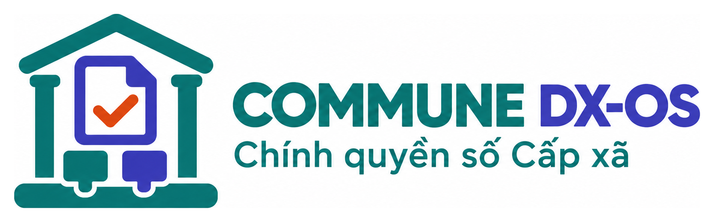

# Tài liệu Commune DX-OS

{ width="420" }

**Commune DX-OS** là hệ điều hành chính quyền số cấp xã, nguồn mở (GPL-3.0-or-later): lõi headless Tầng 1 (đăng nhập một lần, cổng API, dữ liệu, quy trình) và bộ máy một cửa Tầng 2 chạy mọi thủ tục hành chính. Mỗi thủ tục là một **gói** `thu-tuc/<ma>/`; thêm thủ tục là thêm một thư mục, không sửa mã.

## Xem nhanh

Người dân nộp hồ sơ đăng ký khai sinh (thiếu giấy tờ bị chặn, đủ thì nộp được), rồi tra cứu tiến độ bằng mã hồ sơ:

Cán bộ hộ tịch đăng nhập mật khẩu + OTP, xử lý bước tiếp nhận của hồ sơ vừa nộp ([luồng chi tiết](cong-can-bo.md)):

Quay thật trên máy với tài khoản và giấy tờ mẫu giả (`make quay-demo`).

## Bạn cần gì?

| Bạn là | Đọc |
|---|---|
| Người dân, cán bộ một cửa | [Danh mục thủ tục](danh-muc-thu-tuc.md): thời hạn, lệ phí, thành phần hồ sơ, các bước xử lý của từng thủ tục |
| Lập trình viên thêm thủ tục | [Thêm một thủ tục mới trong 5 bước](thu-tuc.md), [bộ máy một cửa](mot-cua.md) |
| Người vận hành | [Cài đặt và chạy từ máy sạch](cai-dat.md) |
| Người tìm hiểu kiến trúc | [Kiến trúc tổng thể](architecture.md), [đối chiếu yêu cầu đề thi](de-thi-mapping.md) |
| Người muốn đóng góp | [Hướng dẫn đóng góp](dong-gop.md), [kế hoạch](PLAN.md), [nhật ký thay đổi](thay-doi.md) |

**English:** [overview](en/index.md) · [quick start from a clean machine](en/quick-start.md) · [adding a procedure, A to Z](thu-tuc.md#ví-dụ-từ-a-đến-z-gói-xác-nhận-thông-tin-về-cư-trú) · [architecture](en/architecture.md) · [contributing](en/contributing.md).

Trang này dựng tự động từ thư mục `docs/` và các gói `thu-tuc/` của [repo](https://github.com/commune-dxos/commune-dxos) mỗi khi nhánh `main` thay đổi. Thấy sai, bấm biểu tượng sửa ở đầu mỗi trang để mở PR.
