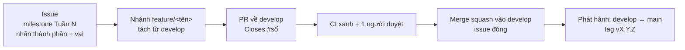
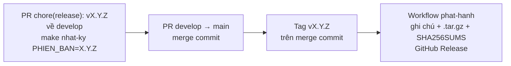

<!-- SPDX-FileCopyrightText: 2026 DTU_DZ_2 -->
<!-- SPDX-License-Identifier: GPL-3.0-or-later -->
# Quy trình làm việc và theo dõi tiến độ

Đội DTU_DZ_2 theo dõi tiến độ ngay trên GitHub, để ai cũng xem được tuần này đội làm gì, việc nào xong, việc nào đang chờ duyệt (D-009 hướng 3, #34). CHANGELOG và ghi chú phát hành sinh tự động từ commit (D-009 hướng 4, #36), xem mục 5–6.

| Xem ở đâu | Link |
|---|---|
| Milestones theo tuần | <https://github.com/commune-dxos/commune-dxos/milestones?state=all> |
| Bảng Project "Commune DX-OS – Lộ trình" | <https://github.com/orgs/commune-dxos/projects> |
| Kế hoạch 7 tuần (nguồn của milestone) | [Kế hoạch](PLAN.md) |
| Issue đang mở | <https://github.com/commune-dxos/commune-dxos/issues> |

## 1. Milestone theo tuần

Mỗi tuần trong [kế hoạch](PLAN.md) là một milestone `Tuần 1` … `Tuần 7`. Hạn của milestone là ngày cuối tuần trong kế hoạch; `Tuần 7` hết hạn ngày 06/12/2026, trước 17:00 là giờ nộp bài.

| Milestone | Thời gian | Mục tiêu |
|---|---|---|
| Tuần 1 | 15–21/10 | Nền móng → v0.0.1 |
| Tuần 2 | 22–28/10 | Lõi headless → v0.1.0, gói thủ tục, trang tài liệu (thực tế: v0.1.0 → v0.3.0) |
| Tuần 3 | 29/10–04/11 | Luồng nghiệp vụ chính: Poka-yoke, cổng công dân, cổng cán bộ → v0.4.0 |
| Tuần 4 | 05–11/11 | Tầng [D] + bảo mật + VPS → v0.5.0 |
| Tuần 5 | 12–18/11 | Tầng [I] + demo công khai → v0.6.0 |
| Tuần 6 | 19–25/11 | Tuần UX + cộng đồng, tài liệu song ngữ, tập trình bày → v0.7.0 |
| Tuần 7 | 26/11–06/12 | Đóng băng PoF, nộp bài → v1.0.0 |

Đội làm nhanh hơn lịch nên số bản phát hành thực tế khác số dự kiến lúc lập kế hoạch; bảng phát hành ở đầu [kế hoạch](PLAN.md).

- Mỗi dòng `[ ]` trong kế hoạch là một issue, gắn vào milestone của tuần đó. PR đóng issue gắn cùng milestone.
- Việc làm sớm hơn kế hoạch vẫn để ở milestone của tuần ghi trong kế hoạch. Việc phát sinh giữa chừng vào milestone đang mở gần nhất.
- Milestone đóng khi mọi việc của tuần đã merge. Tỷ lệ phần trăm trên trang Milestones là tiến độ của tuần.
- Nhãn `tuan-2` … `tuan-7` là cách cũ, giữ lại cho các issue đã gắn; việc mới dùng milestone.

## 2. Nhãn

Mỗi issue và PR có ba loại nhãn:

| Loại | Nhãn | Ai gắn |
|---|---|---|
| Thành phần | `nen-tang`, `mot-cua`, `thu-tuc`, `docs`, `ci` | PR: workflow `gan-nhan` tự gắn theo tệp sửa. Issue: người tạo |
| Vai phụ trách | `vai-1-core`, `vai-2`, `vai-3` | Người tạo issue |
| Khác | `pof` (ảnh hưởng điểm kho mã), `bug`, `enhancement`, `user-feedback`… | Người tạo issue |

Nhãn thành phần ứng với thư mục:

| Nhãn | Thư mục, tệp |
|---|---|
| `nen-tang` | `nen-tang/**` – lõi headless Tầng 1 |
| `mot-cua` | `mot-cua/**` – bộ máy một cửa Tầng 2 |
| `thu-tuc` | `thu-tuc/**` – gói thủ tục |
| `docs` | `docs/**`, `mkdocs.yml`, `*.md` ở gốc, trừ `CHANGELOG.md`, `docs/PLAN.md`, `docs/de-thi-mapping.md` |
| `ci` | `.github/**`, `Makefile`, `scripts/**` |

`CHANGELOG.md`, `docs/PLAN.md` và `docs/de-thi-mapping.md` được cập nhật trong hầu hết PR, nên không tính là đổi tài liệu. Quy tắc nằm ở [`.github/labeler.yml`](../.github/labeler.yml), workflow ở [`.github/workflows/gan-nhan.yml`](../.github/workflows/gan-nhan.yml). Workflow chỉ thêm nhãn, không gỡ nhãn người đã gắn, và không phải check bắt buộc của bảo vệ nhánh.

Nhãn `documentation` là nhãn cũ, việc mới dùng `docs`.

## 3. Bảng Project

Project "Commune DX-OS – Lộ trình" của tổ chức `commune-dxos` chứa mọi issue của repo, có ba trường:

| Trường | Giá trị |
|---|---|
| Trạng thái | Cần làm · Đang làm · Chờ duyệt · Xong |
| Tuần | Tuần 1 … Tuần 7, khớp milestone |
| Thành phần | nen-tang · mot-cua · thu-tuc · docs · ci |

Hai view:

- **Kanban** theo Trạng thái: xem tuần này ai đang làm gì, PR nào đang chờ duyệt.
- **Roadmap** theo Tuần: xem cả lộ trình 7 tuần.

Trạng thái chuyển theo luồng ở mục 4: tạo issue → *Cần làm*; tạo nhánh → *Đang làm*; mở PR → *Chờ duyệt*; merge và đóng issue → *Xong*.

## 4. Luồng một việc: issue → nhánh → PR → `develop`



1. **Issue.** Tạo bằng mẫu "Việc trong tuần" (hoặc "Thủ tục mới" khi thêm gói `thu-tuc/<ma>/`, mẫu tự gắn nhãn `thu-tuc`). Chọn milestone `Tuần N`, gắn nhãn thành phần và vai. Thêm vào Project, trạng thái *Cần làm*.
2. **Nhánh.** Tách từ `develop` mới nhất, đặt tên `feature/<tên-ngắn>`; một nhánh chỉ làm một issue. Chuyển thẻ sang *Đang làm*.
3. **PR về `develop`.** Điền mẫu PR, có `Closes #<số>`, chọn cùng milestone với issue. Workflow `gan-nhan` tự gắn nhãn thành phần. Chuyển thẻ sang *Chờ duyệt*.
4. **Duyệt và merge.** 6 check bắt buộc xanh và 1 thành viên khác duyệt, rồi merge kiểu squash. Issue đóng, thẻ sang *Xong*; cập nhật dòng tương ứng trong [kế hoạch](PLAN.md).
5. **Cuối tuần.** Mọi việc của tuần đã merge thì đóng milestone. Việc chưa xong chuyển sang milestone tuần sau, ghi lý do trong issue.

Chi tiết về commit, kiểm tra trước khi mở PR và giấy phép: [Hướng dẫn đóng góp](../CONTRIBUTING.md).

## 5. Quy ước commit

CHANGELOG và ghi chú phát hành sinh tự động từ tiêu đề commit bằng [git-cliff](https://git-cliff.org) (D-009 hướng 4, #36), nên tiêu đề commit là nội dung người đọc thấy trong nhật ký thay đổi.

```
<loai>(<pham-vi>): <mô tả ngắn bằng tiếng Việt> (#<số-issue>)
```

PR merge kiểu squash, nên **tiêu đề PR** trở thành commit vào `develop`; GitHub thêm số PR vào cuối, ví dụ `refactor(thu-tuc): mô hình gói thủ tục nen-tang/ + mot-cua/ + thu-tuc/ (#30) (#31)`. Gạch đầu dòng trong mô tả squash (`- ...`) được giữ thành mục con trong CHANGELOG.

| Loại | Vào mục CHANGELOG |
|---|---|
| `feat` | Tính năng mới |
| `fix` | Sửa lỗi |
| `refactor` | Tái cấu trúc |
| `docs` | Tài liệu |
| `test` | Kiểm thử |
| `ci`, `chore`, `build` | Hạ tầng và CI |
| khác, hoặc không theo quy ước | Khác |

- **Phạm vi** in đậm ở đầu dòng, trong mỗi mục các dòng xếp theo phạm vi. Ưu tiên tên thành phần: `nen-tang`, `mot-cua`, `thu-tuc`, hoặc tên dịch vụ (`apisix`, `flowable`, `keycloak`…).
- `(#số)` ở tiêu đề tự thành link tới issue/PR trên GitHub.
- Không vào CHANGELOG: commit `Merge ...` (merge `develop` → `main`) và `chore(release): ...`.
- Workflow `quy-uoc-commit` kiểm tiêu đề PR theo mẫu trên và chạy thử git-cliff trên các commit của PR. Workflow này không phải check bắt buộc, nhưng tiêu đề sai nghĩa là dòng CHANGELOG sai: sửa tiêu đề PR trước khi merge.
- Cấu hình: [`cliff.toml`](../cliff.toml).

## 6. CHANGELOG và phát hành

**Không sửa tay `CHANGELOG.md`.** Mục `[Unreleased]` sinh lại từ commit sau tag mới nhất; các mục `[0.0.1]`, `[0.1.0]` viết tay trước khi có git-cliff được giữ nguyên, lệnh không chạm vào mục đã phát hành.

Cài git-cliff một lần (gói PyPI có sẵn binary, không cần Docker hay Homebrew):

```bash
python3 -m venv .venv && .venv/bin/pip install -r scripts/requirements-phat-hanh.txt
```

| Lệnh | Việc |
|---|---|
| `make nhat-ky GIT_CLIFF=.venv/bin/git-cliff` | Viết lại mục `[Unreleased]` từ commit sau tag mới nhất |
| `make nhat-ky PHIEN_BAN=x.y.z GIT_CLIFF=…` | Đổi các commit đó thành mục `[x.y.z] - hôm nay`, thêm `[Unreleased]` trống, cập nhật link so sánh cuối tệp |
| `make ghi-chu-phat-hanh PHIEN_BAN=x.y.z GIT_CLIFF=…` | In ghi chú phát hành ra màn hình. Tag `vx.y.z` đã có: từ tag liền trước tới tag đó; chưa có: xem trước tới `HEAD` |

Tag phát hành nằm trên merge commit của `main`, không phải tổ tiên của `develop`; lệnh tự lấy khoảng `<tag mới nhất>..HEAD` nên chạy được trên `develop`.

Các bước phát hành `vX.Y.Z`:



1. **PR phát hành về `develop`.** Nhánh `feature/release-X.Y.Z`: `make nhat-ky PHIEN_BAN=X.Y.Z`, xem lại mục mới trong CHANGELOG, cập nhật số phiên bản ở tài liệu nếu có. Tiêu đề `chore(release): vX.Y.Z (#issue)`. Merge squash như mọi PR.
2. **PR `develop` → `main`.** Merge kiểu **merge commit** (không squash) để `main` giữ đủ commit của `develop`.
3. **Tag.** Trưởng nhóm đặt tag có chú thích trên merge commit vừa tạo rồi đẩy tag:
   ```bash
   git fetch origin && git tag -a vX.Y.Z -m "vX.Y.Z" origin/main && git push origin vX.Y.Z
   ```
4. **Workflow [`phat-hanh`](../.github/workflows/phat-hanh.yml)** chạy khi có tag `vX.Y.Z`: sinh ghi chú bằng `make ghi-chu-phat-hanh`, đóng gói `commune-dxos-X.Y.Z.tar.gz` bằng `git archive --prefix=commune-dxos-X.Y.Z/`, tính `SHA256SUMS`, tạo GitHub Release đính kèm hai tệp. Workflow chỉ có quyền `contents: write`, không đẩy commit hay tag.
5. **Kiểm tra.** Mở trang Release, tải `.tar.gz` và đối chiếu: `sha256sum -c SHA256SUMS`. Trang tài liệu tự deploy khi `main` thay đổi (workflow `tai-lieu`).
