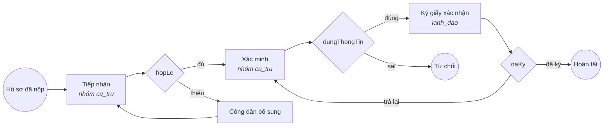

# Thêm một thủ tục mới trong 5 bước

Commune DX-OS cắm–rút theo **gói thủ tục hành chính** (D-009). Mỗi thủ tục là một thư mục `thu-tuc/<ma>/`; bộ máy một cửa [`mot-cua/`](../mot-cua/) chạy mọi thủ tục, nền tảng [`nen-tang/`](../nen-tang/) không biết thủ tục nào. Thêm thủ tục **không sửa dòng mã nào** trong `mot-cua/`, `nen-tang/`, `docker-compose.yml` hay APISIX: chỉ thêm một thư mục rồi chạy `make nap-thu-tuc`. Rút thủ tục: xóa thư mục rồi chạy lại lệnh đó.

Bốn gói có sẵn để chép:

| Gói | Mã | Lĩnh vực | Thời hạn | Quy trình |
|---|---|---|---|---|
| [`thu-tuc/khai-sinh/`](../thu-tuc/khai-sinh/) | KS01 | `ho_tich` | 1 ngày làm việc | tiếp nhận → (bổ sung) → thẩm định → phê duyệt |
| [`thu-tuc/chung-thuc-ban-sao/`](../thu-tuc/chung-thuc-ban-sao/) | CT01 | `chung_thuc` | trong ngày | tiếp nhận → kiểm tra bản chính → ký chứng thực → trả kết quả |
| [`thu-tuc/ket-hon/`](../thu-tuc/ket-hon/) | KH01 | `ho_tich` | 5 ngày làm việc | tiếp nhận → (bổ sung) → xác minh điều kiện → lãnh đạo ký → trao giấy (chờ tới khi hai bên có mặt) |
| [`thu-tuc/hoa-giai-dat-dai/`](../thu-tuc/hoa-giai-dat-dai/) | DD01 | `dat_dai` | 20 ngày làm việc | tiếp nhận đơn → (bổ sung) → xác minh → họp hòa giải → lãnh đạo ký biên bản; hai điểm kết thúc hoàn tất (thành / không thành), một từ chối |

Hai gói sau (#97) được thêm đúng theo 5 bước dưới đây, không sửa dòng mã nào của bộ máy; `make smoke` tự chạy hết quy trình của mọi gói ngoài hai gói đầu bằng `du-lieu-mau.json` của chính gói (mục 5 của `mot-cua/tests/smoke-goi-thu-tuc.sh`), nên gói mới thả vào cũng được kiểm.

Ví dụ dưới đây thêm thủ tục **xác nhận cư trú** (giá trị mẫu, không phải tư vấn pháp lý).

## Bước 1. Chép một gói có sẵn

```bash
cp -R thu-tuc/chung-thuc-ban-sao thu-tuc/xac-nhan-cu-tru
```

Tên thư mục là chữ thường không dấu, số và `-` (2–60 ký tự). Gói phải có đủ 5 tệp:

| Tệp | Nội dung |
|---|---|
| `thu-tuc.yaml` | mô tả thủ tục |
| `quy-trinh.bpmn20.xml` | quy trình BPMN 2.0 viết tay |
| `thanh-phan-ho-so.schema.json` | thành phần hồ sơ (JSON Schema 2020-12) |
| `du-lieu-mau.json` | hồ sơ mẫu **giả** |
| `README.md` | mô tả ngắn, sơ đồ quy trình cho người đọc |

## Bước 2. Sửa `thu-tuc.yaml`

```yaml
# SPDX-FileCopyrightText: 2026 DTU_DZ_2
# SPDX-License-Identifier: GPL-3.0-or-later
ma: XNCT01
ten: Xác nhận thông tin cư trú
linh_vuc: cu_tru
ten_linh_vuc: Cư trú
thoi_han_ngay_lam_viec: 2
le_phi: 0
ghi_chu_le_phi: Không thu phí (giá trị mẫu)
cong_khai: true
quy_trinh: xac_nhan_cu_tru
can_cu_phap_ly:
  - Luật Cư trú 2020
# Không bắt buộc: trạng thái hồ sơ ở từng bước (mục "Trạng thái hồ sơ theo bước" bên dưới).
trang_thai_theo_buoc:
  - tiep_nhan: moi
```

| Khóa | Bắt buộc | Kiểu | Ý nghĩa |
|---|---|---|---|
| `ma` | có | chữ HOA, số, `_`, `-` | mã thủ tục, khóa của danh mục (`mot_cua.thu_tuc.ma`). Trùng mã với thủ tục có sẵn trong dữ liệu mẫu thì gói ghi đè thủ tục đó |
| `ten` | có | chuỗi | tên hiển thị trên cổng công dân |
| `linh_vuc`, `ten_linh_vuc` | có | mã chữ thường; chuỗi | lĩnh vực; chưa có thì bộ nạp tạo. Cán bộ phụ trách lĩnh vực này mới thấy hồ sơ (RLS) và nhận task |
| `thoi_han_ngay_lam_viec` | có | số 0–365 | ngày làm việc (bỏ thứ Bảy, Chủ nhật, ngày nghỉ lễ); `0` = trong ngày tiếp nhận |
| `le_phi` | có | số ≥ 0 | đồng; cách tính chi tiết ghi ở `ghi_chu_le_phi` |
| `can_cu_phap_ly` | có | danh sách chuỗi | văn bản pháp luật |
| `quy_trinh` | có | process id, tối đa 24 ký tự | phải trùng `id` của `<process>` trong BPMN. Dài hơn thì Flowable đổi id định nghĩa quy trình sang UUID và bộ máy không tra được thủ tục của task, nên bộ nạp từ chối (#97) |
| `ghi_chu_le_phi`, `mo_ta` | không | chuỗi | |
| `cong_khai` | không | `true`/`false` | mặc định `true`; `false` thì người ngoài và công dân không thấy |
| `trang_thai_theo_buoc` | không | danh sách `- <bước>: <trạng thái>` | đổi trạng thái mặc định của hồ sơ khi đang ở bước đó ([Trạng thái hồ sơ theo bước](#trạng-thái-hồ-sơ-theo-bước)) |

Tệp dùng **tập con của YAML** (bộ nạp chỉ dùng thư viện chuẩn Python): mỗi dòng `khóa: giá trị`, hoặc `khóa:` rồi các dòng `  - mục`. Không dùng mapping lồng nhau, chuỗi nhiều dòng hay anchor; khóa lạ (gõ sai tên) bị báo lỗi.

## Bước 3. Vẽ lại quy trình trong `quy-trinh.bpmn20.xml`

Đổi `<process id="…">` thành giá trị `quy_trinh` ở bước 2, rồi sửa các bước. Quy ước với bộ máy một cửa:

- **Người xử lý**: `flowable:candidateGroups` là mã lĩnh vực của thủ tục (`cu_tru`) hoặc `lanh_dao`; bước của công dân dùng `flowable:assignee="${nguoiNopSub}"`. Giá trị khác bị bộ nạp từ chối.
- **Biến người xử lý đặt khi hoàn thành bước**: khai trong từng `userTask`. API `/workflow/tasks/{id}/complete` chỉ nhận đúng các biến này, đúng kiểu, đủ biến `required="true"`:

  ```xml
  <userTask id="xac_minh" name="Xác minh thông tin cư trú" flowable:candidateGroups="cu_tru">
    <extensionElements>
      <flowable:formProperty id="dungThongTin" name="Thông tin đúng?" type="boolean" required="true"/>
      <flowable:formProperty id="ghiChu" name="Ghi chú" type="string"/>
    </extensionElements>
  </userTask>
  ```

  Kiểu nhận: `boolean`, `string`, `long`.
- **Biến bộ máy đặt sẵn khi khởi tạo**: `hoSoId`, `maHoSo` (businessKey), `nguoiNopSub`, `hanXuLyLuc` (17:00 ngày hạn, dùng cho hẹn giờ quá hạn).
- **Kết thúc**: đặt `ketQua` = `hoan_tat` hoặc `tu_choi` ở `endEvent` (xem gói mẫu) để bộ máy phát sự kiện `ho_so.hoan_tat` / `ho_so.tu_choi`.

- **Trạng thái hồ sơ** đi theo bước, không phải khai gì nếu dùng mặc định: xem mục [Trạng thái hồ sơ theo bước](#trạng-thái-hồ-sơ-theo-bước).

Cách viết BPMN không có modeler: [`docs/architecture.md` §7](architecture.md#7-viết-bpmn-khi-không-có-modeler). Sửa luôn sơ đồ Mermaid trong `README.md` của gói.

## Bước 4. Khai thành phần hồ sơ và dữ liệu mẫu

`thanh-phan-ho-so.schema.json`: mỗi thành phần là một khóa trong `properties.thanh_phan.properties` (mã chữ thường), giá trị là mảng id tệp đã tải qua `/files`. Thành phần bắt buộc liệt kê trong `required` và có `minItems` ≥ 1:

```json
{
  "$schema": "https://json-schema.org/draft/2020-12/schema",
  "title": "Xác nhận thông tin cư trú",
  "type": "object",
  "required": ["thanh_phan"],
  "properties": {
    "thanh_phan": {
      "type": "object",
      "additionalProperties": false,
      "required": ["to_khai"],
      "properties": {
        "to_khai": {"title": "Tờ khai (theo mẫu)", "type": "array", "items": {"type": "string", "format": "uuid"}, "minItems": 1},
        "giay_to_kem_theo": {"title": "Giấy tờ chứng minh chỗ ở", "type": "array", "items": {"type": "string", "format": "uuid"}, "minItems": 0}
      }
    }
  }
}
```

Bộ nạp ghi các thành phần này vào `mot_cua.thanh_phan_yeu_cau`, và `GET /public/rpc/json_schema_thu_tuc?ma=XNCT01` trả đúng tệp này cho Poka-yoke ở cổng công dân.

`du-lieu-mau.json`: hồ sơ mẫu **giả**, phải khớp schema; `xu_ly` (không bắt buộc) là biến mẫu khi hoàn thành từng bước, phải khớp `formProperty` của BPMN. Bộ nạp từ chối dãy 9 hoặc 12 chữ số liền (dạng số CMND/CCCD). Tuyệt đối không dùng giấy tờ hay số định danh thật.

```json
{
  "ho_so": {"ho_ten_nguoi_nop": "Trần Văn Mẫu", "so_dien_thoai": "0900000003"},
  "thanh_phan": {"to_khai": ["11110000-0000-4000-8000-000000000001"]},
  "xu_ly": {"xac_minh": {"dungThongTin": true}}
}
```

## Bước 5. Kiểm, nạp, thử

```bash
make license              # thêm dòng SPDX cho tệp mới (YAML, XML)
make du-lieu-mo           # cập nhật bộ dữ liệu mở du-lieu-mo/thu-tuc-cap-xa/ (CC-BY-4.0) theo gói mới
make check                # kiểm mọi gói thu-tuc/ (không cần Docker) + BPMN + SPDX + dữ liệu mở khớp gói + test
make nap-thu-tuc          # hệ thống đang chạy: deploy BPMN lên Flowable + ghi danh mục
curl -s 'http://localhost:9080/public/thu_tuc?ma=eq.XNCT01&select=ma,ten,goi,quy_trinh,so_ngay_xu_ly'
```

Gói lỗi thì bộ nạp in từng lỗi rồi bỏ qua gói đó (các gói khác vẫn nạp, hệ thống không dừng), ví dụ:

```text
nap-thu-tuc: gói xac-nhan-cu-tru LỖI, bỏ qua:
  - quy-trinh.bpmn20.xml: process id 'chung_thuc_ban_sao' khác quy_trinh 'xac_nhan_cu_tru' trong thu-tuc.yaml
```

Nộp thử một hồ sơ (token công dân lấy như `docs/architecture.md` §8) theo luồng tạo hồ sơ `POST /api/ho_so` → tải tệp cho từng thành phần bắt buộc `POST /files/ho-so/{id}/tep` → `POST /workflow/ho-so/{id}/khoi-tao` (ví dụ lệnh: `mot-cua/README.md` mục `/workflow`). Cổng công dân tự sinh form từ `thanh-phan-ho-so.schema.json` của gói mới, không sửa mã web; cả cổng và `mot-cua-api` kiểm đủ thành phần theo đúng schema này (Poka-yoke 2 lớp, #53/#59). `make smoke` tự chạy hết quy trình của gói mới bằng `du-lieu-mau.json` của nó (mục 5 của `mot-cua/tests/smoke-goi-thu-tuc.sh`: thứ tự bước = thứ tự khóa trong `xu_ly`, bước của `lanh_dao` do lãnh đạo hoàn thành, còn lại do cán bộ lĩnh vực của gói), nên `xu_ly` phải đi tới một `endEvent` đặt `ketQua = hoan_tat`.

Mở PR theo [`CONTRIBUTING.md`](../CONTRIBUTING.md): job CI `make-check` chạy bộ kiểm gói, job `bpmn` kiểm cấu trúc mọi `thu-tuc/*/quy-trinh.bpmn20.xml`.

## Ví dụ từ A đến Z: gói Xác nhận thông tin về cư trú

*Worked example from A to Z: a "residence confirmation" package.*

Mục 5 bước ở trên là tra cứu nhanh. Mục này đi trọn một lần, theo đúng cách đội đã thêm gói kết hôn (KH01) và hòa giải đất đai (DD01) ở #97: từ issue tới khi `make smoke` tự chạy hết quy trình của gói mới. Năm tệp dưới đây là bản đầy đủ, đã qua bộ kiểm gói và một lần `make smoke` trên volume trống (29/10/2026). Giá trị mẫu, không phải tư vấn pháp lý.

*EN: The five-step section above is the quick reference. This section walks through one complete run, the same way the team added the marriage (KH01) and land-dispute mediation (DD01) packages in #97: from the issue to `make smoke` running the new package's whole workflow. The five files below are complete; they pass the package checker and a full `make smoke` on empty volumes (29 Oct 2026). Sample values, not legal advice.*

| | Việc | *Step* | Cần Docker? |
|---|---|---|---|
| A | Issue và nhánh | *Issue and branch* | không |
| B | Năm tệp của gói | *The five package files* | không |
| C | Kiểm trên máy | *Check locally* | không |
| D | Nạp vào hệ thống đang chạy | *Load into the running system* | có |
| E | Phân công cán bộ cho lĩnh vực mới | *Assign staff to the new field* | có |
| F | Thử bằng tay trên hai cổng | *Try it by hand on both portals* | có |
| G | Smoke tự chạy gói mới | *Smoke runs the new package* | có |
| H | Tài liệu, commit, PR | *Docs, commit, PR* | không |
| I | Rút gói | *Remove the package* | có |

### A. Issue và nhánh · *Issue and branch*

Mở issue bằng mẫu **Thủ tục mới** (các ô khớp khóa của `thu-tuc.yaml`), gắn milestone tuần đang mở, rồi tách nhánh từ `develop`.

*EN: Open an issue with the **Thủ tục mới** (new procedure) template, whose fields match the keys of `thu-tuc.yaml`; attach the current week's milestone and branch off `develop`.*

```bash
git switch develop && git pull
git switch -c feature/<so-issue>-goi-xac-nhan-cu-tru
mkdir thu-tuc/xac-nhan-cu-tru
```

### B. Năm tệp của gói · *The five package files*

Gói chỉ gồm năm tệp này; không sửa tệp nào ngoài thư mục `thu-tuc/xac-nhan-cu-tru/`.

*EN: The package is exactly these five files; nothing outside `thu-tuc/xac-nhan-cu-tru/` changes.*

**`thu-tuc.yaml`** – lĩnh vực `cu_tru` chưa có, bộ nạp sẽ tạo. `quy_trinh` tối đa 24 ký tự. · *EN: field `cu_tru` does not exist yet, the loader creates it; `quy_trinh` is at most 24 characters.*

```yaml
# SPDX-FileCopyrightText: 2026 DTU_DZ_2
# SPDX-License-Identifier: GPL-3.0-or-later
# Gói thủ tục: Xác nhận thông tin về cư trú (ví dụ A–Z trong docs/thu-tuc.md; giá trị mẫu, không phải tư vấn pháp lý).
ma: XNCT01
ten: Xác nhận thông tin về cư trú
linh_vuc: cu_tru
ten_linh_vuc: Cư trú
thoi_han_ngay_lam_viec: 3
le_phi: 0
ghi_chu_le_phi: Không thu phí (giá trị mẫu)
cong_khai: true
quy_trinh: xac_nhan_cu_tru
can_cu_phap_ly:
  - Luật Cư trú 2020, Điều 17
  - Thông tư 55/2021/TT-BCA
trang_thai_theo_buoc:
  - tiep_nhan: moi
```

**`quy-trinh.bpmn20.xml`** – bốn `userTask`. Bước đầu phải có id `tiep_nhan` và biến `hopLe` (bộ máy và smoke dựa vào đó, như mọi gói có sẵn); bước của công dân gán `${nguoiNopSub}`; bước của lãnh đạo dùng nhóm `lanh_dao`; mỗi `endEvent` đặt `ketQua`; hẹn giờ quá hạn chép nguyên từ gói mẫu. · *EN: four `userTask`s. The first must have id `tiep_nhan` with a `hopLe` variable (the engine and smoke rely on it, like every existing package); the citizen step is assigned to `${nguoiNopSub}`; the leader step uses group `lanh_dao`; each `endEvent` sets `ketQua`; the overdue timer is copied verbatim from the sample packages.*

```xml
<?xml version="1.0" encoding="UTF-8"?>
<!-- SPDX-FileCopyrightText: 2026 DTU_DZ_2 -->
<!-- SPDX-License-Identifier: GPL-3.0-or-later -->
<!-- Gói xac-nhan-cu-tru (XNCT01): tiếp nhận → (bổ sung) → xác minh → lãnh đạo ký. Sơ đồ ở README.md. -->
<definitions xmlns="http://www.omg.org/spec/BPMN/20100524/MODEL"
             xmlns:xsi="http://www.w3.org/2001/XMLSchema-instance"
             xmlns:flowable="http://flowable.org/bpmn"
             targetNamespace="urn:dxos:mot-cua"
             id="def_xac_nhan_cu_tru">
  <process id="xac_nhan_cu_tru" name="Xác nhận thông tin về cư trú" isExecutable="true">
    <startEvent id="bat_dau" name="Hồ sơ đã nộp"/>
    <sequenceFlow id="f_bat_dau" sourceRef="bat_dau" targetRef="tiep_nhan"/>

    <userTask id="tiep_nhan" name="Tiếp nhận, kiểm tra thành phần hồ sơ" flowable:candidateGroups="cu_tru">
      <extensionElements>
        <flowable:formProperty id="hopLe" name="Đủ thành phần hồ sơ?" type="boolean" required="true"/>
        <flowable:formProperty id="ghiChu" name="Ghi chú" type="string"/>
      </extensionElements>
    </userTask>
    <sequenceFlow id="f_tiep_nhan" sourceRef="tiep_nhan" targetRef="gw_tiep_nhan"/>
    <exclusiveGateway id="gw_tiep_nhan" name="Đủ thành phần?" default="f_can_bo_sung"/>
    <sequenceFlow id="f_hop_le" name="đủ" sourceRef="gw_tiep_nhan" targetRef="xac_minh">
      <conditionExpression xsi:type="tFormalExpression">${hopLe == true}</conditionExpression>
    </sequenceFlow>
    <sequenceFlow id="f_can_bo_sung" name="thiếu" sourceRef="gw_tiep_nhan" targetRef="bo_sung"/>

    <userTask id="bo_sung" name="Công dân bổ sung hồ sơ" flowable:assignee="${nguoiNopSub}">
      <extensionElements>
        <flowable:formProperty id="ghiChu" name="Ghi chú" type="string"/>
      </extensionElements>
    </userTask>
    <sequenceFlow id="f_bo_sung" sourceRef="bo_sung" targetRef="tiep_nhan"/>

    <userTask id="xac_minh" name="Xác minh thông tin cư trú" flowable:candidateGroups="cu_tru">
      <extensionElements>
        <flowable:formProperty id="dungThongTin" name="Thông tin đúng?" type="boolean" required="true"/>
        <flowable:formProperty id="ghiChu" name="Ghi chú" type="string"/>
      </extensionElements>
    </userTask>
    <sequenceFlow id="f_xac_minh" sourceRef="xac_minh" targetRef="gw_xac_minh"/>
    <exclusiveGateway id="gw_xac_minh" name="Thông tin đúng?" default="f_sai"/>
    <sequenceFlow id="f_dung" name="đúng" sourceRef="gw_xac_minh" targetRef="ky_xac_nhan">
      <conditionExpression xsi:type="tFormalExpression">${dungThongTin == true}</conditionExpression>
    </sequenceFlow>
    <sequenceFlow id="f_sai" name="sai" sourceRef="gw_xac_minh" targetRef="ket_thuc_tu_choi"/>

    <userTask id="ky_xac_nhan" name="Ký giấy xác nhận" flowable:candidateGroups="lanh_dao">
      <extensionElements>
        <flowable:formProperty id="daKy" name="Đã ký?" type="boolean" required="true"/>
        <flowable:formProperty id="ghiChu" name="Ghi chú" type="string"/>
      </extensionElements>
    </userTask>
    <sequenceFlow id="f_ky" sourceRef="ky_xac_nhan" targetRef="gw_ky"/>
    <exclusiveGateway id="gw_ky" name="Đã ký?" default="f_tra_lai"/>
    <sequenceFlow id="f_da_ky" name="đã ký" sourceRef="gw_ky" targetRef="ket_thuc_hoan_tat">
      <conditionExpression xsi:type="tFormalExpression">${daKy == true}</conditionExpression>
    </sequenceFlow>
    <sequenceFlow id="f_tra_lai" name="trả lại" sourceRef="gw_ky" targetRef="xac_minh"/>

    <endEvent id="ket_thuc_hoan_tat" name="Hoàn tất">
      <extensionElements>
        <flowable:executionListener event="start" expression="${execution.setVariable('ketQua', 'hoan_tat')}"/>
      </extensionElements>
    </endEvent>
    <endEvent id="ket_thuc_tu_choi" name="Từ chối">
      <extensionElements>
        <flowable:executionListener event="start" expression="${execution.setVariable('ketQua', 'tu_choi')}"/>
      </extensionElements>
    </endEvent>

    <subProcess id="qua_han" name="Quá hạn xử lý" triggeredByEvent="true">
      <startEvent id="den_han" name="Đến hạn xử lý" isInterrupting="false">
        <timerEventDefinition>
          <timeDate>${hanXuLyLuc}</timeDate>
        </timerEventDefinition>
      </startEvent>
      <sequenceFlow id="f_den_han" sourceRef="den_han" targetRef="danh_dau_qua_han"/>
      <serviceTask id="danh_dau_qua_han" name="Đánh dấu quá hạn"
                   flowable:expression="${execution.setVariable('quaHan', true)}"/>
      <sequenceFlow id="f_danh_dau" sourceRef="danh_dau_qua_han" targetRef="ket_thuc_qua_han"/>
      <endEvent id="ket_thuc_qua_han"/>
    </subProcess>
  </process>
</definitions>
```

**`thanh-phan-ho-so.schema.json`** – một thành phần bắt buộc (`minItems: 1`), một tùy chọn (`minItems: 0`). Đặt mã thành phần trùng một khóa trong `mot-cua/doc-giay-to/loai-giay-to.json` (ví dụ `giay_to_tuy_than`) thì cổng công dân tự có nút đọc ảnh bằng OCR. · *EN: one required component (`minItems: 1`), one optional (`minItems: 0`). Naming a component after a key of `mot-cua/doc-giay-to/loai-giay-to.json` (e.g. `giay_to_tuy_than`) gives it the OCR "read from photo" button for free.*

```json
{
  "$schema": "https://json-schema.org/draft/2020-12/schema",
  "$id": "urn:dxos:mot-cua:thu-tuc:XNCT01",
  "title": "Xác nhận thông tin về cư trú",
  "description": "Mỗi thành phần là mảng id tệp đã tải qua /files (thanh_phan_ho_so.id).",
  "type": "object",
  "required": ["thanh_phan"],
  "properties": {
    "thanh_phan": {
      "type": "object",
      "additionalProperties": false,
      "required": ["to_khai"],
      "properties": {
        "to_khai": {
          "title": "Tờ khai đề nghị xác nhận thông tin về cư trú",
          "type": "array",
          "items": {"type": "string", "format": "uuid"},
          "minItems": 1
        },
        "giay_to_cho_o": {
          "title": "Giấy tờ chứng minh chỗ ở hợp pháp",
          "description": "Nếu có",
          "type": "array",
          "items": {"type": "string", "format": "uuid"},
          "minItems": 0
        }
      }
    }
  }
}
```

**`du-lieu-mau.json`** – hồ sơ **giả**. Thứ tự khóa của `xu_ly` là thứ tự smoke hoàn thành các bước, và phải đi tới `endEvent` đặt `ketQua = hoan_tat`. · *EN: **fake** application. The key order of `xu_ly` is the order in which smoke completes the steps, and it must reach the `endEvent` that sets `ketQua = hoan_tat`.*

```json
{
  "mo_ta": "Hồ sơ mẫu GIẢ cho XNCT01: người nộp, số điện thoại, id tệp đều không có thật.",
  "ho_so": {"ho_ten_nguoi_nop": "Trần Văn Mẫu", "so_dien_thoai": "0900000106"},
  "thanh_phan": {"to_khai": ["58430000-0000-4000-8000-000000000001"]},
  "xu_ly": {
    "tiep_nhan": {"hopLe": true},
    "xac_minh": {"dungThongTin": true, "ghiChu": "Đúng với Cơ sở dữ liệu về cư trú (giả)"},
    "ky_xac_nhan": {"daKy": true}
  }
}
```

**`README.md`** – mô tả cho người đọc trên GitHub, kèm sơ đồ Mermaid. Trang tài liệu tự sinh một trang cho gói từ `thu-tuc.yaml` và schema. · *EN: description for GitHub readers with a Mermaid diagram. The docs site generates the package page itself from `thu-tuc.yaml` and the schema.*

````markdown
# Gói thủ tục `xac-nhan-cu-tru` – Xác nhận thông tin về cư trú (XNCT01)

Ví dụ từ A đến Z trong [`docs/thu-tuc.md`](../../docs/thu-tuc.md). Giá trị mẫu, không phải tư vấn pháp lý.


````

### C. Kiểm trên máy · *Check locally*

Không cần Docker. `make du-lieu-mo` thêm XNCT01 vào bộ dữ liệu mở; bỏ bước này thì `make check` báo dữ liệu mở lệch gói.

*EN: No Docker needed. `make du-lieu-mo` adds XNCT01 to the open dataset; skip it and `make check` reports that the open data is out of sync with the packages.*

```bash
make license        # thêm header SPDX còn thiếu (YAML, XML, README)
make du-lieu-mo     # du-lieu-mo/thu-tuc-cap-xa/: thêm XNCT01 vào danh-muc.json, danh-muc.csv, schema/XNCT01.schema.json
make check          # có dòng: gói xac-nhan-cu-tru hợp lệ: XNCT01 Xác nhận thông tin về cư trú (xac_nhan_cu_tru, 3 ngày làm việc, 4 bước)
make lint           # shellcheck, yamllint, BPMN, reuse như CI
make tai-lieu       # trang tài liệu có trang XNCT01 trong mục Người dân / cán bộ
```

Lỗi hay gặp · *Common errors*:

| Thông báo của bộ kiểm (rút gọn) | Nguyên nhân · *Cause* |
|---|---|
| `process id 'xac_nhan_cu_tru' khác quy_trinh '…' trong thu-tuc.yaml` | `<process id>` trong BPMN khác `quy_trinh` · *BPMN process id differs from `quy_trinh`* |
| `quy_trinh '…' dài quá 24 ký tự` | Flowable sẽ đổi id định nghĩa sang UUID · *Flowable would switch the definition id to a UUID* |
| `bước 'tiep_nhan' giao cho nhóm ho_tich; chỉ nhận mã lĩnh vực 'cu_tru' hoặc 'lanh_dao'` | chép BPMN từ gói khác mà quên đổi nhóm · *copied BPMN still uses another package's group* |
| `du-lieu-mau.json: có dãy số '…' giống số CMND/CCCD` | dữ liệu mẫu có dãy 9 hoặc 12 chữ số · *sample data contains a 9- or 12-digit run* |
| `LỖI: du-lieu-mo/thu-tuc-cap-xa/ lệch với các gói thu-tuc/` | quên `make du-lieu-mo` · *forgot `make du-lieu-mo`* |

### D. Nạp vào hệ thống đang chạy · *Load into the running system*

`make up` nạp mọi gói khi khởi động; hệ thống đang chạy thì gọi lại bộ nạp. Không khởi động lại dịch vụ nào.

*EN: `make up` loads every package at start-up; on a running system just re-run the loader. No service restarts.*

```bash
make nap-thu-tuc
curl -s 'http://localhost:9080/public/thu_tuc?ma=eq.XNCT01&select=ma,ten,goi,quy_trinh,so_ngay_xu_ly'
curl -s 'http://localhost:9080/public/rpc/json_schema_thu_tuc?ma=XNCT01' | jq '.properties.thanh_phan.required'
```

### E. Phân công cán bộ cho lĩnh vực mới · *Assign staff to the new field*

Lĩnh vực `cu_tru` mới tạo chưa có cán bộ nào, nên chưa ai thấy hồ sơ hay nhận việc (RLS). Phân công không đi qua API (mục [Bộ nạp làm gì](#bộ-nạp-làm-gì)); quản trị viên ghi bằng SQL, và việc này vào nhật ký kiểm toán (`can_bo.them_linh_vuc`). Cán bộ được nhận ra bằng `sub` (id người dùng Keycloak). Ví dụ giao thêm `cu_tru` cho `canbo01`:

*EN: The new field `cu_tru` has no staff yet, so nobody sees its applications or gets its tasks (RLS). Assignments are not exposed through the API; an administrator writes them in SQL, and the change lands in the audit log (`can_bo.them_linh_vuc`). Officers are identified by `sub` (the Keycloak user id). Example giving `canbo01` the `cu_tru` field:*

```bash
docker compose exec -T postgres psql -XqtA -U postgres -d commune <<'SQL'
INSERT INTO mot_cua.can_bo_linh_vuc (can_bo_id, linh_vuc_id)
SELECT cb.id, lv.id FROM mot_cua.can_bo cb, mot_cua.linh_vuc lv
WHERE cb.sub = '00000000-0000-0000-0000-00000000b001'   -- canbo01: can_bo.sub = id người dùng Keycloak
  AND lv.ma = 'cu_tru'
ON CONFLICT DO NOTHING;
SQL
```

### F. Thử bằng tay trên hai cổng · *Try it by hand on both portals*

1. `make demo-users` để có mật khẩu mẫu. · *EN: run `make demo-users` for the sample passwords.*
2. Công dân `congdan01` mở <http://localhost:9080/thu-tuc/XNCT01>, bấm nộp: form sinh từ schema, thiếu tờ khai thì cổng chặn (Poka-yoke). · *EN: citizen `congdan01` opens the procedure page and submits; the form is generated from the schema and blocks a missing declaration.*
3. Cán bộ `canbo01` vào <http://localhost:9080/can-bo>, mở hồ sơ, hoàn thành "Tiếp nhận" và "Xác minh"; lãnh đạo `lanhdao01` hoàn thành "Ký giấy xác nhận". Ô nhập của từng bước sinh từ `formProperty`. · *EN: staff `canbo01` completes intake and verification, leader `lanhdao01` signs; each step's inputs come from the `formProperty` declarations.*
4. Công dân tra cứu ở <http://localhost:9080/tra-cuu>: hồ sơ "Hoàn tất", có biên nhận và thông báo kết quả ký số. · *EN: the citizen sees the application as completed, with signed receipt and result PDFs.*

### G. Smoke tự chạy gói mới · *Smoke runs the new package*

Không viết thêm test nào: `make smoke` (mục 5 của `mot-cua/tests/smoke-goi-thu-tuc.sh`) tự tìm gói mới, nộp hồ sơ bằng `du-lieu-mau.json`, tự phân công một cán bộ tạm cho lĩnh vực, hoàn thành từng bước theo `xu_ly` bằng đúng người, rồi kiểm hạn, trạng thái `hoan_tat` và sự kiện `ho_so.hoan_tat`. Bộ dữ liệu mở cũng được đối chiếu với API công khai.

*EN: No new test to write. `make smoke` (section 5 of `mot-cua/tests/smoke-goi-thu-tuc.sh`) finds the new package, submits its `du-lieu-mau.json`, assigns a temporary officer to the field, completes each step in `xu_ly` order as the right role, then checks the deadline, the `hoan_tat` status and the `ho_so.hoan_tat` event. The open dataset is compared with the public API too.*

```text
  ĐẠT   gói xac-nhan-cu-tru: danh mục có quy trình xac_nhan_cu_tru
  ĐẠT   gói xac-nhan-cu-tru: Flowable có quy trình xac_nhan_cu_tru (nap-thu-tuc deploy, không tự quét thư mục)
  ĐẠT   gói xac-nhan-cu-tru (XNCT01): thành phần trong danh mục khớp schema của gói (mã:bắt buộc:số tệp tối thiểu)
  ĐẠT   gói xac-nhan-cu-tru: công dân nộp (tải đủ tệp tối thiểu, khởi tạo) → quy trình xac_nhan_cu_tru ở bước tiep_nhan, 1 tệp
  ĐẠT   gói xac-nhan-cu-tru: hạn xử lý = 3 ngày làm việc sau ngày nhận
  ĐẠT   gói xac-nhan-cu-tru: biến không khai trong BPMN của gói → 400
  ĐẠT   gói xac-nhan-cu-tru: hoàn thành từng bước theo dữ liệu mẫu bằng đúng người (cán bộ cu_tru / lãnh đạo) → 200
  ĐẠT   gói xac-nhan-cu-tru: quy trình kết thúc, đi đúng các bước của dữ liệu mẫu, ketQua = hoan_tat
  ĐẠT   gói xac-nhan-cu-tru: CSDL hồ sơ hoan_tat, có sự kiện ho_so.hoan_tat
```

Quên `make du-lieu-mo` thì smoke trượt mục "dữ liệu mở: danh mục công bố = thủ tục công khai có gói trên /public/thu_tuc" (thực tế có thêm `XNCT01:3:0:to_khai`). · *EN: forgetting `make du-lieu-mo` fails the open-data check, which finds the extra `XNCT01:3:0:to_khai` entry.*

### H. Tài liệu, commit, PR · *Docs, commit, PR*

- Thêm một dòng vào bảng "Thủ tục đang hỗ trợ" của `README.md` và bảng gói ở đầu trang này. Danh mục trên trang tài liệu và kho tri thức của trợ lý hỏi đáp tự lấy từ gói, không phải sửa. · *EN: add a row to the README's supported-procedures table and to the table at the top of this page. The docs catalogue and the Q&A assistant's knowledge base pick the package up on their own.*
- Commit `feat(thu-tuc): gói xác nhận thông tin về cư trú (XNCT01) (#<số>)`, mở PR về `develop` theo [`CONTRIBUTING.md`](../CONTRIBUTING.md). CI chạy bộ kiểm gói (`make-check`), BPMN (`bpmn`), REUSE (`reuse`) và build trang tài liệu. · *EN: commit with that Conventional Commit title and open a PR to `develop`; CI runs the package checker, BPMN lint, REUSE and the docs build.*

### I. Rút gói · *Remove the package*

```bash
git rm -r thu-tuc/xac-nhan-cu-tru && make du-lieu-mo
make nap-thu-tuc    # XNCT01 thôi nhận hồ sơ mới; hồ sơ đang chạy vẫn chạy tới khi xong
```

Thủ tục và lịch sử hồ sơ vẫn trong CSDL để tra cứu và kiểm toán; chỉ không nộp mới được.

*EN: Deleting the folder and re-running the loader retires XNCT01: no new applications, running ones finish. The procedure and its history stay in the database for lookup and audit.*

## Trạng thái hồ sơ theo bước

Cột `mot_cua.ho_so.trang_thai` đi theo bước Flowable (#73): cổng công dân, cổng cán bộ, báo cáo và RLS đọc cùng một giá trị trong CSDL. Bộ nạp tính trạng thái cho **mọi** `userTask` của gói và ghi vào `mot_cua.thu_tuc.trang_thai_buoc`; gói mới không phải sửa mã.

Mặc định theo người nhận của bước trong BPMN:

| Bước giao cho | Trạng thái khi hồ sơ đang ở bước đó |
|---|---|
| công dân (`flowable:assignee="${nguoiNopSub}"`) | `cho_bo_sung` – công dân sửa hồ sơ, tải thêm tệp được |
| `flowable:candidateGroups` có `lanh_dao` | `cho_phe_duyet` – cán bộ không tự chuyển trạng thái được |
| nhóm lĩnh vực của thủ tục | `dang_xu_ly` |

Quy trình kết thúc ở `endEvent` đặt `ketQua` → `hoan_tat` hoặc `tu_choi` (ngày hoàn tất do CSDL ghi). Đổi mặc định của bước nào thì khai trong `thu-tuc.yaml`, ví dụ để hồ sơ còn "mới nộp" tới khi cán bộ tiếp nhận (hai gói mẫu đều khai):

```yaml
trang_thai_theo_buoc:
  - tiep_nhan: moi
```

Nhận `moi`, `dang_xu_ly`, `cho_bo_sung`, `cho_phe_duyet`. Bước không có trong BPMN, trạng thái lạ, khai hai lần hay khai `hoan_tat`/`tu_choi` cho một bước → bộ nạp báo lỗi và bỏ qua gói. Quy tắc lúc chạy (`mot-cua/backend/trang_thai.py`):

- `moi` chỉ có trước lần tiếp nhận đầu: quay lại bước khai `moi` (ví dụ công dân vừa nộp lại sau bổ sung) thì hồ sơ là `dang_xu_ly`.
- Nhiều bước mở cùng lúc: `cho_bo_sung` > `dang_xu_ly` > `cho_phe_duyet` > `moi`.
- Không còn bước mở mà quy trình chưa kết thúc (đang ở hẹn giờ, service task) thì giữ nguyên trạng thái. Hẹn giờ quá hạn chỉ đặt `quaHan`, không đổi trạng thái.
- Chuyển sang `cho_bo_sung`/`tu_choi` thì `ly_do` = biến `ghiChu` người xử lý nhập ở bước đó (không có thì câu mặc định).

Mỗi lần đổi có một dòng trong `mot_cua.lich_su_trang_thai` (ai, bước nào, nguồn) và sự kiện `ho_so.*` mang `duLieu.trangThai`. Cách cập nhật và xử lý lỗi: [`mot-cua/README.md`](../mot-cua/README.md#trạng-thái-hồ-sơ).

## Bộ nạp làm gì

`make up` chạy dịch vụ một lần `nap-thu-tuc`; `make nap-thu-tuc` chạy lại bằng tay. Với mỗi thư mục trong `thu-tuc/`:

1. **Kiểm gói** (`mot-cua/backend/goi_thu_tuc.py`): đủ tệp, YAML, JSON Schema, BPMN (cùng luật với CI), dữ liệu mẫu.
2. **Deploy BPMN** lên Flowable qua REST; BPMN không đổi thì không deploy lại.
3. **Ghi danh mục** qua PostgREST (RPC `mot_cua.nap_thu_tuc`) bằng tài khoản dịch vụ `mot_cua_danh_muc`, chỉ có quyền gọi RPC nạp/rút gói. Kèm biến từng bước (`bien_theo_buoc`) và trạng thái hồ sơ từng bước (`trang_thai_buoc`).
4. **Rút** thủ tục có gói mà thư mục đã bị xóa: thôi nhận hồ sơ mới, hồ sơ đang chạy vẫn chạy tới khi xong.

Chi tiết thiết kế: [`docs/architecture.md` §2.4](architecture.md#24-hợp-đồng-giữa-các-lớp).

## Giới hạn hiện tại

- Một gói một quy trình; nhóm xử lý chỉ là lĩnh vực của thủ tục và lãnh đạo.
- Biến từng bước chỉ có kiểu `boolean`, `string`, `long`.
- Thủ tục cần bảng dữ liệu riêng ngoài hồ sơ chung phải thêm migration trong `mot-cua/db/migrations/` (sửa bộ máy, không còn là cắm–rút thuần).
- Thành phần bỏ khỏi gói không bị xóa khỏi danh mục (hồ sơ cũ còn tham chiếu), chỉ thôi bắt buộc.
