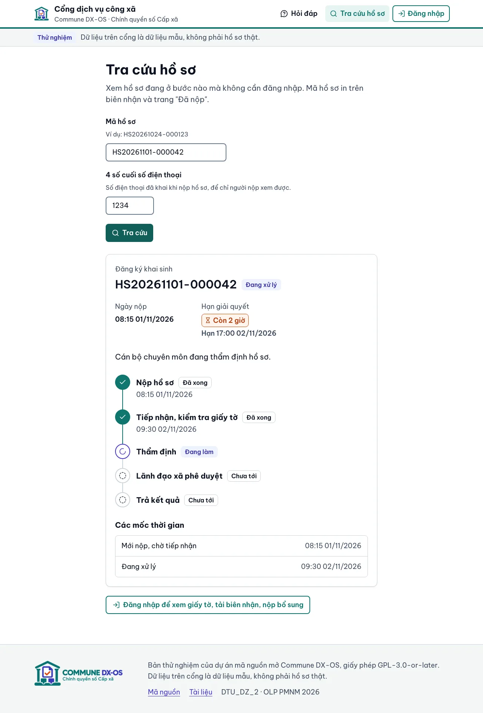
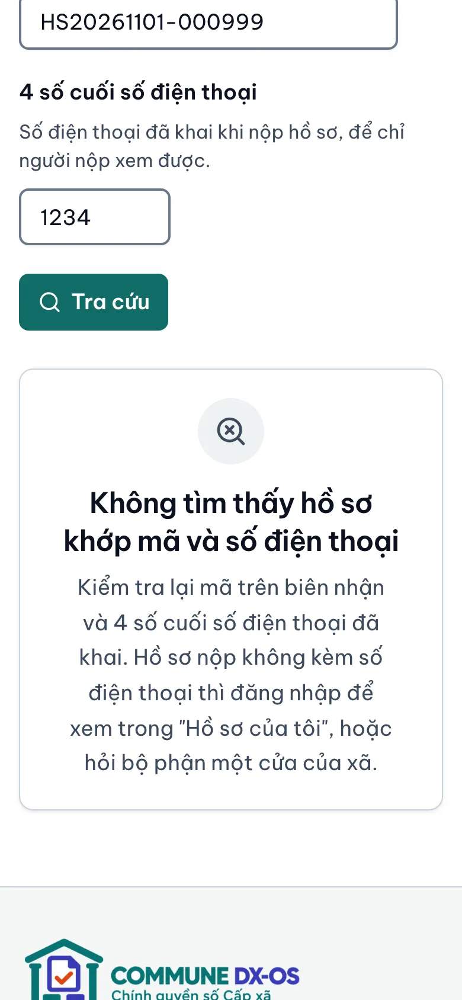

<!-- SPDX-FileCopyrightText: 2026 DTU_DZ_2 -->
<!-- SPDX-License-Identifier: GPL-3.0-or-later -->
# Tra cứu hồ sơ đã nộp

Trang này dành cho người dân đã nộp hồ sơ trên Cổng dịch vụ công xã. Có hai cách xem hồ sơ đang ở bước nào:

| Cách | Cần gì | Xem được gì |
|---|---|---|
| **Tra cứu nhanh**, không cần đăng nhập | Mã hồ sơ và 4 số cuối số điện thoại | Trạng thái, các bước, hạn giải quyết |
| **Hồ sơ của tôi**, cần đăng nhập | Tài khoản đã dùng để nộp | Như trên, thêm lý do, giấy tờ, biên nhận, kết quả, nộp bổ sung |

Bản thử nghiệm của dự án chạy ở `http://localhost:9080` (xem [Cài đặt](cai-dat.md)). Mọi hồ sơ, mã và số điện thoại trong trang này là dữ liệu giả.

## 1. Tra cứu nhanh, không cần đăng nhập

Bấm **Tra cứu hồ sơ** ở đầu trang, hoặc mở trang `/tra-cuu`.

**Cần chuẩn bị:**

- **Mã hồ sơ.** Mã in trên biên nhận và hiện ở trang "Đã nộp" ngay sau khi nộp, dạng `HS20261101-000042`. Chữ hoa hay chữ thường đều được.
- **4 số cuối số điện thoại** bạn đã khai khi nộp hồ sơ.

Nhập hai ô rồi bấm **Tra cứu**.

  

**Xem được:**

- tên thủ tục, mã hồ sơ, trạng thái hiện tại;
- ngày nộp, hạn giải quyết, ngày có kết quả (nếu đã xong);
- 5 bước giải quyết: Nộp hồ sơ → Tiếp nhận, kiểm tra giấy tờ → Thẩm định → Lãnh đạo xã phê duyệt → Trả kết quả. Mỗi bước ghi "Đã xong", "Đang làm" hoặc "Chưa tới";
- các mốc thời gian hồ sơ đổi trạng thái.

**Không xem được** (để người khác cầm biên nhận cũng không đọc được thông tin riêng của bạn):

- họ tên, số điện thoại;
- lý do cán bộ yêu cầu bổ sung hoặc từ chối;
- giấy tờ đã nộp, biên nhận, kết quả.

Muốn xem những phần này thì đăng nhập (mục 2).

## 2. Hồ sơ của tôi, cần đăng nhập

1. Bấm **Đăng nhập** ở góc trên bên phải, đăng nhập bằng tài khoản đã dùng khi nộp hồ sơ. Bản thử nghiệm dùng tài khoản mẫu do xã cấp; cổng chưa cho tự đăng ký tài khoản.
2. Bấm **Hồ sơ của tôi** ở đầu trang (trang `/ho-so`). Hồ sơ mới nộp nằm trên cùng, mỗi hồ sơ có trạng thái và hạn.
3. Bấm vào một hồ sơ để xem chi tiết:
    - **Trong quy trình xử lý:** bước đang làm và các bước đã xong, có giờ.
    - **Giấy tờ đã nộp:** các tệp bạn đã tải lên.
    - **Giấy tờ có ký số của xã:** nút tải **biên nhận hồ sơ** và, khi hồ sơ xong, **thông báo kết quả**. Đây là tệp PDF có chữ ký số của xã, dùng để đối chiếu khi đến nhận kết quả.

**Nộp bổ sung khi cán bộ yêu cầu.** Nếu hồ sơ ở trạng thái "Chờ công dân bổ sung", trang chi tiết hiện khung **Yêu cầu của bộ phận một cửa** ghi rõ cần bổ sung gì. Bạn:

1. bấm **Tải thêm tệp** ở giấy tờ cần bổ sung, chọn ảnh hoặc bản quét rõ nét;
2. ghi chú cho cán bộ nếu cần (không bắt buộc);
3. bấm **Nộp lại hồ sơ**. Hồ sơ chuyển về "Đang xử lý" và quay lại bộ phận một cửa kiểm tra.

## 3. Ý nghĩa trạng thái và hạn

| Trạng thái | Nghĩa là | Bạn cần làm gì |
|---|---|---|
| Mới nộp, chờ tiếp nhận | Xã đã nhận hồ sơ trực tuyến, chưa kiểm tra | Chờ. Bộ phận một cửa kiểm tra trong giờ hành chính |
| Chờ công dân bổ sung | Giấy tờ còn thiếu hoặc chưa rõ | Đăng nhập, xem yêu cầu và nộp bổ sung (mục 2) |
| Đang xử lý | Cán bộ chuyên môn đang thẩm định | Chờ |
| Chờ lãnh đạo phê duyệt | Đã thẩm định xong, chờ lãnh đạo xã ký | Chờ |
| Hoàn tất | Đã có kết quả | Đăng nhập tải thông báo kết quả, hoặc nhận tại bộ phận một cửa |
| Từ chối | Hồ sơ không được giải quyết | Đăng nhập để xem lý do; hỏi bộ phận một cửa nếu chưa rõ |

**Thẻ hạn** cạnh "Hạn giải quyết" cho biết còn bao lâu. Hạn tính tới 17:00 của ngày hạn.

| Thẻ | Nghĩa là |
|---|---|
| Còn … (nền xanh nhạt, biểu tượng đồng hồ) | Còn hạn, hơn 1 ngày |
| Còn … (viền cam, chữ đỏ, biểu tượng đồng hồ cát) | **Sắp trễ hạn**: còn 1 ngày trở xuống |
| Quá hạn … (nền đỏ) | **Trễ hạn**: đã qua hạn mà xã chưa trả kết quả |
| Chưa có hạn | Hồ sơ chưa có ngày hạn giải quyết |

Thẻ có chữ và biểu tượng riêng, người không phân biệt được màu vẫn đọc được. Hồ sơ đã hoàn tất hoặc bị từ chối chỉ hiện ngày hạn, không hiện thẻ.

## 4. Gặp lỗi thì làm gì

  

| Thấy gì | Làm gì |
|---|---|
| Ô nhập bị viền cam, báo "Nhập mã hồ sơ in trên biên nhận…" hoặc "Nhập đúng 4 chữ số cuối…" | Mã phải đủ dạng `HS` + 8 số ngày + `-` + số thứ tự. Ô số điện thoại chỉ nhận đúng 4 chữ số |
| **Không tìm thấy hồ sơ khớp mã và số điện thoại** | Kiểm tra lại mã trên biên nhận và số điện thoại đã khai. Sai mã hay sai số đều hiện cùng câu này, để người lạ không dò được mã nào có thật |
| Không tìm thấy dù đã nhập đúng | Có thể bạn nộp hồ sơ không kèm số điện thoại: đăng nhập và xem ở **Hồ sơ của tôi** |
| **Có quá nhiều lượt truy cập** | Mỗi máy chỉ tra cứu được một số lần trong một phút. Đợi một phút rồi thử lại |
| **Chưa tra cứu được** / **Không kết nối được tới máy chủ** / **Hệ thống đang bận** | Kiểm tra mạng, đợi vài phút rồi bấm **Tra cứu** lại. Dữ liệu bạn nhập vẫn còn trên trang |
| **Quên mã hồ sơ** | Đăng nhập và mở **Hồ sơ của tôi**: mọi hồ sơ bạn đã nộp đều có mã. Mã cũng in trên biên nhận PDF. Nếu nộp tại xã hoặc không có tài khoản, hỏi bộ phận một cửa của xã |

Câu hỏi về giấy tờ, lệ phí, thời hạn của từng thủ tục: xem [Danh mục thủ tục](danh-muc-thu-tuc.md) hoặc mục **Hỏi đáp** trên cổng.

---

Chi tiết kỹ thuật cho lập trình viên (đường gọi API, lý do chọn 4 số cuối số điện thoại, giới hạn lượt gọi): [`architecture.md` §4.12](architecture.md#412-tra-cứu-tiến-độ-hồ-sơ-54).
