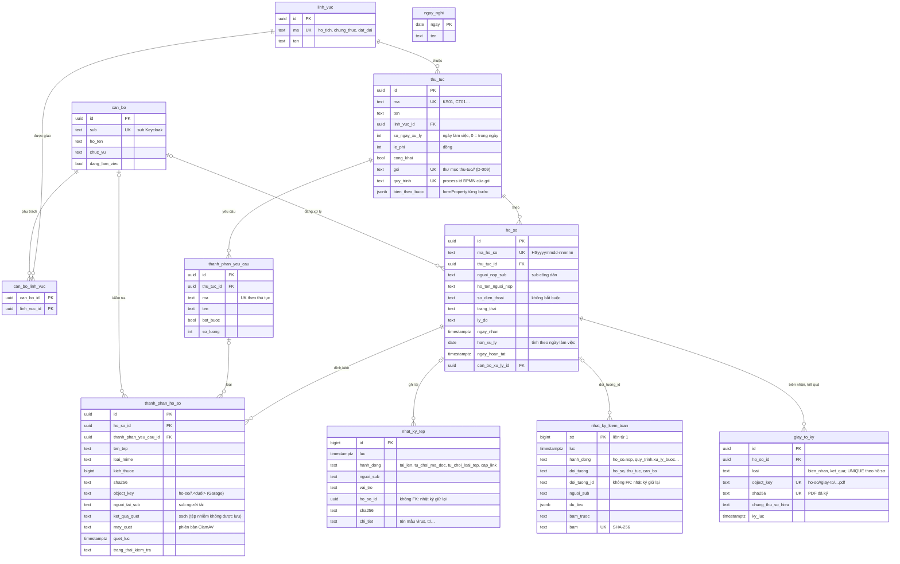
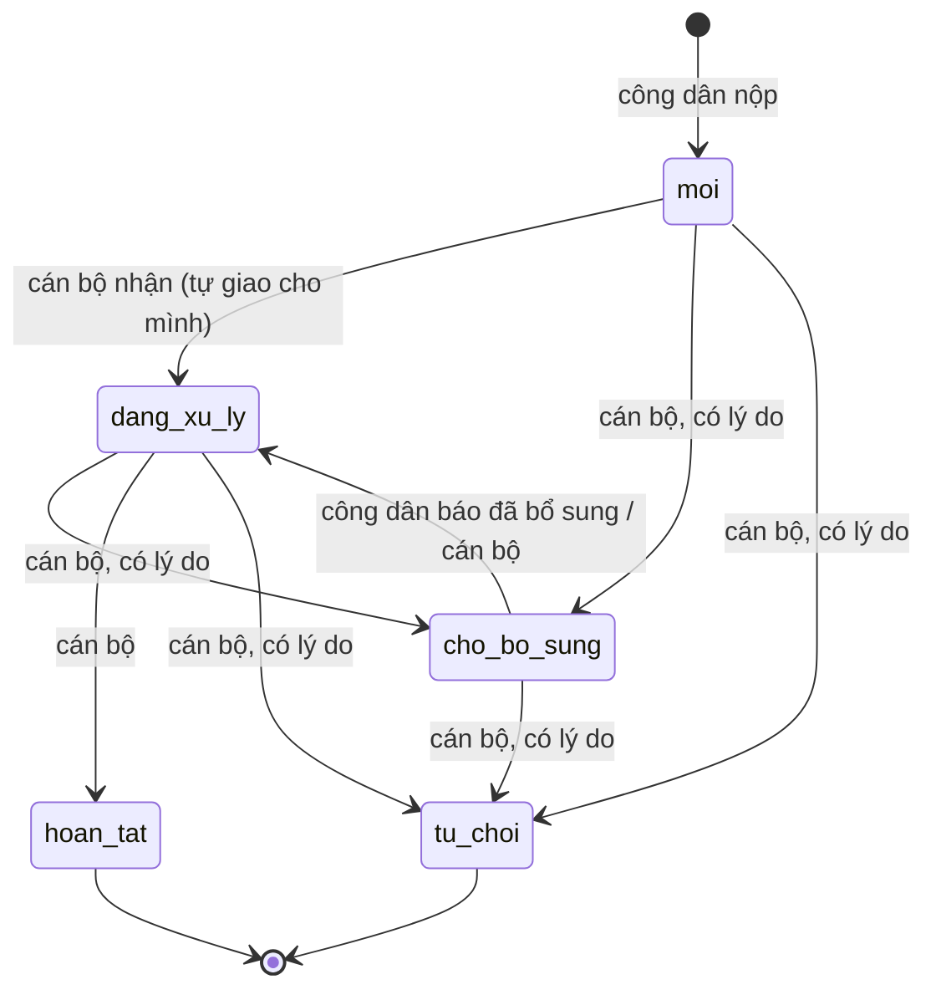

# mot-cua – Bộ máy một cửa cấp xã (Tầng 2)

Bộ máy dùng chung cho **mọi thủ tục hành chính**: hồ sơ, vai trò, phân quyền theo lĩnh vực, API quy trình và tệp, cảnh báo trễ hạn, sự kiện. Bộ máy không chứa logic riêng của thủ tục nào: mỗi thủ tục là một gói [`thu-tuc/<ma>/`](../thu-tuc/) (mô tả, BPMN, JSON Schema thành phần hồ sơ, dữ liệu mẫu) mà bộ nạp `nap-thu-tuc` tự kiểm và nạp (D-009, [`docs/thu-tuc.md`](../docs/thu-tuc.md)). Nền tảng [`nen-tang/`](../nen-tang/) phục vụ bộ máy theo quy ước thư mục; không sửa tệp nào của nền tảng.

| Tệp | Dùng để |
|---|---|
| `postgrest.env` | cấu hình PostgREST: phơi schema `mot_cua` |
| `db/migrations/001_schema_mot_cua.sql` | role `cong_dan`/`can_bo`/`lanh_dao` + `GRANT … TO authenticator`, schema `mot_cua` (bảng giữ chỗ tuần 1, bị 002 thay) |
| `db/migrations/002_schema_day_du.sql` | schema đầy đủ (#5): bảng, trigger, quyền theo cột, RLS mọi bảng |
| `db/migrations/003_tep_ho_so.sql` | tệp hồ sơ (#7): role `dich_vu_tep`, cột người tải/kết quả quét, ràng buộc khóa object theo hồ sơ, bảng `nhat_ky_tep` chỉ thêm; công dân thôi `INSERT` metadata trực tiếp |
| `db/migrations/004_su_kien.sql` | sự kiện (#9): role `dich_vu_su_kien`, hộp thư đi `hop_thu_su_kien` (outbox), `nhat_ky_su_kien` chỉ thêm; xem [Sự kiện hồ sơ](#sự-kiện-hồ-sơ-rabbitmq-9) |
| `db/migrations/005_goi_thu_tuc.sql` | gói thủ tục (D-009): cột `goi`, `quy_trinh`, `bien_theo_buoc`, `json_schema` của `thu_tuc`, hạn 0 ngày (trong ngày), role `dich_vu_danh_muc`, RPC `nap_thu_tuc`, `rut_goi_vang`; `json_schema_thu_tuc` trả schema của gói |
| `db/migrations/006_trang_thai_theo_quy_trinh.sql` | trạng thái hồ sơ theo bước Flowable (#73): thêm `cho_phe_duyet`, cột `thu_tuc.trang_thai_buoc`, bảng `lich_su_trang_thai` chỉ thêm, RPC `dong_bo_trang_thai` (trạng thái + lịch sử + hộp thư đi một transaction); xem [Trạng thái hồ sơ](#trạng-thái-hồ-sơ) |
| `db/migrations/007_nhat_ky_kiem_toan.sql` | nhật ký kiểm toán append-only chuỗi băm SHA-256 (#75): bảng `nhat_ky_kiem_toan` + đầu chuỗi `dau_chuoi_kiem_toan`, trigger ghi kiểm toán cho hồ sơ, tệp, thủ tục, phân công; `dong_bo_trang_thai` ghi thêm bước quy trình; RPC `xac_minh_kiem_toan`; GRANT cho role pgAudit `dxos_kiem_toan`; xem [Nhật ký kiểm toán](#nhật-ký-kiểm-toán-75) |
| `db/migrations/008_giay_to_ky_so.sql` | giấy tờ có ký số (#77): bảng `giay_to_ky` (biên nhận, kết quả; chỉ `dich_vu_tep` ghi, không sửa), trigger kiểm toán `giay_to.ky` kèm SHA-256; xem [Giấy tờ có ký số](#giấy-tờ-có-ký-số-77) |
| `db/seed/002_du_lieu_mau.sql` | **dữ liệu giả**: 3 lĩnh vực, 6 thủ tục kèm thành phần hồ sơ, 3 cán bộ, 6 hồ sơ ở đủ trạng thái, ngày nghỉ 2026; chỉ nạp khi `DXOS_SEED=true`. Thủ tục có gói (KS01, CT01) được bộ nạp ghi đè theo gói; 4 thủ tục còn lại chưa có gói nên chưa nộp qua `/workflow` được |
| `db/tests/rls.sql`, `db/tests/goi_thu_tuc.sql`, `db/tests/trang_thai.sql`, `db/tests/kiem_toan.sql`, `db/tests/giay_to_ky.sql` | test quyền/RLS (110 kiểm tra), danh mục gói (23 kiểm tra), trạng thái theo quy trình (50 kiểm tra), nhật ký kiểm toán (49 kiểm tra: ghi đồng thời qua dblink, chặn sửa/xóa, giả mạo bị chỉ đúng vị trí), giấy tờ ký số (23 kiểm tra), chạy trong một transaction rồi ROLLBACK |
| `keycloak/realm.json` | client role của `dxos_api` (kể cả role dịch vụ), nhóm `/cong-dan`, `/can-bo`, `/lanh-dao`, client `mot_cua_web` (PKCE), client dịch vụ `mot_cua_tep`, `mot_cua_su_kien`, `mot_cua_danh_muc` (Client Credentials, secret do Keycloak sinh), 6 người dùng mẫu có `id` (= `sub`) cố định; cán bộ và lãnh đạo bắt buộc cài OTP |
| `s3/buckets.conf` | bucket Garage `mot-cua-ho-so`; nền tảng tạo bucket và khóa S3 riêng chỉ có quyền trên bucket này |
| `backend/main.py` | API quy trình `/workflow/*` (#6) và API tệp `/files/*` (#7): dịch vụ `mot-cua-api`, chỉ thư viện chuẩn Python; quy trình và biến từng bước đọc từ danh mục gói; xem [API cho Tầng 2](#api-cho-tầng-2) |
| `backend/nap_thu_tuc.py`, `goi_thu_tuc.py`, `kiem_bpmn.py` | bộ nạp gói thủ tục (D-009): dịch vụ một lần `nap-thu-tuc`, `make nap-thu-tuc`; phần kiểm gói chạy cả trong `make check` (`--chi-kiem`); xem [Gói thủ tục](#gói-thủ-tục-d-009) |
| `rabbitmq/definitions.json` | exchange, queue, binding của sự kiện hồ sơ (#9); nền tảng tạo vhost `mot-cua`, user riêng rồi nạp tệp này |
| `backend/worker.py`, `su_kien.py`, `hop_thu.py`, `stomp.py` | sự kiện (#9): dịch vụ `mot-cua-worker` phát hộp thư đi lên RabbitMQ, quét sắp trễ hạn, đối soát trạng thái với Flowable (#73), consumer mẫu |
| `backend/trang_thai.py` | ánh xạ bước → trạng thái hồ sơ (mặc định theo người nhận, ghi đè của gói) và quy tắc tính trạng thái mới (hàm thuần, #73) |
| `backend/tep.py`, `backend/tests/` | phần thuần của API tệp (kiểm tên/loại/magic bytes, ký S3 SigV4, giao thức `clamd`, quy tắc quyền), bộ nạp gói và test đơn vị: `make test` |
| `tests/smoke.sh`, `smoke-tep.sh`, `smoke-su-kien.sh`, `smoke-goi-thu-tuc.sh` | `make smoke`: route công khai, test SQL, MFA, gọi API qua APISIX bằng token thật của từng vai trò (cán bộ, lãnh đạo dùng mật khẩu + TOTP), luồng khai sinh và chứng thực bản sao đầy đủ qua `/workflow`, cắm–rút gói tạm, tải/xem tệp, EICAR, link ký sẵn, sự kiện RabbitMQ. Cần thêm `python3` trên máy để sinh mã TOTP |
| `web-cong-dan/` | web Tầng 2: cổng công dân `/` (#52, đăng nhập `mot_cua_web`) và cổng cán bộ `/can-bo` (#55, đăng nhập `mot_cua_can_bo` + OTP; hộp việc, xử lý bước). React + Vite + Tailwind + shadcn/ui, PKCE; xem [README](web-cong-dan/README.md) |

Sửa schema: thêm tệp `db/migrations/007_<mo-ta>.sql`, **không sửa** tệp đã áp dụng (`tang2-migrate` sẽ dừng vì SHA-256 khác). Áp dụng: `make migrate`.

## Sơ đồ dữ liệu

Khóa chính UUID (trừ `ngay_nghi` khóa theo ngày và bảng nối `can_bo_linh_vuc`); bảng nào cũng có `created_at`, `updated_at` (CSDL tự ghi).



- **Thành phần hồ sơ bắt buộc** nằm trong bảng `thanh_phan_yeu_cau` (không phải JSON trong cột) để kiểm "đủ thành phần" bằng một truy vấn. Hàm `mot_cua.json_schema_thu_tuc(ma)` trả JSON Schema 2020-12 cho Poka-yoke (schema của gói, thủ tục chưa có gói thì sinh từ bảng này): `GET /public/rpc/json_schema_thu_tuc?ma=KS01`. Dữ liệu được kiểm có dạng `{"thanh_phan": {"<ma>": ["<id thanh_phan_ho_so>", …]}}`, ở cả hai lớp: cổng công dân (tệp đã chọn, trước khi gửi request) và `mot-cua-api` (tệp đã quét sạch, trước khi khởi tạo quy trình, #59).
- **Hạn xử lý** = ngày nhận (giờ Việt Nam) + `so_ngay_xu_ly` ngày làm việc, bỏ thứ Bảy, Chủ nhật và `ngay_nghi`; nộp vào ngày nghỉ thì tính từ ngày làm việc kế tiếp. Trigger tính khi nộp. Chưa xử lý: tạm dừng tính hạn khi chờ bổ sung, quy tắc nhận hồ sơ sau 15 giờ.
- **Trạng thái** (trigger chặn bước sai, mã lỗi 23514 → HTTP 400):



## Dữ liệu cá nhân

Tối thiểu theo mục đích giải quyết thủ tục: `nguoi_nop_sub` (định danh Keycloak), họ tên người nộp, số điện thoại liên hệ (không bắt buộc). **Không** lưu số CCCD, ngày sinh, địa chỉ trong CSDL; giấy tờ tùy thân là một thành phần hồ sơ (tệp ở Garage, #7) và chỉ cán bộ phụ trách lĩnh vực của hồ sơ, lãnh đạo, chính người nộp xem được. Danh sách cán bộ không mở cho công dân và người ngoài. Dữ liệu mẫu đều giả (xã giả định, tên, số điện thoại `09000000xx`, `sub` dạng `00000000-…`).

## Quyền theo vai trò

Đổi vai trò như PostgREST làm cho mỗi request: `SET ROLE` theo `resource_access.dxos_api.roles[0]` của JWT, policy đọc `dxos.jwt_sub()` của lõi. RLS bật và `FORCE` trên mọi bảng của `mot_cua`. Không role nào ghi được danh mục, cán bộ, phân công, ngày nghỉ qua API (quản trị bằng migration/SQL); không role nào xóa được hồ sơ.

| Bảng | `anon` (`/public/*`) | `cong_dan` | `can_bo` | `lanh_dao` |
|---|---|---|---|---|
| `linh_vuc`, `ngay_nghi` | đọc | đọc | đọc | đọc |
| `thu_tuc`, `thanh_phan_yeu_cau` | đọc thủ tục `cong_khai` | đọc thủ tục `cong_khai` | đọc tất cả | đọc tất cả |
| `can_bo`, `can_bo_linh_vuc` | — | — | đọc | đọc |
| `ho_so` – đọc | — | hồ sơ của mình | hồ sơ thuộc lĩnh vực mình phụ trách | tất cả |
| `ho_so` – thêm | — | hồ sơ của mình, thủ tục công khai, trạng thái `moi`; chỉ cột `thu_tuc_id`, `ho_ten_nguoi_nop`, `so_dien_thoai` | — | — |
| `ho_so` – sửa | — | chỉ khi `cho_bo_sung`: `ho_ten_nguoi_nop`, `so_dien_thoai`, chuyển về `dang_xu_ly` | hồ sơ lĩnh vực mình, chưa đóng: `trang_thai`, `ly_do`, `can_bo_xu_ly_id` (người được giao phải cùng lĩnh vực) | — |
| `thanh_phan_ho_so` – đọc | — | của hồ sơ mình | của hồ sơ mình thấy | tất cả |
| `thanh_phan_ho_so` – thêm | — | không trực tiếp: qua API tệp `/files` (quét ClamAV trước); dòng do tài khoản dịch vụ `dich_vu_tep` ghi, chỉ vào hồ sơ của người tải khi `moi`/`cho_bo_sung`, loại thành phần phải thuộc thủ tục của hồ sơ | — | — |
| `thanh_phan_ho_so` – sửa | — | — | `trang_thai_kiem_tra`, `ghi_chu_kiem_tra` (CSDL ghi người, giờ kiểm tra) | — |
| `nhat_ky_tep` | — | — | — | đọc (không ai sửa/xóa, kể cả superuser) |
| `giay_to_ky` | — | của hồ sơ mình | của hồ sơ mình thấy | tất cả (chỉ `dich_vu_tep` ghi qua `/files`; không ai sửa, kể cả superuser) |
| `nhat_ky_kiem_toan`, `dau_chuoi_kiem_toan`, RPC `xac_minh_kiem_toan` | — | — | — | đọc, xác minh (chỉ trigger/RPC của bộ máy ghi; không ai sửa/xóa, kể cả superuser) |
| `lich_su_trang_thai` | — | của hồ sơ mình | của hồ sơ mình thấy | tất cả (chỉ thêm, do trigger ghi; không ai sửa, kể cả superuser) |

Cán bộ phụ trách lĩnh vực nào được tra từ `can_bo` (theo `sub`) + `can_bo_linh_vuc`, không cần claim riêng trong JWT: đổi phân công có hiệu lực ngay. Hàm tra cứu nằm ở schema `mot_cua_noi_bo` (không phơi ra API), `SECURITY DEFINER`, `search_path` rỗng.

## API cho Tầng 2

Web (cổng công dân, cổng cán bộ) chỉ gọi APISIX `http://localhost:${APISIX_PORT:-9080}`, gửi access token Keycloak realm `dxos` (client public `mot_cua_web` cho cổng công dân, `mot_cua_can_bo` cho cổng cán bộ; Authorization Code + PKCE; cán bộ, lãnh đạo nhập thêm OTP) ở header `Authorization: Bearer …`. Origin của web phải nằm trong `DXOS_CORS_ORIGINS` (`.env`). Bảng route đầy đủ và lý do thiết kế: `docs/architecture.md` §4.1, §4.2.

| Tiền tố | Dùng cho | Ví dụ |
|---|---|---|
| `/public/` (không token, 60 req/phút/IP) | danh mục công khai cho cổng công dân | `GET /public/thu_tuc?select=id,ma,ten,thanh_phan_yeu_cau(ma,ten,bat_buoc)`, `GET /public/rpc/json_schema_thu_tuc?ma=KS01`, `GET /public/linh_vuc` |
| `/api/` (token) | đọc/ghi bảng `mot_cua` theo cú pháp PostgREST, quyền theo bảng ở mục [Quyền theo vai trò](#quyền-theo-vai-trò) | `GET /api/ho_so?select=*,thu_tuc:thu_tuc_id(ma,ten)&order=ngay_nhan.desc`, `PATCH /api/ho_so?id=eq.<id>` (cán bộ đổi trạng thái), `PATCH /api/thanh_phan_ho_so?id=eq.<id>` (cán bộ kiểm tra giấy tờ) |
| `/workflow/` (token) | quy trình Flowable của hồ sơ, qua `backend/main.py` | bảng dưới |
| `/files/` (token, body ≤ 10 MiB) | tải lên, liệt kê, cấp link xem tệp hồ sơ, qua `backend/main.py` | [bảng dưới](#files--tệp-hồ-sơ) |
| `/files/ho-so/{id}/giay-to/…`, `/files/xac-minh` (token) | biên nhận, thông báo kết quả PDF có ký số; xác minh chữ ký một PDF | [mục dưới](#giấy-tờ-có-ký-số-77) |
| `/files/s3/` (không token, link ký sẵn) | tải nội dung tệp bằng link mà `/files/tep/{id}` hoặc giấy tờ cấp | chỉ GET/HEAD |

OpenAPI của PostgREST: `GET /api/` (kèm token) hoặc `GET /public/`, chỉ liệt kê bảng, cột, RPC mà vai trò của người gọi được quyền.

### `/workflow` – quy trình hồ sơ

Body và response là JSON; lỗi có dạng `{"loi": "…", "chiTiet": …}`. Người dùng không gọi thẳng Flowable và không cầm mật khẩu của nó; backend tự kiểm token, tra quyền rồi gọi Flowable bằng tài khoản kỹ thuật.

**Luồng nộp (#59):** tạo hồ sơ `POST /api/ho_so` → tải từng tệp `POST /files/ho-so/{id}/tep?thanh_phan_yeu_cau_id=…` (ClamAV quét) → khởi tạo `POST /workflow/ho-so/{id}/khoi-tao`. Cổng công dân (`web-cong-dan/src/lib/ho-so.ts`) và smoke dùng đúng thứ tự này.

**Poka-yoke phía máy chủ (#59, `backend/poka_yoke.py`):** trước khi gọi Flowable, `mot-cua-api` dựng tài liệu hồ sơ **từ CSDL** (không lấy từ client), đọc bằng token người gọi (RLS):

```json
{"ho_so": {"ho_ten_nguoi_nop": "…", "so_dien_thoai": "…"},
 "thanh_phan": {"<mã thành phần>": ["<id thanh_phan_ho_so>", …]}}
```

chỉ tính tệp đã quét sạch (`ket_qua_quet = 'sach'`) và đã có object trong kho, rồi kiểm bằng `jsonschema` (MIT, validator Draft 2020-12, kiểm cả `format: uuid`) với `thu_tuc.json_schema` của gói (không có thì `json_schema_thu_tuc`). Thiếu hoặc sai → **422**, không khởi tạo quy trình, không ghi sự kiện, hồ sơ vẫn `moi` để tải bổ sung rồi gọi lại:

```json
{"loi": "Hồ sơ chưa đủ thành phần: Giấy chứng sinh",
 "chiTiet": {"thanhPhan": [{"thanhPhan": "giay_chung_sinh", "ten": "Giấy chứng sinh", "loi": "Thiếu thành phần bắt buộc"}]}}
```

Câu lỗi theo từng thành phần: `Thiếu thành phần bắt buộc`, `Tệp đã nộp chưa được quét sạch, chưa tính là đã nộp`, `Cần ít nhất N tệp`, `Thành phần không thuộc thủ tục này`. Schema trong CSDL hỏng → 500 (lỗi cấu hình, ghi log). Không thêm trigger CSDL cho bước này: khởi tạo quy trình chỉ đi qua `mot-cua-api` (Flowable không mở ra ngoài, APISIX chặn API quản trị), công dân không đổi được `trang_thai` khỏi `moi` qua PostgREST (RLS chỉ cho sửa khi `cho_bo_sung`); cán bộ chuyển `moi → dang_xu_ly` là thao tác tại quầy, không khởi tạo quy trình.

| Endpoint | Ai | Làm gì | Mã trả về |
|---|---|---|---|
| `POST /workflow/ho-so` body `{"thu_tuc_id", "ho_ten_nguoi_nop", "so_dien_thoai"?}` | công dân | nộp và khởi tạo ngay, **chỉ dùng được cho thủ tục không có thành phần bắt buộc** (hồ sơ mới chưa có tệp). Kiểm thủ tục có gói (`thu_tuc.quy_trinh`) và schema với `{"thanh_phan": {}}` → lưu hồ sơ qua PostgREST bằng token của công dân (RLS, CSDL tự đặt người nộp, trạng thái `moi`, hạn xử lý; cột khác client gửi bị bỏ) → khởi tạo quy trình với `businessKey` = mã hồ sơ. Trả `{"hoSo", "processInstanceId", "quyTrinh", "buocDangMo"}` | 201; 400 body sai; 403 không phải công dân; 404 thủ tục không thấy; 422 thủ tục chưa có quy trình hoặc cần giấy tờ (không lưu hồ sơ, `chiTiet.thanhPhan` liệt kê thành phần thiếu; dùng luồng nộp ở trên); 502 Flowable lỗi (hồ sơ đã lưu, trả kèm `chiTiet.hoSo` để gọi lại `khoi-tao`) |
| `POST /workflow/ho-so/{id}/khoi-tao` | công dân (người nộp) | bước cuối của luồng nộp: kiểm thành phần theo JSON Schema (Poka-yoke) rồi khởi tạo quy trình, `businessKey` = mã hồ sơ | 201; 404 không thấy hồ sơ (kể cả hồ sơ người khác); 409 đã có quy trình hoặc hồ sơ không còn `moi` (kiểm trước Poka-yoke); 422 thiếu/sai thành phần (`chiTiet.thanhPhan`) hoặc thủ tục chưa có quy trình |
| `GET /workflow/ho-so/{id}/tien-do` | ai xem được hồ sơ theo RLS | các quy trình của hồ sơ: `batDau`, `ketThuc`, `diemKetThuc` (`ket_thuc_hoan_tat`/`ket_thuc_tu_choi`), `buocDangMo`, `lichSu` các bước | 200; 404 |
| `GET /workflow/tasks` | mọi vai trò | task của người gọi: giao đích danh cho mình (`bo_sung` của công dân, task mình đã nhận) + task chưa ai nhận của nhóm mình (cán bộ: các lĩnh vực đang phụ trách; lãnh đạo: `lanh_dao`). Mỗi task: `id`, `buoc`, `ten`, `nguoiNhan`, `taoLuc`, `processInstanceId`, `hoSoId`, `maHoSo`, `hanXuLyLuc`, `quaHan` | 200 |
| `POST /workflow/tasks/{id}/complete` body `{"bien": {…}}` | người được giao hoặc thuộc nhóm ứng viên | nhận task cho mình (nếu chưa ai nhận) rồi hoàn thành; trả `buocDangMo` sau đó | 200; 400 biến sai/thiếu; 403 không có quyền; 404 không thấy task; 409 người khác vừa nhận |

Biến được phép khi hoàn thành: đúng các `flowable:formProperty` của bước đó trong BPMN của gói (danh mục `thu_tuc.bien_theo_buoc`); biến khác, sai kiểu hay thiếu biến `required="true"` bị từ chối 400. Ví dụ gói khai sinh (`thu-tuc/khai-sinh/`; gói chứng thực: [`thu-tuc/chung-thuc-ban-sao/README.md`](../thu-tuc/chung-thuc-ban-sao/README.md)):

| Bước | Ai | Biến bắt buộc | Biến tùy chọn |
|---|---|---|---|
| `tiep_nhan` | cán bộ lĩnh vực `ho_tich` | `hopLe` (bool: đủ thành phần?) | `ghiChu` (chuỗi) |
| `bo_sung` | công dân nộp hồ sơ | – | `ghiChu` |
| `tham_dinh` | cán bộ lĩnh vực `ho_tich` | `datYeuCau` (bool) | `ghiChu` |
| `phe_duyet` | lãnh đạo | `pheDuyet` (bool) | `ghiChu` |

Thêm thủ tục có quy trình: thêm một gói `thu-tuc/<ma>/` ([`docs/thu-tuc.md`](../docs/thu-tuc.md)), không sửa tệp nào ở đây.

Response của `…/khoi-tao`, `POST /workflow/ho-so` và `…/complete` có thêm `trangThai`: trạng thái hồ sơ trong CSDL sau khi đồng bộ (`null` nếu chưa ghi được, worker sẽ đối soát). Công dân hoàn thành bước `bo_sung` (nộp lại) thì hồ sơ phải đủ thành phần như lúc nộp (cùng Poka-yoke, thiếu → 422, không gọi Flowable).

### Trạng thái hồ sơ

`ho_so.trang_thai` là bản chiếu của tiến độ trong Flowable (#73): cổng công dân, cổng cán bộ, báo cáo và RLS đọc cùng một giá trị, không phải gọi Flowable. Ánh xạ bước → trạng thái khai trong gói (mặc định theo người nhận của bước, ghi đè bằng `trang_thai_theo_buoc` của `thu-tuc.yaml`, [`docs/thu-tuc.md`](../docs/thu-tuc.md#trạng-thái-hồ-sơ-theo-bước)); bộ nạp ghi vào `thu_tuc.trang_thai_buoc`.

| Trạng thái | Nghĩa | Vào khi (gói khai sinh) | Ai chuyển |
|---|---|---|---|
| `moi` | mới nộp, chờ tiếp nhận | nộp hồ sơ; khởi tạo quy trình, bước `tiep_nhan` (gói khai `tiep_nhan: moi`) | CSDL khi thêm |
| `dang_xu_ly` | cán bộ đang xử lý | `tham_dinh`; quay lại `tiep_nhan` sau khi bổ sung; lãnh đạo trả lại | quy trình; cán bộ tại quầy (hồ sơ giấy) |
| `cho_bo_sung` | chờ công dân bổ sung (công dân sửa hồ sơ, tải thêm tệp được) | `tiep_nhan` thiếu thành phần → bước `bo_sung`; `ly_do` = `ghiChu` của cán bộ | quy trình; cán bộ tại quầy |
| `cho_phe_duyet` | chờ lãnh đạo phê duyệt/ký | `phe_duyet` (nhóm `lanh_dao`) | **chỉ quy trình** (cán bộ PATCH → 400) |
| `hoan_tat` | đã trả kết quả | `endEvent` đặt `ketQua = hoan_tat`; CSDL ghi `ngay_hoan_tat` | quy trình; cán bộ tại quầy |
| `tu_choi` | không giải quyết | `endEvent` đặt `ketQua = tu_choi`; `ly_do` = `ghiChu` | quy trình; cán bộ tại quầy |

Chuyển qua `/api` (tại quầy, công dân báo đã bổ sung) vẫn theo bảng của trigger như trước, `cho_phe_duyet` không ai tự chuyển vào/ra. Quy trình (RPC dưới đây) đưa hồ sơ chưa đóng sang bất kỳ trạng thái nào trừ `moi`, vì Flowable có thể đi nhiều bước giữa hai lần đối soát. Hồ sơ đã `hoan_tat`/`tu_choi` không đổi nữa.

**Cập nhật ở đâu, theo thứ tự nào.** Flowable là nguồn đúng; CSDL ghi sau:

1. `mot-cua-api` kiểm quyền, biến, (công dân nộp lại: thành phần hồ sơ) bằng token người dùng.
2. Gọi Flowable (khởi tạo / nhận + hoàn thành task). Lỗi → trả 502, **không ghi gì vào CSDL**.
3. Đọc bước đang mở (và `ketQua` nếu quy trình vừa kết thúc), tính trạng thái mới (`backend/trang_thai.py`).
4. Gọi **một** RPC `mot_cua.dong_bo_trang_thai` bằng tài khoản dịch vụ `mot_cua_su_kien`: khóa dòng hồ sơ (`FOR UPDATE`), đổi `trang_thai` (kèm `ly_do`, giao cán bộ vừa xử lý nếu chưa giao), trigger ghi `lich_su_trang_thai`, ghi các sự kiện `ho_so.*` (mỗi sự kiện mang `duLieu.trangThai`) vào hộp thư đi — **cùng một transaction**, lỗi ở đâu cũng không ghi gì.
5. Bước 4 lỗi (PostgREST, Keycloak dừng; tiến trình chết giữa 2 và 4): request vẫn 200 vì task đã xong trong Flowable, `trangThai: null`, ghi log. `mot-cua-worker` đối soát mỗi `DXOS_SU_KIEN_QUET_GIAY` giây: hồ sơ chưa đóng có quy trình mà trạng thái lệch Flowable (bước mở hoặc `ketQua`) → gọi cùng RPC với nguồn `doi_soat`, kèm sự kiện. Bỏ qua hồ sơ vừa đổi bước trong `DXOS_DOI_SOAT_CHO_GIAY` (60) giây để không giành với API; hồ sơ giấy (không có quy trình) không bị đụng tới. Chạy tay: `docker compose exec mot-cua-worker python /mot-cua/backend/worker.py doi-soat-mot-lan`.

Gọi lại an toàn: sự kiện có khóa chống trùng `ho_so.moi:<quy trình>`, `ho_so.chuyen_buoc:<task>`, `ho_so.ket_thuc:<quy trình>` (API và worker dùng chung khóa kết thúc nên không phát hai lần), trạng thái đã đúng thì RPC không đổi, không thêm lịch sử.

`lich_su_trang_thai`: một dòng cho mỗi lần đổi (cả lúc nộp), ghi bằng trigger nên mọi đường đổi đều có: `tu_trang_thai`, `den_trang_thai`, `ly_do`, `buoc` (bước Flowable vừa xong), `nguon` (`nop`, `api`, `quy_trinh`, `doi_soat`, `he_thong` = SQL quản trị), `nguoi_sub`, `luc`. Ví dụ đọc: `GET /api/lich_su_trang_thai?ho_so_id=eq.<id>&order=id`.

```bash
# Công dân (token lấy như docs/architecture.md §8) nộp hồ sơ khai sinh: tạo hồ sơ → tải tệp → khởi tạo
TT=$(curl -s 'http://localhost:9080/public/thu_tuc?ma=eq.KS01&select=id' | jq -r '.[0].id')
HS=$(curl -s -H "Authorization: Bearer $TOKEN" -H 'Content-Type: application/json' -H 'Prefer: return=representation' \
  -d "{\"thu_tuc_id\":\"$TT\",\"ho_ten_nguoi_nop\":\"Nguyễn Văn Mẫu\"}" http://localhost:9080/api/ho_so | jq -r '.[0].id')
curl -s -X POST -H "Authorization: Bearer $TOKEN" http://localhost:9080/workflow/ho-so/$HS/khoi-tao   # chưa có tệp → 422
for YC in $(curl -s "http://localhost:9080/public/thanh_phan_yeu_cau?thu_tuc_id=eq.$TT&bat_buoc=is.true&select=id" | jq -r '.[].id'); do
  curl -s -H "Authorization: Bearer $TOKEN" -H 'Content-Type: application/pdf' --data-binary @giay-to-gia.pdf \
    "http://localhost:9080/files/ho-so/$HS/tep?ten=giay-to.pdf&thanh_phan_yeu_cau_id=$YC"
done
curl -s -X POST -H "Authorization: Bearer $TOKEN" http://localhost:9080/workflow/ho-so/$HS/khoi-tao   # đủ → 201
# Cán bộ hộ tịch: xem task, tiếp nhận (đủ thành phần)
curl -s -H "Authorization: Bearer $TOKEN_CAN_BO" http://localhost:9080/workflow/tasks
curl -s -X POST -H "Authorization: Bearer $TOKEN_CAN_BO" -H 'Content-Type: application/json' \
  -d '{"bien":{"hopLe":true}}' http://localhost:9080/workflow/tasks/<id>/complete
```

### `/files` – tệp hồ sơ

Thiết kế, luồng quét và nơi giữ khóa: `docs/architecture.md` §4.3. Chỉ nhận **PDF, JPG, PNG**, tối đa 10 MiB một tệp (`DXOS_FILE_MAX_BYTES`). Đuôi tệp, `Content-Type` của request và **nội dung thật (magic bytes)** phải cùng một loại. Mọi tệp được **ClamAV quét trước khi lưu**: tệp nhiễm bị từ chối, không lưu gì, ghi `nhat_ky_tep`. Client không bao giờ cầm khóa S3: xem tệp bằng link đã ký ngắn hạn.

| Endpoint | Ai | Làm gì | Mã trả về |
|---|---|---|---|
| `POST /files/ho-so/{id}/tep?ten=<tên tệp>[&thanh_phan_yeu_cau_id=<uuid>]`, header `Content-Type: application/pdf` \| `image/jpeg` \| `image/png`, body = nội dung tệp | công dân, hồ sơ của mình đang `moi` hoặc `cho_bo_sung` | quét → lưu Garage `mot-cua-ho-so/ho-so/{id}/<uuid>.<đuôi>` → ghi `thanh_phan_ho_so`. Trả dòng metadata (`id`, `ten_tep`, `loai_mime`, `kich_thuoc`, `sha256`, `object_key`, `nguoi_tai_sub`, `ket_qua_quet`, `quet_luc`…) | 201; 400 tên tệp lạ, tệp rỗng, thành phần không thuộc thủ tục; 401; 403 không phải công dân; 404 hồ sơ không thấy (kể cả của người khác); 409 hồ sơ không nhận thêm tệp; 411 thiếu `Content-Length`; 413 quá cỡ; 415 sai loại/giả mạo; 422 có mã độc (`chiTiet.maDoc`); 503 ClamAV chưa sẵn sàng |
| `GET /files/ho-so/{id}/tep` | ai xem được hồ sơ theo RLS | danh sách metadata tệp của hồ sơ | 200; 403 hồ sơ có nhưng không có quyền; 404 |
| `GET /files/tep/{id}[?ttl=<giây>]` | công dân (hồ sơ của mình), cán bộ (lĩnh vực đang phụ trách), lãnh đạo | metadata + `link` (GET đã ký, `ttl` 1–300 giây, mặc định 300) + `hetHanLuc`; ghi nhật ký `cap_link` | 200; 400 `ttl` sai; 403 tệp có nhưng không có quyền (vd. cán bộ sai lĩnh vực); 404 tệp không có hoặc giấy tờ chưa có tệp |
| `GET <link>` (`/files/s3/…`) | ai cầm link | nội dung tệp, `Content-Type` đúng loại, `Content-Disposition: inline`, `X-Content-Type-Options: nosniff` | 200; 403 link bị sửa; 400 `Date is too old` khi link hết hạn |

```bash
# Công dân tải tờ khai vào hồ sơ <HS> rồi lấy link xem 60 giây
curl -s -X POST -H "Authorization: Bearer $TOKEN" -H 'Content-Type: application/pdf' \
  --data-binary @to-khai.pdf "http://localhost:9080/files/ho-so/<HS>/tep?ten=to-khai.pdf"
curl -s -H "Authorization: Bearer $TOKEN" "http://localhost:9080/files/tep/<ID>?ttl=60" | jq -r .link
```

## Gói thủ tục (D-009)

Bộ nạp `backend/nap_thu_tuc.py` chạy ở mỗi `make up` (dịch vụ một lần `nap-thu-tuc`, `mot-cua-api` chờ nó xong) và bằng tay `make nap-thu-tuc`:

1. Quét `thu-tuc/*/`, kiểm từng gói bằng `goi_thu_tuc.kiem_goi()` (đủ 5 tệp, `thu-tuc.yaml` tập con YAML, JSON Schema 2020-12, BPMN theo `kiem_bpmn.py`, dữ liệu mẫu khớp schema).
2. Deploy `quy-trinh.bpmn20.xml` lên Flowable qua REST (tên deployment `thu-tuc/<goi>@<sha12>`, BPMN không đổi thì bỏ qua).
3. Gọi RPC `mot_cua.nap_thu_tuc` qua PostgREST bằng token client `mot_cua_danh_muc` (role `dich_vu_danh_muc`): upsert thủ tục, lĩnh vực, thành phần yêu cầu.
4. Gọi `mot_cua.rut_goi_vang` với danh sách thư mục còn lại: gói đã xóa thư mục thì thủ tục thôi có quy trình.

Gói lỗi: in lý do, bỏ qua, mã thoát 0. Kiểm gói không cần Docker: `python3 mot-cua/backend/nap_thu_tuc.py thu-tuc --chi-kiem` (`make check` chạy lệnh này). Xem kết quả nạp: `docker compose logs nap-thu-tuc`.

```bash
curl -s 'http://localhost:9080/public/thu_tuc?goi=not.is.null&select=ma,ten,goi,quy_trinh,so_ngay_xu_ly'
curl -s 'http://localhost:9080/public/rpc/json_schema_thu_tuc?ma=CT01' | jq .properties.thanh_phan.required
```

## Sự kiện hồ sơ (RabbitMQ, #9)

Thiết kế, lý do và sơ đồ: [`docs/architecture.md` §4.5](../docs/architecture.md#45-sự-kiện-hồ-sơ-qua-rabbitmq-9). Tóm tắt: `mot-cua-api` ghi sự kiện vào hộp thư đi `mot_cua.hop_thu_su_kien` ngay sau khi gọi Flowable thành công; `mot-cua-worker` phát lên exchange `mot_cua.su_kien` (topic, vhost `mot-cua`, routing key = loại sự kiện) qua STOMP, chờ RabbitMQ xác nhận rồi mới đánh dấu đã phát; consumer mẫu nhận từ queue `mot_cua.nhat_ky` và ghi `mot_cua.nhat_ky_su_kien` (lãnh đạo xem được qua `/api/nhat_ky_su_kien`).

### Danh mục

| Loại (routing key) | Khi nào | Ai phát | `duLieu` |
|---|---|---|---|
| `ho_so.moi` | khởi tạo quy trình thành công (`POST /workflow/ho-so`, `/ho-so/{id}/khoi-tao`) | mot-cua-api | `processInstanceId`, `quyTrinh`, `hanXuLy` (ngày), `buocDangMo` (mã bước) |
| `ho_so.chuyen_buoc` | hoàn thành một task (`POST /workflow/tasks/{id}/complete`); hoặc đối soát sửa trạng thái lệch Flowable | mot-cua-api; mot-cua-worker (đối soát) | `processInstanceId`, `tuBuoc`, `denBuoc` (mã bước đang mở sau đó, rỗng nếu kết thúc), `vaiTroXuLy`; đối soát: `tuBuoc` = `null`, `doiSoat: true` |
| `ho_so.hoan_tat` | quy trình kết thúc ở *Hoàn tất* (biến `ketQua = hoan_tat`) | mot-cua-api, ngay sau `chuyen_buoc` cuối | `processInstanceId`, `ketQua`, `diemKetThuc` |
| `ho_so.tu_choi` | quy trình kết thúc ở *Từ chối* (`ketQua = tu_choi`) | mot-cua-api | như trên |
| (mọi loại trên trừ `sap_tre_han`) | | | thêm `trangThai`: trạng thái hồ sơ sau sự kiện, ghi cùng transaction với thay đổi (#73) |
| `ho_so.sap_tre_han` | hồ sơ chưa xong (còn quy trình đang chạy), chưa quá 17:00 ngày hạn, còn ≤ `DXOS_SU_KIEN_SAP_TRE_NGAY` (1) ngày làm việc; **mỗi (hồ sơ, hạn xử lý) một lần** | mot-cua-worker, quét mỗi `DXOS_SU_KIEN_QUET_GIAY` (300) giây | `processInstanceId`, `hanXuLy`, `hanXuLyLuc`, `conLaiNgayLamViec` (0 = hạn hôm nay), `buocDangMo` |

### Định dạng (phiên bản 1)

Một object JSON, `content-type: application/json`; header AMQP `message-id` = `id`, `type` = `loai`, `app-id` = `mot-cua`. Phát **ít nhất một lần**: consumer phải chống trùng theo `id`. Thêm trường không đổi `phienBan`; bỏ hay đổi nghĩa trường thì tăng `phienBan`.

```json
{
  "phienBan": 1,
  "id": "3f2c9a4e-8d1b-4c7a-9e55-0b6d2f1a7c33",
  "loai": "ho_so.sap_tre_han",
  "luc": "2026-10-22T09:00:00+07:00",
  "nguon": "mot-cua",
  "hoSoId": "5b8d0e6a-1f3c-4a2b-9c7d-2e4f6a8b0c1d",
  "maHoSo": "HS20261021-000123",
  "linhVuc": "ho_tich",
  "thuTuc": "KS01",
  "duLieu": {
    "processInstanceId": "8c1e…",
    "hanXuLy": "2026-10-23",
    "hanXuLyLuc": "2026-10-23T17:00:00+07:00",
    "conLaiNgayLamViec": 1,
    "buocDangMo": ["tham_dinh"]
  }
}
```

**Không có dữ liệu cá nhân của công dân**: không họ tên, số điện thoại hay `sub` người nộp, chỉ id nội bộ và mã hồ sơ. Role `dich_vu_su_kien` không được đọc các cột đó (quyền cột), `su_kien.kiem()` từ chối sự kiện có các khóa này. Consumer cần liên hệ công dân (thông báo, tuần 3) tra bằng `hoSoId` qua API, theo quyền của mình.

### Tệp

| Tệp | Nội dung |
|---|---|
| `db/migrations/004_su_kien.sql` | role `dich_vu_su_kien`, bảng `hop_thu_su_kien` (outbox: `khoa_chong_trung` UNIQUE, nội dung phải khớp id/loại/hồ sơ của dòng, đã phát thì không bỏ phát được), `nhat_ky_su_kien` (chỉ thêm, khóa = id sự kiện) |
| `rabbitmq/definitions.json` | exchange `mot_cua.su_kien` (topic) → queue `mot_cua.nhat_ky` (quorum, binding `ho_so.#`, dead-letter sang `mot_cua.su_kien.loi` → queue `mot_cua.nhat_ky.loi` khi NACK hoặc quá 5 lần giao) |
| `keycloak/realm.json` | client dịch vụ `mot_cua_su_kien` (role `dich_vu_su_kien`) |
| `backend/su_kien.py` | định dạng, kiểm tra, ngày làm việc, quy tắc sắp trễ hạn (hàm thuần) |
| `backend/hop_thu.py` | ghi/đọc hộp thư và nhật ký qua PostgREST bằng token dịch vụ |
| `backend/stomp.py` | client STOMP 1.2 tối thiểu (thư viện chuẩn) |
| `backend/worker.py` | dịch vụ `mot-cua-worker`: phát, quét sắp trễ hạn, consumer mẫu. Quét tay một lần: `docker compose exec mot-cua-worker python /tang2/backend/worker.py quet-mot-lan` |
| `tests/smoke-su-kien.sh` | `make smoke`: luồng thật qua `/workflow`, sắp trễ hạn đúng một lần, tin hỏng → queue lỗi, RabbitMQ dừng rồi lên lại |

## Nhật ký kiểm toán (#75)

`nhat_ky_kiem_toan` ghi **mọi thao tác nghiệp vụ quan trọng, trong cùng transaction với thao tác** (trigger hoặc RPC; thao tác lỗi/rollback thì không có bản ghi). Thiết kế và lý do: `docs/architecture.md` §4.6.

| `hanh_dong` | Khi nào | `nguoi_sub` | `du_lieu` (không có họ tên, số điện thoại, tên tệp) |
|---|---|---|---|
| `ho_so.nop` | công dân nộp hồ sơ | người nộp | `maHoSo`, `thuTuc`, `denTrangThai` |
| `ho_so.chuyen_trang_thai` | mọi lần đổi `trang_thai` (theo `lich_su_trang_thai`) | người đổi (cán bộ xử lý bước khi đi theo quy trình) | `tuTrangThai`, `denTrangThai`, `lyDo`, `buoc` |
| `ho_so.cap_nhat` | đổi thông tin người nộp, hạn, cán bộ xử lý, lý do | người đổi | `cot` (tên cột), `canBoXuLy` |
| `ho_so.xoa` | xóa hồ sơ (chỉ SQL quản trị) | — | `maHoSo`, `trangThai` |
| `quy_trinh.xu_ly_buoc`, `quy_trinh.dong_bo` | RPC `dong_bo_trang_thai` có thay đổi (sau khi hoàn thành task Flowable; đối soát của worker) | người hoàn thành task | `buoc`, `trangThaiTruoc`, `trangThai`, `suKien` (id, loại sự kiện vào hộp thư đi) |
| `giay_to.ky` | phát hành biên nhận / thông báo kết quả có ký số (#77) | người có thao tác dẫn tới phát hành | `loai`, `giayToId`, `sha256` (PDF đã ký), `chungThu` (số hiệu) |
| `tep.tai_len`, `tep.kiem_tra` | tải tệp qua `/files`; cán bộ đổi `trang_thai_kiem_tra` | người tải / cán bộ | `tepId`, `thanhPhan`, `sha256` (nội dung tệp), `kichThuoc`, `ketQua` |
| `thu_tuc.them`, `thu_tuc.nap_goi`, `thu_tuc.rut_goi` | thêm thủ tục; nạp gói mới hoặc đã đổi (`goi_sha256`); rút gói | tài khoản dịch vụ danh mục | `goi`, `goiSha256`, `goiSha256Truoc`, `quyTrinh` |
| `can_bo.them_linh_vuc`, `can_bo.bo_linh_vuc` | đổi phân công lĩnh vực (= đổi hồ sơ cán bộ thấy) | — | `linhVuc` |
| `kiem_toan.khoi_tao` | bản ghi 1, lúc chạy migration 007 | — | số hồ sơ, số thủ tục lúc đó |

Mỗi bản ghi: `stt` (liền từ 1), `luc`, `vai_tro` (role của request), `nguon` (`nop`, `api`, `quy_trinh`, `doi_soat`, `he_thong`), `bam_truoc`, `bam = hex(SHA-256(bam_truoc ‖ nội dung chuẩn))`. Lãnh đạo đọc và xác minh qua APISIX:

```bash
curl -H "Authorization: Bearer $TOKEN_LANH_DAO" "http://localhost:9080/api/nhat_ky_kiem_toan?doi_tuong_id=eq.<hồ sơ>&order=stt"
curl -H "Authorization: Bearer $TOKEN_LANH_DAO" http://localhost:9080/api/rpc/xac_minh_kiem_toan
# → {"hopLe": true, "soBanGhi": 97, "sttCuoi": 97, "bamCuoi": "…", "dauChuoi": {…}, "loi": null}
# Trình xác minh độc lập (tự tính lại chuỗi từ bản ghi đọc qua API, không tin hàm trong CSDL):
DXOS_TOKEN=$TOKEN_LANH_DAO python3 mot-cua/backend/kiem_toan.py --api http://localhost:9080/api [--moc 97:<bam>]
```

Truy cập bảng có dữ liệu cá nhân (`ho_so`, `thanh_phan_ho_so`) và thay đổi cán bộ, phân công còn được pgAudit ghi ở mức câu lệnh vào log PostgreSQL (`docker compose logs postgres | grep 'AUDIT: OBJECT'`), không kèm tham số.

## Giấy tờ có ký số (#77)

Thiết kế và lý do: `docs/architecture.md` §4.7. Mẫu HTML ở [`mau-giay-to/`](mau-giay-to/) (`bien_nhan.html`, `ket_qua.html`, biến `$ten` thay bằng dữ liệu đã thoát HTML trong `backend/ky_so.py`); Gotenberg in A4, pyHanko ký PAdES bằng chứng thư step-ca của xã (OpenBao `dxos/tang2/mot-cua/ky-so`, do `ca-init` của nền tảng cấp).

| Giấy tờ | Phát hành khi | Nội dung |
|---|---|---|
| `bien_nhan` – Giấy tiếp nhận hồ sơ và hẹn trả kết quả | ngay sau khi khởi tạo quy trình (nộp đủ thành phần) | mã hồ sơ, người nộp, thủ tục, thời điểm nộp, thành phần đã nhận, lệ phí, hẹn trả |
| `ket_qua` – Thông báo kết quả giải quyết hồ sơ | ngay khi bước cuối đưa hồ sơ sang `hoan_tat` | mã hồ sơ, người nộp, thủ tục, hạn, thời điểm hoàn tất, kết quả |

Phát hành chạy ở luồng nền (lỗi chỉ ghi log), nên cổng gọi `POST …/giay-to/{loai}` khi người dùng bấm tải: có rồi trả lại, chưa có thì phát hành ngay.

```bash
# Công dân lấy biên nhận hồ sơ <HS> (link tải hết hạn sau DXOS_FILE_LINK_TTL giây)
curl -X POST -H "Authorization: Bearer $TOKEN" http://localhost:9080/files/ho-so/<HS>/giay-to/bien_nhan
# Xác minh một PDF bất kỳ (ví dụ biên nhận công dân mang tới)
curl -H "Authorization: Bearer $TOKEN" -H 'Content-Type: application/pdf' --data-binary @bien-nhan.pdf \
  http://localhost:9080/files/xac-minh
# → {"hopLe": true, "toanVen": true, "tinCay": true, "nguoiKy": "UBND xã Mẫu – Bộ phận Một cửa",
#    "phatHanh": {"loai": "bien_nhan", "maHoSo": "HS…", "kyLuc": "…"}, …}
```

Cổng công dân hiện nút tải biên nhận ở trang "Đã nộp"; cổng cán bộ có thẻ "Giấy tờ có ký số" trong chi tiết hồ sơ (biên nhận, và kết quả khi hồ sơ hoàn tất).

## Người dùng mẫu

| Người dùng | `sub` | Vai trò | Ghi chú |
|---|---|---|---|
| `congdan01` | `…0000c001` | `cong_dan` | Nguyễn Văn Mẫu, 3 hồ sơ mẫu |
| `congdan02` | `…0000c002` | `cong_dan` | Lê Thị Thử, 3 hồ sơ mẫu |
| `canbo01` | `…0000b001` | `can_bo` | hộ tịch; bắt cài OTP |
| `canbo02` | `…0000b002` | `can_bo` | chứng thực; bắt cài OTP |
| `canbo03` | `…0000b003` | `can_bo` | đất đai; bắt cài OTP |
| `lanhdao01` | `…0000d001` | `lanh_dao` | bắt cài OTP |

Realm không chứa mật khẩu: đặt bằng `make demo-users` (chạy sau `make smoke`; xem `docs/cai-dat.md` mục 3 và `docs/architecture.md` §8). `sub` cố định chỉ áp dụng khi realm được nạp lần đầu; volume Keycloak cũ giữ `sub` cũ.

## Chạy test

```bash
make test-backend               # test đơn vị API tệp, sự kiện, trình xác minh kiểm toán, ký số PDF (không cần Docker; make check cũng chạy)
make test-sql                   # migration + db/tests/*.sql trên PostgreSQL trống, trước và sau seed (container tạm; CI job test-sql)
make smoke                      # toàn bộ: nền tảng + bộ máy + gói thủ tục + quy trình Flowable + /workflow + /files + sự kiện + kiểm toán
docker compose exec -T postgres psql -XqtA -U postgres -d commune < mot-cua/db/tests/rls.sql   # chỉ RLS
```

Bí mật của bộ máy (khóa S3, secret client `mot_cua_tep`, `mot_cua_su_kien`, `mot_cua_danh_muc`, thông tin kết nối RabbitMQ, mật khẩu `rest-admin` của Flowable) đọc từ OpenBao của lõi bằng AppRole `tang2` (`backend/bimat.py`, chỉ giữ trong bộ nhớ), xem `docs/architecture.md` §4.4.

Cổng cán bộ (#55) dùng `GET /workflow/tasks`, `GET /api/ho_so?id=in.(…)` (kèm `thu_tuc.bien_theo_buoc` để sinh form từng bước), `/files`, `GET /workflow/ho-so/{id}/tien-do` và `POST /workflow/tasks/{id}/complete`; luồng: [`docs/cong-can-bo.md`](../docs/cong-can-bo.md). Sắp tới: tra cứu tiến độ trên cổng công dân (#54), thông báo sắp trễ hạn tới cán bộ qua RabbitMQ (#56).
