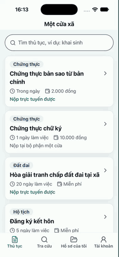
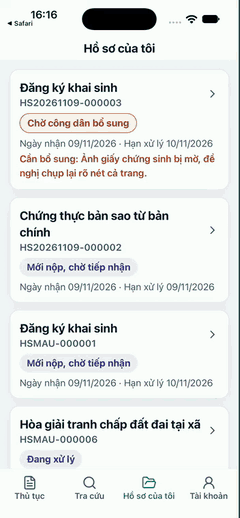

# Một cửa xã – app di động cho công dân

App Android cho người dân dùng bộ máy một cửa của Commune DX-OS (Tầng 2, quyết định D-015):
xem thủ tục, nộp hồ sơ kèm ảnh giấy tờ, tra cứu theo mã hồ sơ, theo dõi và bổ sung hồ sơ của mình,
tải biên nhận và kết quả có ký số. App gọi đúng các API mà cổng công dân web (`mot-cua/web-cong-dan/`) đang dùng, qua APISIX:

| Đường dẫn | Dùng cho | Cần đăng nhập |
|---|---|---|
| `GET /public/thu_tuc` | danh sách thủ tục, JSON Schema thành phần hồ sơ | không |
| `GET /public/rpc/tra_cuu_ho_so` | tra cứu bằng mã hồ sơ + 4 số cuối điện thoại | không |
| `POST /api/ho_so`, `GET /api/ho_so`, `GET /api/lich_su_trang_thai` | tạo hồ sơ, hồ sơ của tôi, các mốc trạng thái (PostgREST, RLS) | có |
| `POST /files/ho-so/{id}/tep`, `GET /files/ho-so/{id}/tep` | tải ảnh giấy tờ (ClamAV quét, Garage lưu) | có |
| `POST /workflow/ho-so/{id}/khoi-tao` | khởi tạo quy trình Flowable của thủ tục | có |
| `GET /workflow/ho-so/{id}/tien-do` | bước quy trình đang mở | có |
| `GET /workflow/tasks`, `POST /workflow/tasks/{id}/complete` | nộp lại hồ sơ sau khi bổ sung | có |
| `POST /files/ho-so/{id}/giay-to/{loai}` | biên nhận, thông báo kết quả PDF ký số (link tải ngắn hạn) | có |

Đăng nhập bằng Keycloak (realm `dxos`), Authorization Code + PKCE, client public `mot_cua_di_dong`,
không có client secret trong app. Token lưu trong Android Keystore qua `react-native-keychain`.

## Tính năng

| Màn | Người dân làm được gì |
|---|---|
| Thủ tục | Tìm thủ tục (gõ không dấu cũng được), xem thời hạn, lệ phí, thành phần hồ sơ |
| Nộp hồ sơ | Khai người nộp, chụp hoặc chọn ảnh từng giấy tờ; thiếu giấy tờ bắt buộc thì app chặn trước khi gửi; mất mạng giữa chừng thì bấm Thử lại gửi tiếp, không tạo trùng hồ sơ |
| Đã nộp | Mã hồ sơ, hạn xử lý, tải biên nhận có ký số |
| Tra cứu | Mã hồ sơ + 4 số cuối điện thoại, không cần đăng nhập |
| Hồ sơ của tôi | Danh sách hồ sơ, trạng thái, hạn, báo quá hạn, lý do cần bổ sung; kéo xuống để làm mới |
| Chi tiết hồ sơ | Lời nhắn theo trạng thái, bước đang xử lý, các mốc kèm lý do, giấy tờ đã nộp; **bổ sung hồ sơ** ngay trên app (chụp thêm ảnh, ghi chú, nộp lại); **tải biên nhận / thông báo kết quả** PDF có chữ ký số của xã |
| Tài khoản | Đăng nhập, đăng xuất Keycloak, máy chủ đang dùng, phiên bản |

Mọi màn có trạng thái đang tải, lỗi kèm nút Thử lại, trống, dải báo mất mạng. Phiên hết hạn hoặc bị thu hồi
(máy chủ trả 401) thì app xóa phiên và hiện lại nút đăng nhập kèm câu "Phiên đăng nhập đã hết hạn".

Giao diện theo cổng công dân web: nền sáng, xanh ngọc `#0F766E` cho nút chính, chàm `#4338CA` cho bước đang xử lý
và nhãn lĩnh vực, đỏ son `#D9480F` chỉ cho cảnh báo. Chữ thân 18, không chữ nào dưới 16 (trừ nhãn thanh tab), vùng
bấm ≥ 48dp, nút bo tròn. Phông chữ là phông hệ thống của Android (Roboto, đủ dấu tiếng Việt); app không nhúng phông.

## Demo

Quay trên iOS Simulator bằng bản dựng thử, với stack chạy trên máy và dữ liệu mẫu giả (repo chỉ phát hành APK
Android). Bên trái: nộp hồ sơ chứng thực tới biên nhận PDF ký số. Bên phải: bổ sung ảnh giấy chứng sinh theo
yêu cầu rồi nộp lại.

<p align="center">
  
  &nbsp;&nbsp;
  
</p>

## Cài APK lên điện thoại Android

1. Trên điện thoại, mở trang Release mới nhất của repo:
   <https://github.com/commune-dxos/commune-dxos/releases/latest>, tải tệp `mot-cua-xa-<phiên bản>-debug.apk`.
   (Bản dựng mới nhất của nhánh `develop` có ở mục Artifacts của workflow `di-dong` trên GitHub Actions.)
2. Mở tệp vừa tải. Lần đầu Android hỏi quyền "Cài ứng dụng không rõ nguồn gốc": cho phép trình duyệt (hoặc
   ứng dụng Tệp) cài, rồi bấm **Cài đặt**. Play Protect có thể cảnh báo vì APK ký bằng khóa debug: chọn
   "Vẫn cài đặt".
3. Mở app **Một cửa xã**. App trỏ sẵn bản demo <https://commune.dzfullstack.com>; đăng nhập bằng tài khoản
   công dân thử nghiệm do đội cấp. Tra cứu và xem thủ tục không cần đăng nhập.
4. Muốn kiểm tệp tải về: so `sha256sum mot-cua-xa-*.apk` với dòng tương ứng trong `SHA256SUMS` của Release.

Cần Android 7.0 (API 24) trở lên. APK debug ký bằng khóa debug do máy build CI tự tạo, mỗi lần build có thể
khác khóa: nếu Android báo "Ứng dụng chưa được cài đặt" khi cài đè bản cũ thì gỡ bản cũ trước rồi cài lại
(phiên đăng nhập sẽ phải đăng nhập lại).

## Công nghệ

React Native 0.80 (bare, New Architecture, Hermes) · TypeScript strict · React Navigation 7 ·
TanStack Query 5 · Zustand 5 · i18next (tiếng Việt) · NetInfo · AsyncStorage · react-native-keychain ·
react-native-app-auth · react-native-image-picker. Giấy phép từng gói: [`DEPENDENCIES.md`](../../DEPENDENCIES.md).
Chỉ build Android; chưa có bản iOS.

## Cấu trúc

```
src/
  cau-hinh/     cấu hình môi trường (DXOS_*), TanStack Query
  dich-vu/      gọi APISIX: goi-api, danh-muc, ho-so, tra-cuu, nop-ho-so, bo-sung, giay-to, thanh-phan, xac-thuc
  kho/          kho Zustand: phiên đăng nhập, trạng thái mạng
  dieu-huong/   stack gốc + thanh tab
  man-hinh/     các màn
  thanh-phan/   thành phần dùng chung: nút, thẻ, ô nhập, mục ảnh giấy tờ, nút giấy tờ ký số, khối bổ sung,
                màn đang tải / lỗi / trống, dải mất mạng
  giao-dien/    màu, cỡ chữ theo cổng công dân
  ngon-ngu/     chuỗi giao diện tiếng Việt (vi.json)
__tests__/      Jest: dịch vụ, kho, render màn chi tiết hồ sơ với máy chủ giả
android/        dự án Android (package vn.communedxos.motcua)
```

## Chạy thử

Cần Node ≥ 22, JDK 17, Android SDK (platform 36 để biên dịch, build-tools 35.0.0, NDK 27.1.12297006, CMake),
một máy ảo hoặc điện thoại Android bật gỡ lỗi USB.

```bash
cd mot-cua/di-dong
corepack enable          # dùng Yarn 1.22 theo packageManager
yarn install --frozen-lockfile
cp .env.example .env     # bỏ qua thì app trỏ bản demo https://commune.dzfullstack.com
yarn start               # Metro
yarn android             # build, cài và mở app trên máy ảo/điện thoại
```

Kiểm tra trước khi commit:

```bash
yarn typecheck && yarn lint && yarn test
```

### Trỏ máy local thay cho bản demo

Chạy lõi ở gốc repo (`make up`), rồi cho máy ảo Android thấy cổng của máy tính:

```bash
adb reverse tcp:9080 tcp:9080
adb reverse tcp:8080 tcp:8080
```

Sửa `.env`:

```
DXOS_GATEWAY_URL=http://localhost:9080
DXOS_KEYCLOAK_URL=http://localhost:8080
```

Biến môi trường được gắn vào mã lúc đóng gói (`babel.config.js`), nên sau khi đổi `.env` phải chạy
`yarn start --reset-cache` (hoặc build lại APK). Bản debug cho phép HTTP thường để gọi máy local.

## Build APK debug

```bash
cd mot-cua/di-dong
yarn apk:debug
# → android/app/build/outputs/apk/debug/app-debug.apk
```

APK debug đã đóng gói sẵn JS (`debuggableVariants = []` trong `android/app/build.gradle`), cài lên
điện thoại là chạy, không cần Metro. APK được ký bằng khóa debug mặc định của máy build
(`~/.android/debug.keystore`); repo không chứa keystore nào. Workflow `di-dong` trên GitHub cũng build APK
khi đẩy vào `develop`/`main` hoặc bấm chạy tay, tải ở mục Artifacts.

## Client Keycloak cho app

Client `mot_cua_di_dong` khai trong [`mot-cua/keycloak/realm.json`](../keycloak/realm.json) (Tầng 2, không sửa
`nen-tang/`): public, chỉ Authorization Code + PKCE S256, redirect `vn.communedxos.motcua:/oauth`.
Dịch vụ `tang2-realm` nạp client này khi `make up` trên máy mới.

Máy chủ đang chạy (realm đã nạp từ trước): `tang2-realm` nạp bằng Partial Import, bỏ qua client đã có và
thêm client mới, nên chỉ cần chạy lại dịch vụ đó ở gốc repo:

```bash
docker compose --profile core up --no-deps --force-recreate tang2-realm
```

Nếu dịch vụ báo lỗi đăng nhập OpenBao (AppRole) hoặc không muốn chạy lại, thêm tay bằng `kcadm.sh` trong container Keycloak (mật khẩu quản trị lấy từ OpenBao
`dxos/core/keycloak/admin`, không in ra màn hình):

```bash
docker compose exec keycloak /opt/keycloak/bin/kcadm.sh config credentials \
  --server http://localhost:8080 --realm master --user admin --password "$KC_ADMIN_PW"
docker compose exec keycloak /opt/keycloak/bin/kcadm.sh create clients -r dxos \
  -s clientId=mot_cua_di_dong -s 'name=mot-cua: app di động công dân' \
  -s publicClient=true -s standardFlowEnabled=true -s directAccessGrantsEnabled=false \
  -s implicitFlowEnabled=false \
  -s 'redirectUris=["vn.communedxos.motcua:/oauth"]' \
  -s 'attributes={"pkce.code.challenge.method":"S256","post.logout.redirect.uris":"vn.communedxos.motcua:/oauth"}'
```

Kiểm tra: `kcadm.sh get clients -r dxos -q clientId=mot_cua_di_dong --fields clientId,publicClient,redirectUris`.

## Giấy phép

GPL-3.0-or-later như toàn repo. Mọi tệp mã có header SPDX 2 dòng; tệp ảnh, `yarn.lock` và Gradle wrapper
(Apache-2.0, tệp gốc của Gradle) khai trong [`REUSE.toml`](../../REUSE.toml).
