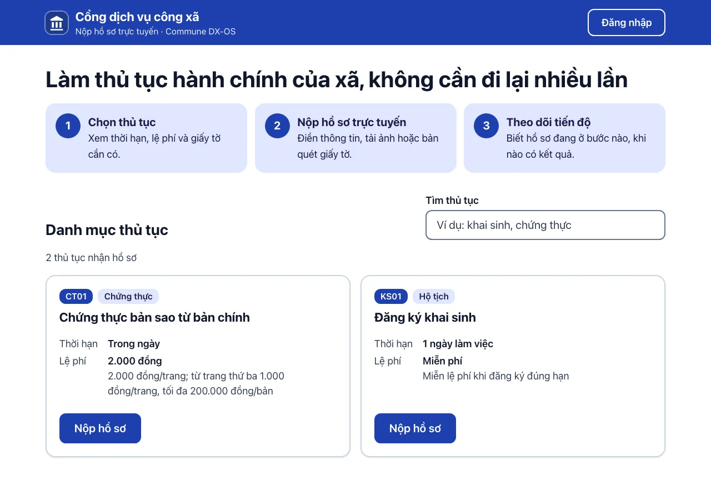
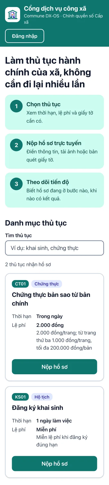
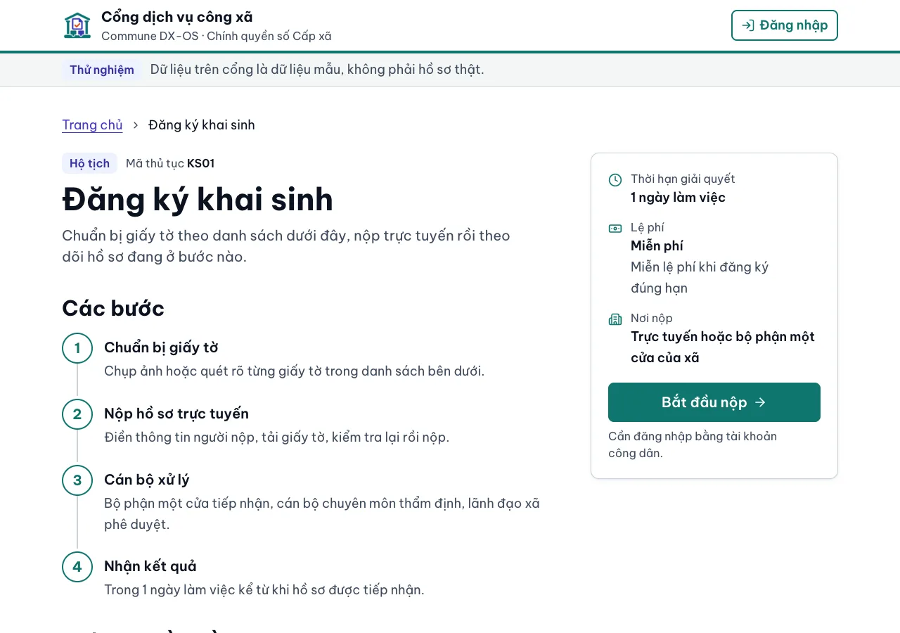
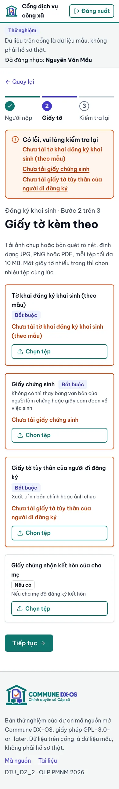
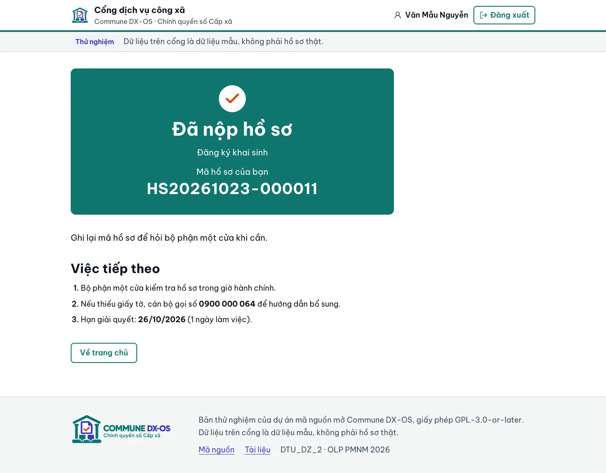

<!-- SPDX-FileCopyrightText: 2026 DTU_DZ_2 -->
<!-- SPDX-License-Identifier: GPL-3.0-or-later -->
# Cổng công dân và cổng cán bộ

Ứng dụng web Tầng 2 của bộ máy một cửa, hai cổng trong một bản build:

- **Cổng công dân** `/` (#52): xem danh mục và chi tiết thủ tục, đăng nhập, nộp hồ sơ kèm giấy tờ (#64), tra cứu tiến độ (#54).
- **Cổng cán bộ** `/can-bo` (#55): đăng nhập mật khẩu + OTP, hộp việc theo lĩnh vực, chi tiết hồ sơ, xử lý từng bước. Luồng đầy đủ: [`docs/cong-can-bo.md`](../../docs/cong-can-bo.md).

Chung một ứng dụng thay vì thư mục `web-can-bo/` riêng để dùng chung theme, phông, thành phần shadcn/ui, lớp gọi APISIX, cấu hình lúc chạy, Dockerfile và nginx; không lặp `package.json` hay lockfile. Mỗi cổng một client OIDC public và một phiên riêng; cổng cán bộ là gói JS nạp lười nên người dân không tải mã của cán bộ. React 19 + Vite 7 + TypeScript + Tailwind CSS 4 + thành phần shadcn/ui (lấy bằng shadcn CLI, MIT) + phông Be Vietnam Pro tự host. Giấy phép từng gói: [`DEPENDENCIES.md`](../../DEPENDENCIES.md) mục 2.

<p>
  
  
</p>
<p>
  
  
</p>
<p>
  
</p>

- **Chỉ gọi lõi qua APISIX** (`VITE_GATEWAY_URL`). Danh mục: `GET /public/thu_tuc?select=…,linh_vuc:linh_vuc_id(ma,ten)&order=ma` (không token, role `anon`, RLS chỉ trả thủ tục công khai, 60 request/phút/IP).
- **Nộp hồ sơ** (`/nop-ho-so/:ma`, cần đăng nhập) theo mẫu dịch vụ công của GOV.UK: mỗi trang một nhóm câu hỏi, thanh bước, tóm tắt lỗi đầu form, "Kiểm tra lại thông tin", "Đã nộp". Giấy tờ cần có đọc từ JSON Schema của gói (cột `thu_tuc.json_schema`); kiểm bằng validator JSON Schema 2020-12 (`@cfworker/json-schema`, MIT) với đúng schema đó: thiếu thành phần bắt buộc hay thiếu số tệp tối thiểu (`minItems`) thì không sang bước sau, và `nopHoSo` (`src/lib/ho-so.ts`) kiểm lại trước khi gửi request đầu tiên nên không request nào đi (Poka-yoke phía trình duyệt, #53; test `src/lib/nop-ho-so.test.ts` đếm fetch = 0). `mot-cua-api` kiểm lại với tệp đã quét sạch trước khi khởi tạo quy trình (#59), thiếu → 422 và form hiện câu lỗi của máy chủ. Không dùng Ajv vì Ajv biên dịch schema bằng `new Function`, bị CSP `script-src 'self'` chặn. Bấm nộp: `POST /api/ho_so` (tạo hồ sơ) → `POST /files/ho-so/{id}/tep` cho từng tệp (ClamAV quét) → `POST /workflow/ho-so/{id}/khoi-tao`; lỗi giữa chừng thì "Thử lại" tiếp tục từ chỗ dở, không tạo trùng hồ sơ. Chế độ `dev:gia` không nộp được (báo rõ).
- **Tra cứu tiến độ** (#54): `/tra-cuu` không cần đăng nhập, mã hồ sơ + 4 số cuối số điện thoại → `GET /public/rpc/tra_cuu_ho_so` (chỉ trạng thái và các mốc, không dữ liệu cá nhân). `/ho-so` (Hồ sơ của tôi, cần đăng nhập): danh sách `GET /api/ho_so` (RLS), chi tiết `/ho-so/{id}`: các bước (dựng từ trạng thái, `src/lib/tien-do.ts`), bước Flowable đang mở (`/workflow/ho-so/{id}/tien-do`), mốc kèm lý do (`/api/lich_su_trang_thai`), giấy tờ đã nộp, biên nhận và kết quả có ký số; hồ sơ chờ bổ sung thì tải thêm tệp (`/files`) và "Nộp lại hồ sơ" (`POST /workflow/tasks/{id}/complete` bước `bo_sung`). Hạn xử lý dùng chung `src/lib/han.ts`, `src/components/the-han.tsx` với cổng cán bộ.
- **Đăng nhập** Keycloak realm `dxos`, client public `mot_cua_web`, Authorization Code + PKCE S256 ([`../keycloak/realm.json`](../keycloak/realm.json)). Web không có bí mật nào; token nằm trong `sessionStorage` của tab. Xem danh mục không cần đăng nhập.
- **Dành cho người dân:** thân chữ 18px, không chữ nào dưới 16px, nút cao ≥ 44px, mọi cặp chữ/nền đạt tương phản WCAG AA, vòng focus chàm 7.9:1 (trắng trong vùng nền xanh), bố cục một cột trên điện thoại, có liên kết "Bỏ qua, tới nội dung chính", tìm thủ tục không cần gõ dấu.
- **Cổng cán bộ (#55, `src/can-bo/`):** bố cục tham khảo [shadcn-admin](https://github.com/satnaing/shadcn-admin) (MIT, không chép mã): thanh bên (Hộp việc, Quá hạn, Sắp trễ hạn, Tôi đang xử lý; dưới 768px thành ngăn kéo), đầu trang có chuông hạn xử lý và menu người dùng, ô số liệu, bảng việc (thẻ trên điện thoại). Đăng nhập client public `mot_cua_can_bo` (PKCE, Keycloak đòi OTP với `can_bo`, `lanh_dao`); token không có hai vai này → trang "không có quyền". Hộp việc = `GET /workflow/tasks` ghép `GET /api/ho_so?id=in.(…)` (RLS theo lĩnh vực); lọc theo trạng thái nhận, thủ tục, hạn (trên URL). Hạn lấy từ biến `hanXuLyLuc`/`quaHan` của quy trình, ghi "còn bao lâu", sắp trễ (≤ 1 ngày) và quá hạn đổi màu, lên đầu danh sách (`src/lib/han.ts`). Chi tiết hồ sơ: người nộp, thành phần và tệp (link ký sẵn `/files/tep/{id}`, chỉ lấy khi bấm), lịch sử bước (`/workflow/ho-so/{id}/tien-do`). Form xử lý bước sinh từ `thu_tuc.bien_theo_buoc` (formProperty trong BPMN của gói: có/không, số, chữ; `src/can-bo/lib/form-buoc.ts`), thiếu trường bắt buộc thì không gửi, gửi `POST /workflow/tasks/{id}/complete`, lỗi 400/403/409 hiện nguyên câu của `mot-cua-api`.
- **Giao diện (#63):** theme shadcn/ui theo bộ nhận diện trong `src/index.css` (xanh ngọc `#0F766E` cho nút chính, chàm `#4338CA` cho liên kết và focus, đỏ son `#D9480F` chỉ cho cảnh báo và dấu tích, chữ `#0B1220`); phông Be Vietnam Pro (OFL-1.1) đóng gói vào bản build, không gọi Google Fonts. Thêm thành phần: `npx shadcn@4.22.1 add <tên>` rồi chỉnh cỡ chữ, vùng bấm như các tệp sẵn có, thêm header SPDX và dòng nguồn.

## Chạy

Cần Node ≥ 20.19 (CI dùng Node 22).

```bash
cd mot-cua/web-cong-dan
npm ci
npm run dev        # http://localhost:5173, gọi APISIX ở http://localhost:9080 (cần make up ở gốc repo)
npm run dev:gia    # không cần lõi: danh mục lấy từ src/du-lieu-gia/thu-tuc.json
npm test           # Vitest
npm run build      # kiểm kiểu + build vào dist/
```

Cổng 5173 khớp `DXOS_CORS_ORIGINS` mặc định (`.env.example` ở gốc) và `redirectUris` của client `mot_cua_web`. Đổi địa chỉ: chép [`.env.example`](.env.example) thành `.env.local`.

**Trong compose (#57):** `make up` ở gốc repo build [`Dockerfile`](Dockerfile) (node → `nginxinc/nginx-unprivileged`, uid 101, rootfs chỉ đọc) thành dịch vụ `mot-cua-web`; APISIX phục vụ ở **http://localhost:9080/** cùng origin với `/public`, `/api`, `/files`, `/workflow`, nên web gọi lõi bằng đường dẫn tương đối. Image không có bí mật hay địa chỉ nào: [`nginx/default.conf.template`](nginx/default.conf.template) sinh `/cau-hinh.js` (Keycloak, realm, client) từ biến môi trường lúc chạy, `src/lib/cau-hinh.ts` ưu tiên nó hơn biến `VITE_*`; [`nginx/bao-mat.headers.template`](nginx/bao-mat.headers.template) đặt CSP (không `unsafe-inline`), `frame-ancestors 'none'`, `nosniff`, `Referrer-Policy`. Route SPA tải lại vẫn 200, đường dẫn lạ trả 404. Cổng cán bộ **http://localhost:9080/can-bo** đi qua route APISIX riêng `mot-cua-web-can-bo` (giới hạn 300 request/phút/IP, `X-Robots-Tag: noindex`), cùng dịch vụ `mot-cua-web`; `/cau-hinh.js` thêm `clientIdCanBo` (biến `DXOS_OIDC_CLIENT_ID_CAN_BO`). Kiểm: `make smoke` mục 4h (`mot-cua/tests/smoke-web.sh`) và 4i (`mot-cua/tests/smoke-can-bo.sh`).

Tài khoản thử (sau `make demo-users` ở gốc repo, dữ liệu giả): cổng công dân `congdan01`, `congdan02`; cổng cán bộ http://localhost:9080/can-bo (dev: http://localhost:5173/can-bo) `canbo01` (hộ tịch), `canbo02` (chứng thực), `lanhdao01` – lần đầu Keycloak đòi cài OTP. `npm run dev:gia` chỉ có dữ liệu giả cho cổng công dân; cổng cán bộ cần lõi chạy.

<p>
  
  
</p>

## Thư mục

| Đường dẫn | Nội dung |
|---|---|
| `src/lib/api.ts`, `src/lib/ho-so.ts` | gọi APISIX (danh mục; tạo hồ sơ, tải tệp, khởi tạo quy trình), câu báo lỗi cho người dân (401, 429, 5xx, mất mạng) |
| `src/lib/thanh-phan.ts` | đọc thành phần hồ sơ từ JSON Schema của gói, kiểm Poka-yoke bằng validator 2020-12 |
| `src/auth/` | cấu hình OIDC + PKCE cho hai client (`oidc.ts`), trạng thái đăng nhập dùng chung (`xac-thuc.tsx`) |
| `src/lib/goi-api.ts` | gọi APISIX bằng access token, đổi lỗi thành câu tiếng Việt (dùng chung cho nộp hồ sơ và cổng cán bộ) |
| `src/pages/` | trang chủ (danh mục), chi tiết thủ tục (`/thu-tuc/:ma`), form nộp hồ sơ (`nop-ho-so/`: từng bước, tóm tắt lỗi, kiểm tra lại, đã nộp), hoàn tất đăng nhập, 404 |
| `src/components/ui/` | thành phần shadcn/ui (MIT) đã chỉnh cho người dân: Alert, Badge, Breadcrumb, Button, Card, Empty, Field, Input, InputGroup, Item, Label, RadioGroup, Separator, Skeleton, Textarea; thêm cho cổng cán bộ: Avatar, DropdownMenu, Select, Sheet, Sidebar, Table, Tooltip (`src/hooks/use-mobile.ts` đi cùng Sidebar) |
| `src/components/` | khung trang (`bo-cuc.tsx`: đầu trang, dải Thử nghiệm, chân trang), khung nội dung (`khung.tsx`), khối thông báo dùng chung cho màn lỗi/trống (`thong-bao.tsx`), trạng thái tải một thủ tục (`tai-thu-tuc.tsx`), dòng thủ tục (`the-thu-tuc.tsx`) |
| `src/can-bo/` | cổng cán bộ (#55): `cong-can-bo.tsx` (cổng vào theo vai trò, route), `du-lieu.tsx` (hộp việc dùng chung, tải lại mỗi phút), `lib/` (gọi API, hạn xử lý, form theo bước, quyền, lọc hộp việc – có Vitest), `components/` (khung thanh bên, chuông, menu người dùng, thẻ hạn, form xử lý), `pages/` (hộp việc, chi tiết hồ sơ, đăng nhập/không có quyền) |
| `src/du-lieu-gia/thu-tuc.json` | dữ liệu giả cho `npm run dev:gia`; test kiểm khớp `thu-tuc/*/thu-tuc.yaml` và `thanh-phan-ho-so.schema.json` |

Thêm thủ tục mới: thêm gói `thu-tuc/<ma>/` ([`docs/thu-tuc.md`](../../docs/thu-tuc.md)); cổng tự hiện thủ tục từ danh mục, không sửa mã web (chỉ cập nhật dữ liệu giả, test sẽ nhắc).
