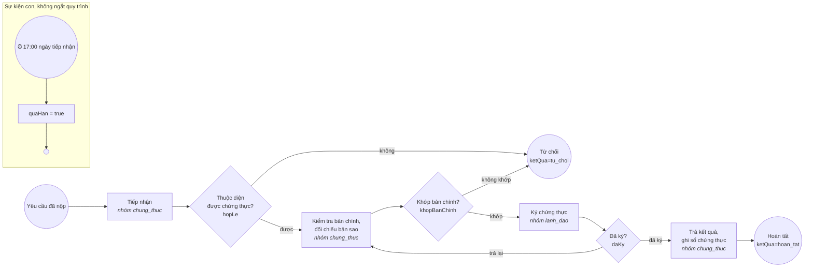

# Gói thủ tục `chung-thuc-ban-sao` – Chứng thực bản sao từ bản chính (CT01)

Gói thứ hai của bộ máy một cửa (D-009), thêm bằng đúng 5 tệp trong thư mục này, **không sửa mã** `mot-cua/` hay `nen-tang/`: bằng chứng cắm–rút theo gói thủ tục (D-008). Cách viết gói: [`docs/thu-tuc.md`](../../docs/thu-tuc.md).

| Tệp | Nội dung |
|---|---|
| `thu-tuc.yaml` | mã `CT01`, lĩnh vực `chung_thuc`, hạn **trong ngày** (`thoi_han_ngay_lam_viec: 0`), lệ phí 2.000 đồng/trang, căn cứ pháp lý, process id `chung_thuc_ban_sao` |
| `quy-trinh.bpmn20.xml` | BPMN 2.0 viết tay: tiếp nhận → kiểm tra bản chính → ký chứng thực → trả kết quả |
| `thanh-phan-ho-so.schema.json` | JSON Schema 2020-12: bản chính (bắt buộc), bản sao (nếu tự chuẩn bị) |
| `du-lieu-mau.json` | yêu cầu mẫu **giả** khớp schema, kèm biến xử lý từng bước mà smoke dùng để chạy hết quy trình |

| Bước | Ai | Biến bắt buộc | Biến tùy chọn |
|---|---|---|---|
| `tiep_nhan` | cán bộ lĩnh vực `chung_thuc` | `hopLe` (boolean) | `ghiChu` |
| `kiem_tra_ban_chinh` | cán bộ lĩnh vực `chung_thuc` | `khopBanChinh` (boolean) | `soTrang` (long), `ghiChu` |
| `ky_chung_thuc` | lãnh đạo | `daKy` (boolean) | `ghiChu` |
| `tra_ket_qua` | cán bộ lĩnh vực `chung_thuc` | `soBan` (long) | `ghiChu` |

Hạn xử lý: `thoi_han_ngay_lam_viec: 0` → `ho_so.han_xu_ly` là ngày tiếp nhận (ngày làm việc kế tiếp nếu nộp vào ngày nghỉ), hẹn giờ quá hạn lúc 17:00 ngày đó. Chưa làm: quy tắc tiếp nhận sau 15 giờ thì trả trong ngày làm việc tiếp theo; tính lệ phí theo số trang (`soTrang`, `soBan` đã được ghi lại để làm việc này).
