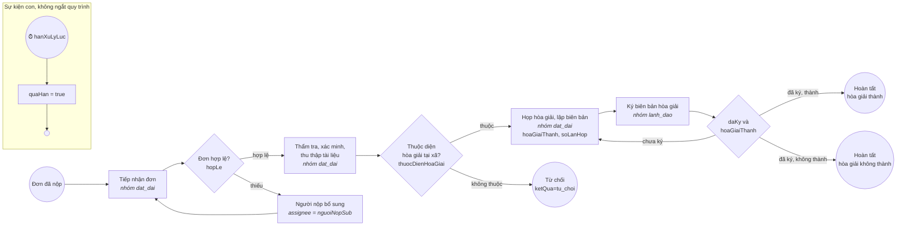

# Gói thủ tục `hoa-giai-dat-dai` – Hòa giải tranh chấp đất đai tại xã (DD01)

Gói thứ tư của bộ máy một cửa (D-009, #97), lĩnh vực **đất đai** (khác hai lĩnh vực của các gói trước), thêm bằng đúng 5 tệp trong thư mục này, **không sửa mã** `mot-cua/` hay `nen-tang/`. Cách viết gói: [`docs/thu-tuc.md`](../../docs/thu-tuc.md). Giá trị lấy theo quy định công khai, rút gọn để minh họa; đối chiếu văn bản trước khi dùng thật.

| Tệp | Nội dung |
|---|---|
| `thu-tuc.yaml` | mã `DD01`, lĩnh vực `dat_dai`, hạn 20 ngày làm việc (luật: không quá 30 ngày kể từ ngày nhận đơn), không thu phí, căn cứ pháp lý, process id `hoa_giai_dat_dai` |
| `quy-trinh.bpmn20.xml` | BPMN 2.0 viết tay: tiếp nhận đơn → (bổ sung) → thẩm tra, xác minh → họp hòa giải → lãnh đạo ký biên bản; ba điểm kết thúc |
| `thanh-phan-ho-so.schema.json` | JSON Schema 2020-12: đơn yêu cầu hòa giải (bắt buộc), giấy tờ về thửa đất (nếu có) |
| `du-lieu-mau.json` | hồ sơ mẫu **giả** khớp schema, kèm biến xử lý từng bước (nhánh hòa giải không thành) mà smoke dùng để chạy hết quy trình |

| Bước | Ai | Biến bắt buộc | Biến tùy chọn | Trạng thái hồ sơ |
|---|---|---|---|---|
| `tiep_nhan` | cán bộ lĩnh vực `dat_dai` | `hopLe` (boolean) | `ghiChu` | `moi` (khai trong `thu-tuc.yaml`) |
| `bo_sung` | người nộp đơn | – | `ghiChu` | `cho_bo_sung` |
| `xac_minh` | cán bộ lĩnh vực `dat_dai` | `thuocDienHoaGiai` (boolean) | `ghiChu` | `dang_xu_ly` |
| `hoa_giai` | cán bộ lĩnh vực `dat_dai` | `hoaGiaiThanh` (boolean) | `soLanHop` (long), `ghiChu` | `dang_xu_ly` |
| `ky_bien_ban` | lãnh đạo | `daKy` (boolean) | `ghiChu` | `cho_phe_duyet` |

Hòa giải thành hay không thành đều là **hoàn tất** (thủ tục hòa giải ở xã đã xong, có biên bản); kết quả nằm ở biến `hoaGiaiThanh` và điểm kết thúc (`ket_thuc_hoan_tat` hoặc `ket_thuc_khong_thanh`). Chưa làm: thành phần Hội đồng hòa giải, mời các bên, sinh biên bản PDF có ký số.
