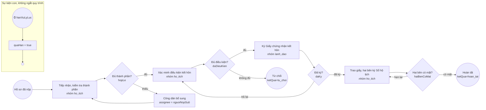

# Gói thủ tục `ket-hon` – Đăng ký kết hôn (KH01)

Gói thứ ba của bộ máy một cửa (D-009, #97), thêm bằng đúng 5 tệp trong thư mục này, **không sửa mã** `mot-cua/` hay `nen-tang/`. Cách viết gói: [`docs/thu-tuc.md`](../../docs/thu-tuc.md). Giá trị lấy theo quy định công khai, rút gọn để minh họa; đối chiếu văn bản trước khi dùng thật.

| Tệp | Nội dung |
|---|---|
| `thu-tuc.yaml` | mã `KH01`, lĩnh vực `ho_tich`, hạn tối đa 5 ngày làm việc (khi cần xác minh), miễn lệ phí, căn cứ pháp lý, process id `dang_ky_ket_hon` |
| `quy-trinh.bpmn20.xml` | BPMN 2.0 viết tay: tiếp nhận → (bổ sung) → xác minh điều kiện kết hôn → lãnh đạo ký → trao giấy chứng nhận khi hai bên có mặt |
| `thanh-phan-ho-so.schema.json` | JSON Schema 2020-12: tờ khai (bắt buộc), giấy tờ tùy thân của **hai** bên (bắt buộc, ít nhất 2 tệp), giấy xác nhận tình trạng hôn nhân (nếu có) |
| `du-lieu-mau.json` | hồ sơ mẫu **giả** khớp schema, kèm biến xử lý từng bước mà smoke dùng để chạy hết quy trình |

Thành phần `giay_to_tuy_than` trùng mã với loại giấy tờ đọc được bằng OCR (`mot-cua/doc-giay-to/loai-giay-to.json`, #93), nên cổng công dân tự có nút "Đọc thông tin từ ảnh" cho thành phần này mà không phải sửa gì.

| Bước | Ai | Biến bắt buộc | Biến tùy chọn | Trạng thái hồ sơ |
|---|---|---|---|---|
| `tiep_nhan` | cán bộ lĩnh vực `ho_tich` | `hopLe` (boolean) | `ghiChu` | `moi` (khai trong `thu-tuc.yaml`) |
| `bo_sung` | công dân nộp hồ sơ | – | `ghiChu` | `cho_bo_sung` |
| `xac_minh` | cán bộ lĩnh vực `ho_tich` | `duDieuKien` (boolean) | `ghiChu` | `dang_xu_ly` |
| `ky_giay_chung_nhan` | lãnh đạo | `daKy` (boolean) | `ghiChu` | `cho_phe_duyet` |
| `trao_giay_chung_nhan` | cán bộ lĩnh vực `ho_tich` | `haiBenCoMat` (boolean) | `soDangKy`, `ghiChu` | `dang_xu_ly` |

Chưa làm: kết hôn có yếu tố nước ngoài, in Giấy chứng nhận kết hôn theo mẫu bằng Gotenberg như biên nhận (#77).
